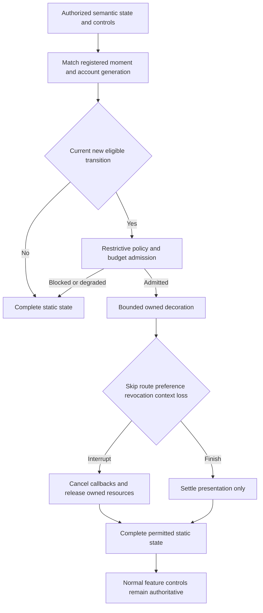

# F8 Meaningful Motion: Semantic Moments and Future Implementation Plan

Date: 2026-11-07. Phase E. Status: PROPOSED, NOT IMPLEMENTED, NOT PLAN LOCKED.

**Goal:** Make changes in learning, creation, allocation and accounting understandable without making animation necessary to finish any task.
**Architecture:** Existing CSS/Motion/Three surfaces consume authorized feature views and committed receipts through one presentation adapter. Motion can explain an outcome; it cannot create one. Every moment first renders complete semantic text and controls, then may add bounded, interruptible decoration.
**Stack:** Extend the existing JS/JSX application, token surfaces and audited Board/Recorder composition. Exact installed Motion/Three versions, APIs and runtime compatibility remain UNVERIFIED. TypeScript-style notation below describes proposed contracts; it does not authorize a language migration or installation.
**Execution boundary:** E permits document material only. Every code, asset, test, profiling and integration task below is future and unchecked. No application implementation, rendering, runtime testing, servers, installs, migrations, credentials, commits or publication are authorized by this document.

## 1. Evidence, scope and approach

| Material read | Supported planning use | Limit |
|---|---|---|
| [Studio/motion reasoning](../../plan/v2/thinking-studio-motion.md) | Acknowledgment ladder, source anchors, Board modes, bounded motion and failure classes | Not browser support, actual durability, measured fps or a selected vendor |
| [Feature lab](../../plan/v2/feature-lab.md) | Proposed 25 extras, five wow candidates, dependency waves and safeguards | Scores and safe-slice editorial labels do not approve membership or prove efficacy |
| [Cards 01](../../plan/v2/feature-card-pack-01.md) | Private reasoning, return, review and exhibit interactions | Not implemented endpoints or calibrated learning outcomes |
| [Cards 02](../../plan/v2/feature-card-pack-02.md) | Private adult cooperation, suppressed recap, readiness and help handoff | Not anonymity, offline durability or support staffing clearance |
| [Cards 03](../../plan/v2/feature-card-pack-03.md) | Outline evidence, repair, statements, pattern lineage and safe refit | Not final allocation, settlement, retirement or rights policy |
| [Design tokens](../01-design-tokens.md) | Existing design-document typography, spacing, surfaces and motion proposals | Document itself says Pending User Approval; not an approved or source-verified token implementation |

The actual shared platform contract was supplied inline. Its planned location is `D:/orbit-main/orbit-main/docs/plan/v2/03-platform-contracts.md`; it was not on disk in this delegation. This draft consumes its exact `ActorContext`, `ResourceRef`, `CommandEnvelope`, `Receipt`, `CommandResult`, `PolicyGate`, `EventEnvelope`, `ProjectionView`, `AccountScope`, `BoardGrant` and `AnchorMapping` names. Earlier cards' `idempotencyKey` wording and illustrative routes are superseded, for this proposed E integration, by canonical `operationId`, `expectedVersion`, `policyVersion` and `/api/v2/fp2`. No other pack's authority or implementation plan is duplicated here.

Approaches considered, not founder selections: (A) a new cinematic renderer would duplicate authority, input and disposal work; reject as the default. (B) static-only presentation is the complete minimum and degraded path. (C) semantic DOM/SVG overlays within existing CSS/Motion surfaces, with optional existing-Three enhancement, is the recommended proposal because it preserves the current tools and makes motion removable. Optional Three is V2, not a prerequisite for any wow candidate.

Received F1-F9 scope only: demand/allocation; ratings; Mentor progression; Student progression; distinct virtual assets; studio/Board/notes; optional paid sessions and their accounting; motion; extras. The detailed original E/F tail remains unavailable. Nothing here reconstructs it, chooses a release wave, or resumes another workflow. Working names, parameters, artwork, policies and extra membership remain proposed.

## 2. Non-negotiable behavior

1. Domain success follows an authoritative commit and current access check. A local preview, helper response, socket message, browser payment callback, grading script or model output cannot grant points, payment, publication, claims, ratings, roles or room access.
2. A committed receipt changes visible text/state immediately. Animation completion never writes business state, unlocks controls, submits a payment, joins a room, publishes content, grades an attempt or grants a reward.
3. `replayed=true`, historical receipt mounts and `no_change` produce static acknowledgment, not another ceremony. A new operation for an already credited source shows newly applied units zero. Only an actual new authorized transition is eligible for its moment.
4. Money, consent, cancellation, recording stop, support, security, accessibility, learning and basic export remain usable during every visual effect. No unskippable ceremony, forced camera journey, paid visual shortcut or token-funded right exists.
5. Sound is off by default. All inventory entries use S0, meaning no sound, even if the user has enabled sound elsewhere. Future audio requires a separately reviewed registry revision; this draft adds no audio assets, alert dependencies or surprise playback.
6. Proposed maximums: ordinary reveal 180 ms, comparison 400 ms, optional navigation/ceremony 800 ms. Reduced motion and motion-off use 0 ms for all these effects. Prefer zero flashes; this registry specifies zero repeated flashes. Never exceed three flashes per second, including combined effects, media overlays and retries.
7. Private notes, mistakes, ratings-in-review, support cases, account statements and drafts stay private. Minors are not publicly ranked by default. Unknown age, rights, visibility or safety eligibility cannot enable public identity/count reveals.
8. Student, Peer and Mentor are distinct authorized identities. Workspace selection is not a role grant. Peer activity does not silently mint Student/Mentor standing. No animation copies the same source into several wallets.
9. No loot boxes, gambling, bought grades/ratings/rank/claims, compelled attendance/streaks, minor payment pressure, scarcity pressure or emotional dependence. Rest and exit never imply lost standing or debt.
10. A 60-fps target is not a measured guarantee. Static and degraded modes must be complete on an unprofiled device, failed renderer, unavailable asset, hidden tab or changed preference.

## 3. Shared-state interpretation and priority

| Authority notation in inventory | Acceptable input | What motion may assert |
|---|---|---|
| U | Account-scoped local interaction or preview | A choice, unsent draft or navigation intent only; no durable/domain success |
| R | Canonical `CommandResult.kind=receipt`, approved policy, authorized result, expected feature state | Exactly the committed/no_change result; no stronger payment/delivery/learning claim |
| V | Authorized versioned view whose feature status derives from canonical records; retain `consistency` and `sourceVersion` | Literal known status; lagging view labeled, never used to authorize a mutation |
| P | Canonical `processing` or actual processing/upload job status | Request/job is pending; no fabricated percentage, finish time or success |
| D | Approved media/local-document adapter's verified durable byte/version acknowledgment | Local persistence at the stated boundary only; not server upload, publication or crash-proof retention |
| H | Actual current capture/device state plus a valid server recording permit when shared recording requires one | Source is currently active/paused/off; not saved bytes or learner consent inferred from a camera |
| B | Authorized `Problem`, revocation, policy block or unavailable capability | Safe blocked/failure state; no hidden resource details or invented policy values |

For D/H branches, producer checks belong to F6/F7 adapters. UI booleans do not provide evidence. Unknown approved recording retention/durability/consent blocks that persistence/recording branch; a nonrecording call remains usable only with independently valid booking/participant/age/guardian/safety eligibility. Unknown mandatory guardian/session eligibility blocks that affected session, never local stop. Local bytes, server verification, validated playable output and canonical publication remain distinct.

Priority order is access/consent/stop and safety messages, financial unknown/failure states, save failures, conflicts, committed ordinary acknowledgment, comparisons, optional ceremonies. At most one decorative moment is active on a surface. A higher-priority state preempts it immediately. Independent status texts coexist; a decorative queue never delays their appearance. No decorative backlog: a moment skipped while hidden does not play later.

Events already registered by the shared contract may invalidate a view: `fp2.v1.review.changed`, `fp2.v1.grade.committed`, `fp2.v1.claim.committed`, `fp2.v1.source.granted`, `fp2.v1.ledger.posted`, `fp2.v1.cycle.adjudicated`, `fp2.v1.board.revision.committed`, `fp2.v1.room.grant.revoked`, `fp2.v1.consent.changed`, `fp2.v1.artifact.map.changed`, `fp2.v1.publication.changed`, `fp2.v1.account.authz.changed`. They are hints for authorized refresh, not a socket-to-success shortcut. Version gaps fetch/rebuild; old events cannot replace newer state. This spec introduces no animation-finished domain event or reward producer.

## 4. Proposed motion types and state machine

These declarations reference the inline shared types without redefining them. `MomentId` and `AssetRecipeId` are registry-validated bounded strings, not permission to accept arbitrary names. `MotionEvidence` is assembled by the trusted view adapter from already authorized data; it is never transport authority.

```ts
type MomentId = string;
type AssetRecipeId = string;
type ProfileId = "P0" | "P1" | "P2" | "P3" | "P4";
type ControlId = "C0" | "C1" | "C2" | "C3" | "C4" | "C5" | "C6";
type MotionPreference = "system" | "reduced" | "off" | "full";
type EffectsPreference = "auto" | "static";
type MotionEvidence =
  | Readonly<{ kind: "preview"; resource: ResourceRef; accountScope: AccountScope }>
  | Readonly<{ kind: "receipt"; receipt: Receipt<unknown>; replayed: boolean; accountScope: AccountScope }>
  | Readonly<{ kind: "view"; view: ProjectionView; accountScope: AccountScope }>
  | Readonly<{ kind: "adapter_ack"; resource: ResourceRef; adapterAckId: string; boundary: "local_durable" | "server_bytes_verified" | "media_ready" | "capture_live"; accountScope: AccountScope }>;
type MotionSpec = Readonly<{
  momentId: MomentId; specVersion: 1; profileId: ProfileId; assetRecipeId: AssetRecipeId;
  controlId: ControlId; soundId: "S0"; purpose: string; staticCopyKey: string;
  requiredFeatureStates: readonly string[]; requiredPolicyScopes: readonly string[];
}>;
type MomentOccurrence = Readonly<{
  occurrenceId: string; momentId: MomentId; resource: ResourceRef; sourceVersion: number;
  receiptId: string | null; sessionGeneration: string; activeIdentity: "Student" | "Peer" | "Mentor";
  phase: "static" | "eligible" | "presenting" | "settled" | "interrupted" | "disposed";
}>;
type PresentationPolicy = Readonly<{
  effectiveMode: "static" | "reduced" | "dom" | "existing_three";
  reason: "user" | "system" | "budget" | "visibility" | "context_loss" | "unverified_adapter" | "normal";
  policyVersion: string; specVersion: 1;
}>;
type MotionPreferencesPayload = Readonly<{
  motion: MotionPreference; effects: EffectsPreference; sound: "off" | "on";
}>;
type MotionPublicationConfig = Readonly<{
  enabledMomentIds: readonly MomentId[]; maximumProfile: ProfileId; assetManifestVersion: string;
  maximumConcurrentDecorations: 1; telemetryEnabled: boolean;
}>;
```

Allowed phases: `static -> eligible -> presenting -> settled -> disposed`; any active phase may become `interrupted -> disposed`. Initial/historical mounts are `static`. Receipt/static text is already complete before `eligible`. Eligibility requires an explicit current interaction, matching account generation, authorized known state, approved required feature policy, registered owned asset, nonreplayed/non-no_change result where success is involved, and budget admission. Failure of any presentation check leaves the semantic state static; it cannot turn a committed domain result into failure.

Occurrence key is transient `(sessionGeneration, momentId, resource.kind, resource.id, sourceVersion, receiptId-or-adapterAckId)`. One in-memory scope keeps at most 64 recent keys. Account/identity/epoch change clears it. Do not store persistent reward-seen markers, private resource IDs or preference history without approved retention. Reloads and old receipts start static, so LRU eviction is not permission to replay historical celebrations.

The presentation-policy gate is `PolicyGate<MotionPublicationConfig>`. Unknown/proposed/suspended configuration disables optional effects, not the complete semantic UI. Required grading, money, media, retention, safety and public-visibility gates are the shared feature gates; motion has no local override. A blocked tax/recording/publicity decision remains a typed shared block, never guessed zero, consent or adult status.

## 5. Timing, easing, performance and allocation profiles

Every inventory row's profile supplies its duration, easing, sound, rendering limit and budget. Row control code supplies interruption/focus/resume. Row copy is also its complete static/reduced-motion result. These inherited fields are mandatory, not omitted implementation details. All budgets are proposed future measured acceptance ceilings for the motion addition, not observed measurements or promises about the whole app.

| Profile | Choreography and easing | Static/reduced mode | Motion-only CPU/GPU/frame/allocation ceilings | Intended use |
|---|---|---|---|---|
| P0 | 0 ms; immediate text/shape update; no easing, RAF, pulse or spinner | Identical final text/controls, immediately | <=1 ms JS per status update; 0 animation frames, GPU effects, new canvas, geometry or textures; <=4 KiB transient presentation metadata | Money, consent, failures, replay, critical capture and truthful unknown states |
| P1 | <=180 ms; E1 `cubic-bezier(0.2,0,0,1)`; one outline segment or noncritical opacity overlay; no layout movement | 0 ms; complete outline and copy; no opacity hiding of critical text | <=2 ms JS and <=2 ms render contribution/frame; <=2 moving DOM/SVG nodes, <=12 SVG primitives, <=8 KiB transient metadata; no WebGL allocations, per-frame objects or full-screen blur | Ordinary verified status and private selection acknowledgment |
| P2 | <=400 ms; E2 `cubic-bezier(0.4,0,0.2,1)`; reveal comparison boundary within fixed rectangles; no semantic value tween | 0 ms; two labeled stacked panels or equivalent table, each independently readable | <=3 ms JS and <=3 ms render contribution/frame; <=4 moving nodes, <=24 SVG primitives, <=16 KiB metadata; no canvas/WebGL allocations or per-frame objects | Explicit reasoning/version comparison; stable labels and data always present |
| P3 | <=800 ms; E3 `cubic-bezier(0.2,0,0.2,1)`; optional miniature route/identity/course envelope, no full-screen camera lock | 0 ms; destination label, reason and ordinary navigation remain complete; SVG substitute for Three | <=3 ms JS and <=4 ms GPU contribution/frame; existing renderer only; <=6 added draw calls, <=12,000 added triangles, <=1 MiB owned geometry buffers, <=16 MiB measured total added GPU allocation including targets; no textures, shadows, bloom or new renderer; <=32 KiB JS metadata; no per-frame allocations | Optional V2 enhancement on independently profiled existing Three surface |
| P4 | <=180 ms; E1; static progress text updates immediately, one bounded marker adjustment per verified acknowledgment, coalesced <=4 updates/sec | 0 ms; exact acknowledged units/time and pending label; unknown total is indeterminate text | <=1 ms JS and <=2 ms render contribution/frame; one marker, <=8 SVG primitives, <=8 KiB metadata; no endless rotation, new canvas/GPU resources or per-frame objects | Upload/local-readiness updates with an actual numerator/denominator |

For a 60-fps target, total frame time is `1000/60 = 16.6667 ms`. Profile ceilings are additions, not entitlements to consume the remainder. Actual app, Board, capture/encoding, browser and OS work may exceed the budget. P3 is not admitted without measured total headroom and approved adapter compatibility; unprofiled devices get DOM/static, not inferred GPU capability from hardware branding. P3 viewport <=640x360 CSS pixels and render pixel ratio <=1.5 are proposed ceilings; actual target allocation must be measured and fit the total limit or P3 is disabled.

Admission and degradation proposal: while foreground, keep a bounded 12-frame timing window without personal content. If three frames exceed 20 ms, optional motion is canceled for that surface and mode becomes static until explicit re-enable or a later verified capability probe. A long-task signal, context loss, low-power preference, capture overload, hidden tab or unavailable instrumentation may also force static. No retry loop probes hidden pages. During live capture, shared calls or active Board drawing, P3 is never admitted and P1/P2 decoration yields to input/encoding; capture controls and actual media/Board updates are not decorative work.

S0 means no audio object is constructed, downloaded or played. All profiles specify zero repeated flashes. Do not animate a financial number, grade, review mean/count, deadline or consent indicator through intermediate false values. Numeric end values appear immediately; a nonsemantic outline may reveal around them. Actual elapsed capture time follows the media clock, not decorative tween time.

Easing is defined as a cubic Bezier timing curve, not a guessed library method. Existing token spring `{stiffness:300,damping:30}` is a historical proposal, not the default for authoritative moments: its overshoot and exact library interpretation need compatibility verification before any optional use. No spring is needed by this registry.

## 6. Asset recipes and token integration

All IDs here are PROPOSED asset-registry IDs, not actual files or globally cleared designs. SVG recipes use original basic geometry, `viewBox="0 0 64 64"`, 2-unit strokes, no external fonts/images/scripts, and decorative `aria-hidden` where equivalent text exists. Actual assets require source/rights review and sanitization. Reuse audited glyph/catalog assets only after identity/license/meaning checks; the shared contract identifies Photon/catalog reuse as an investigation target, not approved currency branding.

| Recipe ID | Original concrete construction | Reuse/meaning constraint |
|---|---|---|
| A00 TEXT | No decorative asset; text and existing form/status controls only | Required fallback for every other recipe |
| A01 RECEIPT | Rounded rectangle `(12,10,40,44)`, radius 4; horizontal lines from x20 to44 at y22/30/38; final check path `M22 46 L28 51 L42 40` | Bounded line reveal after a real receipt; never a bank-paid or correctness symbol by itself |
| A02 THRESHOLD | Horizontal rail x8..56 at y32; 4-unit end ticks; 8-unit square at verified normalized location; text contains authorized threshold/state | No hidden population, fabricated countdown or perpetual pulse; text may omit counts entirely |
| A03 OFFER | Two open brackets at x12/52, y20..44 enclosing a document rectangle x24..40 | Delivered/offered states remain distinct; no purchase/special-access badge |
| A04 CLAIM | Two 8-unit rectangles at `(12,28)` and `(44,28)` joined by line x20..44; attach owner label only within permissioned view | Winner shows a single connected ownership path; loser uses text and disconnected path, not explosion/shame |
| A05 OUTLINE | Three stacked 36x6 outline bars at x14, y16/29/42; a selected bar receives a 2-unit corner bracket | Authoring/review state only; no automatic lifecycle change |
| A06 COMPARE | Two fixed 24x36 panels at x4/36, y14; center divider x32; up to three corresponding straight connector segments | Before/after headings and differing text are present from frame zero; stack on narrow viewports |
| A07 RATINGS | Five fixed 8x8 outline squares at x4/16/28/40/52; text labels `1 star` through `5 stars` in the real panel, not inside the glyph | Glyph is decorative; histogram, raw mean/count and sorting proxy stay separately labeled |
| A08 LEAGUE | Three nested corner frames of sizes 40/28/16 centered at32, no crown, podium or rival silhouettes | Private level/cycle explanation; no public minor rank or invented certification |
| A09 BADGE | Hexagonal outline with points `(32,8),(52,20),(52,44),(32,56),(12,44),(12,20)`; approved achievement code as adjacent text | Deterministic earned source only; no random reveal, professional assurance or purchased standing |
| A10 ASSET | Circle center32 radius20; two interior parallel rails x22/42, y22..42; adjacent technical asset label | Use separate Student/Peer/Mentor text labels; no cash symbol, exchange arrow or branded name assumption |
| A11 RETAKE | Open clockwise arc center32 radius20 from bottom to left; short return elbow at `(12,32)`; two boxed labels for previous/best | Real source improvement and zero repeat remain literal; no score inflation loop |
| A12 REST | Open arch from `(12,44)` via `(12,12),(52,12)` to `(52,44)`; horizontal resting line x18..46 at44 | Quiet optional return bookmark, not a countdown/streak alarm |
| A13 CAPTURE | Rectangle x12 y16 width40 height32; small solid 6-unit square at `(20,24)` adjacent to visible capture text | Static active marker; no flashing red pulse; cannot imply valid consent or saved bytes |
| A14 CHECKPOINT | Three 8x8 squares x12/28/44 at y28 with short joining rails; acknowledged squares get a second interior line | Label recovery checkpoint, chapter or learning checkpoint explicitly; never interchange the three |
| A15 UPLOAD | Open base path `M12 38 L12 50 L52 50 L52 38`; shaft `M32 42 L32 14`, branches to22/24 and42/24 | Actual acknowledged bytes only; unknown total uses pending text without traveling particles |
| A16 PROCESS | Three outlined cards x10/26/42, y22, width12 height20, joined by short lines | One literal stage marker; never an endless spinner or false percent |
| A17 BOARD | Rectangle `(8,12,48,40)`; two original short polyline strokes; optional corner version tag beside, not inside, user content | Real Board content remains its authorized snapshot; decorative icon cannot replace semantic export or stroke data |
| A18 NOTE | Folded-corner rectangle path `M14 8 L42 8 L50 16 L50 56 L14 56 Z`; two plain text-rule lines | Private note/version/source anchor; no public misconception mark |
| A19 SOURCE | Three 8-unit boxes labeled in surrounding UI as source, draft, review; straight lineage connectors | AI draft, captions and rights must show actual stage and uncertainty; never a truth sparkle |
| A20 CALENDAR | Rectangle `(12,14,40,40)` with header line y24 and two fixed cells x20/36 at32 | Slot state/expiry from server, not blinking urgency or device clock authority |
| A21 CONSENT | Two open rings centered `(20,32)` and `(44,32)`, radius10; short center gap; separate participant-choice text | Capture permit only when all required live choices match scope; deny/withdraw remain ordinary controls |
| A22 CASE | Folder-like outline `M10 22 L24 22 L28 16 L54 16 L54 50 L10 50 Z`; adjacent case-status text | Restricted case, not refund, resolution or dispute guilt verdict |
| A23 FORK | Three straight paths from `(12,32)` to `(32,32)`, then `(52,16)` and `(52,48)`; endpoint text labels | Chosen intent/reason/undo; no recommendation authority or hidden destination |
| A24 BRIDGE | Two fixed polylines with square and circular endpoints; a dashed connector is added only at an approved bridge | Independent labels/patterns, no learner strength colors or automatic diagnosis |
| A25 QUILT | A 2x2 arrangement of outline rectangles, each14x14, at x14/36 and y14/36 | Decorative generic recap cover; do not draw one tile per private contributor or reveal suppressed categories |
| A26 MANIFEST | Four fixed text rows with square status markers and one missing-outline marker | Required/optional asset status and timestamp, not an indefinite readiness guarantee |
| A27 HANDOFF | Two 20x28 cards at x6/38, y18; center transfer rail; authorized queue label remains outside glyph | One current assignment after receipt, no exposed staff/billing fields or SLA promise |
| A28 LINEAGE | Three fixed branch rectangles x8/28/48, y26; parent/version labels appear in UI | Rights and review state on fork; copying does not create source rewards |
| A29 SUITCASE | Rounded rectangle `(10,22,44,30)`, radius4; handle path `M24 22 L24 14 L40 14 L40 22`; two interior dividers | Selected authorized export only; zip generation not mistaken for completed download or logout clearance |
| A30 TRAVEL | DOM/SVG: fixed source/destination boxes and one dot on a straight or elbow rail. Optional existing-Three variant: three low-poly open frames and one solid box, no texture/light effect | Camera in miniature moves at most one frame-width with no roll or zoom-to-face; never a full-screen mandatory journey |

Recipes carry meaning through adjacent text and distinct shapes, not a new color theme. No identity, outcome, loss, safety status or money state is conveyed by color alone. No franchise art, imported mascot, emoji, floating coin shower or random particle asset is specified.

Extend the existing 4px spacing scale, typography, 12/16px radii and surface hierarchy. Add proposed scoped duration/easing tokens `--fp2-motion-reveal:180ms`, `--fp2-motion-compare:400ms`, `--fp2-motion-optional:800ms`, `--fp2-motion-instant:0ms` and E1/E2/E3 in the existing token authority, not a competing theme. FP2 proposes replacing broad `transition-all duration-300` on participating controls with property-specific transform/opacity effects and the above bounds; it does not silently change unrelated screens or call the old document approved.

Do not animate blur, box shadows, text layout, financial digits or full glass layers. Existing glass/backdrop blur is optional in degraded mode; text and borders remain. Actual colors, contrast, forced-colors behavior, palette collisions, CVD separation and light/dark rendering require later validation. This ASCII spec supplies no rendered palette QA result.

## 7. Control, focus, cancellation and resume contracts

| Control code | Skip/cancel/exit | Resume and focus behavior |
|---|---|---|
| C0 CRITICAL | No ceremony to skip; escape/back/support and relevant stop/withdraw actions remain available. Never intercept money/consent keys for visual effects | Focus stays on current action or safe error summary according to user action; update concise status text. Reconnect reads canonical operation/view, never resumes decorative timing |
| C1 ACK | Skip control if an overlay occupies space; Escape skips only decoration, not committed business action. Route/account change cancels immediately | Focus remains at initiating control; status announced once per new receipt. No replay after return; exact saved state visible |
| C2 COMPARE | Toggle static stacked/table view; keyboard compare control and Skip always available; cancel preserves the authorized original and revised data | Comparison handle is keyboard operable; focus remains on handle or invoked tab. On return show complete static comparison with its version labels; no hidden layers auto-revealed |
| C3 CHOICE | Route is authorized and applied by ordinary navigation/action, not animation finish. Skip opens same ordinary destination; Back/Undo applies only permitted reversible choice, not fictional rollback | Destination heading focused once on actual navigation, not camera arrival. Retarget cancels old visual path and uses latest authorized target; old callbacks cannot focus or navigate |
| C4 MEDIA | Pause/stop/save/export and permission withdrawal always visible. Canceling decoration does not stop capture, delete bytes or cancel upload. Business cancellation has its own explicit command/adapter action | Focus does not jump during recording/status updates. Reconnect/restoration checks durable acknowledgments and server offsets; resumes actual work only by feature contract, never invented visual percentage |
| C5 OPTIONAL | Closed by Skip/Escape/back immediately; cannot cover critical controls. No required watch time, sound or automatic next ceremony | Return settles static; focus remains on initiating button or safe destination heading. A ceremony has no independent resume state or business side effect |
| C6 LEAVE | User may leave without sharing, writing, spending or positive feedback. Optional bookmark/export selection is independent of logout/consent revocation | Show what saved/downloaded/revoked and what remains pending. Only approved account-scoped drafts may resume. Logout clears private cache/listeners and stale callbacks before next account mounts |

For all codes: OS reduced-motion cannot be overridden by app `full`; app `off/reduced`, safety fallback, hidden tab and context-loss take precedence. Changing preference cancels CSS transitions, Motion effects and Three loops, not only one framework flag. Sound choice never overrides S0. Long updates use a concise status region, not continuous screen-reader announcements per frame or stroke. Urgent capture loss gets immediate plain text; nonurgent progress coalesces. Error summaries are focusable without leaking resource existence.

## 8. F1 demand, delivery, claim and production inventory

All row fields inherit sections 3-7. An entry such as `P1/A01/C1` supplies exact duration/easing/asset/sound, static mode, budgets and controls. Quoted copy is proposed plain copy, with authorized placeholders only. Specific assertions below are future acceptance requirements.

| Stable ID | Trigger, purpose and authority | Profile/asset/control | Static and reduced-motion copy/state | Specific assertion |
|---|---|---|---|---|
| F1-01 | U: Student edits outcome request; distinguish unsent draft | P0/A05/C6 | `Draft not sent.`; edit, discard, send | Account switch never restores another account's outcome text |
| F1-02 | R: request creation committed; receipt, not mentor promise | P1/A01/C1 | `Request saved. No mentor has claimed it yet.` | One receipt; replay static; no inferred allocation |
| F1-03 | V: authorized threshold state changes; explain eligibility for dispatch | P1/A02/C1 | `The request reached the proposed dispatch threshold.` or policy-block copy | Threshold/counter appears only when policy and count visibility permit; no forged client count |
| F1-04 | P/V: dispatch queued or channel attempted; distinguish delivery stages | P0/A03/C0 | `Offer delivery is pending.` | Outbox creation/attempt does not say delivered |
| F1-05 | V: channel/provider acknowledgment recorded | P1/A03/C1 | `The delivery channel accepted the offer.` | Never claim mentor saw/read/accepted it without that authoritative evidence |
| F1-06 | V: primary wave offered to this authorized Mentor | P1/A03/C1 | `An offer is available. Review the terms and expiry.` | Deadline is server-derived; no scarcity pulse or paid priority |
| F1-07 | V: fallback wave becomes authorized | P1/A03/C1 | `A fallback offer is available.` | No new eligibility from animation or raw helper/socket; wave counts use approved allocation |
| F1-08 | P: Mentor accepts offer; outcome unresolved | P0/A04/C0 | `Checking the claim. Check this request before trying again.` | Same operation checked; controls never show winner early |
| F1-09 | R: exclusive claim and capacity commit | P1/A04/C1 | `Claim confirmed. Review the next required step.` | Atomic claim/capacity only; no automatic room join or unpaid production promise |
| F1-10 | B/R-no_change: another valid claim won | P0/A04/C0 | `This offer is no longer available to claim.` | No winner identity/private details; no shame, explosion or reroll reward |
| F1-11 | V/B: offer/claim expires under authoritative lifecycle | P0/A20/C0 | `This offer has expired.`; refresh/support | Timer reaching zero cannot locally expire/reassign a claim |
| F1-12 | R: permitted decline/withdrawal committed | P0/A01/C6 | `Your response was saved.` with exact `declined` or `withdrawn` label | Claim/rights consequences come from receipt, not dismissal animation |
| F1-13 | U/D/R: authorized claimant drafts/saves outline at actual boundary | P1/A05/C1 | `Outline draft saved.` or `Draft not saved.` | Local draft and canonical outline status remain distinct |
| F1-14 | R/V: outline submitted for review | P1/A05/C1 | `Outline submitted for review. It is not approved yet.` | Submission never silently begins approved production or changes expiry |
| F1-15 | R/V: outline review decision committed | P2/A06/C2 | `Outline approved.` or `Changes requested.` with versioned rationale | Reviewer appointment and current claim checked; comparison cannot expose learner answers |
| F1-16 | R/V: production milestone recorded by canonical lifecycle | P1/A05/C1 | `Production milestone recorded.`; exact source/state | Elapsed recording, upload or assistant output alone cannot mark production complete |
| F1-17 | R/V: completed candidate enters course/content review | P1/A19/C1 | `Submitted for content review. Not published.` | Processing-ready status does not bypass rights, captions or publication review |
| F1-18 | R/V: canonical course publication committed | P1/A01/C1 | `Published.` with approved visible course/version | Entitlement/public projection enforced; no auto-public private note/Board/media layer |
| F1-19 | R/V: permitted reassignment decision committed | P2/A06/C2 | `The assignment changed.`; own saved work/rights and next step | Old claimant loses grants through live fences; effect never transfers draft ownership or payment |
| F1-20 | B/V: request withdrawn/unavailable or transition policy blocked | P0/A00/C0 | `This item is unavailable.` or `Policy review is required before this action can continue.` | Missing/unauthorized/revoked object uses same safe copy; no hidden count/status leak |

## 9. F2 rating, edit and moderation inventory

| Stable ID | Trigger, purpose and authority | Profile/asset/control | Static and reduced-motion copy/state | Specific assertion |
|---|---|---|---|---|
| F2-01 | V: zero eligible public reviews | P0/A07/C0 | `Unrated.`; permitted count and explanation only | Prior-only proxy is not a public rating/rank |
| F2-02 | V: eligible aggregate changes | P2/A07/C2 | Raw mean, eligible count, star histogram and sorting-proxy explanation are separate labels/table | No count-up, mean tween, selective favorable bucket reveal or private-review leakage |
| F2-03 | R: eligible Student review submitted | P1/A01/C1 | `Review submitted.`; visibility/moderation state literal | No XP, currency, fee benefit or positive-star pressure |
| F2-04 | U/R: owner edits review, canonical version accepted | P2/A06/C2 | `Review updated.`; before/after only within owner grant | Stale edit returns conflict; new version is not a second eligible review/source |
| F2-05 | V: review held/pending moderation | P0/A19/C0 | `Review is pending moderation.` | Held text excluded from unauthorized/public joins and aggregate display |
| F2-06 | R/V: appointed moderation publishes/retains review | P1/A01/C1 | `Review visibility updated.`; exact permitted state | Publication of review not correctness certification or payment/role award |
| F2-07 | R/V: moderation hides/rejects review | P0/A22/C0 | `The review is not public. Review the reason and appeal options.` | Private case reason shown only to allowed actor; no reviewer retaliation cue |
| F2-08 | R: permitted withdrawal/deletion accepted | P0/A01/C6 | `Review withdrawal saved.`; retention/visibility consequence literal | Aggregate rederives from authoritative eligible set; deleted text not reconstructed from animation cache |
| F2-09 | R/V: appeal or corrected evidence changes review/rating view | P2/A06/C2 | `The review decision changed.` or `Appeal recorded. No decision yet.` | Sorting refresh preserves focus/stable entity labels; no old event downgrade or inferred appeal success |

## 10. F3 Mentor progression inventory

| Stable ID | Trigger, purpose and authority | Profile/asset/control | Static and reduced-motion copy/state | Specific assertion |
|---|---|---|---|---|
| F3-01 | V: authorized private Mentor cycle summary | P0/A08/C0 | `Your Mentor cycle summary.`; approved source/period labels | Private standing is not public certification; unknown policy blocks new awards |
| F3-02 | R/V: quality-evidence source accepted and grant committed | P1/A01/C1 | `Quality contribution recorded.`; requested/issued units separate | Raw helper/course save/review volume cannot create points |
| F3-03 | R/V: category cap clips source award | P0/A02/C0 | `Award limited by the category cap.`; requested, issued, unissued | Clipped remainder is not debt or reissuable next-cycle credit |
| F3-04 | R/V: corrected overall cap binds | P0/A02/C0 | `Award limited by the overall cap.` | Category total 460 and proposed overall 400 stay separate; no erroneous 560/500 label |
| F3-05 | R/V: authoritative cycle adjudicated | P2/A06/C2 | `Cycle closed.`; four-week weights/denominator available in explanation | GET or animation clock cannot adjudicate/roll over a cycle |
| F3-06 | R/V: approved Mentor league transition | P1/A08/C1 | `Your Mentor level changed.`; old/new and reason | No purchasable rank, public minor reveal or compulsory celebration |
| F3-07 | R/V: deterministic approved achievement granted | P1/A09/C1 | `Achievement recorded.`; approved code and source | No randomized badge, professional qualification implication or repeated mint on replay |
| F3-08 | R/V: reviewed correction/appeal changes score/eligibility | P2/A06/C2 | `A contribution needs review.` or exact committed correction | No silent punitive debit; historical receipt preserved and appeal path visible |
| F3-09 | U/R: Mentor rests/leaves progression surface | P0/A12/C6 | `You can return when you choose.`; optional bookmark | No streak loss, pressured attendance, maintenance quota or earnings guilt |

## 11. F4 Student assessment, retake and progression inventory

| Stable ID | Trigger, purpose and authority | Profile/asset/control | Static and reduced-motion copy/state | Specific assertion |
|---|---|---|---|---|
| F4-01 | U: Student opens low-stakes task with approved rubric | P0/A05/C0 | `Review the task and rubric.`; attempt/leave | No diagnosis, grade or reward from opening/task animation |
| F4-02 | R/P: attempt accepted, authoritative grading pending | P0/A19/C0 | `Attempt submitted. Grading is pending.` | Client answers/flags cannot create GradeEvidence or progress |
| F4-03 | R/V: registered grader commits outcome | P2/A06/C2 | `Attempt recorded.`; rubric result, explanation and source version | Outcome text precedes effect; wrong answer is not shame/public comparison |
| F4-04 | B: chance/difficulty calibration or provenance missing | P0/A00/C0 | `This reward needs an approved grading rule.`; ordinary study/support | No guessed normalization equation or trusted local/model answer |
| F4-05 | R/V: comparable first best source is credited | P1/A01/C1 | `Best result recorded.`; actual normalized best and issued delta | Evidence family/version and source cap must be committed atomically |
| F4-06 | R/V: comparable best improves from 15 to 18 | P2/A11/C2 | `Best improved from 15 to 18. New credit: 3.` | Delta exactly 3, not 18; no tween through unearned values |
| F4-07 | R-no_change/V: repeat 18 or lower 15 after best18 | P0/A11/C0 | `Best remains 18. New credit: 0.` | New attempt/operation/copied artifact cannot repeat issuance |
| F4-08 | R/V: approved Student league/badge transition | P1/A08/C1 | `Your Student progress changed.`; source and exact level/achievement | Private-by-default; no public minor rank or Peer/Mentor reward alias |
| F4-09 | R/V/B: rubric changed, appeal or source comparability unresolved | P2/A06/C2 | `This result needs review under the changed rubric.` | Preserve old attempt; no forced regrade or automatic new reward family |
| F4-10 | U/R: learner chooses review, cohort summary or rest | P0/A12/C6 | `Choose what to review, or leave for now.` | Cohort data only if approved/suppressed; no compulsory retake, catch-up or loss |

## 12. F5 distinct virtual-asset inventory

Technical assets `VIRTUAL_STUDENT`, `VIRTUAL_PEER`, `VIRTUAL_MENTOR` are proposed IDs from the shared contract, not approved visible currency names. Ratings, mastery, rank and real money are not balances in these assets.

| Stable ID | Trigger, purpose and authority | Profile/asset/control | Static and reduced-motion copy/state | Specific assertion |
|---|---|---|---|---|
| F5-01 | V: own Student wallet view | P0/A10/C0 | `Student virtual balance.`; available/reserved/source version | No public balance, INR symbol or cross-identity conversion |
| F5-02 | V: own Peer wallet view | P0/A10/C0 | `Peer virtual balance.`; source eligibility literal | Peer room attendance/call-history client cannot mint assets |
| F5-03 | V: own Mentor wallet view | P0/A10/C0 | `Mentor virtual balance.` | Not payable earnings, league points or cash-out promise |
| F5-04 | R/V: authoritative virtual grant posts both ledger sides | P1/A01/C1 | `Virtual award recorded.`; asset, source, issued units | Static exact balance from posted ledger; no coin shower or future issuance |
| F5-05 | R-no_change: semantic source already consumed | P0/A01/C0 | `Not awarded: this source has already been credited.` | Newly applied zero; no celebration on replay/new policy/new operation |
| F5-06 | R/V: cap clips issuance | P0/A02/C0 | `Award limited by the current cap.`; issued/unissued | No compel-spend message, token debt or cycle reset reissue |
| F5-07 | R: optional approved fair sink/reservation commits | P1/A01/C1 | `Reservation saved.` or `Virtual use recorded.`; precise asset/state | No learning/support/export/consent/security lock, paid advantage or same-account transfer |
| F5-08 | R/V: reservation void/expiry resolution commits | P0/A01/C0 | `Reservation resolved.`; exact available/reserved units | Expiry UI clock alone does not release balance; exclusive resolution |
| F5-09 | R/V: unspent reversal or spent correction case | P0/A22/C0 | `Award correction recorded.` or `Correction needs review.` | Additive linked reversal once; spent assets never silently create negative balance/debt |
| F5-10 | V/B: ledger projection lag/mismatch/unknown policy | P0/A00/C0 | `The latest saved balance is still updating here.` or `Balance needs reconciliation.` | View cannot authorize spend; reconcile/quarantine, not whole-wallet overwrite or fabricated zero |

## 13. F6 capture, durability, Board, notes, AI and captions inventory

| Stable ID | Trigger, purpose and authority | Profile/asset/control | Static and reduced-motion copy/state | Specific assertion |
|---|---|---|---|---|
| F6-01 | U/H: camera/mic/screen permission preview | P0/A13/C4 | `Choose a capture source.`; explicit device/surface controls | Source preview is not recording consent or successful saved media |
| F6-02 | B/H: permission denied/unavailable | P0/A00/C4 | `This source is unavailable. Choose a permitted alternative.` | Honest capability fallback; no silent source switch or invented browser support |
| F6-03 | H: valid source actually recording | P0/A13/C4 | `Recording is active.` with actual source/consent indicator | Static marker; media time not chunk callback count; stop always reachable |
| F6-04 | H/B: device unplugged, changed or capture revoked | P0/A00/C4 | `Capture stopped for this source. Check what was saved.` | No fake continued audio; preserve acknowledged draft; new source needs explicit selection |
| F6-05 | H/D: pause/retake source segment boundary | P0/A11/C4 | `Paused.` or `New take started.`; prior segment saved/unsaved literal | Durable previous segment before overwrite; no reward for retake count |
| F6-06 | U/D: layout, slide or prompter choice at saved version | P1/A06/C4 | `Layout preview.` or `Layout saved.`; source/version label | Choice cannot rewrite source timeline or hide stop/permission controls |
| F6-07 | H/B: optional background effect exceeds budget | P0/A00/C4 | `Background effect is off to preserve capture.` | No segmentation dependency for completion; degrade effect, not learning/capture UI |
| F6-08 | D: recovery checkpoint durable journal acknowledged | P4/A14/C4 | `Saved locally through [verified media time].` | Callback alone cannot say saved locally; disclose unsaved interval and storage limit |
| F6-09 | B/D: low quota, eviction or local write failure | P0/A00/C4 | `Local save is not confirmed. Pause or stop before continuing.` | Safe adapter pause/stop; no crash-proof or indefinite-storage claim |
| F6-10 | D/V: approved journal restoration inspected | P2/A06/C4 | `Recovered acknowledged segments. Review the unsaved interval.` | Only verified account-scoped chunks restored; recovery not new publication/grade |
| F6-11 | R/P: authorized upload session starts | P0/A15/C4 | `Upload started. Server storage is not verified yet.` | Starting request is not uploaded; controls and source permission remain live |
| F6-12 | D/P/V: acknowledged upload bytes advance | P4/A15/C4 | `[verified bytes] of [known total] verified.` or `Upload is pending.` | Numerator from server acknowledgment; no guessed ETA or fake 99-percent plateau |
| F6-13 | B/P: network loss/offset/hash mismatch | P0/A00/C4 | `Upload paused. Verify the saved bytes before resuming.` | Reconcile authoritative offsets/hashes, never concatenate corrupt bytes |
| F6-14 | R/D/V: final manifest/bytes verified | P1/A01/C4 | `Server bytes verified. Processing is not complete.` | Duplicate finish creates one asset/job; verified bytes not Ready/Published |
| F6-15 | P/V: actual processing stage changes | P4/A16/C4 | `Processing: [known stage].`; cancel/retry where permitted | Job state literal; unknown percent remains unknown; no perpetual decorative worker |
| F6-16 | B/V: processing/caption/codec validation fails | P0/A00/C4 | `Processing needs attention. This output is not ready.` | Repair/retry/export supported source path; no publishing invalid output |
| F6-17 | R/D/V: validated playable asset ready | P1/A19/C4 | `Ready for review. Not published.` | Actual processed-ready evidence and permitted playback, not thumbnail/request success |
| F6-18 | U/R: chapter marker created/saved | P1/A14/C4 | `Chapter marker saved.`; source segment/time | Chapter is navigation only, never durable-byte or learning checkpoint proof |
| F6-19 | R/V: mentor learning-checkpoint draft reviewed | P2/A19/C2 | `Learning checkpoint reviewed.` or `Checkpoint draft.`; rubric/source status | Source timestamp/prompt approval required; no automatic grading or mastery |
| F6-20 | V/B: trim/map yields exact/removed/unknown anchor | P2/A06/C2 | `Exact mapped time: [time].`, `That time was removed by this edit.`, or `Mapping is unknown.` | Source70 -> output50; removed source50 never snaps or auto-regrades |
| F6-21 | R/V: shared Board grant/revision ready | P1/A17/C1 | `Board access: [allowed permissions]. Version [v].` | Same canonical grant across studio/Mentor/Peer surfaces; generic socket cannot join |
| F6-22 | R/V/B: Board patch commits or revision conflicts | P0/A17/C4 | `Board changes saved.` or `This Board changed. Review the latest version.` | Only committed revision saved; loser explicitly rebases; decorative icon never changes stroke order |
| F6-23 | V/B: Board reconnect/revocation/ephemeral close | P0/A00/C4 | `Your access changed. Check which changes were saved.` | Stop unauthorized ingress; no persistent-studio conversion by URL or decoration; ordinary export requires current rights |
| F6-24 | U/D/R: private note edit/save/conflict | P1/A18/C1 | `Private note saved.` or `Note draft not saved.`; actual boundary | Account isolation and text fidelity; no public misconception profile or fake offline durability |
| F6-25 | U/V/B: note/source anchor inspected after edit | P2/A06/C2 | Source version and exact/approximate/removed/unknown mapping with review choice | Note preserved within rights; mapping does not grant media access or silently relocate reasoning |
| F6-26 | R/P/V: optional grounded AI draft requested/generated | P0/A19/C0 | `AI draft for review. Check its sources and answers.` | Durable draft is not accurate/approved; missing transcript/version abstains; no model correctness sparkle |
| F6-27 | R/V/B: appointed human reviews AI draft | P2/A06/C2 | `Draft reviewed.` or `Source evidence is missing.`; remaining uncertainty | Review is necessary, not proof of accuracy; canonical grader/publication still required |
| F6-28 | R/V: caption draft/correction committed | P2/A06/C2 | `Caption changes saved.`; source/version and review label | No unreviewed transcript truth claim; source rights/time-map preserved; keyboard transcript fallback |
| F6-29 | R/V/B: publication/export/retention decision | P0/A29/C6 | `Published.` only for canonical publication; otherwise exact export/preparation/unavailable state | Export file generation not downloaded; retention/hold rights live; private note/Board layers never auto-included |

## 14. F7 session, booking, payment, consent and recovery inventory

Optional sessions remain student-chosen and mentor-priced; platform share fixed at 15%. Subscription platform share remains separately 20%, with the other 80% assigned to enrolled-course mentors under an approved allocation policy. No motion unlocks fee perks or token conversion. All financial numbers render statically with currency/precision/flow type and known/unknown lines.

| Stable ID | Trigger, purpose and authority | Profile/asset/control | Static and reduced-motion copy/state | Specific assertion |
|---|---|---|---|---|
| F7-01 | U/V: Student browses optional Mentor availability/pricing | P0/A20/C0 | `Optional session.`; mentor price, currency and terms | No payment pressure, minor eligibility assumption or subscription/session rate mixing |
| F7-02 | R: slot hold committed | P0/A20/C0 | `Slot held until [server expiry]. Booking is not confirmed.` | Hold is not purchase/room entitlement; one valid capacity claim |
| F7-03 | B/V: hold/slot conflict or authoritative expiry | P0/A20/C0 | `This slot is unavailable.` | No animated retry buys capacity; local timer cannot release/confirm booking |
| F7-04 | U/V/B: checkout terms reviewed | P0/A01/C0 | Full known amount, SESSION label, fixed share explanation, unknown/blocking fields | No guessed tax/fee zero, hidden total, default minor payment pressure or ceremony over terms |
| F7-05 | R/P: payment instruction accepted/pending | P0/A01/C0 | `Payment is processing. Booking is not confirmed.` | Provider queue/browser callback never says paid or grants room |
| F7-06 | V/B: payment failed/canceled | P0/A00/C0 | `Payment was not confirmed.`; status/retry/support | New send only after permitted status/reconciliation, not animation timeout |
| F7-07 | V: provider result unknown | P0/A22/C0 | `Payment status is unknown. Check this payment before trying again.` | No blind resubmit, success confetti or guessed failure/refund |
| F7-08 | R/V: verified capture plus usable booking committed | P0/A01/C0 | `Booking confirmed.`; captured/payment state and terms snapshot | Both booking/capacity and trusted money evidence required; not merely provider capture |
| F7-09 | R/V: capture occurred after invalid/expired hold | P0/A22/C0 | `Payment received. Your booking needs resolution.` | No conflicting booking, room grant, fake refund or automatic replacement slot |
| F7-10 | R: permitted booking cancel/reschedule recorded | P0/A20/C0 | `Cancellation recorded.` or `Reschedule request recorded.`; exact result | Refund and new slot states remain separate; no invented cancellation terms |
| F7-11 | R/V: room grant issued for usable booking | P0/A21/C0 | `Session access is ready.`; participants/purpose and ordinary Join | No autojoin at animation end; live membership, role/epoch, consent and expiry checked |
| F7-12 | R/V/B: join/reconnect or access revocation | P0/A00/C0 | `Connected.` only for actual permitted transport; otherwise `Session access is unavailable.` | Generic lobby/signaling URL cannot bypass grant; outbox eviction not sole enforcement |
| F7-13 | U/V: recording consent scope presented | P0/A21/C0 | Purpose, source, participants, retention and `Continue without recording` | Mutual explicit choices; education label, payment or camera-on not consent |
| F7-14 | R/V: each consent choice commits; permit derived | P0/A21/C0 | `Recording is off.` until all required grants; then `Recording is permitted for this scope.` | Permit is not capture-active/saved; unknown recording retention blocks recording, while unknown required booking/participant/age/guardian/safety eligibility blocks the affected session; local stop remains usable |
| F7-15 | R/H/V: participant denies/withdraws or scope changes | P0/A21/C0 | `Recording is off.`; nonrecording continuation shown only for independently valid session eligibility | Stop locally immediately; own deny-only revocation needs no Mentor role/all-party re-consent; unavailable durable authority cannot claim remote acknowledgment; prior content follows approved policy |
| F7-16 | R/V: session completion enters review | P0/A19/C0 | `Session completion is under review.` | Duration/client call-history alone cannot create payable obligation |
| F7-17 | R/V: completion approved and mentor payable posted | P0/A01/C0 | `Mentor amount is payable. Transfer is not confirmed.` | Separate integer balanced ledger; SESSION15% never SUBSCRIPTION20% |
| F7-18 | R/V: dispute/support case created or assigned | P0/A22/C0 | `Case recorded.`; own next step, no invented SLA | Case is not refund/completion verdict; only purpose-authorized fields exposed |
| F7-19 | R/V: refund decision/instruction committed | P0/A22/C0 | `Refund approved.` or `Refund sent to the provider. Not confirmed.` | Approved fund-position remedy and linked transactions; queue acceptance not refunded |
| F7-20 | R/V: verified provider refund/reversal confirmed | P0/A01/C0 | `Refund confirmed by the provider.`; exact amount/state | Stable business-source dedup; chargeback/correction not silent history overwrite |
| F7-21 | R/V/B: payout instructed/unknown/provider-confirmed | P0/A01/C0 | `Sent to the provider. Transfer is not confirmed.`, `Transfer status is unknown.`, or `Transfer confirmed by the provider.` | Stable instruction, reconciliation before unknown-result retry; no bank-paid claim beyond provider evidence |
| F7-22 | V/B: owned subscription statement/allocation comparison | P0/A06/C0 | `SUBSCRIPTION: platform 20%; mentor pool 80%.`; allocation/basis unknowns explicit | Separate SESSION15% template; no engaged-seat substitution, zero-course revenue capture or fee perk |

## 15. F8 common identity, navigation, degraded and exit moments

| Stable ID | Trigger, purpose and authority | Profile/asset/control | Static and reduced-motion copy/state | Specific assertion |
|---|---|---|---|---|
| F8-01 | U/V: choose currently authorized Student/Peer/Mentor workspace | P1/A23/C3 | `Workspace: [authorized identity].` | Request cannot grant role; clear/abort old scope before mounting new private data |
| F8-02 | U/V: authorized course/resource navigation | P1/A30/C3 | Destination heading, version and Back | Actual router/input action owns navigation; inaccessible asset/animation cannot strand user |
| F8-03 | U/V: optional course/identity ceremony after real transition | P3/A30/C5 | Same destination and reason; `Skip animation` | V2 only; <=800ms, no full-screen input lock, sound S0 and complete SVG/static path |
| F8-04 | U: retarget/back during optional journey | P0/A30/C3 | Latest authorized destination and reason | Current visual position seeds optional new bounded path; stale callback never navigates/focuses |
| F8-05 | U: motion/preference/visibility change | P0/A00/C0 | `Motion is off.` or exact session preference label | Cancel CSS/Motion/Three effects together; reveal final text without stale completion |
| F8-06 | B/U: GPU context loss/budget failure/asset unavailable | P0/A00/C0 | `Simplified view is active.`; ordinary complete controls | No renderer retry blocks learning/capture/consent/money/export; no new Three context as fallback |
| F8-07 | V/B: lagging projection or account authorization change | P0/A00/C0 | `The latest saved change is still updating here.` or `Your access changed.` | Static read status; response generation and live resource access rechecked before display |
| F8-08 | U/R/D: rest/route leave/logout/export acknowledgment | P0/A12/C6 | `You can leave now.`; exact saved, unsaved, download and revocation statuses | No lost-standing/catch-up rhetoric; stopping decoration never cancels required logout or consent withdrawal |

## 16. F9 extra signatures and their exits

Every one of the 25 portfolio entries is covered, not approved for release. Full-card safe slices govern the fourteen documented cards. The eleven bounded lab-only proposals remain blocked for implementation until their owner, source, schema, permission and policy contracts are completed by the extras pack. Motion never fills those gaps. Five wow candidates are marked `WOW` below; the label is a hypothesis, not measured delight or globally original/trademark-cleared branding.

| Stable ID / proposed extra | Trigger, purpose and authority | Profile/asset/control | Static and reduced-motion copy/state, including exit | Specific assertion |
|---|---|---|---|---|
| F9-X001 Detour With Return Key | R/V/U: preserve origin, choose curated prerequisite, then compare private revision | P2/A06/C2 | `Your original question, with a new way to answer it.`; Return, Skip writing, Abandon | One active minimum detour; inaccessible prerequisite cannot block authorized return; old reasoning/version retained |
| F9-X002 Twin-Clock Review | R/V: authorized revisit outcome paired with separately chosen confidence | P2/A06/C2 | `Confidence and recall can disagree. Nothing is lost.`; no reminder, reschedule, delete | Separate timestamp labels, no countdown, grade inferred from confidence or missed-date penalty |
| F9-X003 Assumption Passport | R/V: original assumption and authorized counterexample/revision compared | P2/A24/C2 | `This assumption worked there; does it work here?`; Keep, Revise, Unsure, Leave | Unreviewed/reviewed/disputed labels; withdrawn correction cannot remain falsely reviewed; private export/redaction |
| F9-X007 Goal Window Tray | U/R: choose a small private goal tray item | P1/A05/C6 | `Keep this goal, change it, or leave it for later.`; clear/leave | No scheduling pressure, purchase-required route or unsolicited reminders; lab-only contract gate |
| F9-X012 Revision Exhibit WOW | R/V: explicit before/after reasoning layer comparison | P2/A06/C2 | `Why I changed it.`; static panels, hide selected layer, leave | Minimum private; feedback/media rights rechecked; no likes/public minor reveal or hidden metadata export |
| F9-X016 Two-Surface Recall | U/R/V: switch between two entitled semantic anchors for recall | P2/A06/C3 | `The same explanation across two sources.`; ordinary source list/return | Preserve source/version; no duplicate completion reward; unavailable anchor never guesses mapping; lab-only gate |
| F9-X023 Confusion Splitter | U/R: voluntary plain-layout comparison on low-stakes item | P2/A06/C2 | `A formatting problem is not an ability label.`; original/plain, concept help, leave | Stable option IDs/content/keyboard order; graded assessment in progress not changed; no diagnostic profile |
| F9-X024 Pause-Repair Dialogue | U/R/V: authored scenario paused at prerequisite, explicitly resumed | P2/A23/C3 | `Pause here, inspect the prerequisite, or continue.` | No live-call/AI diagnosis minimum; return key and version preserved; lab-only gate |
| F9-X042 Assumption Duet WOW | R/V: both consenting adults reveal scoped assumptions; approved bridge compared | P2/A24/C2 | `Your paths diverged here; this bridge connects them.`; individual labeled panels, decline/leave | Shape/pattern plus text; no strength colors, public misconceptions or timeout auto-disclosure; partner exit revokes scope |
| F9-X049 Cohort Question Quilt | R/V: reviewed adult recap passes atomic authorized suppression/publish | P1/A25/C1 | `A difficulty gets explained without naming who struggled.`; leave/withdraw before publish | Below10 distinct contributors or category10 threshold suppress whole required output; never animate private tiles/counts or claim anonymity |
| F9-X053 Trust Receipt | V: actor chooses an already authorized source/permission/unknowns explanation | P2/A19/C2 | `What this action used, what it allowed, and what is unknown.`; close | No hidden security evidence, mandatory explanation gate or token-priced support; lab-only gate |
| F9-X054 Rest Landing | U/R/D: optional return breadcrumb saved at known boundary | P1/A12/C6 | `Return when you choose.`; Save bookmark, Leave without saving | No streak/currency debt or reminders by default; unsaved draft literal; lab-only extra gate, basic exit remains core |
| F9-X056 Intent Fork WOW | U/R/V: explicit manual curated outcome choice with reason/undo | P2/A23/C3 | `This path follows the intent you chose.`; reason, Undo, ordinary path list | Minimum 2D complete; optional P3 only under F8-03; no opaque recommendation or navigation from camera callback |
| F9-X057 Language Bridge Cards | V: mentor-reviewed source pair displayed on explicit language toggle | P2/A06/C2 | `Two reviewed explanations, with their sources and limits.`; source text, leave | No machine-translation correctness promise, hidden original or automatic grade/trait change; lab-only gate |
| F9-X059 Pocket Readiness Stamp | D/V: verified permitted manifest inspected before disconnect | P4/A26/C4 | `These required components are verified locally as of [time].`; missing/online-only listed, leave | Eviction/revocation/account switch invalidates; no offline graded/payment/session truth or indefinite durability stamp |
| F9-X060 Exit Suitcase | U/R/D: select authorized context bundle; actual generation/download/clear stages | P0/A29/C6 | `Choose what to take. You can leave without exporting.`; Prepare, Download, clear/revoke, exit | Basic export free; third-party feedback excluded absent permission; failed download cannot block logout; lab-only extra gate |
| F9-X066 Help Handoff Capsule | R/V: preview-approved context transferred to one authorized support owner | P1/A27/C1 | `The next reviewer has the context you already approved.`; inspect scope, reopen, leave | Exactly one assignment after atomic commit; no broad account dump, new attachment without consent or SLA promise |
| F9-X069 Resource Rescue Slip | R/V: reviewed permitted replacement linked to missing resource | P2/A06/C2 | `A reviewed alternative is available.`; inspect source, use or decline | No repair upsell, forced path or made-up functioning URL; core resource repair not novelty; lab-only gate |
| F9-X073 Outline Evidence Ballot WOW | R/V: claimant links one nonidentifying reviewed rationale to outline version change | P2/A06/C2 | `Your attempt changed the outline here.` only when evidenced; otherwise `The outline changed; evidence is limited.`; skip/leave | Insufficient evidence valid; no unpaid participation pressure, sample reward, automatic F1 transition or public learner answer |
| F9-X079 Mentor Next Fix | R/V: Mentor selects one source-backed finite repair and later disposition | P2/A06/C2 | `One fix, with the evidence that led to it.`; improved/not improved/insufficient/abandon | Correlation not causal improvement; hidden review/tiny cohort unavailable, no request for revised stars |
| F9-X080 Earnings Explain | V: owner opens reconciled/read-only statement explanation | P0/A01/C0 | `This amount is recorded; this amount is only an estimate.`; known/unknown rows and support | SESSION15% and SUBSCRIPTION20% independent; queued payout not paid, unknown tax/allocation not zero |
| F9-X083 Mentor Apprentice Clinic | R/V: consenting adult apprentice compares teaching draft with bounded feedback | P2/A06/C2 | `Review this teaching change and its evidence.`; decline/leave | No automatic Mentor role/certification, public minor profile or live community minimum; lab-only gate |
| F9-X087 Teaching Pattern Library | R/V: rights-checked fork retains source/assumption/counterexample lineage | P2/A28/C2 | `Borrow the explanation, not its hidden assumptions.`; rights/source, cancel/leave | Fork not automatically reviewed or rewarded; challenged source marks descendants for reviewed appeal, not automatic accusation |
| F9-X090 Learner Safe Course Refit WOW | R/V: explicit old/new path choice with authorized mapping preview | P2/A06/C3 | `The course changed; your earlier reasoning did not disappear.`; Keep available path, Inspect, Choose, rollback where permitted | Exact/approximate/removed/unknown labels; no forced regrade, guessed bookmark, permanent old-access promise or automatic migration |
| F9-X093 Demand Portfolio Coverage | V: Mentor inspects own fulfilled/unmet outcome evidence and uncertainty | P0/A05/C0 | `Owned outcomes and unmet demand, with limits.`; ordinary table and leave | No rival private data/income forecast or unknown counts as zero; lab-only gate |

Every extra also inherits C6 when leaving its route/account, even if its primary control code is C1/C2/C3/C4. Leaving a comparison discards only transient decoration, not a valid saved artifact. Leaving an unsaved feature exposes exact saved/unsaved status but never forces a submission, share, review, booking, payment or reminder.

## 17. Concrete mark semantics and full UX states

Threshold and upload indicators are single-measure rails, not attention meters. If approved and known, normalized marker position is `clamp(verifiedNumerator/positiveKnownDenominator,0,1)`; the fraction is presentation only and cannot change threshold, offset or grant authority. Invalid/unknown denominator renders text-only pending/unknown, never a guessed100percent. Numerator/denominator labels and a table/list equivalent accompany any mark. No dual-axis money/progress/rating overlay.

Rating histograms use five stable star buckets, one axis and fixed star order, with direct `1 star` through `5 stars` labels, counts and an equivalent accessible table. A proposed later rendered histogram uses 2px outlines, 4px data-end radii, >=8px focusable hit targets expanded to ordinary control size, and at least2px surface gaps. Pointer tooltips have identical focus/keyboard detail; no essential hover-only evidence. Prior-adjusted proxy is a separately labeled scalar/explanation, not a sixth bar or public confidence guarantee. No render or palette validation is claimed here.

Comparisons use fixed headings `Original`, `Revised`, `Source version`, `Review state`, plus square/circle or solid/dashed legend when two paths exist. Shape follows entity, not rank; filter/sort cannot repaint or rename surviving entities. Text uses existing text tokens, never series/status color as its only encoding. Narrow screen/zoom/forced-colors uses stacked panels or table. A missing layer says unavailable without reconstructing private content.

| Universal UX state | Plain copy and required behavior |
|---|---|
| Empty | `Nothing saved here yet.`; safe create/learn/back path, no shame or reward prompt |
| Draft | `Draft not saved.` or exact local boundary; editable private content, explicit discard/leave |
| Sending/processing | `Your request is processing. Check its status before trying again.`; same operation lookup, permitted cancel/support |
| Committed | Exact receipt result/version appears immediately; `Saved.` only at the correct durable boundary |
| Replayed/no_change | `Your earlier request was saved.` or specific zero-credit copy; no duplicate effect/event/notification |
| Offline/read-only | `You are viewing the last available version.`; online-only actions not falsely queued/successful; approved offline notes only |
| Conflict | `This item changed. Review the latest version before saving.`; preserve approved private draft, explicit rebase |
| Policy/source blocked | `Policy review is required before this action can continue.`; safe decision ID, normal learning/support retained |
| Unavailable/deleted/revoked | `This item is unavailable.`; same nonenumerating missing/unauthorized/revoked copy |
| Partial acknowledgment | Literal local/server/processing/published boundary; list what is unconfirmed, not generalized success |
| Unknown financial result | Stable operation/instruction check and support; no blind retry, provider-paid/refunded fiction or motion delay |
| Degraded renderer | `Simplified view is active.`; equivalent data/actions, no renderer download retry gate |
| Export/exit | `Prepared for download.` versus actual download acknowledgment; clear/revoke statuses independent, no lock-in |

## 18. Future interface, storage and endpoint integration

All paths/interfaces in this section are PROPOSED, not claims of existing source files. Existing reuse paths supplied by the shared audit-backed contract include `D:/orbit-main/orbit-main/FrontEnd/src/pages/mentor/Recorder.jsx`, `D:/orbit-main/orbit-main/FrontEnd/src/whiteboard/board.js` and `D:/orbit-main/orbit-main/FrontEnd/src/whiteboard/sync.js`. Their exact code/compatibility was not read in this six-document delegation. Future engineers verify reuse before changing it; no separate Board, wallet, source, entitlement or animation engine is introduced.

| Proposed future file | Exact proposed responsibility/interface |
|---|---|
| `D:/orbit-main/orbit-main/shared/fp2/motionCatalog.js` | Immutable registry for all stable IDs/profiles/recipes/copy keys; `getMotionSpec(momentId: MomentId, specVersion: 1): MotionSpec`; unknown ID/version fails static |
| `D:/orbit-main/orbit-main/FrontEnd/src/motion/fp2/momentAdapter.js` | `deriveMoment(spec: MotionSpec, evidence: MotionEvidence, scope: AccountScope): MomentOccurrence`; validates registered feature state, current scope, replay/no_change and authorized source boundary; never produces domain authority |
| `D:/orbit-main/orbit-main/FrontEnd/src/motion/fp2/motionPolicy.js` | `resolvePresentationPolicy(preferences: MotionPreferencesPayload, systemReduced: boolean, publication: PolicyGate<MotionPublicationConfig>, runtime: RuntimePresentationSignals): PresentationPolicy`; restrictive mode wins |
| `D:/orbit-main/orbit-main/FrontEnd/src/motion/fp2/momentController.js` | `presentMoment(occurrence: MomentOccurrence, spec: MotionSpec, policy: PresentationPolicy): MomentHandle`; `MomentHandle.skip(): void`, `retarget(target: AuthorizedPresentationTarget): void`, `dispose(reason: DisposalReason): void`; none sends a command |
| `D:/orbit-main/orbit-main/FrontEnd/src/motion/fp2/MomentFrame.jsx` | `MomentFrame({occurrence,spec,policy,children})`; semantic children mount first, optional aria-hidden decoration; keyboard Skip never masks children |
| `D:/orbit-main/orbit-main/FrontEnd/src/motion/fp2/StaticMoment.jsx` | Complete text/list/table/controls renderer using same view model, not separate mock data |
| `D:/orbit-main/orbit-main/FrontEnd/src/motion/fp2/assetRecipes.js` | Original sanitized SVG construction, asset/rights manifest references and optional owned geometry recipes; no remote URL evaluation or new renderer |
| `D:/orbit-main/orbit-main/FrontEnd/src/motion/fp2/budgetGuard.js` | `observeFrame(durationMs: number): void`; `admitProfile(profile: ProfileId, signals: RuntimePresentationSignals): ProfileId`; bounded in-memory numeric window, no content telemetry |
| `D:/orbit-main/orbit-main/FrontEnd/src/motion/fp2/resourceOwner.js` | `releaseOwnedPresentationResources(ownerId: string): void`; refcount shared assets, cancel timers/listeners/loops/decoration only; capture/video/Board resources have different owners |
| `D:/orbit-main/orbit-main/FrontEnd/src/styles/fp2-motion.css` | Scoped duration/easing and static/forced-colors/reduced-motion rules extending existing tokens; no competing palette |
| `D:/orbit-main/orbit-main/BackEnd/services/fp2/motionPreferences.js` | `stageMotionPreferences(tx: Tx, actor: ActorContext, payload: MotionPreferencesPayload): Promise<ProjectionMutation>`; coordinator owns CAS/receipt/outbox, allowlisted own-account settings only |

Supplementary proposed types: `RuntimePresentationSignals{visible:boolean, contextState:"available"|"lost"|"unverified", captureActive:boolean, sharedCallActive:boolean, boardInputActive:boolean, lowPower:boolean, profiledThreeHeadroom:boolean, frameWindowMs:readonly number[]}`; `AuthorizedPresentationTarget{resource:ResourceRef,sourceVersion:number,routeKey:string,accountScope:AccountScope}`; `DisposalReason="skip"|"route"|"preference"|"account"|"revoked"|"hidden"|"context_loss"|"budget"|"unmount"`. `routeKey` must be registered/authorized, not an arbitrary URL. These are local presentation types, never client-created ACL evidence.

| Proposed record | Fields/types | Index/version/lifetime |
|---|---|---|
| MotionPreference child of account | `accountId:Id`, canonical account `version:Version`, `motion:MotionPreference`, `effects:EffectsPreference`, `sound:"off"|"on"`, `schemaVersion:1`, `policyVersion:Id`, `updatedAt:UtcInstant` | Unique accountId; same account root CAS through coordinator; own-account access; retention gate before persistence |
| MotionCatalog build manifest | `manifestVersion:Id`, `specVersion:1`, `momentId`, profile/control/recipe/copy keys, source/rights evidence refs and state | Unique `(manifestVersion,momentId)` and recipeId; immutable approved build material, no user content; replacement explicit |
| MomentOccurrence transient | Fields in section4; bounded keys and current handle/owner | In-memory account scope only; max64 recent keys; dispose/clear on switch/logout; no server table or persistence index |
| Frame budget transient | At most12 finite nonnegative durations, current degradation reason | In-memory numeric data, cleared on disposal; no raw notes/grades/payment/resource IDs in performance export |

Proposed new registered preference command: `POST /api/v2/fp2/commands/motion.preferences.update` with `CommandEnvelope<MotionPreferencesPayload>` and root `ResourceRef{kind:"account",id:ownAccountId}`. Request example: `{"operationId":"motion-op-1","expectedVersion":12,"policyVersion":"approved-policy-1","resource":{"kind":"account","id":"account-1"},"payload":{"motion":"reduced","effects":"static","sound":"off"}}`. IDs are illustrative, not authority. Proposed capability `preferences.edit.own` must be registered and checked against the live account fence; having an identity does not implicitly grant arbitrary account edits.

Response is canonical `CommandResult<{preferences:MotionPreferencesPayload,accountVersion:Version}>`. 200 receipt says preferences saved only after coordinator commit; 202 processing is not saved. 400 INPUT_INVALID for unknown fields/invalid values/authority fields; 404 RESOURCE_NOT_AVAILABLE for another/missing account; 409 VERSION_CONFLICT or OPERATION_CONFLICT; 422 POLICY_BLOCKED if required preference retention/config is not approved; 503 TEMPORARILY_UNAVAILABLE if authority/storage unavailable. Existing `GET /api/v2/fp2/operations/{operationId}` resolves retries; existing account projection/context supplies allowlisted current preference display. No second REST receipt/idempotency coordinator.

Apply restrictive preference immediately for the current session even while persistence is pending or blocked. Copy: `Applied for this session. Not saved to your account.` A failed save cannot leave a user trapped in motion. Expansion to more motion occurs only after current effective restrictions are rechecked; server `full` cannot override OS reduced-motion. Sound `on` changes the preference field, but every moment here still uses S0.

Minimum catalog is bundled immutable control metadata; no mandatory new catalog endpoint, push service or content-tracking event. Remote catalog rollout and telemetry are V2 decisions. No raw provider, consent, source evidence or private feature object is exposed by the catalog. Motion preference commands do not emit feature reward/payment events.

## 19. Interruption, retarget and resource ownership algorithm

1. Render complete authorized semantic children, action controls and source/version labels. Validate evidence and generation. If initial mount/replay/no_change/unknown policy, settle static.
2. Resolve restrictive policy across system preference, app choice, visibility, runtime failure and approved publication gate. Admit only the profile whose measured budgets fit; otherwise static.
3. Allocate at most one owned decorative handle. Attach generation/owner guard to every timer, callback, scheduled frame and asynchronous asset completion. No decoration creates a media stream, room listener, payment call or grading request.
4. For an explicit new current interaction, start bounded decoration with critical text fully visible. Motion end may only change transient phase to settled. Receipts/domain/UI content already show the actual result.
5. On retarget, sample current visual position before cancel; choose the latest already authorized target. Optional new duration is `min(profileMaximumMs,requestedDurationMs)` with nonnegative finite inputs; it may be shortened, never extended into an endless travel queue. In static/reduced mode the destination updates instantly. Old completion callbacks are invalidated before the next handle starts.
6. On preference, hidden tab, route, account, revocation, context loss or budget event, cancel decoration synchronously, reveal final permitted state, invalidate callbacks and release only owned resources. Hide/revoke unauthorized semantic content separately through the shared access/cache contract.
7. On foreground/reconnect, fetch/recheck authorized feature state/version where needed. Do not replay the missed ceremony, run elapsed financial timers as commands, auto-resume recording, or expose a previous account's draft. Media/upload resumption belongs to F6's verified journal/offset protocol.
8. Dispose observers, timers, frame requests, overlay DOM, event subscriptions and owned geometry/material/render-target resources through the verified existing adapter. Shared materials/geometries are released only when their real ownership/reference count reaches zero. Never dispose shared Board renderer or stop capture tracks merely because a moment unmounted. Exact disposal APIs must be verified against installed versions before implementation.

A context-restored event does not restore trust, membership or a recording permit. It only allows a future optional renderer probe after current authority and compatibility checks. If internal GPU allocations cannot be measured within the budget, Three decoration remains off. No speculative new renderer, expensive recovery loop or provider retry is coupled to visual recovery.

## 20. Textual flow diagram and equivalent table



| Diagram stage | Equivalent operation | Domain consequence |
|---|---|---|
| A-B | Render actual authorized state, validate registry/scope/version | None created by motion |
| C-D | Historical, replay, no_change or ineligible input | Full static result only |
| E | Check approved visual config, system/user preference and budgets | Cannot change feature approval or grant |
| F | At most one bounded decorative handle | No command/event/receipt generation |
| G-H | Interrupt and invalidate/dispose owned effects | Valid saved outcome stays saved; revocation still enforced independently |
| G-I | Normal visual finish | Transient phase settles only |
| J-K | Complete static controls/data remain | Ordinary authenticated feature commands determine future changes |

This is ASCII textual Mermaid plus its equivalent table. It has not been rendered; no palette, layout or visual QA is claimed.

## 21. Minimum, V1 and V2 boundaries

- **Minimum:** Complete semantic/static components, nonenumerating errors, account isolation, typed feature-policy blocks, capture acknowledgment labels, exact money/consent states, all relevant inventory copy and controls, no sound or Three decoration. This is a real usable slice only when each feature's canonical backend/access foundations exist.
- **V1 candidate:** P1/P2/P4 DOM/SVG moments, restrictive preference handling, one controller/asset catalog, exact source comparisons, budget degradation, all interruption tests, original sanitized assets with rights review. Only founder-approved feature/extra scope participates. No uncalibrated Student reward branch or unsafe public ranking/recording is enabled for motion.
- **V2 candidate:** Independently profiled P3 within an existing verified Three surface, richer approved comparisons, remote catalog compatibility and opt-in minimal telemetry after review. A cinematic version of a wow remains optional; the static job must still be useful without space language.
- **Never implicit:** New engine, public social feed, forced identity ceremony, purchased animation advantage, permanent call Board retention, cash-out/conversion, professional badge certification, additional money flow, automatically published AI output or reconstruction of the missing phase tail.

## 22. Future numbered tasks with exact acceptance

All paths below are PROPOSED test targets. Under later implementation approval, first author the named failing assertions, then implement the named interface, then execute the targeted tests using the verified runner. No app test was run in E. Runner commands, vendor SDK calls and mandatory commits are not invented here.

- [ ] **Task 1 - Registry and full coverage.** Files: shared motionCatalog, StaticMoment and `D:/orbit-main/orbit-main/FrontEnd/src/motion/fp2/__tests__/motionCatalog.test.js`. Implement `getMotionSpec`. Assert `allF1F9StableIdsRegistered`, `everyEntryHasCopyAssetProfileControlBudget`, `unknownIdIsStatic`, `allSoundIdsAreS0`, `noFlashOrInfiniteLoopProfile`. All IDs in sections8-16 must have one versioned definition; only approved feature scope is enabled.
- [ ] **Task 2 - Evidence adapter and commit boundary.** Files: momentAdapter plus `D:/orbit-main/orbit-main/FrontEnd/src/motion/fp2/__tests__/momentAuthority.test.js`. Implement `deriveMoment`. Assert `noSuccessFromClientFlags`, `replayAndNoChangeStatic`, `laggingProjectionCannotGrant`, `localUploadReadyPublishedDistinct`, `sourceUnknownBlocksReward`, `oldEventCannotReplaceNewView` with M01-M07/M20-M24. Unknown authority degrades or blocks the feature branch, never fabricates success.
- [ ] **Task 3 - Accessible semantic surface.** Files: MomentFrame/StaticMoment/CSS and `D:/orbit-main/orbit-main/FrontEnd/src/motion/fp2/__tests__/motionAccessibility.test.jsx`. Implement semantic-first rendering and controls. Assert `staticReducedAndFullHaveSameFactsAndActions`, `keyboardSkipDoesNotCancelBusiness`, `screenReaderStatusOncePerReceipt`, `criticalTextNeverHidden`, `narrowZoomForcedColorsComparisonComplete`, `noHoverOnlyEvidence` with M08/M09/M25. Future real assistive-technology review remains required.
- [ ] **Task 4 - Policy and preferences.** Files: motionPolicy, preference handler and `D:/orbit-main/orbit-main/BackEnd/tests/fp2MotionPreferences.integration.test.js`. Implement `resolvePresentationPolicy`/`stageMotionPreferences` through the shared coordinator. Assert `osReducedWins`, `unknownVisualPolicyStatic`, `restrictiveSessionSettingImmediate`, `ownAccountOnly`, `sameOperationConflict`, `unknownRetentionNotPersisted`, `staleAccountVersionNotOverwritten` with M10/M11/M26. No second idempotency system.
- [ ] **Task 5 - Controller interruption and retarget.** Files: momentController and `D:/orbit-main/orbit-main/FrontEnd/src/motion/fp2/__tests__/motionLifecycle.test.js`. Implement handle skip/retarget/dispose. Assert `retargetUsesLivePosition`, `routeCancelsOldArrival`, `preferenceCancelsCssMotionThree`, `hiddenResumeNoCeremonyCatchup`, `animationFinishHasNoDomainEffects`, `singleDecorationPriority` with M12-M16/M27. Focus comes from actual navigation/action, not visual arrival.
- [ ] **Task 6 - Asset recipes, tokens and ownership.** Files: assetRecipes/resourceOwner/scoped CSS plus `D:/orbit-main/orbit-main/FrontEnd/src/motion/fp2/__tests__/motionAssets.test.js`. Implement original sanitized recipes and owned-resource release. Assert `noExternalSvgExecution`, `unavailableAssetTextFallback`, `sharedAssetsNotDisposedPrematurely`, `noPerFrameAllocation`, `unmountReleasesOwnersListenersTimers`, `captureAndBoardOwnersUnaffected` with M17-M19. Verify installed library APIs before any adapter calls.
- [ ] **Task 7 - Budget/degraded mode.** Files: budgetGuard/controller and `D:/orbit-main/orbit-main/FrontEnd/src/motion/fp2/__tests__/motionBudget.test.js`. Implement admission/window degradation. Assert `threeUnprofiledDisabled`, `threeLateFramesOfTwelveStatic`, `captureAndBoardPreemptDecoration`, `contextLossFull2DFallback`, `noNewRendererForFallback`, `addedResourceCeilingsHonored` with M18/M28/M29. Unit counters do not prove real GPU/frame performance; separately profile authorized devices.
- [ ] **Task 8 - F1-F5 semantic integrations.** Files: future authorized feature surfaces plus `D:/orbit-main/orbit-main/FrontEnd/src/motion/fp2/__tests__/motionCoreMoments.integration.test.jsx`. Integrate all sections8-12 via shared views/receipts. Assert claim winner/loser/expiry distinction, separate rating measures, corrected Mentor caps, private Student best-delta/retakes, distinct assets and spent-reversal review with M02-M05/M20-M22/M30-M32. Real database authority/fence tests belong to the shared/core packs and remain prerequisite.
- [ ] **Task 9 - Studio/Board/session semantics.** Files: future verified reuse surfaces and `D:/orbit-main/orbit-main/FrontEnd/src/motion/fp2/__tests__/motionStudioMoney.integration.test.jsx`. Integrate sections13-14 without mounting dormant helper authority. Assert D/H acknowledgment boundaries, exact/removed anchors, one Board grant, withdrawal stop/nonrecording completion, capture-without-booking resolution and provider unknown/reconciliation copy with M06/M07/M23/M24/M33-M36.
- [ ] **Task 10 - All extras and wow/exit utility.** Files: later approved extra surfaces and `D:/orbit-main/orbit-main/FrontEnd/src/motion/fp2/__tests__/motionExtras.integration.test.jsx`. Implement section16 signatures only after their contracts/policies are approved. Assert `all25HaveStaticAndExitPaths`, `wowNoThreeRequired`, `quiltSuppressionBeforeReveal`, `duetNoTimeoutDisclosure`, `exhibitRightsBeforeLayer`, `refitNoForcedRegrade`, `exitDownloadIndependentOfLogout` with M25/M37-M42. Founder may narrow scope; an unapproved extra stays disabled, not implemented from a title.
- [ ] **Task 11 - Account, security and privacy release review.** Files: fp2AccountScope integration plus `D:/orbit-main/orbit-main/FrontEnd/src/motion/fp2/__tests__/motionAccountIsolation.test.js`. Assert delayed response/asset/callback from A never enters B, epoch loss cancels overlays/subscriptions, public snapshots exclude private counts/text, and telemetry remains off without policy with M19/M43-M45. Uniform copy is not a timing-leak proof; future abuse tests required.
- [ ] **Task 12 - Real visual/device/operations acceptance.** Future owner-approved manual/device fixtures and runner paths chosen after compatibility verification. Verify full/static/reduced/sound-off flows, visual contrast/palette/forced-colors/layout, actual browser/OS capture/storage, keyboard/assistive tech, context-loss recovery, profiler ceilings and repeated lifecycle release. Fail optional motion release for unmet budgets/rights/accessibility; fail feature release for missing required policy/authority. No screenshot, model result or synthetic PASS substitutes for device, legal/safety/vendor or efficacy evidence.

## 23. Future failure input -> expected outcome vectors

These are acceptance specifications, not executed test results. Each row also applies to all inventory entries of the corresponding authority/profile/control class.

| ID / concrete input or failure | Expected outcome |
|---|---|
| M01 Client/socket supplies `claimed=true`, `paid=true`, `verified=true`, `points=999` | No success/grant motion; canonical feature authority required; transport authority fields rejected by shared schema |
| M02 Claim command processing then another Mentor wins | Pending static state, then safe loser copy; no earlier winner ceremony, private winner leak or room grant |
| M03 Same claim/reward operation after lost response, `replayed=true` | Exact original receipt visible, no new animation/event/notification/payment/grant |
| M04 New operation/policy/copy for already credited semantic source | New receipt with newly applied0; static no_change, no reward ceremony or cross-wallet mint |
| M05 Offer timer locally reaches zero while server still shows live/stale version | Refresh/check state; timer cannot expire/reassign capacity or overwrite authoritative lifecycle |
| M06 Chunk callback fires but durable journal write fails | `Local save is not confirmed.`; acknowledged interval only, safe pause/stop, no Saved locally |
| M07 Upload request accepted, bytes verified later, processing-ready later, publication absent | Separate Started -> Server bytes verified -> Ready for review labels; never Published before canonical publication |
| M08 Disable motion/sound/Three for every enabled moment | Same facts, next actions, amount/consent/cancel/export/support controls and completion; durations0, S0 |
| M09 Keyboard Escape while payment/recording stop/compare control has focus | Decoration skipped only; no implicit charge/cancel/withdrawal; proper feature controls remain reachable |
| M10 User chooses full while OS reduced-motion is active | Effective reduced/static, CSS/Motion/Three spatial effects canceled, no OS preference override |
| M11 Preference persistence policy unknown or server returns503 | Restrictive local/session choice effective immediately; `Applied for this session. Not saved to your account.`; no sensitive persistence |
| M12 Retarget miniature destination halfway from A to B toward C | Old handle invalidated, optional new path uses live position and authorized C; no B arrival/focus/navigation callback |
| M13 Route unmount occurs1ms before effect completion | No stale focus/navigation/setState/domain call; owned decoration disposed, committed receipt unchanged |
| M14 Reduced-motion changes mid-P2/P3 | All framework/CSS effects canceled; final permitted labels/panels immediately complete; no resume replay |
| M15 Hidden tab resumes after hold expiry, payment capture or consent withdrawal | Refresh current canonical state; no elapsed animation replay, local expiry command or stale recording permit |
| M16 Consent withdrawal/error arrives during badge/course ceremony | Critical state immediately preempts and remains actionable; ceremony canceled, no pressure to finish it |
| M17 Missing/corrupt/unlicensed SVG or async asset load fails | A00 text/control fallback; no external SVG execution, blocked export, hidden amount or perpetual fetch |
| M18 Context loss during optional P3 | Existing renderer decoration stops; complete2D route/static data controls; no new renderer/paid/provider action |
| M19 Repeat mount/unmount/account change100 times | After each disposal zero owned timers/listeners/RAF/geometry/material/target references; stable measured shared-resource baseline, no capture/Board stop caused by motion |
| M20 Best normalized15 improves18, then repeats18 and15 | New deltas3,0,0; best18 displayed literally; no count-up or first15 credit again |
| M21 Mentor categories120/160/80/60/40; proposed overall400 | Category sum460, overall400 displayed separately; clipped source unissued amount honest; no560/500 |
| M22 Three virtual wallets and a SESSION payable shown on same account | Distinct identity/asset/flow labels, no arrows/conversion/cash symbol or score-as-money; no payment inferred from coins |
| M23 Unknown grading calibration/rubric comparison/model source | Reward branch SOURCE_BLOCKED/POLICY_BLOCKED, draft/ordinary learning still possible; no guessed grade or automatic publish |
| M24 Keep source[0,40),[60,100) seconds; anchors70/50/40/60/100 |70->50 exact;50/40 removed;60->40 exact;100 outside half-open kept intervals; no snapped prompt/note or regrade |
| M25 Narrow viewport,200percent zoom, forced-colors or screen reader only | Complete stacked/table comparison, text/shape labels, keyboard detail, no hidden clipped actions or color-only meaning |
| M26 Own-account preference command expectedVersion12 but live version13; same operation changed payload | Authorized409 conflict; explicit refresh/rebase/new operation for corrected intent; no whole-account overwrite |
| M27 New lower-priority celebration queued behind three save/consent failures | Failures visible immediately; no decorative backlog; at most one decoration, no catch-up ceremony |
| M28 In12 sampled frames, three exceed20ms or actual GPU allocation exceeds ceiling | Cancel optional decoration, static mode; no automatic loop to re-enable; core controls/data complete |
| M29 Live capture, nonrecording shared call (sharedCallActive=true), or Board input starts while P3 active | P3 admission denied/canceled immediately even when captureActive=false and boardInputActive=false; shared-call lifecycle adapter supplies current sharedCallActive, not UI recording inference. Decoration never competes with call/input; capture/call/Board owners remain independent |
| M30 Prior[1,1,2,9,7], one fresh perfect review versus300-review raw4.7 fixture | Separate labeled count/mean/histogram/proxy; proposed lower proxies3.761973<4.610277; no prior-only public rank/false exact confidence |
| M31 Qualified populations3/15/80 | Proposed primary/fallback1/2,1/5,3/5 shown only in authorized explanation; no motion-created recipients/capacity |
| M32 Four Mentor weeks100/100/100/100 | `(100+70+49+34.3)/2.533=100`; period/weights static; GET/visual clock does not adjudicate cycle |
| M33 SESSION approved basis50,000 minor INR; SUBSCRIPTION100,000 | Session platform/mentor7,500/42,500; subscription platform/pool20,000/80,000, separately labeled; unknown tax/base/allocation not zero |
| M34 Provider capture after slot expired; another booking owns slot | Paid-pending-resolution copy, no Booking confirmed/room grant/refund promise or conflicting reservation |
| M35 Payout/refund sent, acknowledgment lost, then duplicate webhook ID/new webhook ID same source | Unknown status and reconciliation path; no blind resend; same business source cannot repeat ledger effect or success ceremony |
| M36 One participant denies/withdraws; separate unknown required guardian/session or recording-retention case | Local stop always usable; own deny-only withdrawal under approved minimal security/retention does not require Mentor role/all-party re-consent or recording-use approval; unavailable durability means no remote acknowledgment and new ingest/renewal blocked. Otherwise independently eligible nonrecording call remains usable; unknown required guardian/session eligibility blocks that affected session; prior content policy-bound |
| M37 Quilt9 distinct contributors, or10 overall but one category9, or withdrawal before publish | Suppression rechecked atomically; required output suppressed; no private tiles, counts, rare labels or identity reveal |
| M38 Duet one partner leaves/declines reveal at timeout | No automatic reveal; revoked partner scope and private notebook separation; ordinary leave without penalty |
| M39 Exhibit feedback/source revoked while comparison pending | Unauthorized layer unavailable and caches cleared; no screenshot/export/animation reconstruction; permitted own reasoning intact |
| M40 Refit removes anchor, changes rubric or old media rights revoked | Removed/unknown repair tray and permitted choice; old attempt reference preserved under policy, no forced regrade/guessed resume/perpetual access promise |
| M41 Exit export prepared but browser download failed, logout chosen | Exact Prepared/not downloaded state; logout/revocation proceeds independently, private scope cleared, no token gate |
| M42 Five wow signatures run with P3 unavailable and no space labels | Useful ordinary2D choices/comparisons, source/version/undo/exit intact; if job is not useful, revise/drop spectacle rather than add pressure |
| M43 A response/asset/frame callback resolves after login as B or identity/epoch change | Generation mismatch discarded before render/cache/focus; no A private content, counts, receipts or listeners in B |
| M44 Missing resource versus other member's private/revoked resource | Same404 RESOURCE_NOT_AVAILABLE and `This item is unavailable.`; no owner/version/count/layer hint or celebratory status leak |
| M45 Telemetry/asset rights/public-visibility config unknown, or minor eligibility unknown | No telemetry/uncleared asset/public ranking branch; complete private/static core, explicit blocking decision rather than guessed approval |

## 24. Provisional D mathematics consumed, not recalculated by motion

F1 owns component definitions/qualification and one canonical score: `100*(0.35Q+0.30E+0.15R+0.10P+0.05T+0.05F)`, each component in[0,1]. Weights35/30/15/10/5/5 sum100. Qualified populations3/15/80 produce proposed primary/fallback1/2,1/5,3/5. An animation cannot select an offer winner or prove database exclusivity.

F2 owns rating computation. For eligible star-k reviews of server-derived ageDays, `a_k=a0_k+sum(2^(-ageDays/180))`, prior `a0=[1,1,2,9,7]`; `A=sum(a_k)`, `mu=sum(k*a_k)/A`, `V=(sum(k*k*a_k)/A-mu*mu)/(A+1)`, `L=clip(mu-1.2815515655*sqrt(max(0,V)),1,5)`. L is an approximate sorting proxy, not an exact confidence guarantee. D fixtures: fresh one-perfect proxy approximately3.761973, established300-review counts[1,2,7,66,224] raw mean4.7 and proxy approximately4.610277. Public zero eligible reviews is UNRATED; prior-only ranking is not permitted.

F3 owns Mentor category/cycle source math. Proposed category caps120/160/80/60/40 sum460; corrected binding overall proposal400. Four-week weights1/.7/.49/.343 sum2.533; rolling score `(week0+0.7*week1+0.49*week2+0.343*week3)/2.533`. These are proposals, not finalized fair/calibrated policy. F4 owns chance/difficulty normalization, approved assessment families and comparable best-delta evidence; motion does not invent the missing equation. Comparable best15->18 earns3; repeat18/lower15 earns0.

Shared money uses checked integer minor INR and balanced same-asset legs. Under the proposed HALF_UP candidate and an approved nonnegative recognized basisB: `platformSESSION=floor((15*B+50)/100)`, `platformSUBSCRIPTION=floor((20*B+50)/100)`, `mentorPool=B-platform`. Percentages remain fixed, while basis/rounding/tax/withholding/fees/refunds/reserves/allocation require approval. SESSION101-minor example15/86 is a precision vector, not an approved checkout minimum. Unknown statutory rate is not guessed; no currency conversion is added.

F5's twelve-month capped/nonnegative synthetic-wallet scenarios are not inflation forecasts. Cached/source-reported/synthetic outputs are not causal evidence of learning, fairness or delight. F8 labels authoritative recorded outputs and known assumptions; it creates no competing calculators.

## 25. Blocking decisions, dependencies and verification limits

| Decision ID | Blocked typed configuration/action | Required concrete validation or approval |
|---|---|---|
| DEC-M01 | `PolicyGate<MotionPublicationConfig>` unapproved; optional effects off | Founder choose enabled scope, durations/curves/names/recipes; accessibility review; test all static/reduced/full paths before enabling |
| DEC-M02 | MotionPreference persistence/telemetry policy unknown; session-only restriction, telemetry off | Approve own-account retention/deletion and optional telemetry purpose/consent/fields; cross-account/logout/deletion tests |
| DEC-M03 | Asset rights/sanitization/branding unverified; A00 fallback | Review original recipes/reuse provenance, approved asset manifest and SVG sanitization; no global novelty/trademark-clearance claim |
| DEC-M04 | Exact existing CSS/Motion/Three compatibility/ownership unknown; Three off | Verify installed versions/module boundaries/APIs and runner under later authorization; prove skip/preference/context-loss/disposal with existing owners |
| DEC-M05 | Real rendering, palette, accessibility, frame/GPU budgets unverified; conservative static/DOM | Authorized light/dark/forced-colors/CVD/layout/keyboard/assistive-tech/device review and profiler results; no screenshot-only fps guarantee |
| DEC-M06 | Extra membership, lab-only contracts, wow/attention/live-ops scope unapproved | Explicit founder scope/owner/capacity decisions, completed extras contracts and utility/stop tests; no invented calendar or missing-tail instruction |
| DEC-E-C01/C02/C07 | Shared atomic authority/source/dedup/producer topology unverified | Real unique/CAS/fence/recovery/provenance tests before claim/grade/ledger success integration; animation cannot compensate |
| DEC-E-C03/C08/C11/C12 | Safety/consent/Board purpose/publicity/retention/holds/staffing unapproved | Qualified current-applicability and founder policy; withdrawal/nonrecording, sparse-cohort/revocation/retention/assignment tests; education not legal exemption |
| DEC-E-C05/C09 | Grading/rating/progression/calibration unknown | Approved source/grader/comparability/qualification/cycle parameters and abuse/fairness validation; preserve D as proposed |
| DEC-E-C04/C06/C10 | Currency names/sources/money/provider/vendor/licenses/support/prices unknown | Founder currency choices and qualified accounting/legal/provider/current-primary-source confirmation, stable-idempotency/reconciliation tests; fixed15%/20% unchanged |

Dependencies are canonical feature state machines/ACLs, source/grade evidence, atomic domain/ledger/receipt/outbox contracts, recoverable provider states, account-scope isolation, source/time maps, consent/room/Board grants, and existing token/renderer ownership. Core learning/support/export/consent/security are not sellable advantages. Motion may ship static when optional art is blocked; a blocked feature authority/money/safety branch cannot ship merely because its mock looks complete.

This delegation read exactly the six named planning/design documents. Root/STATE restrictions were supplied in the task, not independently reread beyond the six-read budget. No application source, environment/credential file, web research, Bash, Edit/Write, app import/run/test/build, device renderer, server, install, migration, live DB/provider, paid service, commit or public publication was used. Brainstorming and dataviz guidance were invoked for this document-only proposal; no referenced skill script or renderer was run.

Returned material is not a disk-write/line/link/character validation result. MAIN owns writing/registration and CP-E document/preservation checks. Actual rendering/palette/device behavior, library APIs, resource release, source/grader efficacy, legal/safety/rights/vendor clearance, support/operations capacity and Office recalculation remain UNVERIFIED. Future assertions above do not claim tests passed, measured60fps, causal learning gains or approved policy. Obtain the missing detailed original E/F tail before extending scope beyond the received contracts.
