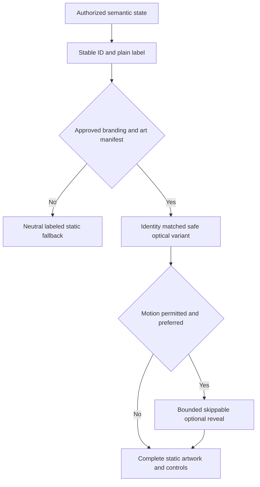

# Playground Naming and Bespoke Art Directions

Date: 2026-11-07. Phase E. Status: THREE PROPOSALS; NO BRAND, NAME, ASSET OR RELEASE APPROVED.

**Goal:** Give Mentor and Student progression an original, reusable visual grammar that explains evidence, improvement and optional comparison while preserving Orbit and complete plain/static interfaces.
**Architecture:** Stable semantic IDs map through an approved versioned branding/art manifest to bounded bespoke SVG constructions and localized labels. Score/grade/source authority remains in [F3](../../plan/v2/06-mentor-playground.md), [F4](../../plan/v2/07-student-playground.md) and the [shared contract](../../plan/v2/03-platform-contracts.md), never in artwork, color or animation.
**Tech stack:** Existing Orbit JS/JSX, token bindings and SVG/component primitives. No new renderer, icon font, palette, asset generator or library is selected. No assets were generated or rendered.

## 1. Evidence and non-goals

Read basis: [existing art direction](../00-art-direction.md), [design tokens](../01-design-tokens.md), [proposed lore/live-ops](lore-live-ops.md), [D progression](../../plan/v2/thinking-playgrounds.md), [D signal/rating](../../plan/v2/thinking-signal-ratings.md), and [source audit](../../plan/v2/01-existing-system-audit.md).

Existing documents support Orbit's observatory/academy language, token names, typography, SVG/static equivalence and functional metaphors. They remain pending/proposed where labeled. The audit reports existing bespoke badges, reduced-motion handling and quality fallback; it does not establish rendered contrast, exact asset compatibility, device fps or trademark clearance.

Historical fiction references are mood references only, not permission to copy characters, logos, ship silhouettes, vocabulary, music, story beats or licensed iconography. These three constructions are original design proposals in this document, not a global originality or trademark-search claim. Names/commissioned art must undergo founder selection and qualified clearance before visibility. No protected universe/character/icon is used as a progression name or asset recipe here.

Non-goals: rename Orbit; replace existing UI tokens; generate forty badges or thirty-mission catalogs; create assets now; sell rank/grades/claims; claim learning efficacy; invent a renderer/vendor API; approve public minor ranking, financial perks or extra-feature membership.

## 2. Stable identifiers and neutral shipping fallback

Visible names are display metadata, never primary keys, ledger assets, role grants or semantic source families.

| Stable semantic key | Neutral label until approval | Owner / rule |
|---|---|---|
| `mentor.band.T0` through `mentor.band.T4` | `Mentor standing band T0` ... `T4` | F3 exact rational current standing |
| `mentor.comparison.T0` through `T4` | `Mentor comparison tier T0` ... `T4` | F3 optional movement; not expertise |
| `student.tier.T0` through `T4` | `Student comparison tier T0` ... `T4` | F4 optional contextual movement; not mastery |
| `VIRTUAL_STUDENT` | `Student virtual units` | Shared/F5 distinct asset, no cash value |
| `VIRTUAL_PEER` | `Peer virtual units` | Shared/F5 distinct Peer identity, not Student league |
| `VIRTUAL_MENTOR` | `Mentor virtual units` | Shared/F5 distinct asset, not Mentor score |
| Catalog-owned badge ID | `Reviewed achievement: {plain criterion title}` | Catalog stable ID; evidence/revocation via shared authority |
| Catalog-owned mission ID | `{plain real-job title}` | Catalog criterion/version; not a second faucet |

Existing Photon/Stardust/Pact/Pulse records are not mapped/migrated automatically. An approved new display manifest cannot rename persisted history, convert balances or change semantic source equivalence. Preserve historical original display name/version where needed, without implying the new brand existed then.

Until approval, neutral text and a generic original evidence-frame fallback are sufficient. Branding gate is separate from grading/progression gate: an unknown name is not a reason to fabricate an asset, grade or reward.

## 3. Three complete naming directions

Every candidate label below is PROPOSED and UNVERIFIED for name/asset clearance and localization. No name is an earned certification, role, safety clearance or cash claim.

### Direction A - Layered Bearings

Premise: useful explanations expose an origin, bridge an assumption and preserve a reviewed layer. It extends the proposed Continuity Observatory without renaming Orbit. The stable score tier still supplies meaning; the label is optional metaphor.

| Tier | Mentor proposed label | Student proposed label | Functional plain companion |
|---|---|---|---|
| T0 | Datum | First Mark | Current standing / contextual comparison |
| T1 | Span | Trace | Same; not a competence title |
| T2 | Frame | Traverse | Same |
| T3 | Array | Crosscheck | Same |
| T4 | Horizon | Synthesis | Same; not mastery certification |

Proposed separate virtual display names: Student `Lens Marks`, Peer `Link Marks`, Mentor `Pattern Marks`. Each retains the explicit suffix/help text `Virtual units; no cash value.` No common balance or exchange follows from shared wording.

Badge naming grammar candidate: a plain criterion noun followed by `Layer`, `Span` or `Frame`, selected by catalog purpose rather than rarity. Example illustrative title pattern `Reviewed repair / Repair Layer`; not a new badge definition or completed catalog entry.

Art grammar: offset evidence plates, an open source notch and a bridge stroke. Additional reviewed detail changes the number/arrangement of panels, not shine, wealth or a larger crown. Student improvement compares an earlier and current plate with a labeled gap; Peer linking uses two equal plates, never Student-tier art by identity substitution.

Strength: closest to existing observatory/source/version contract; preserves uncertainty and revision. Risk: technical words may be obscure or read as prestige. Mitigation: plain label first, optional metaphor second, remove metaphor if localization or comprehension fails.

### Direction B - Openwork Atlas

Premise: explanations are assembled from inspectable joins rather than a hierarchy of powerful characters. It adds craft inside Orbit's existing observatory surfaces; no new workshop UI system.

| Tier | Mentor proposed label | Student proposed label | Functional plain companion |
|---|---|---|---|
| T0 | Thread | Sketch | Current standing / contextual comparison |
| T1 | Seam | Join | Same |
| T2 | Weave | Patch | Same |
| T3 | Loom | Pattern | Same |
| T4 | Tapestry | Context | Same; not a qualification |

Proposed separate virtual display names: Student `Thread Notes`, Peer `Join Notes`, Mentor `Pattern Notes`. `Notes` means virtual display units here and must not be confused with private course notes; reject/rename if usability tests show confusion. No cash value or conversion.

Badge naming grammar candidate: functional title plus `Join`, `Panel` or `Openwork`. Catalog selects a bespoke motif for the actual criterion, never a generic imported badge icon with a changed letter.

Art grammar: interrupted lattice ribs, inspectable junctions and rectangular open panels. One intentionally open edge represents continuing revision, not locked access. Student art uses a worked example panel; Mentor art uses an explanation join; Peer art uses symmetric paired joints. No textile/cultural pattern is copied from a protected or sacred source.

Strength: clear making/revision metaphor and flat SVG feasibility. Risk: rank words can sound like apprenticeship/craft certification; currency word Notes can collide with real note-taking. Mitigation: retain neutral functional labels, test terminology, and keep no-qualification copy visible.

### Direction C - Quiet Relay

Premise: a useful explanation connects contexts and leaves an exit open. The narrative focuses on recoverable, optional progress rather than status accumulation.

| Tier | Mentor proposed label | Student proposed label | Functional plain companion |
|---|---|---|---|
| T0 | Seedline | Notice | Current standing / contextual comparison |
| T1 | Junction | Try | Same |
| T2 | Channel | Compare | Same |
| T3 | Relay | Revise | Same |
| T4 | Confluence | Transfer | Same; a label, not proof of transfer |

Proposed separate virtual display names: Student `Trace Units`, Peer `Bridge Units`, Mentor `Relay Units`. No cash value, cash-out or identity exchange.

Badge naming grammar candidate: functional title plus `Route`, `Junction` or `Return`. A rest/return depiction is not an attendance badge, streak achievement or dependency cue. Catalog criteria must still be independently useful approved work.

Art grammar: bounded nonarrow paths, paired endpoints and an open return arc. Direction is represented by source/current text and panel order, not a moving spacecraft or a protected silhouette. Student comparison uses two route alternatives; Mentor evidence uses a labeled junction; Peer cooperation uses equal connecting endpoints.

Strength: noncompetitive voluntary tone and clean exit; least visual status escalation. Risk: verbs can be mistaken for instructions or proven outcomes. Mitigation: prefix `Comparison label`, retain actual criterion text, and never mark Transfer as demonstrated transfer without graded evidence.

## 4. Recommendation and decision matrix

Recommend **Direction A, Layered Bearings**, as an unapproved proposal: it is the closest fit to the existing Orbit observatory and proposed source/revision lore, and its plates/notches map cleanly to receipts, uncertainty and private improvements. B is a real alternative for craft-oriented tone; C is a real alternative if optionality/exit matters more than status vocabulary. No founder direction has been selected.

| Criterion | A | B | C |
|---|---|---|---|
| Existing observatory/source continuity | Strongest conceptual fit | Requires craft metaphor explanation | Good route/connection fit |
| Flat original SVG construction | Offset plates/notches | Open ribs/joints | Paths/endpoints |
| Risk to plain-purpose comprehension | Technical nouns | Certification and note-name confusion | Verbs/outcome wording |
| Static/reduced-motion completeness | Full | Full | Full |
| Distinct Student/Peer/Mentor grammar | Plate roles; separate asset labels | Different joints/panels | Different route relations |
| Requires name/asset/localization clearance | Yes, unverified | Yes, unverified | Yes, unverified |

These are editorial design judgments, not measured preference, efficacy, production-cost or legal ratings. If all visible naming hurts comprehension, keep neutral IDs/labels and only the useful evidence art.

## 5. Existing token and typography binding

Use canonical token references, not hard-coded feature colors. The read historical values below identify the existing proposal; they are not a validated contrast palette or a claim about emitted CSS.

| Existing token/style | Historical value/intent | Playground use |
|---|---|---|
| `--color-space-bg` | #020617 | Root background; preserve canonical source |
| `--color-space-surface` | #0f172a | Evidence panels and static fallback |
| `--color-nebula-cyan` | #38bdf8 | Existing active/link semantic, not a rank color scale |
| `--color-quantum-emerald` | #10b981 | Existing success state only after committed receipt |
| `--color-stellar-gold` | #f59e0b | Existing warning accent where semantically appropriate; not purchasable prestige |
| `--color-text-primary` / `--color-text-muted` | #f8fafc / #94a3b8 | Labels/values in text tokens, not series colors |
| Editorial/telemetry fonts | Existing sans/mono split | Plain titles/body in sans; bounded metadata/version in mono |
| 4px base spacing | Existing 4/8/12/16/24/32/48 scale | Shared panels, touch targets and layout rhythm |
| 12/16px/pill radii | Existing card/major/status intent | Preserve component semantics; no independent radius system |

Historical universal blur/transition-all and spring settings are not copied blindly. For low-power/forced-color/static paths, remove blur and decorative movement while preserving layout, focus and controls. Duration proposals below require an explicit shared F8/token mapping decision; they do not silently overwrite the existing300ms token.

Score plots are optional. Minimum uses readable tables and summaries. Future chart designers must validate actual light/dark/forced-color bindings before release; status hues are not reused for category identity, entity encoding stays stable under filtering, and multi-series views include legend/direct labels plus an identical table. No palette validator or renderer ran here.

## 6. Bespoke SVG construction specification

All coordinates below are proposed design geometry for later authored assets, not generated SVG files or rendered results. No code comments, pictograph characters, icon fonts, imported franchise paths or external image dependencies.

Common construction:
- Logical viewBox64x64;4-unit construction grid; meaningful content within8..56; external visual padding at least4 units.
- Primary stroke2 logical units at64px, round/controlled joins; optical16px variant simplifies to1.5px strokes and fewer intersections. Do not merely scale down dense64px detail.
- Main semantic silhouette must survive monochrome. No text embedded as geometry; labels are DOM/localized text and screen-reader accessible.
- Proposed per-badge budget: at most12 paths/groups,80 path commands, no embedded raster, no filter/mask/external use by default, and <=6KB uncompressed SVG. Budgets are targets to validate, not measurements.
- Deterministic IDs/prefixes prevent repeated-instance title/clip ID collisions. Asset sanitizer allowlist denies scripts, foreignObject, event handlers, remote references and unsafe styles.
- Never use glow, particles, color, number of sparkles or fill intensity as the only earned/locked/review state. No rarity/sale countdown.

| Direction | Base construction recipe | Identity distinction | Detail evolution |
|---|---|---|---|
| A | Rear open plate rectangle(12,12)-(44,44), front plate(20,20)-(52,52); rear upper edge has an8-unit source notch; bridge connects(28,36)-(44,36) through an open4-unit gap | Mentor bridge spans two evidence panels; Student earlier/current panels have equal footprint; Peer two panels remain symmetric | T0 one open plate; T1 source notch+bridge; T2 paired plate; T3 two orthogonal internal frame bars; T4 bounded four-panel array with an open outer edge |
| B | Open panel bounds(12,16)-(52,48); ribs atx20/32/44 interrupted aroundy32; two horizontal joins at24/40 | Mentor explanation joint uses one offset coupling; Student worked panel uses two inspected joins; Peer equal dual coupling | T0 open rib; T1 one joint; T2 two perpendicular joins; T3 three-rib panel; T4 bounded openwork arrangement, not a crest/crown |
| C | Endpoint pads centered(16,40)/(48,24), diameter8; bounded path through(24,40),(32,32),(40,24); open return arc stays inside(12,12)-(52,52) | Mentor reviewed junction has a third context pad; Student alternatives use two labeled equal branches; Peer link has equal endpoints | T0 one path stub; T1 joined path; T2 reviewed alternate branch; T3 bounded three-context junction; T4 open confluence with one clear exit, no enclosing cage |

Tier geometry is not enough to distinguish earned criteria. Catalog badge art must add a criterion-specific original silhouette/negative-space motif from the allowed grammar, not paste identical base art with a number. Direction choice supplies a family grammar; catalog/art review owns the forty bespoke Mentor constructions and any Student inventory.

Review/appeal states use a small separate labeled state plate outside the main achievement geometry. Revocation must not add a shame mark to public identity or erase all art/history. Decorative orbital rings cannot imply a score, exact probability or award count.

## 7. Functional art-to-evidence mapping

This is a reusable mapping contract, not a badge/mission inventory or new completion rule.

| Evidence/semantic purpose | A motif | B motif | C motif | Plain accessible label template |
|---|---|---|---|---|
| Reviewed lesson | Open source plate and explanation span | Inspected explanation join | Reviewed route segment | `Reviewed lesson contribution: {title}` |
| Validated repair/outcome | Selected before/current plate pair | Repaired open joint | Alternate reviewed context path | `Reviewed repair evidence: {title}`; never causal learning claim |
| On-time accepted milestone | Bounded checkpoint notch | Completed agreed join | Accepted junction marker | `Accepted milestone: {title}`; time judged by F1, not animation |
| Helpful resolution | Two source panels with one permitted bridge | Question/explanation coupling | Equal endpoints with resolved route | `Reviewed resolution: {title}` |
| Reusable pattern | Bounded frame with source notch | Open repeatable panel | Context-preserving junction | `Rights-reviewed teaching pattern: {title}` |
| Student best improvement | Equal earlier/current plates | Changed worked-example join | Two comparable route alternatives | `Best task value changed from {before} to {after}; new points {issued}` |
| Cap clipping | Same evidence motif plus separate status text | Same | Same | `Evidence recorded; points limited by cap` |
| Private/paused | Neutral evidence frame; no absence symbol | Neutral open panel | Open exit path | `Private progress; comparison off` |
| Review pending/unknown art | Generic open evidence frame | Same neutral fallback | Same neutral fallback | `Review pending: {plain criterion title}` |

No art grants source permissions, publication, grade, money, room access or reputation. A badge title like Transfer is not evidence of transfer; the authoritative criterion result must carry that evidence independently.

## 8. Manifest and catalog interfaces

The catalog agent owns stable mission/badge IDs, criterion inventory/version/localization, evidence windows and bespoke artKey requests. F3/F4 own source/grade/cap outcomes. This art package owns proposed rendering/name manifest interfaces. None duplicates the others' catalogs.

```ts
type ArtDirectionId = "direction.A" | "direction.B" | "direction.C";
type SemanticArtKind = "standing_band" | "comparison_tier" | "badge" | "mission" | "virtual_asset";
type ArtRequest = Readonly<{
  semanticId: Id; kind: SemanticArtKind; identity: "Student" | "Peer" | "Mentor";
  catalogVersion: Id | null; artKey: Id;
  state: "neutral" | "in_progress" | "earned" | "review_pending" | "revoked";
  plainLabel: string; decorative: boolean;
}>;
type ApprovedArtEntry = Readonly<{
  artKey: Id; directionId: ArtDirectionId; artVersion: Id;
  semanticId: Id; identity: "Student" | "Peer" | "Mentor";
  labelKey: Id; constructionRef: Id; opticalSize: 16 | 24 | 48 | 64;
  clearanceEvidenceId: Id; accessibilityEvidenceId: Id;
}>;
type ArtResolution =
  | Readonly<{ state: "approved"; entry: ApprovedArtEntry; accessibleLabel: string }>
  | Readonly<{ state: "neutral_fallback"; reasonCode: string; accessibleLabel: string }>;
type BrandingManifest = Readonly<{
  manifestId: Id; version: Version; policyVersion: Id;
  directionId: ArtDirectionId; approvedDisplayNames: Readonly<Record<Id,string>>;
  artEntries: readonly ApprovedArtEntry[];
}>;
interface PlaygroundArtResolver {
  resolveArt(request: ArtRequest, gate: PolicyGate<BrandingManifest>): ArtResolution;
  resolveDisplayName(semanticId: Id, identity: "Student" | "Peer" | "Mentor", gate: PolicyGate<BrandingManifest>): string;
}
```

Approved manifest state requires explicit approval and clearance evidence; `proposed` can drive a labeled planning preview only, not production-visible naming. Identity/semanticId mismatch, unapproved asset, missing optical variant or unsafe content returns neutral_fallback. Accessible labels describe the actual authoritative state; artRequest cannot claim earned if criterion projection is pending. Validate cross-package schema and label bounds rather than accept arbitrary catalog HTML.

Catalog handoff requirements: each requested artKey supplies actual criterion plain title, identity, semantic source purpose, accessibleLabelKey, state variants, sizes, rights/provenance, and revocation behavior. Art review returns construction/version/evidence; catalog never supplies trusted point amounts or uses art render callbacks to award.

No catalog inventory appears in this document. Naming grammar examples are title patterns only, not promises that a particular badge or mission exists.

## 9. Accessibility and layout

- Plain purpose first, metaphor second. Neutral functional labels stay available even after branding approval.
- Functional art is either a single appropriately labeled SVG image or decorative artwork with equivalent adjacent text; never both announcements for the same information. Decorative SVG is hidden from assistive technology.
- Use localized title/description IDs unique per instance; do not encode important text inside paths or rely on hover. Repeated list items must not share SVG label IDs.
- Proposed controls have44x44CSS-pixel target area, visible focus and keyboard operation; a16px badge glyph does not become a16px control.
- Forced colors/monochrome keeps the source/frame/join silhouette and text. Earned/review/private states include words, not color alone.
- On narrow screens, stack label, criterion/state and action. Permit text wrapping and200%/400% zoom without clipped receipt, cap, consent, support or exit controls.
- Comparison tiers and authoritative grade values remain separately labeled. Art cannot make protected tier look like earned expertise or a completed pending grade.
- Badge grids are optional navigation to authorized evidence, not mandatory public profile galleries. Minor/unknown/private records are not exported/shared by default.
- Basic permitted export includes text/criteria/source version and accessible fallback without tokens. Export never grants rights to another participant's data or source media.

## 10. Static, reduced-motion, sound and performance plan

| Moment | Proposed normal-motion ceiling | Static/reduced-motion result | Authority condition |
|---|---:|---|---|
| Evidence row appears | <=180ms opacity/local reveal | Immediate full row and text | Committed source receipt only |
| Best-value comparison | <=400ms optional local comparison | Earlier/current values and issued points side by side | F4 accepted comparable grade, not local callback |
| Newly earned art | <=800ms, explicit skip | Immediate labeled earned art | Catalog/shared durable receipt; replay has no second ceremony |
| Tier movement | <=400ms local labeled swap | Current tier, previous tier and explanation | Sealed adjudication result, not client percentile |
| Cap/review/correction | No celebration/punishment | Literal status and appeal/support | Exact receipt/case state |
| Pause/exit/account switch | No delay | Immediate control completion and cleared scope | Shared generation/fence/visibility contract |

Sound off by default and independently selectable; no autoplay pressure. Preference changes mid-reveal cancel decorative motion and finish static state immediately. Reduced-motion disables orbit/camera/parallax/layout travel, not learning or controls. Interrupted routes/unmounts/account changes cancel completion callbacks; animation never creates an award or changes a balance.

Proposed SVG-first minimum requires no WebGL, custom shader, new motion library or full-screen particle layer. Optional existing 3D decoration, if later approved, uses the same semantic manifest and a complete static fallback; renderer/context loss cannot remove functionality. No protected spacecraft/character models.

Proposed future budgets: bounded SVG complexity from section6; only visible list art instantiated; lazy-load optional detail variants; no continuous idle animation; release event/listener/object resources on unmount; honor user-selected static/low-power mode. Validate rather than claim asset bytes, CPU/memory/GPU behavior,60fps, thermal performance or accessibility. If budgets fail, simplify geometry/drop motion, not essential controls or text.

## 11. Textual resolution flow



| Diagram path | Equivalent requirement |
|---|---|
| A-B | Grade/source/catalog authority supplies state; stable IDs never change with branding |
| B-C-D | Missing/proposed/suspended manifest returns neutral label/art, not guessed approval |
| C-E | Validate identity, semantic key, clearance, sanitizer and optical size |
| E-F-G | Static/reduced-motion/low-power path is fully functional |
| F-H-G | Optional reveal is bounded/skippable and cannot award or block exit |

Text-only Mermaid plus equivalent table; no diagram renderer or palette QA was run.

## 12. Dependencies and proposed future files

Audit-supported existing investigation targets include `D:/orbit-main/orbit-main/FrontEnd/src/index.css`, `D:/orbit-main/orbit-main/FrontEnd/src/hooks/useQualityTier.js`, and the existing badge/share/progression components described in the audit. Exact badge component filenames were not independently established in this six-read package and are not guessed as existing. Later source inspection must select embedding points without duplicating the system.

All paths below are PROPOSED, not existing or written files.

| Future absolute file | Exact responsibility/interface |
|---|---|
| `D:/orbit-main/orbit-main/shared/fp2/artManifest.js` | `validateBrandingManifest(input: JsonValue): BrandingManifest`; registered bounded names/identity/state/evidence references |
| `D:/orbit-main/orbit-main/FrontEnd/src/components/fp2/art/playgroundArtResolver.js` | Implements PlaygroundArtResolver; approved manifest or deterministic neutral fallback |
| `D:/orbit-main/orbit-main/FrontEnd/src/components/fp2/art/PlaygroundMark.jsx` | `PlaygroundMark({resolution,plainLabel,decorative,opticalSize})`; unique labels, static-first SVG variant |
| `D:/orbit-main/orbit-main/FrontEnd/src/components/fp2/art/PlaygroundArtReveal.jsx` | `PlaygroundArtReveal({receiptId,accountScope,motionPreference,soundPreference,onSkip,children})`; bounded optional reveal, no mutation callback |
| `D:/orbit-main/orbit-main/FrontEnd/src/assets/fp2/playgrounds/` | Future approved bespoke SVG variants only; catalog-owned keys, original construction/provenance; no generated files now |
| `D:/orbit-main/orbit-main/FrontEnd/src/components/fp2/__tests__/playgroundArt.test.jsx` | Future resolution/accessibility/identity/optical/static fixtures |

Minimum: neutral labels/static evidence frame, canonical tokens, accessible state text and resolver gate. V1 candidate: one separately approved naming/art direction, reviewed catalog-specific original constructions, bounded optional reveals. V2 candidate: richer original optical variants/approved decoration after measured device/accessibility performance. No implied asset generation, forty-badge completion, franchise licensing, new renderer, public minor sharing, paid themes or currency migration.

## 13. Numbered future tasks

These tasks are unchecked; no runner/render/install/code/commit permission is granted by E.

### Task A1 - Founder direction and manifest contract
- [ ] Present A/B/C plus neutral-only alternative; record explicit founder choice or keep branding gate unknown. Request qualified name/asset/localization clearance evidence before visible use.
- [ ] Author failing `manifestMustBeApproved`, `identityMismatchFallback`, `nameChangeDoesNotChangeStableId`, `unknownKeyNeutralFallback` assertions in `D:/orbit-main/orbit-main/FrontEnd/src/components/fp2/__tests__/playgroundArt.test.jsx` using A01-A04.
- [ ] After separate implementation approval, implement validateBrandingManifest/resolver; verify the project's runner and execute assertions. No visibility until the required gate is approved.

### Task A2 - Bespoke construction and catalog handoff
- [ ] Obtain catalog-owned artKey/criterion requests and author acceptance assertions `criteriaHaveDistinctSilhouettes`, `noProtectedOrImportedPaths`, `svgSanitizerRejectsUnsafe`, `optical16Simplified` using A05-A08.
- [ ] Under later art-production approval, author reviewed SVG variants within the chosen geometry/complexity budgets and maintain provenance/clearance references; do not invent catalog entries.
- [ ] Execute sanitizer/complexity/byte checks and render authorized previews for actual layout review; record measured results instead of claiming this specification generated assets.

### Task A3 - Accessible state and static completion
- [ ] Author `uniqueSvgLabelIds`, `decorativeNotDoubleAnnounced`, `forcedColorsLabelsRemain`, `zoomAndKeyboardComplete`, `pendingNotEarned` using A09-A13.
- [ ] Implement PlaygroundMark and static-first embedding in canonical F3/F4 surfaces; preserve plain labels and table equivalents.
- [ ] Under later approval, run DOM/assistive/keyboard/zoom/forced-color checks and real contrast validation against emitted tokens. A source/token declaration is not a contrast pass.

### Task A4 - Motion interruption and cross-pack authority
- [ ] Author `noAwardOnAnimation`, `replayedReceiptNoSecondReveal`, `reducedMotionMidRevealCompletes`, `accountSwitchCancels`, `rendererLossStaticComplete`, `minorSharingDenied` using A14-A19.
- [ ] Implement PlaygroundArtReveal through shared preference/account-scope/receipt contracts; no mutation/grading/payment callback.
- [ ] Run authorized device/performance/accessibility/revocation tests and compare results to approved budgets; simplify art/motion on failure and keep all controls.

## 14. Failure-input acceptance matrix

These are future assertions, not rendered/executed results.

| ID / input or failure | Expected outcome |
|---|---|
| A01 Proposed/unknown/suspended BrandingManifest | Neutral labels and static fallback; no candidate brand silently visible |
| A02 Student semantic tier requested with Peer identity | Identity mismatch fallback/rejection; no Student/Peer score or asset alias |
| A03 Founder changes label while semantic basis/source remains same | Display manifest version changes only; no grade/grant/ledger migration or reissue |
| A04 Missing catalog artKey/clearance/optical size | Labeled neutral fallback; review_pending if criterion pending; no fabricated asset approval |
| A05 Two different badge criteria receive same generic icon with swapped number | Art review fails bespoke criterion silhouette requirement; catalog quantity does not prove originality |
| A06 Protected character/logo/path/silhouette or unlicensed external asset supplied | Quarantine/reject; qualified rights/name review required; mood reference is not license |
| A07 SVG contains script/foreignObject/onload/remote href | Sanitizer rejects; never mounts unsafe SVG |
| A08 Dense64px variant reduced to illegible16px | Optical review fails; author simplified variant or use plain text fallback |
| A09 Repeated mark instances share title/description IDs | Test fails; unique scoped label IDs required |
| A10 Decorative mark plus adjacent identical accessible text | Decorative SVG hidden; one useful announcement, no duplicated label |
| A11 Forced colors/monochrome/sound off | State and identity readable through shape/text; no color/sound-only earned status |
| A12 Narrow viewport or400% zoom with long localized label | Reflow/wrap; score/cap/consent/support/exit controls reachable, no clipped fixed-width card |
| A13 Grade/catalog state review_pending but animation wants earned styling | Pending text/fallback only; no success semantics or celebratory award |
| A14 Animation completes or fails before receipt commit | No grade/points/badge/payment mutation; unchanged pending state |
| A15 Original receipt replay after network loss | Original state only; no second reveal/award/notification |
| A16 Reduced-motion enabled mid reveal | Cancel movement; immediate complete static result and controls |
| A17 Account A reveal callback fires after account B or identity change | Callback discarded by scope/generation; no A art/evidence in B UI/cache |
| A18 Context/GPU loss, low-power mode or unsupported optional renderer | Complete SVG/text/static flow; no mandatory3D or claimed fps |
| A19 Minor/age-unknown/private/paused achievement requested for public share | Shared access/policy denial; no exported hidden identity/evidence; own permitted basic export remains |
| A20 Candidate currency name implies exchange/rank or perk requests fee advantage | Correct copy/reject design; no cash value/conversion; fixed session15% and subscription20% unchanged |

## 15. Open decisions and limits

| Decision | Blocked typed state | Required acceptance |
|---|---|---|
| DEC-E-A01 / shared C10,C11 | `PolicyGate<BrandingManifest>` unknown | Founder selects A/B/C/neutral-only; qualified current name/asset and localization review; no global trademark promise |
| DEC-E-A02 / C04,C09 | League/currency/badge naming proposed | Confirm stable identity/asset mapping and catalog naming; no migration/conversion, certification or paid advantage |
| DEC-E-A03 / C10 | Art construction/asset approval unknown | Choose bespoke geometry, sanitizer/provenance/optical budgets and actual reviewed assets; no asset exists from this draft |
| DEC-E-A04 / C08,C10 | Motion/token mapping proposed | Reconcile180/400/800ms moment proposals with existing token/F8 policy; test static/live reduced-motion and interruption |
| DEC-E-A05 / C03,C11,C12 | Public/share/catalog visibility unknown | Approve safe audiences, rights/retention/withdrawal and sparse-cohort privacy; minors not public by default |
| DEC-E-A06 / C10,C12 | Accessibility/device/performance evidence unknown | Authorized contrast/render/assistive/device tests, measured budgets and staffed catalog/art review capacity |

Six assigned evidence documents were read; no root/STATE/environment/credential or additional app-source read occurred in this package. Main must apply the supplied root/STATE restrictions and own all writes, registration, link/line/character/preservation checks. No code/test/build/server/install/provider/DB/paid generation, rendered diagram, palette validator, generated SVG or public publication occurred. All names, geometry, budgets, efficacy, vendor/license/prices, device fps and legal/safety applicability remain unverified where they require validation. The missing detailed E/F tail is not reconstructed or expanded.
