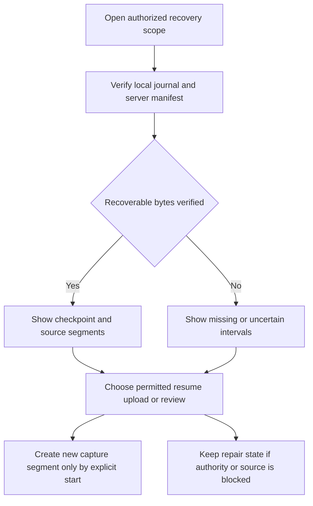

# Studio UX - Honest Capture, Private Learning Artifacts and Review

Date: 2026-11-08. Phase: E continuation, F6. Status: PROPOSED, NOT RENDERED, NOT DEVICE-VERIFIED, NOT PLAN LOCKED.

**Intent:** A mentor can see what is actually recoverable and publish only a reviewed version; a learner can preserve private reasoning without giving a mentor notebook access or needing AI/tokens.
**Dependencies:** `D:/orbit-main/orbit-main/docs/plan/v2/03-platform-contracts.md`, `D:/orbit-main/orbit-main/docs/plan/v2/11-studio-capture.md`, `D:/orbit-main/orbit-main/docs/plan/v2/12-studio-notes-whiteboard.md`.
**Evidence:** The same six named planning/audit/research files used by the two companion plans. No app-source, browser/device, provider, model or asset run supports this design.

All layouts, labels, budgets and membership choices below are proposals. Existing art/tokens/Motion/Three/Board and canonical recorder/library/learning/call surfaces are extended, not replaced by a competing system. No palette, rendered graphic, Office calculation, device fps or visual-quality result is claimed.

## 1. Goals, anti-goals and approach

Goals: explicit device/surface choice; quick unconditional local stop; visible recovery boundary; precise upload/processing/review status; one shared Board; private note/mistake ownership; exact/removed/unknown time mappings; complete keyboard/static/sound-off use.
Anti-goals: fake progress, silent recording, another account's draft, recording as booking requirement, guilt/streak pressure, model output as grade, paid basic export, permanent call retention or celebratory publication before a receipt.

| Approach | Trade-off | Recommendation |
|---|---|---|
| Preserve existing UI unchanged | Familiar but hides audited acknowledgment/access/cut failures | Not an authoritative release path |
| Replace studio with a suite | Potential convenience with unverified terms/migration/permissions | Do not select |
| Extend current shell with explicit state panels | More precise status without a second app/theme | Bounded private slice first; proposed, not user-selected |

## 2. Surface inventory and navigation

| Existing surface | Proposed extension | Authority remains |
|---|---|---|
| Mentor Recorder | Setup, capture, recovery, edit/review panels | Recording owner/live permit/policy |
| Mentor MediaLibrary | Local/server/job/version distinctions and repair entry | Canonical media artifact/access |
| Course authoring/review | Version-bound publication candidate and source-map issues | Canonical appointed review/course publication |
| Peer VideoCall | Shared Board and optional recording state, no generic join grant | Authorized connection/room membership |
| Mentor session room | Same Board/recording controls only in independently usable booking | Booking/participant/age/safety eligibility |
| Existing course learning view | Private notes, mistakes, timestamp repair and optional review | Learner owner ACL, separate source entitlement |

New panels mount inside these surfaces, not new role dashboards. Route/URL identity is presentation only; hidden buttons do not secure a route.

## 3. Text-only layout sketches

Desktop/wide candidate; size and fit must be measured later.

```text
STUDIO: Draft title | Private | Source/edit version | Help
Setup  Capture  Recover  Edit  Review
[ Device/surface status ] [ Capture OFF/ON ] [ Stop capture ]
[ Preview / composition / shared Board ] [ Context panel ]
[ Actual source time or unknown ] [ Local acknowledgment ]
[ Server verified bytes ] [ Upload/job state ] [ Next action ]
```

| Sketch region | Required content | Cannot imply |
|---|---|---|
| Header | Private/publication state, exact version, own title | Role grant, published state from provider readiness |
| Device strip | Selected actual track/source and permission state | Tab/system audio merely because requested |
| Preview | Current composition with accessible source labels | Recorded pixels until recorder actually starts |
| Context | Devices, layout, prompter, slides, Board or recovery issues | A second Board mutation authority |
| Status area | Distinct local/remote/processing/review truth | One generic Saved badge for everything |
| Stop | Always reachable before nonessential tools | Waiting for server, consent or animation |

Narrow/low-power candidate.

```text
Draft title | Private | Capture OFF/ON
[ Stop capture ]
[ Preview or accessible source summary ]
[ Source/device status ]
[ Local checkpoint ] [ Server verification ]
Devices | Layout | Board | Prompter | Review
[ One active context panel ]
```

Equivalent behavior: one context panel at a time, no horizontal tool maze, status/stop stay reachable, dialogs cannot cover the only stop control, device/preview failure permits an independently supported alternative. These are text structures, not a tested responsive design.

## 4. Setup and support evidence

Support labels derive from the capture plan's matrix: DOCUMENTED primitive, UNVERIFIED behavior, PROBE_REQUIRED configuration or explicitly UNSUPPORTED path. No browser/OS YES values are invented.

| Control | Required states/copy | Interaction |
|---|---|---|
| Camera | `Not selected`, `Permission needed`, `Preview available`, `Denied`, `Track ended` | User chooses actual device after permission; no background request |
| Microphone | Same plus signal status | Explicit mute/source choice; actual track presence checked |
| Screen/window/tab | `Choose a source`, selected actual surface, `Sharing ended` | Fresh explicit display choice; never silently switch source |
| Tab/system audio | `Not available from this source` or actual enabled source | Separate capability/control; video choice is not audio evidence |
| Codec profile | `Needs a recording/playback check`, supported-profile evidence ref | MIME probe alone cannot enable verified support copy |
| Local recovery | `Device recovery not enabled` or approved acknowledgment status | Privacy/key/storage evidence required; no IndexedDB guarantee |
| Background effect | `Optional; may increase device load`, OFF/degraded | Never needed for recording/learning/access |

Start preflight explains recording purpose, sources, visibility, retention and participant scope where applicable. Camera/mic permission is separate from recording/persistence consent. Disabled start shows a safe policy/device reason and a permitted alternative; no fake demo fallback.

## 5. Capture controls and CPU trade-offs

| Feature | Proposed behavior | Failure/degrade path |
|---|---|---|
| Layout | Reuse existing composition presets; preview and version the selection | Unsupported layout/frame size -> simpler approved composition |
| Device changes | Explicit choice and new source segment/composition version | Pause by default on source loss; no fictional continued audio |
| Pause/resume | Requested versus confirmed pause distinguished; retained live tracks disclosed | Pause clock unknown -> interruption/unknown interval, not a guessed gap |
| Retake | Mark replacement range, preserve old acknowledged source, capture new segment | Unresolved source map blocks final candidate; deletion separate |
| Prompter | Font/scroll/speed/keyboard controls; manual/static mode complete | Stop automatic scrolling on reduced motion/user choice; retain editable text |
| Slides | Authorized asset source/version, current slide label, explicit fit | Decode/rights failure -> unavailable placeholder and allowed next step |
| Board | Shared authoritative document/grant/revision | Access/conflict -> stop sends, repair snapshot; not local-success strokes |
| Background | OFF by default; optional effect/profile | Device load -> turn effect off with notice, preserve usable controls |
| Audio mix | Actual sources independently named/muted | Missing tab audio -> explicit mic-only option, never silent fake track |
| Preview | Clearly labeled not proof of saved bytes | Lost GPU/hidden-tab -> accessible source/control fallback |

Compositing, scaling, slide decode, Board rasterization, background segmentation and encoding may compete for CPU/GPU/memory. No cost/fps is measured. Prefer disabling optional effects and simplifying layout before affecting basic controls; never discard unacknowledged data to preserve a glamorous preview.

## 6. Readouts, not invented charts

Use text/numeric readouts with units and equivalent tables first. No new palette or plotted chart is chosen; existing text/status tokens must receive future contrast/forced-color review. Unknown is displayed literally, not a zero-length success bar. Separate measures have separate denominators; no dual-axis or combined local/server completion statistic.

| Readout | Data and unit | Display rule |
|---|---|---|
| Mic signal | Actual sampled signal status; numeric level only with registered definition/unit | `Signal detected`, `No signal detected` or `Signal unknown`; silence alone is not device failure |
| Clipping | Measured profile-defined threshold/window | Warn only from measured evidence; no invented threshold |
| Source time | Validated media milliseconds/current candidate clock status | `Source time 00:40` only with valid clock; otherwise `Timing is being checked` |
| Free device space | OS/browser estimate in bytes with timestamp | `Estimated space`; no guaranteed quota or exact remaining-time promise |
| Recoverable local bytes | Sum of currently verified acknowledged chunk bytes | `Acknowledged on this device`; unacknowledged buffer separate |
| Server verified bytes | Authoritative verified manifest bytes | Same source/upload version displayed; received-not-verified excluded |
| Upload progress | Verified bytes / sealed known total bytes | Percentage only if denominator is known; open recording uses absolute bytes |
| Processing | Actual job state and version | Indeterminate QUEUED/PROCESSING if no approved measurable total |
| Publication | Canonical receipt/version | No progress simulation or provider-ready substitution |

For future optional meters, every status has a text label, keyboard-accessible details and table equivalent; color is never sole meaning. Audio meter motion is nonessential and can be replaced by sampled text without changing capture. No palette validator, rendering or visual inspection was run in this plan.

Illustrative capacity arithmetic from D: 4 Mbps with 256 decimal MB free gives a simple 512 seconds, minus a 30-second modeled reserve gives 482. This is not a device quota/recovery guarantee; container/copies/buffers/eviction require actual margin/evidence. Do not show this as an accurate live countdown.

## 7. Acknowledgment copy and actions

| State | Exact proposed copy | Available next action |
|---|---|---|
| Buffered | `Buffered here. Not yet saved.` | Stop/pause; inspect uncertain tail |
| Local checkpoint acknowledged | `Saved on this device through the last recovery checkpoint.` | Inspect checkpoint/approved upload; disclose eviction/device-loss limits |
| Local save failed | `Some recent footage was not saved. Capture has stopped.` | Review last acknowledgment and uncertain intervals; retry only explicitly |
| Transfer accepted | `Transfer received. Verification is pending.` | Check same upload status, not another blind upload |
| Server verified | `Verified on the server.` | Process/review exact source version |
| Unknown upload result | `Upload status is uncertain. We will check before retrying.` | Reconcile; show last known verified manifest |
| Processing | `Processing this version. It is not ready for review yet.` | View job/source/edit version; leave safely |
| Processing failed | `This version could not be processed.` | Safe failure detail, permitted repair/retry/support |
| Ready | `Ready for review.` | Open exact playback/caption/map candidate |
| Owner reviewed | `Your review is saved. Publication checks remain.` | Submit appointed-review candidate |
| Published receipt | `Published version saved.` | View canonical version/current permitted access |
| Version conflict | `This item changed. Review the latest version before saving.` | Refresh and explicit compare/rebase |
| Unauthorized/missing/revoked | `This item is unavailable.` | Safe navigation/support; no ownership/existence hints |

Status announcements coalesce routine progress so assistive technology is not flooded. Safety/access/save failures receive an immediate concise announcement; routine byte counts are inspectable rather than constantly spoken. Exact cadence is a future accessibility/device decision.

## 8. Stop, withdrawal and session eligibility

Stop capture is available without authentication, network, storage, role or policy resolution and cancels source tracks/capture callbacks immediately. It does not falsely report remote revocation or deletion. Pausing may leave tracks live; that distinction stays visible.

| Condition | Copy and control outcome |
|---|---|
| Local stop only | `Capture is off on this device.`; remote status separate |
| Durable withdrawal receipt | `Recording permission was withdrawn.`; show permitted cutoff/status |
| Minimal durable authority unavailable | `Capture is off on this device. Remote withdrawal is not confirmed.`; new server recording/renewal/ingest fail closed |
| Recording denied, independent session eligibility valid | `Recording is off. You can continue without it.`; ordinary call controls remain usable |
| Mandatory guardian/session eligibility unknown | `This session cannot continue until eligibility is confirmed.`; affected session blocked, local stop still usable |
| Recording-use policy suspended | Recording start/persistence blocked; participant-owned deny-only withdrawal still usable under approved minimal policy |
| Previously authorized captured bytes | `Earlier content is handled under the applicable retention policy.`; do not promise instant deletion |

Withdrawal is not behind Mentor onboarding, all-party re-consent, payment or an education-exemption statement. A participant controls their own consent choice, not another's. Recording scope changes require fresh explicit choices; booking, joining, enabling camera or silence do not grant recording/publication permission.

## 9. Recovery tray and interruption journey

Recovery is a review of evidence, not automatic restart.



| Diagram node | Equivalent UI |
|---|---|
| A | Authenticate current account; do not expose previous account drafts |
| B | Check length/digest/journal acknowledgment and server offsets |
| C-D | List verified chunks/checkpoint with exact source refs |
| C-E | List missing/uncertain interval; unknown length remains unknown |
| F | Explicit recover-upload/review/export/discard actions subject to current rights |
| G | New segment and live approved permit; no fabricated continuity |
| H | Safe policy/source/auth/consent block and support |

Tray columns: source segment/version; locally acknowledged bytes; server verified bytes; clock certainty; missing/uncertain interval; permitted action. Do not call a recovery checkpoint a chapter or quiz checkpoint.

Crash/reload: show the last verified checkpoint and uncertain tail. Quota/eviction: missing bytes are acknowledged honestly; server verified bytes may permit recovery under current access. Codec/container failure: recoverable bytes are not necessarily playable; show validation failure. Auth expiry: pause upload and ask for reauthentication without restarting source/operation identity. Membership/consent loss: no new ingest/renewal; prior content follows approved policy.

Logout/account switch stops capture/uploads/listeners, clears old private UI/cache and applies approved local deletion/locking/key rules before next-account mount. Security cannot be delayed by failed export. Any warning distinguishes possible unsynced loss without guilt or blocking logout; delayed responses fail generation checks.

## 10. Edit, caption, review and publication journey

| Step | UI contract | Block/repair |
|---|---|---|
| Choose source | Immutable source version, validated duration/known gaps | Corrupt/unverified source cannot become READY |
| Propose cuts/retake | Source and output timelines separately labeled | Invalid/overlapping/rate/repeated spans blocked for V1 |
| Review map | Exact/removed/unknown labels with source refs | Removed note/quiz not snapped to nearby cursor |
| Process | Job pinned to source/edit/composition versions | Old job cannot overwrite new candidate |
| Captions | Track/language/version, draft/corrected status | Missing/failed/access-revoked track explicit |
| Owner review | Playback, audio, slide/Board/caption/map checks | Owner approval not appointed publication authority |
| Publication candidate | Rights/appointed-review/lesson linkage | No auto-publish from provider ready or AI label |
| Publication receipt | Canonical saved version and permitted destination | Lost response resolved by same operation, no duplicate lessons |

Half-open cut example displayed in seconds: kept source [0,40),[60,100) -> output [0,40),[40,80). Source70 -> output50; source50/40 removed; source60 -> output40; source100 outside. Original source refs remain immutable. Approximate/unknown mapping is not silently shown as exact.

A recovery checkpoint means byte recovery; chapter means navigation; mentor-approved learning checkpoint means an authored learning/assessment object. Different labels/IDs; chapter split never awards progress. Local quiz/model output never supplies trusted GradeEvidence or reinterprets prior normalized best.

Published playback, original downloads, HLS segments, captions and thumbnails obey current entitlement/access and approved revocation latency. `Unavailable` may replace removed content while permitted owner notes survive; never promise old media remains available forever.

## 11. Shared Board UX across studio and calls

| Surface | Controls | Same underlying contract |
|---|---|---|
| Studio | Authoring pages, source-linked annotations, approved export | PERSISTENT_STUDIO grant/revision/purpose |
| Mentor call | Participant collaboration and optional recording indicator | EPHEMERAL_CALL plus usable booking/membership |
| Peer call | Participant collaboration and optional recording indicator | EPHEMERAL_CALL plus authorized connection/membership |
| Published course | Approved read-only Board artifact/text equivalent | COURSE_PUBLISHED rights/entitlement/version |

Local stroke preview is labeled unsaved until shared revision receipt. Access changed stops sends immediately and checks own in-flight receipts. Reconnect displays `Checking the latest Board version`; conflicts offer explicit review/rebase, not silent overwrite. Undo is versioned; another user's edit is not erased by a local history shortcut.

Controls include a keyboard-accessible entity/page list, text/math/code equivalents, zoom/reset, explicit selection status and focus escape. Audit rasterization is not claimed to meet accessibility; semantic additions require tests. Input focus in notes/prompter/call chat must not trigger global Board shortcuts.

Call end/expiry has neutral `This call Board is closed.` copy and approved cleanup, not guilt or a hidden saved-studio promise. Export/copy requires separate mode/purpose/rights; no URL switch retains a call Board. Pixel capture and a Board snapshot are distinct artifacts; timed audio replay stays an explicitly unverified V2 pilot with missing intervals shown.

## 12. Private notes, mistakes and voluntary review

```text
MY PRIVATE NOTES | Saved version or Unsaved
[ Title ] [ Timestamp link: source version / mapping status ]
[ Paragraph / math / code / reflection blocks ]
Save | Export | Compare versions | Archive
Mistakes: Open / Revisiting / Resolved by me / Archived
Review: Off / Choose a date / Snooze / Disable
```

Equivalent table: title/editor are owner-authored; timestamp is a source anchor not media access; save shows exact receipt version; export is basic rights-aware version export without tokens; mistake status is self-report; review dates/reminders are voluntary and OFF by default.

A Mentor cannot see this panel's content because they own the course. Teacher authoring notes/resources are separate owned artifacts. Support/review access requires an explicit assigned purpose/field grant; no blanket private-notebook search or public misconception score.

Source removed: `That time was removed by this edit.` Unknown map: `This note's time has not been mapped to this version.` Revoked source: `This source is unavailable.` Preserve permitted owner reasoning/original refs, with explicit repair and chosen-path actions; do not silently move bookmarks or regrade old attempts.

Version conflict compares permitted old/local/latest reasoning with explicit rebase. Math/code retain textual source and do not execute code. Export names the version/format and fidelity warnings; no silent missing equations. Optional PDF/advanced commercial exporters are not assumed available. Missed review: `Review when it suits you.` No streak loss, attendance inference, shame, time-on-platform reward or minor payment pressure.

## 13. Optional AI draft assistance

| State | Copy | Controls/boundary |
|---|---|---|
| Policy/model unavailable | `Draft assistance is unavailable. You can author this manually.` | Manual note/quiz work remains usable |
| Missing source/transcript | `There is not enough verified source material to draft this.` | Abstain; choose permitted source, never generic fallback truth |
| Unverified generated draft | `AI draft. Check every claim and source before using it.` | Source preview, edit, reject; no accuracy badge |
| Invalid citation/stale version | `This draft needs source review.` | Resolve exact source/version or reject |
| Mentor reviewed | `Your draft review is saved. Publication checks remain.` | Canonical authoring/appointed review next |

Teacher draft requests cannot fetch student private notes/mistakes through course ownership. Ollama is an optional later approved adapter, not a working RAG/quiz claim. Citation validation is not factuality; human approval is not an accuracy guarantee. Model/local quiz/stub output never grades, awards mastery/currency/rank or grants publication.

No model/server/provider/hardware run or cost benchmark occurred. Context/retention/source rights/hardware budget remain typed gates; local inference is not free or automatically private/compliant.

## 14. Motion, sound and quality behavior

Reuse existing tokens/Motion/CSS/Three practices. Motion carries committed state only and grants nothing. Proposed ordinary reveals <=180 ms, comparisons <=400 ms, optional skippable ceremonies <=800 ms; no device performance claim. Studio safety/save flows need no ceremony.

| Moment | Trigger / meaning | Static/reduced-motion/cancel equivalent |
|---|---|---|
| Local checkpoint | Actual durable acknowledgment | Literal checkpoint label; no animated saved state from buffered bytes |
| Verified upload | Server manifest acknowledgment | Text bytes/version; no guessed progress tween |
| Processing change | Version-bound job status | Plain QUEUED/PROCESSING/FAILED/READY |
| Retake/map comparison | User requests version comparison | Side-by-side text/span table; no forced spatial travel |
| Board save/conflict | Revision receipt/problem | Saved revision or conflict label/focus actions |
| Source removed | Authorized mapping result | Repair tray and explicit unavailable text |
| Publication | Canonical receipt | Exact version/result without confetti or second replay celebration |

Sound off by default and independent of motion preference; source audio monitoring is an explicit functional choice, not a surprise success sound. Reduced motion cancels spatial/layout/camera/automatic prompter movement but retains full operation/status/stop controls. Preference/route/account changes cancel old callbacks; hidden-tab resume cannot invent success. GPU/context loss falls back to accessible 2D controls. Avoid flashing; no animation blocks consent, logout, export, learning, support or exit.

## 15. Costs and policy disclosure

Explain device storage and network/processing stages without a sale promise. Published-meter examples in capture plan are illustrative allocated storage/delivery subtotals, not all-in quote or cost per booking/viewer hour. Currency ISO, taxes, conversion, captions, inference hardware, originals, support, rights and operations remain UNKNOWN, not zero.

No currency names/art/caps/perks are finalized here. No recording/notes/Board action creates conversion/cash-out, purchased grade/rank/review/claim/security/access or forced attendance. Fixed optional learner-chosen mentor-priced session share15% and separately subscription20%/remaining80% are unchanged; recognized bases/fees/taxes/refunds/reserves/KYC/allocation require explicit founder/qualified policy.

## 16. Numbered future UX acceptance tasks

Every item is future and NOT RUN. Use later manifest-verified targeted tests and authorized real-device/browser/accessibility checks; DOM/text fixtures do not prove camera, durability, contrast, codec or thermal acceptance. No execution or commit is required now.

- [ ] **UX Task 1 - Setup truth.** Extend EXISTING `D:/orbit-main/orbit-main/FrontEnd/src/pages/mentor/Recorder.jsx`; NEW test `D:/orbit-main/orbit-main/FrontEnd/src/studio/__tests__/studioSetupUx.test.js`. First assert denied/no-audio/unverified-codec states cannot display verified support, then implement capture-plan ProbeResult binding, rerun/review.
- [ ] **UX Task 2 - Acknowledgment separation.** NEW future `D:/orbit-main/orbit-main/FrontEnd/src/studio/StudioStatusPanel.jsx`; test `D:/orbit-main/orbit-main/FrontEnd/src/studio/__tests__/studioStatusUx.test.js`. Assert buffered != local != transfer != verified != ready != published, unknown denominator has no percentage, delayed old job cannot update new version; implement/rerun/review.
- [ ] **UX Task 3 - Unconditional stop and eligibility.** Extend existing Recorder/call controls; test `D:/orbit-main/orbit-main/FrontEnd/src/studio/__tests__/studioStopUx.test.js`. Assert stopLocal without network/auth/role, suspended-policy withdrawal, unavailable remote confirmation and independent guardian/session block copy; implement/rerun/review.
- [ ] **UX Task 4 - Recovery/account isolation.** NEW future `D:/orbit-main/orbit-main/FrontEnd/src/studio/RecoveryTray.jsx`; test `D:/orbit-main/orbit-main/FrontEnd/src/studio/__tests__/studioRecoveryUx.test.js`. Assert uncertain tail disclosed, no automatic restart, logout never waits for export, A response cannot mount in B; implement/rerun/review.
- [ ] **UX Task 5 - Map/review/publication.** Extend existing Recorder/MediaLibrary review shell; test `D:/orbit-main/orbit-main/FrontEnd/src/studio/__tests__/studioMapReviewUx.test.js`. Assert 70 -> 50, 50/40 removed, 60 -> 40, 100 outside, checkpoint kinds separate, owner/model review not publication; implement/rerun/review.
- [ ] **UX Task 6 - Shared Board/input accessibility.** Extend EXISTING `D:/orbit-main/orbit-main/FrontEnd/src/whiteboard/Whiteboard.jsx`; test `D:/orbit-main/orbit-main/FrontEnd/src/whiteboard/__tests__/studioBoardUx.test.js`. Assert text focus not intercepted, keyboard entity/page alternative, same grant/revision state on three surfaces and no call-Board promotion; implement/rerun/review.
- [ ] **UX Task 7 - Private notes/export/review.** NEW PrivateNotesPanel from companion plan; test `D:/orbit-main/orbit-main/FrontEnd/src/notes/__tests__/privateNotesUx.test.js`. Assert owner-private access, exact-version math/code warnings, source unavailable without lost permitted reasoning, OFF review/no penalty; implement/rerun/review.
- [ ] **UX Task 8 - Draft labels and abstention.** NEW future `D:/orbit-main/orbit-main/FrontEnd/src/studio/AssistanceDraftPanel.jsx`; test `D:/orbit-main/orbit-main/FrontEnd/src/studio/__tests__/assistanceDraftUx.test.js`. Assert missing source abstains, citations/source versions visible, manual path survives AI outage, no grade/accuracy/publication success; implement/rerun/review.
- [ ] **UX Task 9 - Motion/device acceptance.** Test `D:/orbit-main/orbit-main/FrontEnd/src/studio/__tests__/studioAccessibility.test.js` plus later approved real profiles. Assert static/sound-off/reduced-motion/GPU-loss/route-interruption completion; later verify keyboard/screen-reader/IME/orientation/low-power/lock/space/codec behavior and existing-token contrast. No screenshots/palette/device checks claimed now.

## 17. Minimum, V1, V2 and handoff

Minimum: one private approved capture or file-ingest slice with plain setup/stop/recovery/status/review and one private note/Board path, only after the corresponding policy/authority/durability gates. Missing foundation yields explicit blocks, not a mock saved interface.
V1 candidate: enabled tested device profiles, verified resumable upload, cut-only map/processing/caption review, one shared serialized Board, private versioned notes/basic export/voluntary dates and canonical reviewed publication. Optional recording and AI activate separately after approval.
V2 candidate: proven timed replay, richer map/refit and collaboration/device expansions; no unseen scope or extra membership inferred. Mentor caps, Student grading, Signal/rating formulas and money remain shared proposals owned elsewhere, not recalculated by UX.

OPEN: local disclosure/key/logout/retention policy; guardian/session/recording scope; Board TTL/schema/accessibility; actual browser/audio/codec matrix; processing/caption/access mediation; editor/export licenses/fidelity; AI evidence/hardware budget; operating costs/staffing; motion/contrast/device acceptance. MAIN reviews these proposed documents, validates line/link/character bounds, preserves authoritative drafts and registers only through the resumed E workflow. No files, application changes, assets, tests/builds, provider/model/browser runs, migrations, commits or publication were performed by this agent.
