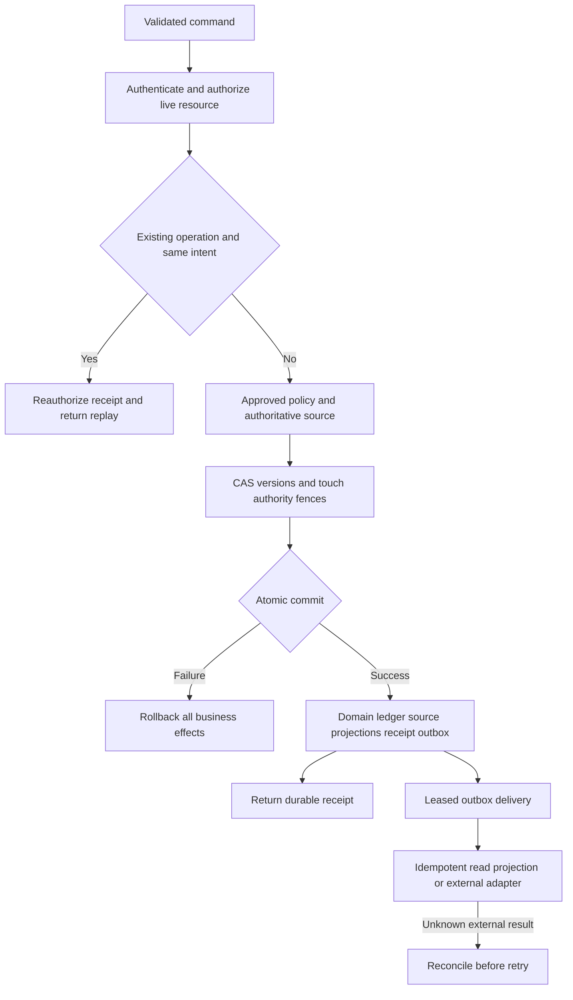

# Feature Pack 2 Shared Platform Contracts and Future Implementation Plan

Date: 2026-11-07. Phase: E master-plan draft. Status: PROPOSED, NOT IMPLEMENTED, NOT PLAN LOCKED.

**Goal:** Give F1-F9 one authority, version, source, accounting, access, time and recovery contract so feature engineers do not build competing systems.
**Architecture:** Feature handlers validate feature-specific evidence and produce plans through a shared coordinator. Authoritative domain changes, invariant projections, semantic source consumption, ledger entries, receipts and outbox records commit atomically; external effects and discovery projections recover asynchronously.
**Tech stack:** Reuse the audited JS/JSX application and existing Board/transport primitives. Storage topology, drivers, provider capabilities and library APIs remain UNVERIFIED. TypeScript-style declarations below specify interfaces, not a decision to migrate the application or install TypeScript.
**Execution gate:** Every implementation/test task below is future and unchecked. Phase E approval permits documents only, not code, tests, builds, installs, migrations, servers, credentials, commits or publication.

## 1. Status, evidence and non-goals

This document is the proposed canonical inline contract for the other E packs. Its proposed modules and endpoints are not claims of existing files or deployed APIs. A feature spec may add a registered command/schema, but must not redefine these types or create another wallet, role authority, Board authority, grading shortcut or payment coordinator. Conflicts require an explicit contract revision and founder decision, not a local exception.

| Evidence read | What it supports | What it does not establish |
|---|---|---|
| [Phase D synthesis](thinking.md) | Shared invariants, F1-F9 scope and provisional corrected constants | Final policy, release membership or measured efficacy |
| [Existing-system audit](01-existing-system-audit.md) | Reusable modules and source-checked authority/lifecycle failures | Runtime readiness, deployed indexes or live topology |
| [Signal/rating reasoning](thinking-signal-ratings.md) | Proposed qualification, rating formula and exclusive claim semantics | Calibrated fairness or real database concurrency |
| [Economy/session reasoning](thinking-economy-sessions.md) | Separate assets, balanced accounting and distinct money shares | Tax, accounting/provider clearance or final refund terms |
| [Studio/motion reasoning](thinking-studio-motion.md) | Acknowledgment ladder, Board purpose, time mapping and accessible completion | Browser support, crash-proof storage or actual device performance |

The agent also read `D:/orbit-main/orbit-main/.agent/STATE.md` to confirm E-only restrictions. Historical documents, cached workbook values, synthetic models and audit reports are not causal learning evidence. No additional app-source read, web research or execution supports this draft. Existing A/U audit hypotheses must be verified before repairs; intentional ephemeral Board deletion is not reclassified as a defect.

Non-goals: choose vendors/brands; finalize legal/safety/money policy; collapse Student, Peer and Mentor; silently migrate existing balances; mount dormant source/model code; invent the missing detailed E/F phase tail; promise bank settlement, trademark clearance, Office recalculation, measured efficacy or device fps.

## 2. Non-negotiable boundaries

1. Client identity selection is a request for a workspace, not a role grant. Authentication, current product identity, staff capabilities, resource ownership/membership, entitlement, consent and source authority are separate server checks.
2. Raw helper/source clients, socket messages, browser payment callbacks, local grading and model output cannot award points, money, ratings, roles, claims, room membership or publication rights.
3. `operationId`, `expectedVersion` and `policyVersion` have exactly these names in every proposed pack. Public routes use `/api/v2/fp2`; durable event names begin `fp2.v1.`.
4. Semantic source uniqueness excludes `operationId`, policy versions, copied artifact IDs and mutable display names. A real best-delta improvement is separately validated, not disguised duplicate issuance.
5. Money is integer minor INR. Session `flowType=SESSION` uses fixed 15%; subscription `flowType=SUBSCRIPTION` uses fixed 20%, with the other 80% assigned to enrolled-course mentors under an approved allocation/base policy. No override, netting shortcut or fee perk changes these constraints.
6. Virtual assets are distinct, nonconvertible and have no cash value or cash-out path. Scores, review credibility, rank, claims and money are different domains.
7. No loot boxes, gambling, bought grades/ratings/rank/claims, coerced attendance/streaks, emotional dependence or minor payment pressure. Core learning, accessibility, support, consent, security and basic export cannot be unfair token advantages.
8. New artifacts, notes and personal progress are private by default. Minors are not publicly ranked by default; unknown age or safety eligibility cannot authorize a public-ranking or recording branch.
9. Unknown required policy, topology, keys, provenance or resource authority fails closed. Production never falls back to mock payment, fake signing, generated permissions or an unvalidated source.
10. Static, reduced-motion, keyboard and sound-off paths complete every operation. Motion never makes an uncommitted state appear successful or blocks consent, cancellation, support, learning or exit.

## 3. Canonical transport and server types

All identifiers are opaque bounded strings; all payloads are allowlist-validated. `UtcInstant` is a server-validated UTC ISO-8601 instant. `Version` is a positive safe integer, starts at 1 and increases by one per committed root-resource mutation. `absent` means authorized creation, not version zero. `IntUnits` is a canonical decimal integer string; arithmetic uses checked integer operations, not binary floating-point amounts. Maximum sizes/amounts require approved configuration.

```ts
type Id = string;
type UtcInstant = string;
type Version = number;
type IntUnits = string;
type Identity = "Student" | "Peer" | "Mentor";
type Capability = string;
type CommandName = string;
type ExpectedVersion = Version | "absent";
type JsonValue = null | boolean | number | string | JsonValue[] | { [key: string]: JsonValue };
type ResourceKind = "account" | "request" | "flare" | "claim" | "course" | "lesson" | "assessment" | "review" | "progression" | "wallet" | "session" | "room" | "board" | "note" | "recording" | "artifact" | "consent" | "case" | "cycle";
type ResourceRef = Readonly<{ kind: ResourceKind; id: Id }>;
type PolicyScope = "identitySafety" | "sourceProvenance" | "grading" | "progression" | "virtualEconomy" | "money" | "recordingConsent" | "retention" | "publicVisibility" | "board" | "media" | "delivery";
type PolicyGate<T> =
  | Readonly<{ state: "unknown"; decisionIds: Id[]; blockedActions: CommandName[] }>
  | Readonly<{ state: "proposed"; value: T; policyVersion: Id; decisionIds: Id[] }>
  | Readonly<{ state: "approved"; value: T; policyVersion: Id; approvalId: Id; evidenceIds: Id[]; validFrom: UtcInstant }>
  | Readonly<{ state: "suspended"; policyVersion: Id; decisionIds: Id[]; reasonCode: string }>;
type ActorContext = Readonly<{
  actorId: Id; accountId: Id; authSessionId: Id; sessionGeneration: Id;
  activeIdentity: Identity; identities: readonly Identity[]; capabilities: readonly Capability[];
  authzEpoch: Version; sessionExpiresAt: UtcInstant; requestId: Id; serverNow: UtcInstant;
}>;
type CommandEnvelope<T> = Readonly<{
  operationId: Id; expectedVersion: ExpectedVersion; policyVersion: Id;
  resource: ResourceRef; payload: T;
}>;
type Receipt<R> = Readonly<{
  receiptId: Id; operationId: Id; commandName: CommandName; resource: ResourceRef;
  outcome: "committed" | "no_change"; policyVersion: Id; resourceVersion: Version;
  affectedVersions: readonly { resource: ResourceRef; version: Version }[];
  committedAt: UtcInstant; result: R; eventIds: readonly Id[]; duplicateOfReceiptId: Id | null;
}>;
type ProblemCode = "AUTH_REQUIRED" | "RESOURCE_NOT_AVAILABLE" | "INPUT_INVALID" | "COMMAND_UNSUPPORTED" | "VERSION_CONFLICT" | "OPERATION_CONFLICT" | "POLICY_BLOCKED" | "SOURCE_BLOCKED" | "INSUFFICIENT_AVAILABLE" | "CAPACITY_CONFLICT" | "CONSENT_REQUIRED" | "GRANT_EXPIRED" | "TEMPORARILY_UNAVAILABLE";
type Problem = Readonly<{
  code: ProblemCode; requestId: Id; retryable: boolean; message: string;
  decisionIds: readonly Id[]; currentVersion?: Version;
}>;
type CommandResult<R> =
  | Readonly<{ kind: "receipt"; receipt: Receipt<R>; replayed: boolean }>
  | Readonly<{ kind: "processing"; operationId: Id; retryAfterSeconds: number }>
  | Readonly<{ kind: "problem"; problem: Problem }>;
```

`ActorContext` is constructed only by the server from a verified session and current authority records. Never deserialize it from the body or trust its capability snapshot without a live fence check. Unknown capabilities/commands/schemas are rejected; a string type does not mean arbitrary names are accepted. Staff capability does not become a product identity. Feature payloads cannot contain trusted `role`, `amount`, `verified`, `approved`, `graderId`, authoritative timestamps or ledger accounts; attempted authority fields produce `INPUT_INVALID`.

Policy version identifies an immutable approved bundle resolving every scope needed by that command. It is not a deduplication key, client-controlled experiment arm or permission to apply an older suspended policy. A proposed value may drive clearly labeled planning previews only, never an authoritative award, public release or charge. A missing tax, retention duration or fee rule is a blocked typed state, not a guessed zero or null silently treated as permission.

## 4. Actors, capabilities and revocation

| Actor | Proposed capability examples | Required additional checks | Explicit denial |
|---|---|---|---|
| Any authenticated member | `context.read.own`, `receipt.read.own`, `case.create.own` | Account/session isolation; current entitlement for resource detail | Other accounts' receipts, drafts or private projections |
| Student | `assessment.attempt.submit`, `note.edit.own`, `review.submit.eligible`, `session.book.own` | Enrollment, approved assessment/review/session eligibility, resource version | Self-grading, arbitrary XP, mentor publication or public minor ranking |
| Peer | `peer.connection.respond`, `peer.room.join.member`, `board.edit.member` | Authorized connection and live room/document membership | Generic socket join, client-created verified call history or Student reward alias |
| Mentor | `studio.edit.own`, `claim.accept.offered`, `course.publish.candidate`, `session.availability.edit.own` | Current role, offer/capacity, ownership/rights, publication review, session terms | Role alone does not verify expertise, grant a claim or clear child safeguards |
| Appointed assessment/content reviewer | `assessment.grade.assigned`, `publication.review.assigned` | Explicit appointment, conflict policy, source/rubric/version | Unassigned course editing or private student note access |
| Support/moderation | `case.read.assigned`, `moderation.decide.assigned` | Case purpose and field-level grant; appeal/audit policy | General financial, contact, private grade or recording access |
| Finance operator | `money.reconcile.assigned`, `money.resolve.assigned` | Approved fund-position remedy and dual-control rules where required | Arbitrary share overrides or treating queued instructions as paid |
| Registered service | `source.validate.<kind>`, `ledger.commit.planned`, `outbox.deliver.<channel>` | Narrow workload identity, producer registry, approved keys/topology/policy | Browser/helper/model events masquerading as service authority |

Every authorizing command compares live account `authzEpoch`, membership version, consent version and resource version. Role loss, suspension, membership removal, account switch or consent withdrawal revokes matching grants. Revocation writes the same authority-fence records that commands conditionally touch inside their transaction; a merely read stale ACL snapshot is insufficient. The transaction adapter must prove the write-conflict/CAS ordering in DEC-E-C01.

A command that linearizes before a concurrent revocation may commit under its then-valid grant; a command after revocation cannot commit under the old epoch. Outbox-driven socket eviction is supplemental: ingress already denies stale grants even before disconnect delivery. If live authority cannot be checked, protected writes stop. Read authorization is rechecked before responding; already delivered bytes cannot be recalled. External media-token revocation latency must be validated/approved, never advertised as instantaneous without enforceable mediation.

Role loss does not erase existing money liabilities, case rights or an independently valid learner entitlement. Recovery services resolve already committed obligations under narrow authority; they do not reactivate the user's revoked content or room permissions. Receipt lookup exposes only the currently permitted result fields, even for a historically valid operation.

## 5. Version, command and idempotency algorithm

1. Authenticate and construct server context; validate bounded route, envelope and registered payload schema. Bind the selected identity to current account identities.
2. Authorize resource discovery before exposing existence, current version, source, receipt or validation detail. Check the required live capability/ownership/membership fences.
3. Canonicalize the validated intent and hash `(actorId, activeIdentity, commandName, resource, expectedVersion, policyVersion, payload)`. Reject duplicate JSON keys, nonfinite numbers and unrecognized authority fields before hashing.
4. Look up unique `(actorId, operationId)`. Same hash plus current permitted receipt access returns the durable original receipt with `replayed=true`; no new mutation/event/ceremony. Different hash returns `OPERATION_CONFLICT`. Another actor cannot enumerate the operation.
5. A durable operation lease may reserve processing, but is never a completion marker. An unexpired live lease returns `processing`; an expired lease can be recovered after inspecting actual committed receipt/provider state.
6. For a new execution, resolve the command's approved policy bundle, current authority and authoritative sources inside the transaction. CAS the root against `expectedVersion`; creation requires `absent` plus explicit parent/create authority.
7. Validate source lineage, source-cycle assignment, semantic uniqueness, best-delta comparability, balances, per-category/period/balance caps, claim capacity, room/consent and every affected version. All relevant fences/uniques participate in the same transaction.
8. Commit all domain changes, both/all ledger legs, invariant projections, source consumption, terminal receipt, operation completion and outbox rows together. Otherwise roll back all business effects. Never mark completion before ledger/source writes.
9. Return the durable receipt. Downstream delivery/projection processing is separately recoverable. A lost HTTP response is resolved by the same operation ID, not by issuing another payment/grant.

`no_change` has no new credit, claim, payout instruction or reward notification. A different operation ID for an already consumed source gets its own authorized `no_change` receipt referencing the original result, with newly applied units zero. Original-operation replay returns the original result without reapplying it. A genuinely improved validated best-delta transition can commit a new benefit; it does not rewrite old receipts.

`VERSION_CONFLICT` is 409 only after authorization and includes the current root version; the client must refresh and explicitly rebase, not auto-retry an overwrite. Read-time rollover cannot mutate a cycle or whole wallet. Cycle adjudication is a registered authoritative command with its own semantic cycle key. GET endpoints are side-effect-free.

Blocked/rejected preflight requests return a `Problem`, not a success receipt. If approved retention permits a rejected-operation record, it contains minimal metadata; if that retention policy is unknown, do not persist sensitive rejected payloads. A corrected intent needs a new operation ID. This does not bypass a source already consumed by a previous successful operation.

## 6. Persistence and mandatory indexes

Every row has a bounded ID, server timestamps and schema version. Private content is separated from allowlisted control metadata. Index and atomicity behavior must be verified against the chosen storage/topology before any feature relies on it; definitions below are requirements, not an applied migration.

| Proposed record | Load-bearing fields | Required uniqueness/index | Lifetime/authority |
|---|---|---|---|
| Resource | `kind`, `id`, `version`, `ownerId`, `visibility`, `state`, `policyVersion` | Unique `(kind,id)`; owner/state lookup | Canonical object ACL; child access checks parent |
| AuthzFence | `subjectId`, `scopeRef`, `authzEpoch`, `serial`, `state` | Unique `(subjectId,scopeRef)` | Revocation and commands conflict on this row |
| Operation | `actorId`, `operationId`, `intentHash`, `state`, `leaseOwner`, `leaseUntil`, `receiptId` | Unique `(actorId,operationId)`; state/lease lookup | Lease expiry is recovery eligibility, not deletion/completion |
| Receipt | Typed receipt fields plus authorized result reference | Unique `(actorId,operationId)`; unique receipt ID | Immutable successful result; retained/redacted by approved policy |
| SourceRegistry | `sourceId`, `producerId`, `rootOriginId`, `equivalenceFamilyId`, `sourceVersion`, `evidenceRef`, `state`, `committedAt`, `sourceCycleId` | Unique producer/source identity; indexed origin/equivalence | Authoritative provenance, not client origin declarations |
| SourceConsumption | `basisKey`, `benefitFamily`, `ownerId`, `identity`, `creditedBest`, `basisSequence`, `sourceCycleId`, `originalGrantId` | Unique `basisKey`; unique `(basisKey,basisSequence)` in grant history | Stable dedup across copies/policies/operation IDs |
| LedgerTransaction | `txnId`, `assetId`, `semanticTxnKey`, `flowType`, `state`, `reversesTxnId`, `policyVersion` | Unique `txnId`; unique `(assetId,semanticTxnKey)` | Posted rows immutable; linked additive reversals |
| LedgerEntry | `txnId`, `legOrdinal`, `accountId`, `side`, `amount` | Unique `(txnId,legOrdinal)`; account/history lookup | All transaction legs committed together |
| AssetAccount | `assetId`, `ownerType`, `ownerId`, `bucket`, `normalSide`, `balance`, `version` | Unique `(assetId,ownerType,ownerId,bucket)` | Authoritative balance/reservation projection in ledger transaction |
| ClaimCapacity | `mentorId`, `activeClaimId`, `version`, `state` | Unique mentor; unique active opportunity/claim constraint | Cross-request capacity and exclusive claim commit together |
| Outbox | Event envelope, `state`, `attemptCount`, `leaseUntil`, `lastErrorCode` | Unique `eventId`; unique resource/sequence/type; pending/lease index | At-least-once delivery, not distributed exactly-once |
| ProviderInbox | `providerId`, `providerEventId`, `verifiedPayloadRef`, `businessSourceKey`, `state`, `leaseUntil` | Unique `(providerId,providerEventId)`; state/lease lookup | Receipt dedup is separate from recoverable business processing |
| ConsumerCheckpoint | `consumerId`, `eventId`, `resource`, `lastSequence` | Unique `(consumerId,eventId)`; consumer/resource lookup | Projection effect and checkpoint atomic together |
| ReadProjection | `projectionName`, `resource`, `sourceVersion`, `authScope`, `schemaVersion`, `data` | Unique projection/resource/auth-scope; source-version index | Rebuildable, never authorization or spend authority |
| RoomMembership | `roomId`, `actorId`, `membershipVersion`, `state`, `purpose`, `expiresAt` | Unique current `(roomId,actorId)`; room/state lookup | Membership owner/revocation command controls lifetime |
| Consent | `resource`, `purpose`, `participantId`, `consentVersion`, `choice`, `policyVersion`, `effectiveAt` | Unique resource/purpose/participant/version; current pointer | Immutable choices plus current revocable scope |
| BoardDocument/Grant | Document mode/revision/schema/policy; grant subject/document/epochs/permissions/expiry | Unique document; unique grant ID; subject/document/expiry index | Purpose-specific retention, no generic-room bypass |
| TimeMap/Anchor | Map source/edit versions/spans/status; anchor owner/source/time | Unique map/edit version; unique anchor ID; owner/source index | Immutable source anchors; derived mappings are rebuildable |
| PolicyBundle | `policyVersion`, scoped gates, approval/evidence references, state | Unique policy version; current approved pointer per scope | Immutable values; explicit suspension/replacement |

Do not TTL-delete receipts/source markers merely to reduce storage: doing so can permit duplicate grants after retry or policy change. Approve minimal nonreversible/opaque dedup markers and key lifecycle in DEC-E-C02/C07/C12, separately from deletable personal content. If lawful retention/deletion cannot preserve a required dedup boundary, block further issuance for that basis until a reviewed resolution exists; do not invent permanent retention or silently forget history. A legal hold requires documented authority, purpose, access and expiry/review, not an unrestricted staff flag.

## 7. Semantic grants and authoritative grading

```ts
type BenefitFamily = "student.mastery" | "student.wallet" | "mentor.quality" | "mentor.wallet" | "peer.wallet" | "badge.achievement";
type SourceRecord = Readonly<{
  sourceId: Id; producerId: Id; rootOriginId: Id; equivalenceFamilyId: Id; sourceVersion: Version;
  subjectId: Id; eligibleBenefitFamilies: readonly BenefitFamily[]; evidenceRef: ResourceRef;
  state: "accepted" | "quarantined" | "revoked"; committedAt: UtcInstant; sourceCycleId: Id;
}>;
type GradeEvidence = Readonly<{
  sourceId: Id; assessmentFamilyId: Id; attemptId: Id; learnerId: Id; course: ResourceRef;
  rubricVersion: Id; normalizedScore: number; graderRef: Id; committedAt: UtcInstant;
}>;
type GrantRequest = Readonly<{ sourceId: Id; benefitFamily: BenefitFamily; recipient: { accountId: Id; identity: Identity }; target: ResourceRef }>;
type ProjectionMutation = Readonly<{ resource: ResourceRef; expectedVersion: ExpectedVersion; newVersion: Version; changes: JsonValue }>;
type SemanticGrantPlan = Readonly<{
  basisKey: Id; sourceId: Id; basisSequence: Version; benefitFamily: BenefitFamily; sourceCycleId: Id;
  requestedUnits: IntUnits; issuedUnits: IntUnits; unissuedUnits: IntUnits;
  bestBefore: number | null; bestAfter: number | null; ledgerPlans: readonly LedgerPlan[];
  projectionMutations: readonly ProjectionMutation[];
}>;
```

`basisKey = digest(canonical(domain, recipientAccountId, recipientIdentity, stableBenefitFamily, authoritativeEquivalenceFamilyId))`. Domain and benefit family are fixed registry entries; policy version, operation ID, course/artifact copy ID and display name are deliberately absent. Digest encoding/key lifecycle is approved under DEC-E-C02/C07; implementations cannot choose incompatible encodings. Source IDs and origin declarations submitted by a client are lookup hints, never accepted evidence by themselves.

A copied assessment/artifact inherits the server-established origin/equivalence family for the same benefit. Exact-content fingerprints are only one provenance check and do not prove detection of paraphrased or hidden copies. Unknown lineage is quarantined and blocks issuance; a reviewed genuinely distinct learning outcome can receive a new family, but creating another artifact or changing policy cannot do so. Source permissions, ownership and rights are validated separately from dedup.

For comparable validated Student outcomes, `delta = max(0, newNormalizedBest - creditedBest)`. A previously credited 15 improved to 18 earns exactly 3; repeating 18 or submitting 15 again earns 0. A new attempt ID alone cannot make the first 15 earn again. Lock/CAS the shared assessment-family basis before deriving its next sequence. A changed rubric must carry approved comparability evidence; otherwise return `SOURCE_BLOCKED`, not a new reward family by default.

The F4 grader owns one versioned chance/difficulty normalization rule and its calibration inputs; consumers must not implement another equation. `GradeEvidence.normalizedScore` is a bounded nonnegative safe integer produced by the registered authoritative grader after answer-key/rubric/entitlement checks, not a client flag or local quiz result. The approved normalization registry must pin score-unit scale, range and rounding before producing this integer; a rational/raw score without that approved conversion is blocked, not implicitly floored or converted by a wallet consumer. The registry links that normalization to the approved rubric-comparability version; existing credited-best values cannot be reinterpreted on a new scale by changing policy IDs. Missing normalization policy/calibration blocks this new reward branch under DEC-E-C05. Grading corrections/appeals create linked evidence revisions and reviewed corrections; they do not silently overwrite historical mastery or debit a child's wallet.

The approved source registry selects allowed benefit families. One account having several identities does not permit the same event to mint into all wallets; each recipient identity/family needs explicit authorized source eligibility. Distinct legitimate benefits may reference one source only under an approved registry rule. Source committed time fixes its cycle; a retry, copied artifact or client clock cannot move an old benefit into a fresh weekly cap.

Cap checks and issuance happen in the same transaction as source consumption. Record requested/issued/unissued units honestly. An award clipped by a cap creates no token debt and cannot be reissued next week by replay; a later independent improvement may earn only its validated new delta. Score, currency and badge projections remain separate even when they consume related evidence.

## 8. Integer ledgers and separate money contracts

```ts
type AssetId = "INR" | "VIRTUAL_STUDENT" | "VIRTUAL_PEER" | "VIRTUAL_MENTOR";
type CashFlowType = "SESSION" | "SUBSCRIPTION";
type LedgerLeg = Readonly<{ accountId: Id; side: "debit" | "credit"; amount: IntUnits }>;
type LedgerPlan = Readonly<{
  txnId: Id; assetId: AssetId; semanticTxnKey: Id;
  flowType: CashFlowType | "VIRTUAL"; legs: readonly LedgerLeg[];
  reversesTxnId: Id | null; accountingPolicyVersion: Id;
}>;
type MoneyBasis = Readonly<{
  flowType: CashFlowType; currency: "INR"; recognizedBasisMinor: IntUnits;
  basisPolicyVersion: Id; termsSnapshotId: Id; providerSourceId: Id;
}>;
type MoneySplit = Readonly<{
  flowType: CashFlowType; basisMinor: IntUnits; platformMinor: IntUnits;
  mentorPoolMinor: IntUnits; allocationPolicyVersion: Id | null;
}>;
```

Technical virtual IDs above are PROPOSED identifiers, not approved visible currency names. No cross-asset transaction or conversion route exists. Money plans require `assetId=INR` with SESSION/SUBSCRIPTION; virtual plans require their matching virtual asset and `flowType=VIRTUAL`. Ratings/rank/progression points are not spendable asset accounts.

For every posted transaction, one asset/precision applies and `sum(debits) = sum(credits)`. Each positive leg is a validated integer; reject fractions, negative values, zero-effect transfers, same-account transfers and unknown accounts. User virtual available balances cannot be negative. Issuance has a matching system issuance leg; an optional sink has a matching sink leg. Reservations move available to reserved in a balanced transaction; posting, voiding and expiry are exclusive resolutions. Financial account classes/normal sides and permissible system balances require the approved accounting map, not a guessed liability model.

For nonnegative integer approved basis `B`, proposed deterministic HALF_UP rounding is:
`platformSESSION = floor((15*B + 50)/100)`; `platformSUBSCRIPTION = floor((20*B + 50)/100)`; `mentorPool = B - platform`.
The fixed percentages are constraints; rounding, recognized base, tax/withholding, fees, partial refunds and reserve policy remain DEC-E-C06 decisions. Multiplication/division must be checked integer arithmetic. Do not apply a familiar statutory rate, subtract unknown costs as zero, use whole-INR rounding or let the client choose the base.

A SESSION basis of 50,000 minor INR gives platform 7,500 and mentor gross obligation 42,500. A 101-minor precision vector gives 15 and 86; it is not an approved minimum checkout. A SUBSCRIPTION basis of 100,000 gives platform 20,000 and mentor pool 80,000. Provider fees/cost entries are separate under approved policy and cannot silently change 15%/20% or become purchased advantages.

Subscription allocation is blocked until the enrolled-course beneficiary/base/refund policy is approved. Proposed equal-enrolled-course allocation, only as a candidate: sort stable eligible course IDs, assign `floor(pool/courseCount)` to each, then one remaining minor unit to the first remainder courses; aggregate each mentor's courses afterward. For pool 80,000 and eligible A/B/C, A=26,667, B=26,667, C=26,666; a mentor owning A and B receives 53,334. Equal-unique-mentor or weighted allocation is a different decision, not an interchangeable implementation. Zero eligible courses leaves an explicit unresolved/suspense pool under the approved accounting map; it never silently becomes platform revenue.

Money states distinguish captured, confirmed booking, completion review, mentor payable, payout instructed and provider-confirmed paid. A payout ledger intent is not a bank transfer. An expired hold with capture becomes paid-pending-resolution; it cannot buy a conflicting slot. Fund-position-aware refunds/chargebacks create linked balanced transactions and a recoverable provider instruction. Never mark refunded/paid/released merely because a queue accepted work.

Unspent virtual reversals are additive and linked once to the original grant. If already spent, create a restricted correction/appeal case under approved policy; do not silently make the user negative, invent debt collection or claw back a minor. Financial corrections after payable/paid need approved funding/recovery decisions, not the same virtual-wallet shortcut.

## 9. Atomic coordination, external recovery and reconciliation

```ts
type Tx = Readonly<{ opaqueTransactionHandle: unique symbol }>;
type AuthorityFenceRef = Readonly<{ subjectId: Id; scope: ResourceRef; expectedEpoch: Version }>;
type AtomicPlan<R> = Readonly<{
  resource: ResourceRef; expectedVersion: ExpectedVersion; resourceNextState: JsonValue;
  authorityFences: readonly AuthorityFenceRef[]; sourceGrants: readonly SemanticGrantPlan[];
  ledgerPlans: readonly LedgerPlan[]; invariantProjections: readonly ProjectionMutation[];
  receiptResult: R; outbox: readonly EventEnvelope<JsonValue>[];
}>;
interface AtomicStore {
  runAtomic<T>(work: (tx: Tx) => Promise<T>): Promise<T>;
}
```

`Tx` is coordinator-owned and cannot arrive through transport. The adapter must provide a real multi-record all-or-nothing commit, unique constraints, conditional version writes, conflicting authority fences and approved durability. `runAtomic` is a proposed adapter contract, not a claim about a vendor SDK method. Missing topology/index/durability evidence returns `TEMPORARILY_UNAVAILABLE`/`POLICY_BLOCKED`; sequential row writes, compensating a half-post after claiming success, or in-memory locks do not satisfy this contract.

| Failure boundary | Persisted truth | Required recovery |
|---|---|---|
| Crash before atomic commit | No business change or terminal receipt | Recover lease; revalidate current policy/authority/source; retry safely |
| Crash during ledger/source/projection write | Entire transaction rolled back | No half-credit, orphan claim or false completed state |
| Commit succeeded, HTTP response lost | Complete receipt/domain/source/ledger/outbox | Same operation returns original permitted receipt |
| Commit succeeded, notification/index worker failed | Authoritative result remains committed; outbox pending | Retry downstream with consumer idempotency; do not undo claim or say delivered |
| Webhook inbox saved, business handler failed | Inbox RECEIVED/PROCESSING or retryable failure, not business completion | Expired lease/retry re-enters effect handling |
| Provider instruction sent, acknowledgment unknown | Local instruction identity plus UNKNOWN_RESULT | Query/reconcile provider by stable identity before another send |
| Provider capture after expired slot | Authenticated captured funds evidence; no valid booking | Restricted paid-pending-resolution workflow; no double booking or invented refund terms |
| Posted history/projection mismatch | Posted history is authoritative | Quarantine affected spending/resolution, reconcile and rebuild with checkpoint |

Provider ingress verifies signature, replay bounds, provider identity and actual business-source fields using approved keys/config. Raw payload handling/retention must be approved. Unique provider event IDs suppress duplicate inbox insertion only; they must not suppress recovery of an unfinished business handler. Distinct webhook IDs describing the same capture still deduplicate on the stable capture business source.

Inbox effect processing commits its effect, ledger/source/projection/receipt/outbox and PROCESSED marker atomically. Leases are reclaimable; poison/schema-invalid evidence is quarantined with a restricted case, not acknowledged as paid. No production mock path exists. A sandbox is an explicitly isolated nonproduction adapter with no production assets, memberships or grants.

External payout/refund/upload/delivery instructions use stable business-derived idempotency keys and durable outbox identity. If a provider cannot demonstrate idempotency plus query/reconciliation for unknown results, that adapter cannot launch the corresponding money flow. Never blindly resubmit an UNKNOWN_RESULT payout. Outbox delivery acknowledgments describe channel/provider acceptance only, not learner receipt, course publication, bank settlement or efficacy.

Reconciliation compares provider statements against business sources, posted ledger history, invariant balances, booking/claim states, receipts and pending external instructions. Every difference creates an assigned restricted case with amount/source/state and next permitted action; it does not auto-write unexplained adjustments. Rebuilding a projection is checkpointed and cannot rewrite ledger history. Reconciliation cadence, operator staffing, escalation and privacy are blocked decisions, not an assumed unattended job.

## 10. Event envelope and projections

```ts
type EventName = `fp2.v1.${string}`;
type EventEnvelope<T> = Readonly<{
  eventId: Id; eventName: EventName; schemaVersion: 1;
  operationId: Id; policyVersion: Id; resource: ResourceRef;
  resourceVersion: Version; aggregateSequence: Version; occurredAt: UtcInstant;
  causationEventId: Id | null; payload: T;
}>;
type ProjectionView = Readonly<{
  resource: ResourceRef; schemaVersion: Version; sourceVersion: Version;
  consistency: "current" | "lagging"; generatedAt: UtcInstant; data: JsonValue;
}>;
type AccountScope = Readonly<{
  accountId: Id; sessionGeneration: Id; activeIdentity: Identity;
  authzEpoch: Version; policyVersion: Id;
}>;
```

Registered events include `fp2.v1.source.granted`, `fp2.v1.grade.committed`, `fp2.v1.review.changed`, `fp2.v1.claim.committed`, `fp2.v1.ledger.posted`, `fp2.v1.cycle.adjudicated`, `fp2.v1.board.revision.committed`, `fp2.v1.room.grant.revoked`, `fp2.v1.consent.changed`, `fp2.v1.artifact.map.changed`, `fp2.v1.publication.changed`, `fp2.v1.notification.requested` and `fp2.v1.account.authz.changed`. Feature schemas must register bounded allowlisted payloads; unregistered suffixes are invalid despite the template-string type.

Each root aggregate has monotonically ordered `aggregateSequence`; no global event ordering is promised. A ledger's source/receipt links identify cross-resource effects. Delivery is at-least-once. Consumers apply an event and their unique `(consumerId,eventId)` checkpoint atomically. Old/duplicate events cannot replace a newer projection. Sequence gaps trigger fetch/rebuild; no speculative balance, rank, room grant or completion is derived from a socket payload.

Version 1 permits compatible optional fields only after schema registration. Required-field/meaning changes need an explicit new event contract and migration/consumer compatibility plan; do not reinterpret old `fp2.v1.` data. Replay uses the recorded approved decision, not today's weights or current model answer. Correction events link the superseded evidence and recalculate only permitted projections.

Invariant projections needed for balance, reservations, source best/caps, claim capacity and consent/membership are transactional. Discovery, dashboards, review histograms and notifications are rebuildable read projections and may lag. `minVersion` requests return a current view or a bounded lagging/processing response; they never treat stale data as spending or authorization authority. Public projections are explicit allowlists, never joined full User records or private-note/grade/media objects.

Cache keys include `(accountId,sessionGeneration,activeIdentity,authzEpoch,policyVersion,projectionName,resource,sourceVersion)`. Anonymous/public caches are separate allowlisted data and contain no private resource references. Login/logout/account/identity/epoch changes abort in-flight work, disconnect/unsubscribe scoped socket/push listeners and clear the previous account's in-memory/query/private local scope before mounting the next. A delayed response must match the active generation before it can populate a cache or UI. Broadcast/tab coordination must enforce the same boundary.

Private offline persistence is not enabled until device/shared-device disclosure, encryption/key lifecycle, logout deletion and retention are approved/tested. Do not promise offline availability from an IndexedDB entry or retain another account's note/media after switch. Functional core export/support remains available under normal security/rights rules, never conditional on tokens.

## 11. Consent, purpose, room and Board grants

```ts
type BoardMode = "EPHEMERAL_CALL" | "PERSISTENT_STUDIO" | "COURSE_PUBLISHED";
type BoardPermission = "read" | "edit" | "export";
type BoardGrantRequest = Readonly<{ document: ResourceRef; purpose: string; requestedPermissions: readonly BoardPermission[] }>;
type BoardGrant = Readonly<{
  grantId: Id; document: ResourceRef; mode: BoardMode; purpose: string; actorId: Id;
  sessionGeneration: Id; authzEpoch: Version; membershipVersion: Version;
  consentVersion: Version | null; documentVersion: Version;
  permissions: readonly BoardPermission[]; policyVersion: Id;
  issuedAt: UtcInstant; expiresAt: UtcInstant;
}>;
type BoardCommandPayload = Readonly<{ grantId: Id; schemaId: Id; entityOperationKey: Id; patch: JsonValue }>;
type BoardApplyResult = Readonly<{ document: ResourceRef; documentVersion: Version; snapshotRef: ResourceRef; appliedEntityOperationKey: Id }>;
type ConsentChoice = Readonly<{ purpose: string; scopeVersion: Version; choice: "grant" | "deny" }>;
type ConsentWithdrawal = Readonly<{ purpose: string; scopeVersion: Version }>;
```

Consent scopes identify every participant, purpose, recording source, visibility, retention and policy version. All required participants must grant the same current scope before recording starts. A new purpose/scope/version requires new explicit choices; silence, booking payment, mentor role, an education label or an enabled camera is not recording consent. Consent records have field/purpose grants and withdrawal/appeal paths; unknown participant/guardian/safety requirements block the new recording branch. Calls remain usable without recording.

Withdrawal immediately disables capture in the consenting UI, revokes server recording permits and fences further authorized recording append/publication. Disconnected clients cannot continue a shared recording under an unverifiable live permit. Previously captured/uploaded authorized bytes follow the approved prior-content/deletion/hold policy; withdrawal is not a promise to delete all evidence instantly. Server times/fences and validated media intervals govern races, not a caller's claimed timestamp. Unapproved retention/purpose means no new recording persistence.

Register `consent.recording.withdraw` as a deny-only safety command: authenticate the account, authorize ownership of the participant's consent scope, and commit the revocation fence under the approved minimal security/retention purpose even if the recording-use policy is suspended. It must not require a live Mentor role, all-party re-consent or continued recording-use approval, and it cannot grant any capability or modify another participant's choice. If that minimal retention or storage/fence authority is unavailable, the client still stops locally; new server recording/renewal/ingest remains fail-closed, and durable/remote confirmation is explicitly unavailable rather than fabricated. A nonrecording call remains usable only where its independent booking/participant/age/safety eligibility is already valid; an unknown required guardian or session-eligibility policy still blocks that affected session, not the user's local stop control.

Room join, signaling, Board edit, snapshot read, export, cleanup and recording ingest all check the same live membership/purpose/epoch. An opaque grant is a revocable registry reference, not an eternal bearer credential. Generic call/video socket handlers and client-created room/history records cannot bypass it. Session room authority also requires a confirmed usable booking and participant capability; a default lobby or URL parameter supplies no entitlement.

EPHEMERAL_CALL preserves the deliberate call-end/expiry purpose; PERSISTENT_STUDIO requires explicit retained-artifact purpose/retention; COURSE_PUBLISHED requires approved publication/media rights and learner entitlement. Creating a durable studio mode does not retain all Peer/mentor call Boards indefinitely. Export copies require their own rights/purpose and retain source provenance; privacy is not removed by changing mode.

V1 Board editing is serialized by the document revision and registered patch schema. `expectedVersion` is the Board revision; grant `documentVersion` is issuance information, not an enduring edit lock. Concurrent losers refresh the authorized snapshot and explicitly rebase or present conflict. `(document,entityOperationKey)` deduplicates repeated semantic insertions; editing an existing entity requires its registered version/operation semantics. Unknown patch schemas, image refs or replay clocks fail closed. All three surfaces use this authority and snapshot adapter, not separate mutation stores.

V2 may adopt a proven operation/CRDT adapter, but only with an explicit schema/reconnect/migration decision preserving grants, provenance, dedup, access, exports and recording clocks. The common contract does not claim synchronous existing Board tests prove convergence, stylus fidelity or accessibility.

## 12. Immutable source anchors and output maps

```ts
type TimeAnchor = Readonly<{
  anchorId: Id; ownerId: Id; sourceAsset: ResourceRef; sourceVersion: Version;
  sourceSegmentId: Id; sourceTimeMs: number; kind: "chapter" | "quiz" | "note" | "board" | "caption";
}>;
type TimeSpan = Readonly<{
  occurrenceId: Id; sourceSegmentId: Id; sourceStartMs: number; sourceEndMs: number;
  outputStartMs: number; outputEndMs: number;
}>;
type EditTimeMap = Readonly<{
  mapId: Id; sourceAsset: ResourceRef; sourceVersion: Version; editVersion: Version;
  state: "complete" | "pending"; spans: readonly TimeSpan[];
}>;
type RationalMs = Readonly<{ numerator: IntUnits; denominator: IntUnits }>;
type AnchorMapping =
  | Readonly<{ status: "exact"; editVersion: Version; occurrenceId: Id; outputTimeMs: RationalMs }>
  | Readonly<{ status: "approximate"; editVersion: Version; outputTimeMs: RationalMs; reasonCode: string }>
  | Readonly<{ status: "removed"; editVersion: Version; reasonCode: string }>
  | Readonly<{ status: "unknown"; editVersion: Version; reasonCode: string }>;
```

Source times are bounded nonnegative integer milliseconds from the validated media timeline, never chunk-callback count, wall-clock elapsed time or a guessed post-trim cursor. Source asset/version/segment identity must match the authorized map. Recovery checkpoint, chapter marker and learning checkpoint remain different concepts and IDs.

All intervals are half-open. For a kept span `[a,b)` mapped to `[c,d)`, `o = c + (s-a)*(d-c)/(b-a)`. Use exact integer/rational arithmetic and store reduced numerator/denominator; playback-only rounding is explicit and does not rewrite the source anchor. Reject zero/negative lengths, overlapping output spans, invalid source bounds or version mismatches. V1 supports rate-1 kept spans with one unambiguous occurrence; repeated-source occurrences/rate changes require the approved V2 map contract, not silently selecting the first match.

For kept source `[0,40000)` and `[60000,100000)`, output spans are `[0,40000)` and `[40000,80000)`. Source 70000 maps exactly to 50000/1; source 50000 is removed; source 40000 is removed; source 60000 maps to 40000/1; source 100000 is not inside a kept half-open span. Final output duration is 80000. Never snap a removed quiz/note to a nearby timestamp or auto-regrade under an edit.

A pending/incomplete map returns `unknown`; a validated complete map omitting an in-domain anchor returns `removed`. An approximate mapping must expose its reason and require explicit review where correctness matters. Notes, Board operations, captions and quizzes preserve private source anchors even if a mapping is unavailable; source access revocation returns the nonenumerating resource error before mapping details. Mapping a timestamp does not grant access to its media or publish a checkpoint.

## 13. Proposed public API and error contract

All normal JSON commands use the canonical envelope. Feature-specific command names/payloads/results are registered in their own pack specs under this same coordinator. There is no public arbitrary reward, role, amount, source-verified or ledger-leg endpoint. Provider ingress is a separately authenticated external protocol, not a client command exception.

| Proposed route | Request | Authorized response | Failure contract |
|---|---|---|---|
| `GET /api/v2/fp2/context` | Authenticated session; optional requested workspace | Allowlisted account/identity/capability display plus epoch/generation; not internal session secrets | 401 AUTH_REQUIRED; invalid workspace 400 INPUT_INVALID |
| `POST /api/v2/fp2/commands/{commandName}` | `CommandEnvelope<registered payload>` | 200 durable receipt/no_change; 201 authorized creation receipt; 202 processing with Retry-After | 400 schema/authority fields; 404 unavailable resource; 409 version/operation/capacity; 422 policy/source/consent; 503 unavailable authority/topology |
| `GET /api/v2/fp2/operations/{operationId}` | Session plus owner operation ID | Currently permitted receipt, processing or retained failure metadata | 404 for missing/other-owner/inaccessible operation; no source/actor hints |
| `GET /api/v2/fp2/resources/{kind}/{id}/projection?minVersion={v}` | Authorized ref; optional positive version | `ProjectionView`; 202 if required version is not yet projected | 404 unavailable; 400 invalid version; 503 projection unavailable |
| `POST /api/v2/fp2/commands/board.grant.request` | Envelope of `BoardGrantRequest`; root is Board | Receipt result `BoardGrant` with actual allowed subset | 404 unavailable membership/document; 422 unapproved purpose/retention; no requested role authority |
| `POST /api/v2/fp2/commands/board.patch.apply` | Envelope of `BoardCommandPayload`; root Board revision | Receipt result `BoardApplyResult` | 409 stale revision/entity conflict; 422 invalid live grant/schema; 404 inaccessible document |
| `POST /api/v2/fp2/commands/consent.recording.respond` | Envelope of `ConsentChoice`; root consent scope | Receipt with participant choice/current scope; recording availability derived from all participants | 409 stale scope; 422 policy/safety gate; 404 other participant/scope |
| `POST /api/v2/fp2/commands/consent.recording.withdraw` | Envelope of `ConsentWithdrawal`; root consent scope | Receipt with withdrawal/cutoff and revoked permit references allowed to caller | Same operation replays; denial alone adds no call penalty, but continued nonrecording use requires independently valid booking/participant/age/guardian/safety eligibility; local stop never waits for that eligibility |
| `GET /api/v2/fp2/artifacts/{id}/anchors/{anchorId}?editVersion={v}` | Authorized asset/anchor and positive edit version | `AnchorMapping` | 404 missing/unauthorized/revoked source/anchor; 400 invalid version; unknown mapping is not success placement |
| `POST /api/v2/fp2/providers/{providerId}/webhooks` | Approved provider signature/raw protocol payload; no ActorContext from body | Provider-specific acknowledgment only after durable verified inbox acceptance | Invalid keys/signature/schema never mock-accepted; transient persistence failure remains retryable |

Nonenumerating resources return the same 404 `RESOURCE_NOT_AVAILABLE` with copy `This item is unavailable.` for absent, unauthorized, removed or revoked objects. Validate only envelope shape before resource authorization; detailed payload/current-version/source errors come afterward. Do not leak ownership, participant names, hidden review status, private counts, original media URLs or existence through search, socket errors or operation lookups. Rate limits and timing leakage require explicit future abuse tests; uniform copy alone is not a timing-proof claim.

`Problem.currentVersion` appears only for an authorized VERSION_CONFLICT. Decision IDs are safe internal identifiers, not sensitive case details. Public registry/health output never exposes keys, raw provider payloads, private policy evidence or internal service capabilities. Provider response status/ack rules remain adapter-specific and blocked until verified under DEC-E-C10; this document does not invent a provider API.

Example registered Board request body: `{"operationId":"op-1","expectedVersion":7,"policyVersion":"policy-approved-1","resource":{"kind":"board","id":"board-1"},"payload":{"document":{"kind":"board","id":"board-1"},"purpose":"authorized-call","requestedPermissions":["read","edit"]}}`. The server checks document/root equality, membership and approved purpose; these illustrative IDs confer no permissions.

## 14. Shared transaction flow



| Diagram node | Equivalent operation | Authoritative result |
|---|---|---|
| A-B | Validate transport, authenticate and authorize resource | No business effect yet |
| C-D | Check actor/operation intent and current receipt permission | Original receipt only; no duplicate event |
| E-F | Resolve approved policy/source and CAS/touch fences | Reject stale/revoked/duplicate/ineligible plans |
| G-H | Failed transaction | No partial business state |
| G-I-J | Successful transaction and response | Complete committed or no_change receipt |
| K-L-M | Recoverable delivery/projection/provider work | Delivery status distinct from authoritative business/settlement state |

Diagram is textual Mermaid only, with the equivalent table above; no rendering, palette or visual QA is claimed.

## 15. UX states and motion-independent copy

| State | Plain copy | Required controls/behavior |
|---|---|---|
| Sending/lease processing | `Your request is processing. Check its status before trying again.` | Read same operation; disable duplicate payment/claim, preserve cancel path where permitted |
| Committed mutation | `Saved.` | Display exact committed version/result; no success before receipt |
| Original operation replay | `Your earlier request was saved.` | No second award/celebration or external instruction |
| Duplicate benefit/new operation | `Not awarded: this source has already been credited.` | Show own original receipt reference and newly applied units zero |
| Cap clipping | `Award limited by the current cap.` | Requested/issued/unissued and approved cap period; no token debt or compelled spending |
| Version conflict | `This item changed. Review the latest version before saving.` | Refresh and explicit merge/rebase; preserve unsaved private draft in approved scope |
| Policy/source block | `Policy review is required before this action can continue.` | Safe reason/decision ID, ordinary learning/support path unaffected |
| Resource unavailable | `This item is unavailable.` | No ownership/existence hints; safe navigation/support |
| Revoked Board edit | `Your access changed. Check which changes were saved.` | Stop sending, resolve in-flight operation receipts, discard unauthorized cache/subscription |
| Recording denied/withdrawn | `Recording is off.` | Local stop remains available; show continued nonrecording use only when independent booking/participant/age/guardian/safety eligibility is valid; no forced consent or denial-derived payment penalty |
| Capture without usable booking | `Payment received. Your booking needs resolution.` | Restricted resolution/support, no room grant or false refund confirmation |
| Payout instruction only | `Sent to the provider. Transfer is not confirmed.` | Pending/unknown result and support route, never bank-paid copy |
| Removed time anchor | `That time was removed by this edit.` | Preserve source-linked note/prompt; explicit authorized review, no automatic relocation |
| Lagging projection | `The latest saved change is still updating here.` | Show last source version; do not use stale balance/access for commands |

Static text and focus/status announcements convey every meaning. Proposed ordinary reveals <=180 ms, comparisons <=400 ms, optional skippable ceremonies <=800 ms; sound off by default and independent of motion preference. Reduced-motion cancels spatial/camera/layout movement, not the underlying command. Route interruption/account switch cannot fire stale callbacks. A 60-fps target is not measured acceptance. Local durable save, verified upload, processed-ready and published states use the F6 acknowledgment ladder, not this generic `Saved.` receipt for unsaved bytes.

## 16. Shared future files and exact interfaces

Every path in this section is PROPOSED for later authorized implementation; existence is not established here. No file is created by this draft. Declarations are shared contract notation; frontend receives transport/view types, never an authority constructor or server source/ledger credentials.

| Proposed future file | Responsibility / exact interface |
|---|---|
| `D:/orbit-main/orbit-main/shared/fp2/contracts.d.ts` | Canonical declarations in this document; shared transport types separated from server-only context/Tx types |
| `D:/orbit-main/orbit-main/shared/fp2/schema.js` | `validateEnvelope(input: JsonValue): CommandEnvelope<JsonValue>`; `validateRegisteredPayload(commandName: CommandName, input: JsonValue): JsonValue`; reject unknown authority fields |
| `D:/orbit-main/orbit-main/BackEnd/services/fp2/commandCoordinator.js` | `executeCommand<I,R>(actor: ActorContext, commandName: CommandName, envelope: CommandEnvelope<I>): Promise<CommandResult<R>>`; `commitAtomicPlan<R>(tx: Tx, actor: ActorContext, envelope: CommandEnvelope<JsonValue>, plan: AtomicPlan<R>): Promise<Receipt<R>>` |
| `D:/orbit-main/orbit-main/BackEnd/services/fp2/authority.js` | `requireCapability(tx: Tx, actor: ActorContext, resource: ResourceRef, capability: Capability): Promise<void>`; current fences/membership/ownership, not context snapshot alone |
| `D:/orbit-main/orbit-main/BackEnd/services/fp2/policy.js` | `requireApprovedPolicies(policyVersion: Id, scopes: readonly PolicyScope[], serverNow: UtcInstant): Promise<Readonly<Record<PolicyScope, PolicyGate<JsonValue>>>>`; any required nonapproved gate throws POLICY_BLOCKED |
| `D:/orbit-main/orbit-main/BackEnd/services/fp2/sourceAuthority.js` | `validateAuthoritativeSource(tx: Tx, actor: ActorContext, sourceId: Id, benefitFamily: BenefitFamily): Promise<SourceRecord>`; `planSemanticGrant(tx: Tx, actor: ActorContext, request: GrantRequest): Promise<SemanticGrantPlan>` |
| `D:/orbit-main/orbit-main/BackEnd/services/fp2/ledgerCoordinator.js` | `validateLedgerPlan(tx: Tx, plan: LedgerPlan): Promise<void>`; `splitMoney(basis: MoneyBasis): MoneySplit`; `allocateEqualEnrolledCourses(poolMinor: IntUnits, sortedEligibleCourseIds: readonly Id[]): Readonly<Record<Id, IntUnits>>` only under approved candidate policy |
| `D:/orbit-main/orbit-main/BackEnd/services/fp2/atomicStore.js` | Implements `AtomicStore.runAtomic`; binds real transaction handle, CAS/fences/uniques/durability; no sequential/mock production fallback |
| `D:/orbit-main/orbit-main/BackEnd/services/fp2/outbox.js` | `deliverOutbox(eventId: Id): Promise<"acknowledged" | "retry_pending" | "unknown_result" | "quarantined">`; adapter names and APIs chosen only after DEC-E-C10 |
| `D:/orbit-main/orbit-main/BackEnd/services/fp2/providerInbox.js` | `acceptProviderEvidence(providerId: Id, rawBody: Uint8Array, headers: Readonly<Record<string,string>>): Promise<Id>`; `processProviderInbox(inboxId: Id): Promise<"processed" | "retry_pending" | "quarantined">` |
| `D:/orbit-main/orbit-main/BackEnd/services/fp2/reconciliation.js` | `reconcileBusinessSource(sourceId: Id): Promise<Readonly<{ state: "matched" | "case_opened"; caseId: Id | null }>>`; narrow worker authority and approved retention |
| `D:/orbit-main/orbit-main/BackEnd/services/fp2/projectionService.js` | `getProjection(actor: ActorContext, resource: ResourceRef, minVersion?: Version): Promise<ProjectionView>`; `consumeProjectionEvent(consumerId: Id, event: EventEnvelope<JsonValue>): Promise<void>` |
| `D:/orbit-main/orbit-main/BackEnd/services/fp2/boardAuthority.js` | `issueBoardGrant(tx: Tx, actor: ActorContext, request: BoardGrantRequest): Promise<BoardGrant>`; `applyBoardCommand(tx: Tx, actor: ActorContext, envelope: CommandEnvelope<BoardCommandPayload>): Promise<BoardApplyResult>`; staged effects share coordinator transaction |
| `D:/orbit-main/orbit-main/shared/fp2/timeMap.js` | `mapTimeAnchor(anchor: TimeAnchor, map: EditTimeMap): AnchorMapping`; pure exact map validation, no media-access grant |
| `D:/orbit-main/orbit-main/BackEnd/routes/fp2Routes.js` | Mount registered HTTP handlers under `/api/v2/fp2`; feature commands dispatch through `executeCommand`, not another coordinator |
| `D:/orbit-main/orbit-main/FrontEnd/src/services/fp2Client.js` | `sendCommand<I,R>(commandName: CommandName, envelope: CommandEnvelope<I>): Promise<CommandResult<R>>`; response generation check before cache/display |
| `D:/orbit-main/orbit-main/FrontEnd/src/services/fp2AccountScope.js` | `resetAccountScope(previous: AccountScope | null, next: AccountScope | null): Promise<void>`; abort/clear/disconnect before mounting next scope |

Generic `changes`, `patch`, event payloads and command payloads are validated against registered feature schema IDs; they are not arbitrary document updates. Feature handlers may stage changes using `Tx` but cannot commit independently or perform provider calls inside a database transaction. The coordinator assigns receipt/event identities and checks the complete plan before commit. Source validators use registered authoritative evidence, never server-side replays of a browser's untrusted amount.

Audited reuse: preserve demand records/taxonomy/UI rather than a third request engine; existing rating records/moderation rather than a second public score; Photon art/catalog and separate MoneyLedger concepts rather than whole-wallet overwrites; mounted Recorder/MediaLibrary/Board rather than a replace-all studio; notifications/inbox and canonical dashboards rather than competing surfaces. Specific existing audit-supported paths include `BackEnd/services/signalFlareService.js`, `BackEnd/services/gameologyService.js`, `BackEnd/services/payment/index.js`, `BackEnd/models/MoneyLedger.js`, `FrontEnd/src/pages/mentor/Recorder.jsx`, `FrontEnd/src/whiteboard/board.js` and `FrontEnd/src/whiteboard/sync.js`. Their inclusion is a reuse investigation target, not permission to modify or evidence of compatibility with the proposed interfaces.

## 17. Minimum, V1 and V2 boundaries

- **Minimum shared foundation:** schema registry, server context/live fences, nonenumerating errors, typed policy blocks, account isolation, atomic source/domain/ledger/receipt/outbox coordination, recoverable inbox/outbox and exact source anchors. No pack may bypass missing foundation to ship a visual prototype as authoritative.
- **V1 candidate:** private single-version vertical slices, serialized authorized Board snapshots/patches, rate-1 cut maps, bounded source-authoritative grants, honest lagging projections and static/reduced-motion completion. Paid sessions/subscriptions activate only after their topology, money, safety and provider gates are approved; optional recording remains off unless separately cleared.
- **V2 candidate:** proven collaborative-operation adapter, richer approved edit maps, additional approved sources and provider integrations, measured device/reliability and abuse pilots. These are candidates, not approval of extras, public rankings, gifting, paid perks, AI publication or scope expansion.
- **Never implicit:** asset conversion, cash-out, arbitrary XP endpoint, bought review/rank/claim advantage, permanent call retention, a new identity system or alternate subscription allocation.

## 18. Future numbered tasks and test assertions

All test files below are PROPOSED and not existing claims. In each task, first author the named failing assertions, then implement the stated interface, then execute the targeted tests and review failures under a later implementation approval. No runner command is guessed before manifest/test-runner verification; no commit step is mandatory or authorized here.

- [ ] **Task 1 - Transport and registry.** Files: shared contracts/schema and `D:/orbit-main/orbit-main/BackEnd/tests/fp2Contracts.test.js`. Implement `validateEnvelope`/registered payload validation. Assert `authorityFieldsRejected`, `unknownCommandRejected`, `absentOnlyForAuthorizedCreation`, `canonicalIntentStable` and `sameOperationDifferentIntentConflict` with G01-G03. Future acceptance: all assertions pass under the verified runner.
- [ ] **Task 2 - Context, object ACL and live fences.** Files: authority/policy plus `D:/orbit-main/orbit-main/BackEnd/tests/fp2Authority.integration.test.js`. Implement `requireCapability` and approved-policy resolution. Assert `nonenumeratingResourceResponses`, `identityHintCannotGrantRole`, `revocationOrdersAgainstCommit`, `unknownRetentionBlocksPersistence` and `suspendedPolicyCannotAuthorize` with G04/G05/G15. Include real transaction race tests, not a mocked context snapshot.
- [ ] **Task 3 - Atomic coordinator and adapter.** Files: commandCoordinator/atomicStore plus `D:/orbit-main/orbit-main/BackEnd/tests/fp2Atomic.integration.test.js`. Implement `executeCommand`/`commitAtomicPlan`/`runAtomic`. Inject failure after each staged domain/leg/source/projection/receipt/outbox write and before/after commit. Assert G06/G07: no partial business effects; a committed lost response replays exactly once. Topology/unique-index evidence is a blocking prerequisite.
- [ ] **Task 4 - Semantic source and best-delta grants.** Files: sourceAuthority plus `D:/orbit-main/orbit-main/BackEnd/tests/fp2Source.integration.test.js`. Implement `validateAuthoritativeSource`/`planSemanticGrant`. Assert G08-G11/G23: copies/new policy/new operation cannot reissue; legitimate comparable 15-to-18 earns three; repeat earns zero; incomplete lineage/calibration blocks; caps consume the original fixed source cycle without future token debt.
- [ ] **Task 5 - Ledger precision and separate money flows.** Files: ledgerCoordinator plus `D:/orbit-main/orbit-main/BackEnd/tests/fp2Ledger.integration.test.js`. Implement ledger validation and approved split/allocation. Assert G12-G14/G24: integer conservation, asset/flow separation, 15%/20% fixed, deterministic residuals, unavailable allocation/fee/tax basis blocked, spent virtual reversal held for review rather than negative balance.
- [ ] **Task 6 - Recoverable provider inbox/outbox.** Files: providerInbox/outbox plus `D:/orbit-main/orbit-main/BackEnd/tests/fp2Recovery.integration.test.js`. Implement inbox acceptance/processing and delivery leases. Assert G16-G18: saved webhook receipt cannot suppress failed handler retry, alternate webhook IDs cannot repeat capture, unknown payout result requires reconciliation and production missing keys never mock-accepts.
- [ ] **Task 7 - Reconciliation and event projections.** Files: reconciliation/projectionService plus `D:/orbit-main/orbit-main/BackEnd/tests/fp2Projection.integration.test.js`. Implement event+checkpoint consumption and source reconciliation. Assert G19/G25: duplicate/old/gapped events do not overwrite newer views; mismatches open restricted cases; GET never rolls over or changes authoritative balances; rebuild derives from posted history.
- [ ] **Task 8 - Account/client isolation.** Files: fp2Client/fp2AccountScope plus `D:/orbit-main/orbit-main/FrontEnd/src/services/__tests__/fp2AccountScope.test.js`. Implement `resetAccountScope` and scoped response handling. Assert G20: delayed A response after B login cannot enter B's UI/cache; identity/epoch changes clear previous private scope and socket/push listeners. Test static, sound-off and reduced-motion states without implying real-device acceptance.
- [ ] **Task 9 - Unified room/Board/consent.** Files: boardAuthority/fp2Routes plus `D:/orbit-main/orbit-main/BackEnd/tests/fp2Board.integration.test.js`. Implement registered grant/patch/consent commands against live fences. Assert G05/G15/G21: generic room join is denied, all three Board surfaces share one revision/authority, withdrawal always permits local stop and fences further authorized recording; otherwise independently eligible nonrecording calls remain available, while unknown mandatory guardian/session eligibility blocks the affected session, ephemeral mode never silently becomes persistent.
- [ ] **Task 10 - Exact source/output anchors.** Files: shared timeMap plus `D:/orbit-main/orbit-main/BackEnd/tests/fp2TimeMap.test.js`. Implement `mapTimeAnchor`. Assert G22/G26: source 70 seconds maps to output 50, removed and half-open endpoints stay unavailable, pending/version-mismatched maps never place quizzes, and unsupported repeated/rate-edited maps require the approved V2 contract.
- [ ] **Task 11 - Feature command integration.** Files: registered F1-F9 handlers chosen in their pack specs, fp2Routes and `D:/orbit-main/orbit-main/BackEnd/tests/fp2CrossPack.integration.test.js`. Consume the exact shared interfaces rather than duplicate systems. Assert G27-G30: exclusive cross-request claim capacity, approved cycle/cap math, rating proxy/count separation and privacy/source controls remain intact through full commands. Verify the audited existing source guards before changing them.
- [ ] **Task 12 - Release gate and operator review.** Files: future acceptance fixtures and owner-approved operational configuration, paths selected only after DEC-E-C01/C10/C12. Run all applicable golden cases plus provider/browser/abuse/accessibility/device tests with explicit evidence labels. Fail release for any unapproved required policy, unproven transaction fence, uncontrolled external retry, unsupported retention/safety branch or missing staffing; do not convert synthetic PASS into launch clearance.

## 19. Cross-pack golden vectors

These are specified future assertions, not tests executed during E. Numeric examples reuse D synthetic constants or exact proposed integer formulas; no application, provider, database, Office or device result is claimed.

| ID / input or failure | Expected outcome |
|---|---|
| G01 Client body contains `role=mentor`, `verified=true`, `amount=999999` | 400 INPUT_INVALID; no source, role, balance or payment effect |
| G02 Same actor/operation/validated intent after lost response | Original permitted receipt, `replayed=true`; one grant/claim/provider instruction |
| G03 Same actor/operation but changed payload or policyVersion | 409 OPERATION_CONFLICT; no second intent effect |
| G04 Missing resource vs another member's private resource | Same 404 RESOURCE_NOT_AVAILABLE and safe copy; no version/owner/count detail |
| G05 Role/membership revocation races with Board/claim command | Fence ordering permits only pre-revocation linearized commit; later stale grant cannot commit |
| G06 Inject crash after one ledger leg or source/projection/receipt stage | All business effects absent, or all committed together; never a half-post |
| G07 Crash after commit before HTTP response/outbox acknowledgment | Durable receipt/source/ledger present; retry/outbox recovery cannot duplicate effects |
| G08 Same semantic source, new operationId and new approved policyVersion | Newly applied benefit zero; original source identity remains consumed |
| G09 Copied artifact with new artifact/course ID but same authoritative family | No repeat benefit within that recipient/family; preserved provenance; unknown copy lineage blocks |
| G10 Comparable normalized best 15 -> 18 -> 18 -> 15 | Applied deltas 3, 0, 0; credited best remains 18 |
| G11 New rubric/attempt lacking approved comparison or grader provenance | SOURCE_BLOCKED; no trusted grade/reward from raw helper/model output |
| G12 SESSION approved basis 50,000; separate SUBSCRIPTION 100,000 minor INR | Session platform/mentor 7,500/42,500; subscription platform/pool 20,000/80,000; no mixed rates |
| G13 SESSION basis 101 minor under proposed HALF_UP rule | Platform 15, mentor 86, total 101; not approval of this checkout price |
| G14 Approved equal-course candidate, pool 80,000, courses A/B/C; mentor owns A/B | 26,667/26,667/26,666; mentor A/B total 53,334; no engaged-seat-only substitution |
| G15 Recording-use policy suspended/unknown or one participant denies/withdraws; separate case with unknown mandatory guardian/session eligibility | No new recording permission/persistence; deny-only withdrawal and local stop remain usable; otherwise eligible nonrecording call remains usable, but unresolved required guardian/session eligibility blocks that affected session; prior-content handling policy-bound |
| G16 Inbox receipt saved, effect handler crashes; provider retries same event | Handler lease recovered; exactly one business effect; receipt existence does not suppress retry |
| G17 Two provider event IDs for one capture; hold expires before capture | One capture source; paid-pending-resolution, no conflicting booking or guessed refund success |
| G18 Payout sent but network acknowledgment unknown; missing production keys | Reconcile stable instruction before resend; missing keys fail closed, never mock-paid |
| G19 Consumer receives version 8 twice, then 7, then 10 with gap | No double effect/downgrade; gap triggers authorized refresh/rebuild; no balance authority from socket |
| G20 A request resolves after logout/login as B or identity/epoch change | Old generation discarded; no A note/review/media/receipt/cache appears in B scope |
| G21 Closed ephemeral call Board requested as retained studio by URL change | Denied until distinct approved purpose/mode/rights/retention; no generic room bypass |
| G22 Keep source [0,40), [60,100) seconds; anchors 70/50/40/60/100 | 70 -> 50 exact; 50/40 removed; 60 -> 40 exact; 100 outside kept half-open intervals; output duration 80 |
| G23 Source originally capped in cycle C1 retried in C2 | No reissue/token debt; authoritative source cycle and consumption remain C1 |
| G24 Virtual reward already spent before reversal | Restricted correction/appeal state; no silent negative user balance or cash recovery |
| G25 Projection differs from immutable posted ledger; GET during cycle rollover | Quarantine/reconcile/rebuild affected projection; GET does not overwrite wallet/adjudicate cycle |
| G26 Pending map, wrong source version, overlapping span or unsupported repeated occurrence | Unknown/block/validation error as applicable; no guessed checkpoint placement or silent regrade |
| G27 Qualified populations 3/15/80; two concurrent claims and one mentor accepts two requests | Primary/fallback 1/2, 1/5, 3/5; one claim per opportunity and approved mentor capacity enforced atomically |
| G28 Mentor category caps 120/160/80/60/40; four-week scores 100/100/100/100 | Category sum 460; proposed binding overall cap 400; weighted rolling score `(100+70+49+34.3)/2.533 = 100` |
| G29 Prior [1,1,2,9,7], half-life 180 days, risk 1.2815515655; fresh one-perfect vs [1,2,7,66,224] | Approximate lower proxies 3.761973 < 4.610277 with absolute tolerance 0.000001 against these displayed six-decimal values; established raw mean 4.7; no prior-only public rank or efficacy claim |
| G30 Motion/sound disabled, GPU/context lost, or preference changes during receipt ceremony | Same complete controls/result/cancel/support flow; no stale callback or animation-created authority |

Shared provisional F1 score remains `100*(0.35Q+0.30E+0.15R+0.10P+0.05T+0.05F)`, each component in [0,1]; weights total 100%. F1 owns reviewed component definitions/qualification and F2 owns one rating computation. Rating formula: `a_k=a0_k+sum(2^(-ageDays/180))` for eligible star-k reviews; `A=sum(a_k)`, `mu=sum(k*a_k)/A`, `V=(sum(k*k*a_k)/A-mu*mu)/(A+1)`, `L=clip(mu-1.2815515655*sqrt(max(0,V)),1,5)`. L is an approximate sorting proxy, not an exact confidence guarantee. Public mean/count/histogram/outcomes remain separately labeled; zero eligible reviews is UNRATED.

Mentor four-week weights remain `1,0.7,0.49,0.343`, divided by `2.533`; category caps total 460 and corrected overall proposal is 400, never the erroneous 560/500. F3 owns approved evidence/cycle/category math; F4 owns chance/difficulty normalization and comparable best-delta grading. F5's twelve-month capped/nonnegative synthetic wallets are not inflation forecasts. This shared contract consumes those authoritative versioned results rather than inventing competing calculators.

## 20. Blocking decision register

All decisions below remain OPEN. Fixed session/subscription percentages are not reopened by these decisions. Approval of E drafting is not approval of any proposed parameter, asset name, safety policy, release membership or vendor.

| ID | Decision/typed blocked state | Concrete evidence or acceptance required before enabling |
|---|---|---|
| DEC-E-C01 | Atomic storage topology, uniqueness/CAS/fence durability, clocks and runner compatibility | Select supported topology/adapter; verify index definitions, real concurrent revocation/claim/grant/ledger failures and crash recovery; no in-memory/sequential fallback |
| DEC-E-C02 | Producer/workload identity, grant signing, digest encoding and key lifecycle | Approve service/producer allowlist, canonical identity encoding, custody/rotation/revocation and production fail-closed tests; do not inspect credentials during E |
| DEC-E-C03 | Identity age/guardian eligibility, mutual recording scope, withdrawal, safety and appeal | Qualified current-applicability review plus founder policy; test deny/withdraw/membership loss and nonrecording completion; education is not exemption |
| DEC-E-C04 | Virtual technical/display names, approved sources/caps/sinks and migration | Explicit founder choices and source/cap/abuse pilot; no implicit conversion, cash-out, paid advantage or balance migration |
| DEC-E-C05 | Grader appointment, immutable chance/difficulty rubric, assessment families/comparability | Authoritative answer/rubric integration, calibration/appeal tests and comparable 15-to-18/repetition assertions; no local/model answer authority |
| DEC-E-C06 | Recognized money basis, rounding, tax/withholding/invoices/KYC, fees/refunds/reserves and enrolled-course allocation | Qualified finance/legal/provider confirmation and approved fund-position/conservation tests; unknown tax/cost is blocked, not zero; preserve 15%/20% |
| DEC-E-C07 | Provenance/equivalence families, source rights, copies, dedup-marker retention/deletion | Approve lineage review and privacy-compatible stable-marker scheme; copy/new-policy/new-operation adversarial tests; no claimed perfect plagiarism detection |
| DEC-E-C08 | Board mode/patch schema, persistence/sync adapter, grant TTL and revocation latency | Verify existing Board snapshot/reconnect/export/cleanup; choose serialized V1 versus proven V2 adapter; test all surfaces against same live grant |
| DEC-E-C09 | Qualification/fairness, rating prior/recency/risk, progression caps/cycles and source-family grants | Founder parameter decision plus real calibration/abuse/fairness validation; retain D constants as proposals and distinguish models from runtime |
| DEC-E-C10 | Provider/editor/media/model adapters, exact APIs/licenses/support/prices and external acknowledgment contracts | Current primary-source terms/version pinning, license/security review and authorized failure/device/provider tests; no invented SDK call or price |
| DEC-E-C11 | Public artifact/ranking projections, adult opt-in, minor suppression and sparse-cohort privacy | Founder/safety choice and reidentification/access tests; unknown/minor public rank branch stays off; private notes never inferred public |
| DEC-E-C12 | Content/control/audit/inbox/outbox/receipt retention, holds, operator staffing and reconciliation/delivery cadence | Purpose-specific approved retention/deletion/hold rules, workload ownership and recovery drills; no indefinite retention, delivery promise or unattended legal remedy |

If the detailed original E/F tail is later supplied, compare it with this draft before extending scope. Until then this is an implementable contract proposal for the received F1-F9 scope, not a reconstruction of unseen instructions.

## 21. Verification limits and handoff

This is returned document material, not a disk-write result. Its proposed types/signatures and golden assertions require main-session document review and later authorized implementation verification. No source fixes, commands, app imports/tests/builds, provider/DB calls, installs, migrations, environment reads, credentials, commits or rendered diagrams were performed by this agent. The six reads were the five named v2 planning/audit documents and STATE.

Main owns writing/registration, line/link/character validation and preservation checks at CP-E. Real transaction semantics, source/grade calibration, browser/device behavior, vendor/license/legal/safety clearance, operator capacity and Office recalculation remain UNVERIFIED. Future test assertions do not claim runtime success, measured learning improvement or finalized policy.
