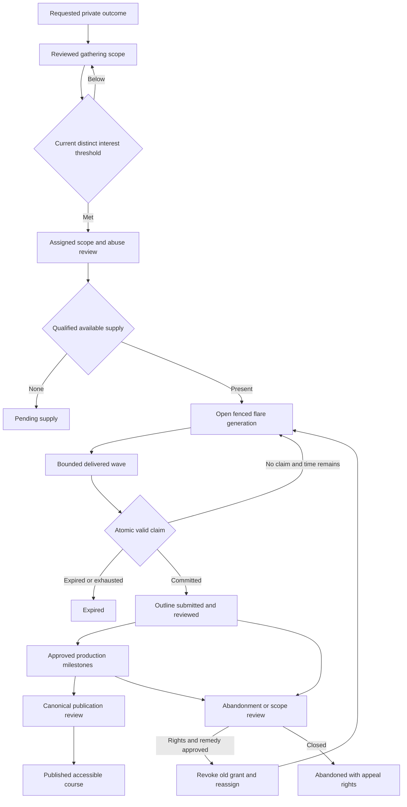

# F1 Signal Flare: Demand-to-Publication Master Plan

Date: 2026-11-07. Phase E. Status: PROPOSED, NOT IMPLEMENTED, NOT PLAN LOCKED.
STATE CHECK: Phase E, task FP2-E, branch feature/orbit-v3-foundation as recorded in STATE; Git was not queried by this agent.

**Goal:** Help members request a defined learning outcome, gather honest interest, find a qualified available Mentor without broadcasting to everyone, and follow an accountable course-production process.
**Architecture:** Consolidate the existing request and flare meanings behind the supplied shared command coordinator. Request scope, interest, allocation generation, offers, claims, milestones and publication remain separate versioned records with one authoritative lifecycle.
**Stack:** Reuse the audited JS/JSX application, taxonomy, demand UI, inbox and authoring surfaces. Interface notation is not a TypeScript migration. Storage topology, exact adapters and deployed indexes remain UNVERIFIED.
**Execution gate:** This is document material only. Every code, test, migration, provider or release task below is future and unchecked. E approval does not authorize implementation.

## 1. Evidence, approaches and boundaries

| Read evidence | Supported finding | Limit |
|---|---|---|
| [D signal/rating reasoning](thinking-signal-ratings.md) | Proposed scoring, threshold, exploration, waves, lifecycle and synthetic examples | No calibrated optimum, real concurrency or final policy |
| [Existing-system audit B07/B04/B05/B09/B11](01-existing-system-audit.md) | Two existing demand engines; reusable taxonomy/inbox/authoring; inconsistent claim/delivery authority | Audit evidence is static; A/U findings need verification before repairs |
| [Marketplace research](research-marketplace-economy.md) | Star-aware ranking rationale, notification evaluation and recoverable accounting patterns | Notification-template engagement is not fatigue, learning or allocator evidence |
| [Learning evidence](research-learning-evidence.md) | Support, accuracy, feedback and continuity concerns; heterogeneous learning evidence | Reports are not reproduced vendor incidents or causal evidence for this feature |

Recommended D approach: qualified, exposure-aware small waves with exclusive claims. Alternatives: all-recipient fan-out increases duplicate effort; strict score-only sequential offers starve qualified newcomers; ungated random offers ignore expertise. The recommendation remains a proposal, not a founder-selected final policy. The current flare already has bounded fan-out; do not describe it as a global broadcast.

Audited existing reuse targets: `D:/orbit-main/orbit-main/BackEnd/controllers/courseRequestController.js`, `D:/orbit-main/orbit-main/BackEnd/services/signalFlareService.js`, `D:/orbit-main/orbit-main/BackEnd/services/notify.js`, `D:/orbit-main/orbit-main/FrontEnd/src/pages/CoursesBrowse.jsx`, and canonical mentor authoring surfaces named in the audit. Existence is supported by that audit, not a fresh app-source inspection here. Do not add a third demand engine or copy incompatible old thresholds into v2.

Non-goals: money collection, escrow/pledges, guaranteed revenue, paid prioritization, automatic expertise verification, automatic semantic merges, public ranking of minors, unrestricted contributor rights, new dashboards, or automatic publication from model/helper output. Historical requests and consent must not be silently migrated or discarded.

## 2. Consume the shared contract

The written [shared platform contract](03-platform-contracts.md) is canonical; its earlier inline/not-on-disk description is historical delegation provenance only. Use its `ActorContext`, `ResourceRef`, `CommandEnvelope<T>`, `Receipt<R>`, `CommandResult<R>`, `PolicyGate<T>`, `EventEnvelope<T>`, `ProjectionView`, `Tx`, authority fences, source registry, atomic coordinator, outbox and account-cache isolation unchanged.

All normal commands use `operationId`, `expectedVersion`, `policyVersion`, `resource` and `payload`. `ActorContext` is server constructed. Routes are PROPOSED under `/api/v2/fp2`; events begin `fp2.v1.`. The coordinator owns commit, receipts and events. There is no feature-local payment, grading, reward or role authority.

For a new request, the client supplies an opaque proposed ID and `expectedVersion="absent"`; creation requires live create authority. Later request commands use the actual request resource version. Scope version and allocation generation are distinct from mutable resource version. A newer wave cannot make an older scope claim valid.

Semantic creation/transition keys are server derived. Unique interest is `(accountId,canonicalRequestId,scopeVersion)`, regardless of identity selection, request copy or operation ID. A claim's exclusivity key is the stable request/scope, plus the current allocation generation fence; changing operation ID or resource version cannot create another active claim. A materially new scope needs reviewed provenance, not a client declaration of a new reward family.

Required gates are typed, not generic TBD. `PolicyGate.state` must be `approved` for every required action scope. A `proposed` value supports labeled planning previews only; `unknown` or `suspended` blocks the corresponding authoritative branch.

## 3. Proposed policy configuration

```ts
type FlarePolicy = Readonly<{
  thresholdDistinctInterests: 50;
  interestWindowDays: 45;
  expertiseFloor: 0.60;
  activeClaimCapacity: 1;
  primaryDivisor: 30;
  primaryMax: 3;
  fallbackMax: 5;
  offerWindowMinutes: 20;
  opportunityMaxHours: 72;
  outlineDueHours: 72;
  productionHeartbeatDays: 7;
  newcomerDeliveredOfferLimit: 3;
  explorationMaxScoreGap: 20;
  singleSlotExplorationEvery: 4;
  dispatchLeaseSeconds: 60;
  undeliveredOfferMaxMinutes: 5;
}>;
type DemandPrivacyPolicy = Readonly<{
  participantCountBandMinimum: 10;
  publicRequestsEnabled: boolean;
  minorPublicRequestsEnabled: false;
  publicCountReleaseDelaySeconds: number;
}>;
type FlarePolicyBundle = Readonly<{
  allocation: PolicyGate<FlarePolicy>;
  privacy: PolicyGate<DemandPrivacyPolicy>;
  scopeReview: PolicyGate<JsonValue>;
  delivery: PolicyGate<JsonValue>;
  productionRights: PolicyGate<JsonValue>;
  abandonmentAppeal: PolicyGate<JsonValue>;
}>;
```

Every value above is PROPOSED. The 60-second dispatch lease, five-minute undelivered-offer bound and count-band minimum are additional draft engineering/privacy assumptions, not D results. Public count delay, staffing, threshold-review criteria, review deadlines, reliability excuses and rights rules have no final value: their required gate remains `unknown` until explicitly approved. No runtime use of this bundle is authorized now.

Capacity one applies from claim through outline, production and publication review, not only after production starts. Availability is explicit opt-in and confirmation; quiet hours and unavailable delivery channels exclude/defer invitations. No attendance coercion, location tracking, online surveillance, payment perk or league level bypasses competence or capacity.

## 4. Actors and field-level access

| Actor/capability | Permitted fields/action | Additional live checks | Explicit denial |
|---|---|---|---|
| Student or Peer, `request.create.own` | Own bounded outcome, prerequisites, level, language, scope and source references | Current account/identity; approved request/retention/safety policy | Trusted demand totals, verified expertise, money or publication flags |
| Member, `request.interest.respond` | Own add/withdraw choice and own receipt | Canonical scope; account eligibility and abuse fence | Multiple interests by switching Student/Peer/Mentor identity |
| Participant, `request.read.participant` | Reviewed scope, count band, lifecycle, own interest, approved milestone summary | Membership, age/privacy policy; requested visibility | Other interested accounts, minor identities, flags or private reviewer notes |
| Mentor, `flare.offer.read.own` | Own offer, deadline, scope snapshot, evidence labels and proposed preview | Current Mentor role, offer subject and resource ACL | Other recipients, scores, contact lists or demand-source identities |
| Mentor, `claim.accept.offered` | Claim offered scope and acknowledge its terms | Current offer/grant, expertise, availability, capacity and generation | Claiming a browsed URL without an offer or buying claim priority |
| Claim owner, `claim.outline.submit.own`, `claim.milestone.submit.own` | Own artifact references, proposals and progress evidence | Current claim grant, source rights and artifact version | Trusting local upload state as processed-ready/publication evidence |
| Appointed reviewer, `request.scope.review.assigned`, `claim.outline.review.assigned`, `claim.progress.review.assigned` | Assigned scope/evidence, reason codes, deadlines, decisions | Assignment, conflicts, purpose-specific field grant | Unassigned private notes/grades or changing money shares |
| Publication reviewer, `publication.review.assigned` | Candidate course/rights/accessibility/source attestations | Canonical publication process, assigned case and approved policy | Directly publishing from a flare score or client `approved=true` |
| Moderator, `request.abuse.review.assigned`, `claim.reassign.assigned` | Restricted case facts, account/source eligibility decisions and appeals | Assignment, audited reason, conflict/appeal and rights policy | Public blame, account merging by weak correlation or secret score edits |
| Registered allocator/delivery service | Validated threshold, eligibility snapshot, offers, recovery and cancellations | Narrow service identity, approved policy and transaction adapter | Raw sockets, analytics, browser/model events supplying claim authority |

Request publication, review and contact disclosure are separate permissions. A public request never makes its supporters public. Minor/unknown-age identities are not publicly ranked or listed by default. Adult public request/profile display requires explicit approved opt-in. Private learning/support remains available without public exposure.

## 5. Persistence and indexes

All proposed records carry `id`, schema version, resource version, server timestamps and policy version. Private free text and evidence bytes are separate from allowlisted control metadata. Integer counters are checked nonnegative safe integers; text/array/URL limits require approved schema configuration.

| Proposed record | Load-bearing fields/types | Mandatory indexes/authority |
|---|---|---|
| DemandRequest | ownerId:Id; scopeVersion:Version; canonicalRequestId:Id; state:RequestState; reviewedScopeRef:Id; visibility:private/participants/public; allocationGeneration:Version; activeClaimId:Id|null; eligibilityRevision:Version | Unique ID; owner/state; canonical/scope; one current scope; active claim pointer CAS |
| RequestOrigin | originId:Id; originalRequestId:Id; originalTextRef:Id; sourcePermissionRef:Id; taxonomyVersion:Id; lineageState:reviewed/quarantined | Unique origin; canonical/origin lookup; preserve source and requester attribution privately |
| ScopeRevision | requestId:Id; scopeVersion:Version; outcomeIds:Id[]; prerequisiteIds:Id[]; levelId:Id; languageTag:string; exclusions:string[]; reviewedBy:Id; reasonCode:string | Unique request/scope; immutable reviewed snapshot; reviewer assignment authority |
| ClusterProposal | originIds:Id[]; suggestedCanonicalId:Id; methodVersion:Id; similarityEvidenceRef:Id; state:suggested/accepted/rejected/split; participantChoicesRef:Id | Unique proposal; state/assignment; suggestion is not merge authority |
| Interest | accountId:Id; requestId:Id; scopeVersion:Version; choice:active/withdrawn; validUntil:UtcInstant; eligibilityState:eligible/quarantined/ineligible; originId:Id | Unique account/canonical/scope; eligible/expiry; record version; server-set eligibility/time |
| DemandCounter | requestId:Id; scopeVersion:Version; eligibleCurrentCount:number; eligibilityRevision:Version; lastEvaluatedAt:UtcInstant | Unique request/scope; transactional with interest and threshold fences; never trust a projection |
| AllocationRun | requestId:Id; scopeVersion:Version; generation:Version; state:open/claimed/expired/canceled; openedAt:UtcInstant; expiresAt:UtcInstant; qualifiedSnapshotRef:Id; rankingSnapshotRef:Id; subjectSequence:number; nextWave:number | Unique request/scope/generation; one current open generation; expiry/state recovery index |
| MentorQualification | mentorId:Id; subjectId:Id; expertiseChecklistVersion:Id; fit:number; reviewState:approved/unknown/suspended; availabilityConfirmedAt:UtcInstant; optIn:boolean; authzEpoch:Version | Unique mentor/subject/checklist; live safety/capacity fence required beyond snapshot |
| MentorOfferExposure | mentorId:Id; subjectId:Id; lifetimeDeliveredOffers:number; last7DayDeliveryRefs:Id[]; exposureDebt:number; lastEligibleDeliveredAt:UtcInstant|null | Unique mentor/subject; update exposure only on proven delivery; stable account lineage governed by policy |
| FlareOffer | runId:Id; mentorId:Id; wave:number; state:OfferState; scopeVersion:Version; generation:Version; queuedAt:UtcInstant; deliveredAt:UtcInstant|null; claimBy:UtcInstant|null; deliverySourceId:Id|null; acknowledgmentAt:UtcInstant|null; grantId:Id | Unique run/mentor; state/deadline; no repeat offer in same generation |
| ProductionClaim | requestId:Id; scopeVersion:Version; generation:Version; mentorId:Id; state:ClaimState; grantEpoch:Version; termsSnapshotId:Id; outlineDueAt:UtcInstant; courseRef:ResourceRef|null | Unique active request/scope; shared ClaimCapacity unique mentor; grant epoch fences all authoring/publication |
| Outline/Milestone | claimId:Id; revision:Version; artifactRef:ResourceRef; artifactVersion:Version; dueAt:UtcInstant; state:proposed/submitted/approved/rework/excused/missed; reviewerDecisionRef:Id|null | Unique claim/milestone/revision; claim/due; authoritative artifact and review evidence |
| ReassignmentCase | claimId:Id; caseId:Id; reasonCode:string; state:open/decided/appealed/closed; rightsResolutionRef:Id|null; nextScopeVersion:Version|null | Unique case; assigned/state; decisions cannot invent transfer rights |

Use shared Operation/Receipt, AuthzFence, SourceRegistry, Outbox and invariant projection records. No feature-local ledger is created. Index syntax/topology are requirements to verify later under DEC-E-C01, not applied migrations. Dedup/control-marker retention must follow DEC-E-C07/C12; no indefinite content retention or TTL deletion that enables duplicate claims.

## 6. Request, scope and demand flow

1. Member enters outcome, prerequisites, language, level and exclusions; sees `Interest is not enrollment or a payment commitment.` The private original is preserved after any merge.
2. Server validates permissions and source references. Taxonomy/normalized-token matching may suggest similar requests, but cannot establish semantic equality. Multilingual text is preserved; ASCII-only matching is not a new canonical requirement.
3. Requester reviews a merge suggestion. An assigned reviewer confirms outcome/level/language/prerequisite compatibility. Each affected requester accepts a changed scope or remains attached to the original scope; silence is not consent to an expanded request.
4. Accepted merge preserves origin IDs and maps prior interests by account. If one member supported both origins, the canonical cluster counts one. New material scope requires explicit interest reconfirmation; old interest is not silently transferred.
5. Add/withdraw/eligibility correction and current count commit together. Eligibility combines current account authority, stable account source, approved abuse constraints and scope choice. It does not mean government identity verification or guaranteed unique humans.
6. Proposed threshold is 50 eligible current distinct interests within 45 days. `validUntil` derives from the approved interest policy and server commit time; renewal is an explicit new choice, not background attendance pressure.
7. Crossing threshold produces an authoritative threshold candidate and outbox event once. Assigned abuse/scope review must approve before allocation opens. A count projection or browser callback cannot cross the authority boundary.
8. Before a claim, a drop below threshold or material source/safety issue pauses/cancels the generation under approved policy. At accept, the transactional current count must still meet the approved gate. After a committed claim, ordinary withdrawals are informational; they do not silently revoke work or create a debt. Material changes enter reviewed renegotiation.

Spam/brigading controls: approved per-account request/interest limits, bounded text/source validation, account lineage checks, duplicate-origin review, unusual cohort correlation and coordinated timing flags. Rate limit values and correlation rules stay blocked until approved and abuse-tested. IP/device/contact correlation alone is not proof, especially on shared devices or school networks. Paid demand boosts and rewards for repeated interests are excluded.

Collusion/hoarding controls: exclude self-controlled demand manipulation under reviewed evidence; never let supporters buy votes, grade signals or invitation rank. Global active-claim capacity prevents simultaneous hoarding across different requests. Repeated unexcused failures inform reviewed reliability, not automatic public punishment. Moderation reasons and appeals are distinct from low ratings.

## 7. Qualification and exact D scoring

Qualification requires relevant reviewed expertise fit >=0.60, valid current Mentor authority, approved safety eligibility, opt-in confirmed availability and fewer than one active claim. Unknown expertise fails qualification. Unknown quality can use the proposed neutral value only after these gates pass.

`S = 100*(0.35*Q + 0.30*E + 0.15*R + 0.10*P + 0.05*T + 0.05*F)`.
All components are in [0,1]; weights sum to 1. A missing required evidence-policy bundle blocks ranking rather than becoming guessed zero.

| Component | Exact proposed definition | Source/uncertainty boundary |
|---|---|---|
| Q quality, 35% | `clip((L-1)/4,0,1)` from F2 eligible versioned teaching-quality view; if UNRATED, synthetic neutral 0.50 | F2 approved rater/scope mapping; show unknown label, never a prior-only public rating |
| E expertise, 30% | Reviewed relevant outcome/prerequisite checklist fit | Checklist fixed/versioned before offer; popularity and paid badges excluded |
| R reliability, 15% | `(onTimeMilestones+2)/(dueMilestones+3)` | Accountable accepted due commitments only; excused technical/policy delays excluded from both counts; empty history=2/3, labeled prior |
| P responsiveness, 10% | `(acknowledgedInWindow+2)/(eligibleDeliveredOffers+4)` | At most one qualifying response per actually delivered offer; failed delivery/quiet hours not counted; empty history=1/2, labeled prior |
| T availability recency, 5% | `max(0.20,2^(-daysSinceConfirmedAvailability/30))` | Server-confirmed opt-in date; no confirmed availability means exclude, not floor substitute |
| F exposure fairness, 5% | `1/(1+eligibleOffersInLast7Days)` | Approved eligible delivery sources, stable account identity; no reset by workspace switching |

Proposed eligible response includes an explicit acknowledge, timely accept or timely decline; automated receipt/read status is not acknowledgment. Acknowledgment does not reserve a claim or extend its deadline. Approved responsiveness policy must adopt this interpretation before use.

| D synthetic example | Q/E/R/P/T/F | Score |
|---|---|---|
| Established | .91/.90/.90/.80/.90/.20 | 85.85 |
| Specialist | .85/1/.75/.90/.70/.50 | 86.00 |
| New qualified | .50/.90/(2/3)/.50/1/1 | 69.50 |

These invented inputs and D results are not real Mentors or measured fairness. The first two quality inputs are scenario values, not numerical claims that the F2 examples produce exactly those Q values. Outcomes are displayed separately, not folded into stars or duplicated in score weights.

Rank by S descending, E descending, oldest eligible delivered-offer time first, stable mentor ID ascending. Null prior offer time sorts as oldest. Store full component evidence versions, cutoff, unknown labels, policy version and reason codes in a restricted snapshot. Mentor sees only own explanation; supporters never receive the ranked recipient list.

## 8. Waves, exploration and timers

For initial qualified available population N>0:
`primary = min(N,max(1,ceil(N/30)),3)`; `firstFallback=min(5,N-primary)`.
Later fallback waves have at most five unoffered currently qualified candidates. N=0 is pending supply, not a zero-size claimable wave.

| Population | Primary | First fallback | Further candidate waves if nobody claims |
|---|---|---|---|
| 3 | 1 | 2 | Exhausted |
| 15 | 1 | 5 | 5, then 4 |
| 80 | 3 | 5 | Continue batches <=5 over the remaining distinct candidates until claim/exhaustion/72-hour expiry |

Freeze the generation's candidate IDs and score/evidence snapshot; revalidate live role, qualification, availability, safety and capacity before each delivery and accept. Removed candidates do not regain eligibility through stale offers. New candidates wait for an explicitly reopened/reviewed generation. Do not reorder outstanding offers due to a background score update.

Protected exploration: if primary>=2, reserve at most one primary slot for a qualified newcomer with fewer than three lifetime delivered offers and S within 20 points of best. Pick greatest approved exposure debt, then stable ID. If primary=1, allow this only on every fourth authoritative subject opportunity sequence. Fill all other slots by rank. Exploration never admits low-fit, unavailable, sanctioned or capacity-full Mentors.

Proposed exposure debt: count prior subject opportunities where a Mentor passed the live exploration eligibility snapshot but received no eligible offer, resetting debt on eligible delivery. The subject sequence and each Mentor/opportunity eligibility fact are server records; unique keys prevent increments on worker retry. Lifetime newcomer count follows approved account lineage across workspaces; do not merge people from weak device/IP matches. This debt definition requires DEC-E-S03 approval and distribution validation.

Each offered Mentor receives at most one offer per request/scope/generation. Next wave starts only after the preceding wave has no potentially valid offer: claimed, declined, expired, canceled or failed delivery. No overlapping fallbacks simply because a notification worker is slow.

Delivery protocol: queue in the atomic outbox; adapter validates current channel preference/quiet hours/epoch. `DELIVERED` requires an approved delivery attestation that the offer is accessible in that Mentor's authorized inbox. Push/provider acceptance alone is not proof of reading. State/copy distinguish queued, channel delivered and acknowledged. If accessible-inbox attestation cannot be proven, do not start the response window or count nonresponse.

Set `claimBy=min(deliveredAt+20 minutes,run.expiresAt)` from server delivery evidence. A wave ending near opportunity expiry gets the shorter explicit remaining deadline. Failed deliveries get no P denominator, no F delivery count and no invisible window. The proposed five-minute undelivered bound marks the attempt failed after lease recovery confirms no delivery; it does not discard an unknown external result without reconciliation.

Opportunity expiry is fixed at openedAt+72 hours and cannot refresh on retries, acknowledgments or copied requests. Offer worker lease is operational only; lease expiry enables recovery, not claim expiry. Queued and delivered offers are canceled after claim; late deliveries/accepts are denied by the live generation and request fences even before socket cancellation reaches the UI.

## 9. Lifecycle and recovery

```ts
type RequestState = "REQUESTED" | "GATHERING" | "THRESHOLD_MET" | "PENDING_SUPPLY" | "FLARE_OPEN" | "OFFERED" | "CLAIMED" | "OUTLINE_SUBMITTED" | "OUTLINE_APPROVED" | "PRODUCTION" | "REVIEW" | "PUBLISHED" | "EXPIRED" | "ABANDONMENT_REVIEW" | "ABANDONED" | "REASSIGNMENT";
type OfferState = "QUEUED" | "DELIVERED" | "ACKNOWLEDGED" | "DECLINED" | "EXPIRED" | "CANCELED" | "DELIVERY_FAILED" | "CLAIMED";
type ClaimState = "ACTIVE" | "OUTLINE_REVIEW" | "OUTLINE_APPROVED" | "PRODUCTION" | "PUBLICATION_REVIEW" | "PAUSED" | "REVOKED" | "COMPLETED" | "ABANDONED";
```

| Transition | Authoritative preconditions/effect | Failure/recovery |
|---|---|---|
| REQUESTED -> GATHERING | Assigned scope approval and valid source/retention; preserve original | Rework or quarantine, not silent deletion |
| GATHERING -> THRESHOLD_MET | Transactional >=50 valid distinct interests; once-only threshold source | Count correction below threshold returns to gathering before allocation |
| THRESHOLD_MET -> PENDING_SUPPLY | Approved threshold/scope/abuse review; N=0 | Await explicit supply/reopen command; no fictional notified count |
| THRESHOLD_MET/PENDING_SUPPLY -> FLARE_OPEN | Reviewed current scope, count and supply; new fenced generation | Atomic run/snapshot/outbox or no effects |
| FLARE_OPEN -> OFFERED | At least one validated delivered offer | Only queued remains FLARE_OPEN; undelivered work recovered |
| OFFERED -> FLARE_OPEN | Current wave terminal without claim; time/candidates remain | Advance once by generation/wave semantic key |
| OFFERED -> CLAIMED | Live offer, time, threshold, role, expertise, safety and capacity; exclusive atomic claim | Concurrent loser CAPACITY_CONFLICT; lost response replays original receipt |
| CLAIMED -> OUTLINE_SUBMITTED | Current owner grant; processed-ready outline/source rights; proposed due 72 hours | Preserve authorized draft; late outline enters review, not automatic blame |
| OUTLINE_SUBMITTED -> OUTLINE_APPROVED | Assigned reviewer approves scope, contribution rights and milestone plan | Rework stays outline review; timeout enters assigned escalation policy |
| OUTLINE_APPROVED -> PRODUCTION | Owner explicitly accepts reviewed milestone terms | New scope requires new version/agreement, not unpaid silent expansion |
| PRODUCTION -> REVIEW | Canonical candidate course, media/checkpoints/captions/rights evidence ready | Processing/upload/QA failures stay repair state, not completion |
| REVIEW -> PUBLISHED | Canonical publication authority verifies access/rights/quality; revocation fence current | Claim completed/capacity released with authoritative publication; index delivery may lag |
| FLARE_OPEN/OFFERED/PENDING_SUPPLY -> EXPIRED | Fixed opportunity deadline or reviewed exhausted-supply closure | Release offers; no automatic payment, rerun or revenue guarantee |
| Active claim -> ABANDONMENT_REVIEW | Voluntary withdrawal, missed accountable milestone or safety/technical case | Pause grants as scope requires; heartbeat absence is a review trigger, not guilt |
| ABANDONMENT_REVIEW -> PRODUCTION/ABANDONED | Reviewed remedy/deadline or approved closure with appeal and rights resolution | Preserve liabilities/appeal and lawful contributions; no punitive token debt |
| ABANDONMENT_REVIEW -> REASSIGNMENT -> FLARE_OPEN | Authorized rights/scope decision; revoke old grant, release capacity, increment generation, approve new timeline | Old owner cannot write/publish; one active claim remains globally enforced |

Proposed production heartbeat every seven days reports actual evidence and blockers. No fabricated percentage from elapsed time or chapters uploaded. Missing heartbeat creates an assigned private review; approved excused delays are separate from reliability failures. Reviewer workload/deadline/escalation staffing is a release blocker, not assumed unlimited capacity.

Reassignment does not automatically transfer IP, private raw recordings, notes or contributor permission. If rights resolution is unknown, remain paused. Grant revocation and new owner authority are fenced in the same transaction; notification delivery is supplemental. An appeal may preserve/restrict lawful work under approved policy, not secretly reactivate revoked publication rights.

## 10. Proposed feature command payloads and results

```ts
type CreateRequest = Readonly<{ outcomeText: string; prerequisiteIds: readonly Id[]; levelId: Id; languageTag: string; exclusions: readonly string[]; sourceRefs: readonly ResourceRef[] }>;
type InterestChoice = Readonly<{ scopeVersion: Version; choice: "add" | "withdraw" }>;
type AcceptOffer = Readonly<{ offerId: Id; scopeVersion: Version; generation: Version; termsSnapshotId: Id }>;
type SubmitOutline = Readonly<{ claimId: Id; outline: ResourceRef; outlineVersion: Version; scopeVersion: Version; milestoneProposalRefs: readonly ResourceRef[] }>;
type SubmitMilestone = Readonly<{ claimId: Id; milestoneId: Id; artifact: ResourceRef; artifactVersion: Version; blockerCode: string | null }>;
type ReviewDecision = Readonly<{ caseId: Id; decision: "approve" | "rework" | "pause" | "reject"; reasonCode: string; evidenceRefs: readonly ResourceRef[] }>;
type FlareClaimResult = Readonly<{ claim: ResourceRef; requestVersion: Version; scopeVersion: Version; generation: Version; outlineDueAt: UtcInstant; course: ResourceRef | null }>;
type RequestParticipantView = Readonly<{ request: ResourceRef; scopeVersion: Version; state: RequestState; reviewedScope: JsonValue; interest: "active" | "withdrawn" | "none"; countBand: string | null; milestoneSummary: JsonValue; updatedAt: UtcInstant }>;
```

Submitted refs are lookup hints. Server derives owner, rights, due dates, verified source, trust score, count and authority. Ref/resource equality, parent membership and version checks are mandatory. A feature payload cannot contain trusted `amount`, `notified`, `verified`, `mentorId`, source-cycle timestamps, `approved` authority or ledger legs; review decisions are accepted only from appointed actors and recorded as reviewed decisions, never client source authority.

All commands below use the canonical envelope and return a durable `CommandResult<typed result>`, including no_change/replay semantics. Authorized creation is 201; mutations/replays 200; lease processing 202; errors use the shared Problem contract. Same actor/operation changed intent is 409 OPERATION_CONFLICT. Authorized stale root is 409 VERSION_CONFLICT. Missing/unauthorized/revoked resources share 404 RESOURCE_NOT_AVAILABLE.

| Proposed endpoint | Request/result | Capability and source/privacy checks | Additional failure |
|---|---|---|---|
| POST `/commands/request.create` | CreateRequest -> request ref/version, REQUESTED | `request.create.own`; identity/safety, provenance, retention, ownership of referenced sources | 400 bounds/authority fields; 422 unapproved policy or inaccessible source |
| POST `/commands/request.cluster.respond` | proposalId, choice accept/reject -> own choice | `request.cluster.respond.own`; affected-origin owner; no access to other private originals | 409 stale scope; 422 rights/merge policy |
| POST `/commands/request.scope.review` | ReviewDecision plus proposal ref -> reviewed scope/version | `request.scope.review.assigned`; reviewer conflict and origin permissions; preserve private originals | 422 unaccepted material scope/invalid lineage |
| POST `/commands/request.interest.respond` | InterestChoice -> own choice and safe count band | `request.interest.respond`; canonical account uniqueness, current scope and abuse/retention fence | 409 stale scope; 422 eligibility block; repeat add no_change |
| GET `/requests/{id}` | RequestParticipantView via projection/minVersion | `request.read.participant` or approved public allowlist; own interest only; count policy | 404 unavailable; 202 lagging; no vote identities |
| GET `/flares/offers/own` | cursor -> own offer refs/safe scope/deadlines | `flare.offer.read.own`; Mentor authority/session generation; no other recipients | 400 invalid cursor; 404 inaccessible offer details |
| POST `/commands/flare.offer.respond` | offerId, acknowledge/decline -> offer state/deadline | `flare.offer.respond.own`; live offer/subject/deadline; authoritative delivery source | 409 terminal offer; 422 expired grant; acknowledge never reserves |
| POST `/commands/claim.accept` | AcceptOffer -> FlareClaimResult | `claim.accept.offered`; request/scope/run/offer and live expertise/count/capacity/epoch | 409 CAPACITY_CONFLICT; 422 GRANT_EXPIRED or policy block |
| POST `/commands/claim.outline.submit` | SubmitOutline -> outline revision/review state | `claim.outline.submit.own`; live claim/authoring grant; processed-ready artifact/provenance | 422 SOURCE_BLOCKED; 409 stale scope/artifact |
| POST `/commands/claim.outline.review` | ReviewDecision -> approved/rework outline ref | `claim.outline.review.assigned`; assignment/rights/current versions; no private learner grades | 422 unclear rights or unaccepted milestones |
| POST `/commands/claim.production.start` | claimId, planRef/version -> PRODUCTION | `claim.production.start.own`; current owner explicitly accepts approved scope/plan | 422 policy/terms block; 409 stale reviewed plan |
| POST `/commands/claim.milestone.submit` | SubmitMilestone -> submitted evidence/blocker | `claim.milestone.submit.own`; claim/artifact grant and registered readiness source | 422 unvalidated helper/upload evidence |
| POST `/commands/claim.milestone.review` | ReviewDecision plus milestoneId -> approved/rework/excused state | `claim.progress.review.assigned`; due commitment/source/conflict; restricted case fields | 422 unapproved excuse/correction policy |
| POST `/commands/claim.publication.request` | claimId, course ref/version -> REVIEW | `course.publish.candidate`; current claim owner and canonical studio readiness | 422 missing rights/captions/access/checkpoint evidence |
| POST `/commands/claim.withdraw` | claimId, reasonCode -> ABANDONMENT_REVIEW | `claim.withdraw.own`; owner and scope; no forced public reason/text | 422 handling/rights policy block; support/exit still accessible |
| POST `/commands/claim.reassignment.decide` | caseId, disposition, reviewed rights/scope refs -> paused/closed/reassignment | `claim.reassign.assigned`; appointment, appeal and contribution grants; shared capacity/revocation | 422 unresolved rights/appeal; no arbitrary new owner body authority |
| POST `/commands/case.create.own` | resource, category, bounded own evidence refs -> private case receipt | Shared `case.create.own`; affected member, field-purpose grant and retention | 404 other-party private sources; 422 unsupported sensitive retention |

Paths in the table are suffixes under `/api/v2/fp2`. Canonical publication approval, receipt/operation lookup and projections reuse the shared/platform or F6 contracts; do not duplicate their coordinator. Registered service-only commands `flare.threshold.evaluate`, `flare.run.open`, `flare.wave.advance`, `flare.delivery.record`, `flare.offer.expire` and `flare.run.expire` require their matching narrow workload capabilities, live fences and approved source evidence. They are not publicly invocable by a browser capability string.

Example accept envelope: `{"operationId":"op-accept-1","expectedVersion":12,"policyVersion":"approved-policy-1","resource":{"kind":"request","id":"request-1"},"payload":{"offerId":"offer-1","scopeVersion":2,"generation":3,"termsSnapshotId":"terms-1"}}`. IDs are illustrative, not grants. Offer scope/run/current resource all must agree.

## 11. Coordinator pseudocode and recovery

```text
evaluateThreshold(tx, actor, envelope):
  authorizeAssignedServiceAndTouchFences(tx, actor, envelope.resource)
  policy = requireApprovedPolicyBundle(envelope.policyVersion)
  scope = loadCurrentReviewedScope(tx, envelope.resource)
  count = currentEligibleDistinctInterestCount(tx, scope)
  compareExpectedVersion(tx, envelope)
  if count < policy.thresholdDistinctInterests:
    return stageNoChangeOrApprovedPreclaimPause(tx, scope)
  source = obtainAuthoritativeThresholdCandidate(tx, scope)
  if candidateAlreadyConsumed(tx, source):
    return stageNoChangeReceipt(tx)
  return stageThresholdStateSourceReceiptAndOutbox(tx, scope, source)

planWave(tx, actor, envelope):
  run = authorizeCurrentOpenRunAndTouchFences(tx, actor, envelope)
  assert serverNow < run.expiresAt
  assert previousWaveHasNoPotentiallyValidOffers(tx, run)
  candidates = unofferedSnapshotCandidatesWithLiveQualification(tx, run)
  recipients = applyApprovedRankingAndBoundedExploration(candidates, run)
  assert allRecipientsDistinctAndWaveBounded(recipients)
  return stageOffersWaveSequenceReceiptAndOutbox(tx, run, recipients)

acceptClaim(tx, actor, envelope):
  authorizeCurrentMentorOfferAndTouchFences(tx, actor, envelope)
  request, run, offer = loadCurrentRequestRunAndOffer(tx, envelope)
  assert request.scopeVersion == envelope.payload.scopeVersion
  assert run.generation == envelope.payload.generation
  assert offer.state in {DELIVERED, ACKNOWLEDGED}
  assert serverNow < offer.claimBy and serverNow < run.expiresAt
  assert currentEligibleCount(tx, request) >= approvedThreshold
  assert liveExpertiseSafetyAvailabilityPass(tx, actor, request)
  compareExpectedVersion(tx, envelope)
  conditionallyAcquireSharedMentorCapacity(tx, actor.actorId)
  conditionallyAcquireUniqueRequestScopeClaim(tx, request, run)
  claim = stageClaimWithCurrentGrantAndTerms(tx, request, actor)
  return stageRequestClaimCapacityReceiptAndCancellationOutbox(tx, claim)
```

The shared `executeCommand` handles canonical hash, original-operation replay, leases, approved policies and final `commitAtomicPlan`. These routines stage plans; they never independently commit or call providers inside the transaction. An in-memory lock or sequential writes do not satisfy atomicity.

Domain, source markers, request version, capacity, grants, invariant counters, receipt and outbox commit together. Failure before commit leaves no business effects. Crash after commit returns the original permitted receipt on retry. Worker lease expiry inspects committed delivery/claim/receipt state before retrying. Notification/index failure does not revoke a valid claim or imply a Mentor saw a message.

For a new operation accepting the same already-owned semantic claim, return authorized no_change referencing the existing claim, not another grant. Another Mentor receives CAPACITY_CONFLICT only while still authorized to know their offered opportunity; revoked/inaccessible requests remain nonenumerating 404. GET never expires offers, recalculates demand into authoritative state or creates milestones.

## 12. Registered events and projections

| Proposed event | Minimal payload | Consumer/idempotency boundary |
|---|---|---|
| `fp2.v1.request.scope.changed` | request ref, scopeVersion, approved summary ref | Scope/canonical projection; no original private text or supporter IDs |
| `fp2.v1.request.interest.changed` | request ref, eligibilityRevision, safe projection invalidation | Participant projection; exact account source remains server-only |
| `fp2.v1.flare.threshold.reviewed` | request ref, scopeVersion, decisionRef | Allocator reads canonical approved evidence; event itself cannot grant claim |
| `fp2.v1.flare.wave.opened` | run ref, generation, wave, delivery instruction refs | Private delivery consumer; no public recipient list |
| `fp2.v1.flare.offer.delivery.changed` | offer ref, state, evidence ref, deadline if valid | Own inbox/response counters; one exposure source per offer |
| `fp2.v1.claim.committed` | claim/request refs, scopeVersion, generation | Owner/progress and cancellation consumers; no learner contacts |
| `fp2.v1.claim.outline.changed` | claim ref, outline revision, review state | Assigned studio/review projections |
| `fp2.v1.claim.milestone.changed` | claim ref, milestone ref, safe state/due date | Progress/reliability uses reviewed source, not event assertion alone |
| `fp2.v1.claim.reassigned` | claim/request refs, generation, revoked grant epoch | Revocation and new progress projection; contribution details restricted |
| `fp2.v1.flare.run.closed` | request ref, generation, expired/canceled/claimed | Cancel outstanding offers, rebuild safe state |
| Shared `fp2.v1.publication.changed` | canonical course/request refs and approved publication state | Course access/discovery follows canonical publication authority |

All carry the shared envelope, aggregate sequence, policy/version/operation/causation. At-least-once consumers apply effect and checkpoint atomically. Duplicate/old/gapped events cannot recreate offers, increment exposure twice or overwrite newer request state. Sequence gaps trigger authorized canonical refresh. Public discovery is rebuildable and privacy-filtered, never claim authority.

Own caches use the complete shared AccountScope. Logout/account/identity/epoch changes abort old commands/read callbacks, unsubscribe scoped sockets/push and clear private data before the next account mounts. Public projections omit supporters, eligibility flags, recipient ranks, private original text, review notes, grades and media URLs.

## 13. Student/Mentor UX, copy and motion

| State | Plain copy | Required action/meaning |
|---|---|---|
| New request | `Describe what you want to learn.` | Outcome/level/language/exclusions and private source permissions |
| Gathering | `Interest is gathering. This is not an enrollment or payment commitment.` | Own add/withdraw; safe count band; similar request review |
| Threshold candidate | `The interest threshold is met. The request is being reviewed.` | No notified/claimable claim from count alone |
| Pending supply | `No qualified available mentor has been found yet.` | Revise/withdraw/support; no fabricated ETA |
| Queued offer | `An offer is queued. Delivery is not confirmed.` | Private Mentor inbox status; no running hidden deadline |
| Delivered offer | `Review this scope before the deadline shown.` | Exact UTC/localized deadline, accept/acknowledge/decline, source labels |
| Claimed | `A mentor has accepted this scope. The outline is next.` | Approved owner display only; next actual due date |
| Outline/rework | `The outline needs review.` / `Changes were requested.` | Real review state and safe reason, not production completion |
| Production | `Work is in progress. View the latest confirmed milestone.` | Evidence/dates/blockers; no time-derived percentage |
| Review | `The course is under review and is not available yet.` | Actual readiness, no access promise |
| Published | `The course is available.` | Canonical access-checked course link; stale index may separately lag |
| Expired | `No mentor accepted this round.` | Explicit re-scope/reopen request, no repeated automatic alerts |
| Paused/reassignment | `The production plan is being reviewed.` | Private case/appeal; revised owner/schedule only after decision |
| Claim race | `This opportunity is no longer available to claim.` | Refresh own authorized offer; no recipient details |
| Scope conflict | `The scope changed. Review the new version before accepting.` | Explicit re-consent/rebase; preserve authorized draft |

Static labels, a semantic ordered status list, focus management and status announcements carry all meaning. Optional flare reveal <=180 ms and claimed reveal <=400 ms are proposals, not measured fps. Reduced-motion removes spatial effects; sound is off by default. Timers are text and never color-only. Replay/no_change produces no second celebration. Account switch, route exit, GPU loss or motion-preference change cannot fire stale success callbacks. No forced alert, attendance streak or emotional-dependence copy.

Count bands are proposed: fewer than 10 displays `Gathering interest`; 10-49 displays `10-49 eligible interests`; threshold reviewed displays `Interest threshold met`, not exact individual changes. Public exposure is off until privacy/delay policy approval. Operators with purpose grant can see exact authoritative count; supporter identities require a separately approved case grant.

## 14. Honest earning preview and optional branches

F1 minimum/V1 does not charge or mint assets for requesting, interest, response or claim. Preview is a separate nonauthoritative calculation with typed `assumption`, `approvedBasisAvailable` and `unknownCostPolicy` labels. No interest-to-sales conversion, success probability or net-income forecast is inferred.

Proposed preview fields: scenarioId:Id; flowType:SESSION/SUBSCRIPTION; assumedRecognizedBasisMinor:IntUnits; assumedEligibleCourseIds:Id[]; assumedEnrollmentRange:integer pair|null; approvedAllocationPolicyVersion:Id|null; status:illustration_only/blocked; grossMentorObligationMinor:IntUnits|null; unresolvedDecisionIds:Id[]. Server does not persist or collect money from this preview. Unknown basis, fees/tax/cost/beneficiary rules produce `blocked`, not zero costs or net earnings.

Subscription arithmetic illustration only: approved hypothetical basis 100,000 minor INR gives platform 20,000 and enrolled-course mentor pool 80,000. Under the shared PROPOSED equal-enrolled-course candidate with A/B/C, allocations are 26,667/26,667/26,666; owning A/B would total 53,334. Allocation/base policy is still blocked. These figures are not a price, forecast, pledge or entitlement.

Optional student-chosen mentor-priced sessions separately retain platform 15%; basis 50,000 gives platform 7,500 and mentor gross obligation 42,500 under the shared proposed rounding/base assumptions. F1 does not treat this as course income or a session perk. Actual fees/tax/refunds/provider confirmation and payment authority belong to the shared money/F7 contracts. No share override, currency conversion, paid rank, fee perk or bank-paid promise.

| Option | Possible value | Decision/blocked state | Minimum/V1 disposition |
|---|---|---|---|
| Pledge | May reveal stronger intent than an interest click | `PolicyGate<FundingTerms>.unknown`: recognition, refunds, chargebacks, minors, provider, liability and fairness need qualified review | No collection endpoint or paid vote; optional unpaid interest remains distinct |
| Guarantee | May describe a reviewed production commitment | `PolicyGate<GuaranteeTerms>.unknown`: funded remedy, enforceability, safety and dispute staffing unresolved | Never promise enrollment, learning effect, delivery date or income guarantee |
| Co-creation | May help scope/examples and shared review | `PolicyGate<ContributionRights>.unknown`: authorship, licenses, revocation, compensation, private sources and publication grants | Request feedback only with ordinary permissions; retained contributor assets/rights transfer blocked |

An education label is not a legal exemption. Core learning, export, consent, support, security and accessibility cannot be sold as token advantages. No loot boxes, gambling, bought grades/claims or payment pressure on minors.

## 15. Textual lifecycle diagram



| Diagram nodes | Equivalent operation | Authority/result |
|---|---|---|
| A-B | Preserve original; review/merge scope and permissions | Reviewed version, not forced clustering |
| B-C-D | Distinct current interest and assigned threshold/abuse review | Transactional counter plus source and approved decision |
| E-F-G-H | Supply check, generation and small delivery waves | No broadcast; actual delivered evidence and bounded UTC deadlines |
| I-J-K | Valid exclusive claim or explicit expiration | Atomic request/capacity/grant/receipt/outbox |
| K-L-M-N | Outline, actual milestones, canonical publication review | No helper-generated completion/access |
| O-P-Q | Private abandonment/appeal and rights resolution | Fenced revocation before new authority; no implicit IP transfer |

This is unrendered monochrome/textual Mermaid with an equivalent table. No visual, palette, browser or device QA is claimed.

## 16. Proposed future files and interfaces

All paths here are PROPOSED, not existence claims. Reuse the shared exact interfaces and registered schemas; no app-source files were inspected or changed in this task.

| Future file | Interface/responsibility |
|---|---|
| `D:/orbit-main/orbit-main/BackEnd/services/fp2/demandService.js` | `planInterest(tx: Tx, actor: ActorContext, envelope: CommandEnvelope<InterestChoice>): Promise<AtomicPlan<JsonValue>>`; scope/canonical uniqueness and counters |
| `D:/orbit-main/orbit-main/BackEnd/services/fp2/flareAllocator.js` | `computeFlareScore(input: FlareScoreInput): FlareScoreResult`; `planNextWave(tx: Tx, actor: ActorContext, envelope: CommandEnvelope<JsonValue>): Promise<AtomicPlan<JsonValue>>` |
| `D:/orbit-main/orbit-main/BackEnd/services/fp2/claimService.js` | `planClaimAccept(tx: Tx, actor: ActorContext, envelope: CommandEnvelope<AcceptOffer>): Promise<AtomicPlan<FlareClaimResult>>`; shared capacity/fences |
| `D:/orbit-main/orbit-main/BackEnd/services/fp2/claimProduction.js` | `planOutlineSubmission(tx: Tx, actor: ActorContext, envelope: CommandEnvelope<SubmitOutline>): Promise<AtomicPlan<JsonValue>>`; milestone/reassignment staging |
| `D:/orbit-main/orbit-main/BackEnd/services/fp2/flareProjection.js` | `getRequestParticipantView(actor: ActorContext, request: ResourceRef, minVersion?: Version): Promise<ProjectionView>` |
| `D:/orbit-main/orbit-main/shared/fp2/flareSchemas.js` | Feature schema/command/event registration; no unbounded arbitrary patches |
| `D:/orbit-main/orbit-main/FrontEnd/src/components/fp2/RequestProgress.jsx` | Accessible status/count-band/own-interest display embedded in canonical demand surface |
| `D:/orbit-main/orbit-main/FrontEnd/src/components/fp2/FlareOfferCard.jsx` | Own scope, deadline, explicit response and honest uncertainty via shared fp2Client |

`FlareScoreInput` contains bounded Q/E/R/P/T/F values, evidenceVersionRefs and unknown labels; `FlareScoreResult` contains score, components, policyVersion and evidence cutoff. Source/trust fields are service-built, never accepted from browser payload. Frontend never receives an actor constructor, private ranking list or `Tx`.

Dependencies: shared policy/context/fences/atomicity first; F2 approved quality-scope output next; reliable inbox attestation and demand counter/source integration; F6 processed-ready artifacts/publication grants; moderation/rights/operator policy. No F3 league or F5 wallet benefit is implied by a flare claim. Student, Peer and Mentor remain distinct identities and capabilities.

## 17. Minimum, V1 and V2

- **Minimum candidate:** private reviewed requests, canonical distinct interests, safe progress, typed policy blocks, original provenance, no money and no claim until shared authority/atomicity is proven.
- **V1 candidate:** bounded approved waves, exclusive capacity-one claims, outlined production/review/expiry, private appeal and fenced reassignment, static/reduced-motion UX, authorized source/grade/review integration. Existing records need an explicitly approved compatibility/migration plan.
- **V2 candidate:** approved multilingual clustering assistance, proven richer exposure evaluation, contributor workflow after rights policy, approved provider-backed money branches only if separately selected and cleared.
- **Not included implicitly:** paid pledges, guarantees, public minor ranking, automatic publication, cross-wallet rewards, unlimited outreach or extra-feature portfolio membership.

## 18. Unchecked future tasks and acceptance

Each task first authors the named failing assertions, then implements its proposed interface, then runs targeted tests under a later explicit implementation approval. Verify actual manifests/runner/topology before selecting commands. There is no mandatory commit step and no execution permission now.

- [ ] **Task 1 - Schemas and privacy.** Future files: flareSchemas, flareProjection, `D:/orbit-main/orbit-main/BackEnd/tests/fp2FlareContracts.test.js`. Assert F1-01/F1-18/F1-22: authority fields rejected, supporter lists absent, unknown public policy private/blocked, account-generation leak denied.
- [ ] **Task 2 - Canonical demand/scope.** Future files: demandService and `D:/orbit-main/orbit-main/BackEnd/tests/fp2Demand.integration.test.js`. Assert F1-02/F1-03/F1-04/F1-16: multilingual originals preserved, merge consent/splits preserved, same-account interests deduplicated and material scope reconfirmed.
- [ ] **Task 3 - Authoritative threshold.** Future files: demandService/shared coordinator and `D:/orbit-main/orbit-main/BackEnd/tests/fp2Threshold.integration.test.js`. Assert F1-05/F1-06/F1-20/F1-21: no notification from raw count, zero supply honest, corrections/expiry transactional, GET side-effect-free.
- [ ] **Task 4 - Ranking and exploration.** Future files: flareAllocator and `D:/orbit-main/orbit-main/BackEnd/tests/fp2FlareScoring.test.js`. Assert exact D scores 85.85/86.00/69.50, fixed weights and F1-07/F1-08/F1-09/F1-15: 3/15/80 waves, qualified bounded newcomers and no purchased priority.
- [ ] **Task 5 - Delivery and leases.** Future files: flareAllocator/shared outbox and `D:/orbit-main/orbit-main/BackEnd/tests/fp2FlareDelivery.integration.test.js`. Assert F1-10/F1-11/F1-12: no failed-delivery penalties, one delivery source, quiet hours exclude and fixed server deadlines never refresh.
- [ ] **Task 6 - Claims and revocation.** Future files: claimService/shared capacity/atomicStore and `D:/orbit-main/orbit-main/BackEnd/tests/fp2Claim.integration.test.js`. Run real transaction races and staged crash injection for F1-13/F1-14/F1-17/F1-19: one request winner, one global Mentor claim, replay once, revoked publication impossible.
- [ ] **Task 7 - Production/rights/review.** Future files: claimProduction/F6 integration and `D:/orbit-main/orbit-main/BackEnd/tests/fp2ClaimProduction.integration.test.js`. Assert F1-16/F1-17/F1-23/F1-24: explicit scope acceptance, lawful contribution handling, processed-ready versus local-save distinction, assigned late-heartbeat review.
- [ ] **Task 8 - Safe canonical UI.** Future files: RequestProgress/FlareOfferCard plus `D:/orbit-main/orbit-main/FrontEnd/src/components/fp2/__tests__/FlareFlow.test.jsx`. Assert F1-18/F1-22/F1-25 with keyboard/static/reduced-motion/sound-off/route interruption and account switches; no success before receipt.
- [ ] **Task 9 - Handoff/release gates.** Future acceptance fixture path chosen after runner verification. Replay shared G01-G07/G19-G21/G27/G29-G30 and all vectors below; require recorded topology, delivery, expertise/rights, moderation/staffing and privacy approvals. Synthetic checks cannot satisfy launch calibration or device acceptance.

## 19. Concrete future failure vectors

These are specified assertions, not tests run in E.

| ID/input or failure | Expected outcome |
|---|---|
| F1-01 Browser sends mentorId, notified=true, amount or trusted source timestamp | INPUT_INVALID; no claim, payment, role or source authority |
| F1-02 Same account supports two merged origins and switches Student to Peer | One canonical interest; both original provenance refs retained privately |
| F1-03 Similar topic but different language/level/prerequisites | Suggested cluster only; reject/split without discarding original or forcing consent |
| F1-04 Material scope merge without requester choice | No interest transfer or offer; new scope requires review and reconfirmation |
| F1-05 49 eligible interests plus one quarantined/Sybil-flagged source | Threshold not met; review flag is not accepted demand or proven fraud |
| F1-06 50 approved current interests and N=0 qualified supply | PENDING_SUPPLY; no offers or fictional notified count |
| F1-07 N=3 available qualified Mentors | Primary 1, fallback <=2, no repeated recipient |
| F1-08 N=15 | Primary 1; fallback 5,5,4 if still eligible/time remains; no 15-recipient broadcast |
| F1-09 N=80 | Primary 3, first fallback <=5; bounded qualified exploration at most one primary slot |
| F1-10 Queued offer push fails and authorized inbox delivery is unproven | No claim window/P denominator/F delivery count; retry/reconcile before marking delivered |
| F1-11 Same delivery retried after worker crash | One offer/source/exposure increment; recovered receipt/outbox, not duplicate alerts |
| F1-12 Client says deadline is future, server time equals claimBy | Accept denied GRANT_EXPIRED; half-open deadline, acknowledgment cannot extend |
| F1-13 Two Mentors accept the same current opportunity concurrently | Exactly one atomic claim/capacity/grant/receipt; loser authorized CAPACITY_CONFLICT |
| F1-14 One Mentor accepts two different requests concurrently | Shared capacity permits at most one; losing request has no orphan claim |
| F1-15 Newcomer below expertise .60 or >20 score points from best; paid cosmetic owned | No exploration qualification/priority; currency never changes ranking |
| F1-16 Scope expands after claim or outline approval | Explicit reviewed new version/agreement; no silent extra work or retained old acceptance |
| F1-17 Reassignment committed; old owner submits/publishes with cached grant | Live grant epoch denied; old bytes/rights handled only by approved policy |
| F1-18 Minor/unknown age, small cohort, public supporter request | No public ranking/supporter identities; private/count-band policy enforced |
| F1-19 Crash after staged claim or after full commit before HTTP response | Precommit all rolled back; postcommit original receipt replay and recoverable cancellations |
| F1-20 Interest expires/withdraws or becomes ineligible before acceptance | Transactional threshold recheck/pause; stale projection cannot authorize claim |
| F1-21 GET during expiry, threshold crossing or cycle change | Read only; no offer expiry, source consumption, balance or claim mutation |
| F1-22 Account A offer resolves after login as B | Discard old generation; no A scope, receipt, draft, socket or push visible to B |
| F1-23 Local helper marks outline uploaded/approved without authoritative readiness/rights | SOURCE_BLOCKED; no outline approval, points or publication |
| F1-24 Seven-day heartbeat missed during approved technical/policy delay | Assigned private review/excused decision; no automatic reliability failure/public accusation |
| F1-25 Motion disabled/GPU lost/route exits during commit or earning preview | Complete static operation/status/support path; no stale celebration or authority; unknown money policy stays blocked |

## 20. Blocking decisions and handoff

| ID | Open decision | Required validation before activation |
|---|---|---|
| DEC-E-S01 | Canonical request/merge/split semantics, source permissions and historical compatibility | Founder scope policy; migration mapping preserving originals, consent and distinct interests; multilingual/split/duplication tests |
| DEC-E-S02 | Threshold/window, current interest eligibility and abuse limits | Approve 50/45-day candidate or revised values; shared-device/Sybil/withdrawal calibration; no unique-human guarantee |
| DEC-E-S03 | Expertise checklist, score priors, response interpretation, exposure debt and exploration | Approve D weights/competence floor and debt definition; qualified newcomer/time-zone/distribution validation; no paid rank |
| DEC-E-S04 | Delivery attestation, quiet hours, timers, dispatch leases and fallback policy | Verified inbox/channel contract, crash/unknown-result/device tests; approve additional 60-second/five-minute assumptions |
| DEC-E-S05 | Production milestones, reviewer deadlines, excuses, abandonment/appeal and staffing | Capacity review, assigned queue/escalation drill; approved due/heartbeat/rights rules; no automatic guilt |
| DEC-E-S06 | Public scope/count bands, adult opt-in, minor suppression and retention | Approve privacy/delay policy and reidentification/access tests; private default until cleared |
| DEC-E-S07 | Earning-preview scope and optional pledge/guarantee/co-creation membership | Explicit founder selection plus qualified money/rights/safety/provider review; missing basis/refund/rights gate blocks branch |

Shared DEC-E-C01/C02/C03/C05/C06/C07/C09/C10/C11/C12 and F2 quality-scope decisions remain dependencies. Fixed 15% sessions and separate 20% subscriptions are not reopened. Obtain the missing detailed original E/F tail before applying unseen instructions.

END-OF-TURN: Returned draft only; no files changed, Bash commands, app imports/tests/builds, providers, DB calls, installs, migrations, credentials/environment contents, commits or publication. Six reads across this package included STATE, root CLAUDE and the four named evidence documents. No current document line/link/character validator was run; MAIN owns writes, registration, preservation checks and CP-E. Runtime atomicity/delivery, calibration, rights/legal/safety, real devices and measured learning effects remain UNVERIFIED. Future tasks remain unchecked and all policies/names/scope choices remain PROPOSED.
