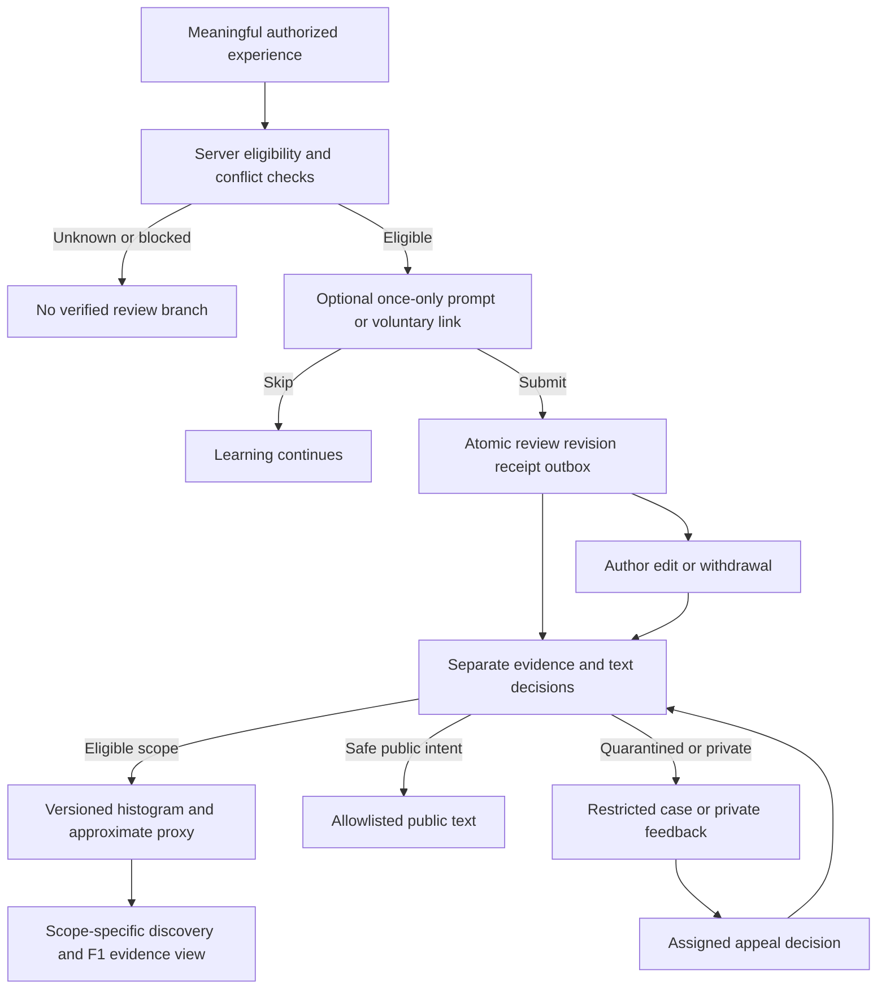

# F2 Credible Ratings, Reviews and Learning Evidence Master Plan

Date: 2026-11-07. Phase E. Status: PROPOSED, NOT IMPLEMENTED, NOT PLAN LOCKED.
STATE CHECK: Phase E, task FP2-E, branch feature/orbit-v3-foundation as recorded in STATE; Git was not queried by this agent.

**Goal:** Give learners useful, low-pressure review tools and give discovery/allocation honest star-aware evidence without pretending popularity proves learning or safety.
**Architecture:** Existing review/moderation records feed versioned, source-authoritative eligibility and separate content/evidence decisions. One shared calculator produces labeled scope-specific aggregates; authoritative source selection is distinct from rebuildable public projections.
**Stack:** Reuse audited JS/JSX, rating records, session stars and moderation surfaces. Type notation specifies proposed interfaces, not a language migration. No new library or vendor is selected.
**Execution gate:** E drafting only. Every implementation/test/release task below is future and unchecked. No runtime or causal claim is made.

## 1. Evidence, approaches and existing behavior

| Read evidence | Supports | Does not establish |
|---|---|---|
| [D signal/rating reasoning](thinking-signal-ratings.md) | Exact provisional star model, seven synthetic results, eligibility/edit/fatigue proposals | Final prior/risk policy, real calibration, fraud resistance or database behavior |
| [Audit B05/B09/B11/B14](01-existing-system-audit.md) | Editable Peer records, session stars, Cosmic recency/prior math; no located mounted course-review writer; hidden spotlight text leakage | Deployed behavior, complete course-review absence, or all A/U bug hypotheses |
| [Marketplace research](research-marketplace-economy.md) | Applied star-histogram Dirichlet/normal-approximation rationale | A universal risk setting, exact sparse posterior bound or education-marketplace efficacy |
| [Learning evidence](research-learning-evidence.md) | Heterogeneous feedback/outcome evidence and reported accuracy/support friction | That ratings, completion or feedback volume cause mastery gains |

Recommended D approach: star-histogram shrinkage plus a clearly labeled approximate uncertainty proxy and visible actual distribution/count/age. Raw averages can overrank sparse perfect samples. Binary Wilson applies to Bernoulli outcomes, not an ordinary 1-5 star mean. An exact posterior-quantile comparator is a future calibrated alternative, not an approved replacement or mandatory new library.

Audit-supported reuse paths: `D:/orbit-main/orbit-main/BackEnd/controllers/trustController.js`, `D:/orbit-main/orbit-main/BackEnd/models/rating.js`, `D:/orbit-main/orbit-main/BackEnd/controllers/sessionsController.js`, `D:/orbit-main/orbit-main/BackEnd/controllers/cosmicController.js`, and `D:/orbit-main/orbit-main/BackEnd/models/Course.js`. These are audit-supported existence claims, not freshly inspected source here. Extend records/moderation instead of adding a competing public reputation engine.

Peer reviews currently use one editable reviewer/recipient record; completed connection affects weight rather than submission eligibility. Session stars and Course.rating counters have different writers/semantics. Hidden-review star retention is deliberate current policy; leaking hidden quote text is a separately source-checked defect. Do not label all hidden star contributions a defect or silently mix historical data into a new verified cohort.

## 2. Shared contract and non-negotiables

Consume the supplied inline [shared platform contract](03-platform-contracts.md), not yet on disk at drafting time. `ActorContext`, `ResourceRef`, `CommandEnvelope<T>`, `Receipt<R>`, `CommandResult<R>`, `PolicyGate<T>`, `EventEnvelope<T>`, `ProjectionView`, `Tx`, authority/source/atomic coordinator, case/consent and account scope are canonical and are not redefined here.

Use canonical `operationId`, `expectedVersion`, `policyVersion`, `resource`, `payload`; `/api/v2/fp2` routes; `fp2.v1.` events; server actor context; approved policy gates; live fences; atomic receipt/outbox and nonenumerating errors. No client/helper/socket/model output supplies verified learning, review eligibility, fraud conviction, points, payments, rank, role or publication authority.

Scores, virtual assets, reviews, safety cases and learning outcomes are separate domains. Rating a course cannot mint currency or buy rank/claims. Review submission is optional and never gates learning, exit, export, refunds, consent, security, accessibility or support. No paid review advantage, minors' public ranking by default, coerced streaks or emotional-dependence copy.

A new aggregate methodology does not automatically rewrite historical reputation, award money or migrate data. Existing review records require approved provenance/eligibility compatibility and any affected score corrections must use linked versioned evidence, not a silent history overwrite.

## 3. Scope and verified eligibility

```ts
type ReviewScope =
  | Readonly<{ kind: "COURSE"; course: ResourceRef; recipientMentorId: Id }>
  | Readonly<{ kind: "SESSION"; session: ResourceRef; recipientId: Id; direction: "STUDENT_TO_MENTOR" | "MENTOR_TO_STUDENT" }>
  | Readonly<{ kind: "PEER"; recipientId: Id; connectionSourceId: Id }>;
type ReviewEligibility = Readonly<{
  eligibilityId: Id; reviewerAccountId: Id; scopeKey: Id;
  experienceSourceId: Id; experiencedResource: ResourceRef; experiencedVersion: Version;
  state: "eligible" | "unknown" | "blocked" | "revoked";
  conflictState: "clear" | "review_required" | "disallowed";
  checkpointKind: "GRADED_ATTEMPTS" | "APPROVED_LEARNING_CHECKPOINT" | "COMPLETED_SESSION" | "COMPLETED_CONNECTION";
  experienceAt: UtcInstant; evidenceVersion: Version; policyVersion: Id;
}>;
```

These fields are server generated. Source IDs submitted by a client are lookup hints; raw answers, watch time or `completed=true` never establish eligibility. `unknown` is an explicit SOURCE_BLOCKED state for the verified branch, not unverified evidence passed through as verified.

| Scope | Proposed verified eligibility and uniqueness | Public/aggregation boundary |
|---|---|---|
| COURSE | Authenticated real course enrollment plus either two distinct registered server-graded attempts or one approved meaningful learning checkpoint; no self/coauthor/control conflict. One active review per reviewer account/course, across versions/identities | Experienced course/lesson/rubric version recorded. Course public aggregate only after scope/privacy approval; never expose reviewer grades or identity from eligibility |
| SESSION Student -> Mentor | Current participant; actual completed authorized session under canonical completion evidence; self/control conflict clear. One active reviewer/session/recipient/direction | Session teaching summary separate from course review cohort; payment capture, booking or browser call-end alone insufficient |
| SESSION Mentor -> Student | Actual completed authorized session and participant grant; same uniqueness rule | Private constructive feedback only by default; never a public Student/minor rank or F1 teaching-quality input |
| PEER | Approved completed connection source and current authorized parties; one active reviewer/recipient relation under reviewed compatibility with existing semantics | Separate Peer reputation. Do not silently aggregate into Mentor teaching quality or verify a client-created call history |

Proposed two graded attempts mean two distinct accepted attempt sources in the relevant course, not two retries of the same submission. A reviewed checkpoint describes the learning task and rubric version; duration/completion clicks alone are insufficient. F4 registered grading owns answer keys/normalization and appeals; F2 only consumes its eligible evidence.

Refund after a valid learning experience does not automatically invalidate an honest review. Preview-only viewers cannot self-assert verified course status. Reviews from free but genuinely enrolled/eligible learners follow the same experience rule; spending more does not increase credibility. Account suspension may block new actions while existing valid history is reviewed under policy, not erased to manipulate a score.

Unknown appointment, identity/age, enrollment authority, source lineage, conflict, review timing or retention policy blocks the new verified/public branch. Identity selection does not grant a role. Serious correctness, rights or safety reports can still reach the ordinary private support/case route independent of review eligibility.

## 4. Timing, low fatigue, dimensions and edits

```ts
type ReviewInteractionPolicy = Readonly<{
  initialSubmissionWindowDays: 30;
  editWindowDays: 30;
  editCooldownHours: 24;
  promptsPerEligibleCourse: 1;
  promptsPerCompletedSession: 1;
  remindersEnabled: false;
  mentorRepliesPerThread: 1;
  dimensions: readonly ["clarity", "accuracy", "usefulness"];
}>;
type ReviewPolicyBundle = Readonly<{
  interaction: PolicyGate<ReviewInteractionPolicy>;
  eligibility: PolicyGate<JsonValue>;
  conflictAndRaterScope: PolicyGate<JsonValue>;
  evidenceModeration: PolicyGate<JsonValue>;
  contentVisibility: PolicyGate<JsonValue>;
  retention: PolicyGate<JsonValue>;
  publicPrivacy: PolicyGate<JsonValue>;
}>;
```

Every value is PROPOSED. D proposed the 30-day edit window; the 30-day initial submission window and 24-hour edit cooldown are additional explicit draft assumptions, not evidence-backed optimal values. Course/session/Peer timing needs founder and safety review before activation. Until approved, the required gate is `unknown`, not zero days or unlimited timing.

Flow: after the first eligible meaningful checkpoint, show one optional nonblocking review invitation. A skipped/dismissed prompt stays dismissed for that scope; V1 has no repeated nudges. The voluntary Review link remains discoverable. Session feedback is offered after canonical completion, never during checkout or an ongoing call. No prompt on every lesson or each retake.

Submit overall integer stars 1-5; optional one selected dimension with integer stars 1-5; optional bounded text. No required essay or all-dimension matrix. Text-only correctness/safety reports use a private case, not a fabricated star. Dimensions are separately labeled raw/count evidence, not additional copies of the overall vote or hidden weights in the main formula.

Author can edit within the approved 30-day window from first committed review, with expectedVersion, immutable history and `Edited` label. Edits change the current active review but never create another review or reset recency/prompt eligibility. No silent favorable-rating requirement or Mentor edit right. Repeated edits during proposed 24-hour cooldown return a safe policy block; withdrawal, urgent privacy redaction requests, safety reports and support remain available without cooldown.

An edit that cites a newly experienced course version must resolve a new authoritative experience source under the same reviewer/course uniqueness. Preserve historical experienced version/first review time; do not create a second vote. A new course copy/version cannot turn the same controlled reviewer into independent evidence.

Mentor may create one reply thread response with bounded text and edit/history under the same approved safety/timing policy. Author cannot alter another person's text. A reply is not a new rating and cannot expose private learner grades, contacts or recording URLs. Mutual visibility, current target ownership and content moderation are live checks, not implied by role.

## 5. Actor capabilities and privacy fields

| Actor/capability | Allowed action/fields | Live checks and explicit denial |
|---|---|---|
| Reviewer, `review.eligibility.read.own` | Own eligible/blocked state, safe reason, scope/version, review link | Own account/session and source permission; never return answer keys, private grades, other participant history or reviewer list |
| Eligible learner, `review.submit.eligible` | Own stars, one dimension and optional text | Authoritative eligibility, conflict, windows, parent ACL and approved retention/content policy; no arbitrary reviewer/verified/rank fields |
| Author, `review.edit.own`, `review.withdraw.own` | Current own review and own history/redaction requests | Root version, timing for ordinary edits; withdrawal/report not learning-gated; no another author's review |
| Recipient Mentor, `review.reply.own` | Visible review safe text/stars and own reply | Current recipient/ownership, thread purpose, visibility and reply uniqueness; deny contacts/private assessments/source internals |
| Assigned moderator, `review.moderate.assigned` | Assigned safe review/context, restricted evidence status, redaction and reason | Field-purpose grant, conflicts and independent appeal; no unrestricted recording/note/grade/contact access |
| Assigned appeal reviewer, `review.appeal.decide.assigned` | Case reason, relevant revision and evidence decision | Appointment distinct from disputed decision where required; no arbitrary star rewriting |
| Registered eligibility/calculation service | Registered experience provenance and approved scope inputs | Narrow workload identity and source registry; helpers/browser ratings do not attest eligibility |
| Public reader | Approved course/Mentor aggregate and published redacted review projection | Approved public scope, target visibility, adult opt-in/anonymous policy, sparse-cohort rules; no private learner identity/rank |

Default new review text is private/candidate until its explicit publication intent and approved moderation/privacy process permit a public projection. Anonymous-to-public does not mean anonymous to authorized abuse handlers; explain the approved field-purpose access accurately. Do not promise anonymity from free text, timing or sparse cohorts.

Unknown/minor age cannot authorize a public author profile or public learner-rating target. Proposed safe v1 minor contribution is private feedback only until a reviewed anonymization/consent policy clears aggregate use. Adult reviewers may opt into approved public attribution; display names are not dedup identities. Public course/Mentor scores do not imply permission to publicly rank their students.

## 6. Records, types and indexes

```ts
type Stars = 1 | 2 | 3 | 4 | 5;
type ReviewDimension = "clarity" | "accuracy" | "usefulness";
type EvidenceState = "PENDING" | "ELIGIBLE" | "QUARANTINED" | "INVALID" | "WITHDRAWN";
type ContentState = "PRIVATE" | "CANDIDATE" | "PUBLISHED" | "REDACTED" | "HIDDEN" | "DELETED";
type ReviewSubmitPayload = Readonly<{
  eligibilityId: Id; overallStars: Stars;
  dimension: Readonly<{ name: ReviewDimension; stars: Stars }> | null;
  text: string | null; publicationIntent: "private_feedback" | "public_candidate";
}>;
type ReviewEditPayload = Readonly<{
  overallStars: Stars; dimension: Readonly<{ name: ReviewDimension; stars: Stars }> | null;
  text: string | null; publicationIntent: "private_feedback" | "public_candidate";
  experiencedEligibilityId: Id | null;
}>;
type ReviewResult = Readonly<{
  review: ResourceRef; version: Version; evidenceState: EvidenceState; contentState: ContentState;
  experiencedVersion: Version; firstCommittedAt: UtcInstant; edited: boolean;
}>;
```

| Proposed record | Load-bearing fields | Required uniqueness/index |
|---|---|---|
| ReviewEligibility | Fields in section 3 plus scope descriptor and source refs | Unique reviewer/scope/source eligibility; reviewer/state; experience/source lookup; current version fence |
| Review | reviewerAccountId:Id; scopeKey:Id; scopeKind:COURSE/SESSION/PEER; targetRef:ResourceRef; experiencedVersion:Version; currentRevision:Version; evidenceState; contentState; firstCommittedAt; ageAnchorAt; policyVersion | Unique active reviewer/scopeKey; target/state; source lookup; one review across course versions/workspaces |
| ReviewRevision | reviewId:Id; revision:Version; overallStars:Stars; dimension|null; privateTextRef:Id|null; safePublicTextRef:Id|null; eligibilityId:Id; experiencedVersion:Version; editedAt:UtcInstant; editedBy:Id | Unique review/revision; immutable original/version/source; private text separate |
| ReviewReply | reviewId:Id; recipientId:Id; revision:Version; privateTextRef:Id; safePublicTextRef:Id|null; contentState; firstCommittedAt | Unique review/recipient thread; reply/revision history; moderation visibility enforced |
| ReviewPrompt | reviewerId:Id; scopeKey:Id; eligibilityId:Id; state:eligible/shown/dismissed/submitted; firstShownAt:UtcInstant|null | Unique reviewer/scope/promptKind; retry cannot reprompt; no grade/reward effect |
| EvidenceDecision | reviewId:Id; decisionVersion:Version; state; reasonCode:string; caseId:Id; evidenceRefs:ResourceRef[]; decidedBy:Id; decidedAt:UtcInstant; appealState | Unique review/decisionVersion; assigned case/state; immutable appealable decision |
| ContentDecision | review/reply ref; revision:Version; visibility state; reasonCode; safeTextRef:Id|null; decision/case refs | Unique target/revision/decision; published safe-text index; original cannot be selected by public quotes |
| RatingInputSnapshot | scopeKey:Id; methodologyVersion:Id; cutoff:UtcInstant; inputReviewRevisionRefs:Id[]; evidenceDecisionVersions:Id[]; raterSelectionVersion:Id; sourceDigest:Id | Unique scope/methodology/cutoff/inputDigest; restricted authoritative selection provenance |
| RatingAggregateProjection | scopeKey:Id; sourceVersion:Version; schemaVersion:Version; asOf:UtcInstant; rawHistogram:5 integer counts; weightedHistogram:5 finite numbers; rawCount; rawMean:number|null; effectiveMass:number; posteriorMean:number|null; lowerProxy:number|null; status:UNRATED/RATED/BLOCKED; methodologyVersion:Id | Unique scope/methodology/authScope; sourceVersion; public/private projections separate |
| ReviewCase | caseId:Id; review/reply/source refs; category:privacy/fraud/retaliation/correctness/rights/safety/appeal; assignment/purpose; state; decision refs | Unique case; assigned/state; approved retention; no public case count joining private targets |

Use shared Receipt/Operation, AuthzFence, SourceRegistry, Outbox, ConsumerCheckpoint, Consent and PolicyBundle. Posted history, source decisions and dedup markers cannot be TTL-forgotten to recreate reviews/rewards. Retention/deletion/holds need DEC-E-C07/C12 approval; do not claim perpetual original-text storage or instant deletion of all lawful case evidence.

## 7. Exact provisional star model

For star category k=1..5, prior `a0=(1,1,2,9,7)`. Prior mass=20; prior mean=4.00. These are deliberately proposed design assumptions, not observed platform quality.

For each eligible selected active review j, `ageDays=(asOf-ageAnchorAt)/86400000` and `w_j=2^(-ageDays/180)`.
`a_k=a0_k+sum(w_j where star_j=k)`; `A=sum(a_k)`;
`mu=sum(k*a_k)/A`;
`V=(sum(k*k*a_k)/A-mu*mu)/(A+1)`;
`sigma=sqrt(max(0,V))`;
`L=clip(mu-1.2815515655*sigma,1,5)`.
F1 approved quality mapping uses `Q=(L-1)/4`; if UNRATED, F1's distinct proposed neutral 0.50 applies, not a public prior-only rating.

`L` is an approximate risk-adjusted sorting proxy, not binary Wilson, an exact posterior quantile, a proven 90% lower guarantee, fraud-resistant reputation, learning mastery or a safety clearance. Recency produces fractional discounted pseudocounts; correlated reviews further weaken an independent-sample interpretation.

Proposed `ageAnchorAt=firstCommittedAt` of the original review after authoritative eligibility validation, even if moderation/publication arrives later. Edits, unhide, appeals, replies, copies and methodology changes never refresh this timestamp. Experience date/version is displayed separately. Future/invalid timestamps or negative ages are quarantined, not silently clipped into fresh maximum-weight evidence. This anchor policy requires approval; source times are server validated.

Compute raw histogram/count/mean only from the same eligible selected cohort used in that scope, before recency discount. Effective evidence mass is `sum(w_j)`, not number of people and not raw count. Prior mass is never included in displayed review count. Dimension summaries have separate counts and are not additional overall-star votes. Safety/correctness cases remain active according to case policy even when old star weights decay.

Empty eligible selected set yields status UNRATED, rawCount=0, rawMean=null, lowerProxy=null and posteriorMean=null in public/F1 transport. Internal diagnostic prior mean 4.00 may exist but cannot create a public rating/rank. Required policy/source unavailable yields BLOCKED, not UNRATED or fabricated prior evidence.

Arithmetic requirements: deterministic approved methodology version/cutoff; finite bounded star/weight inputs; stable input ordering and numerically stable summation; reject corrupted histograms, NaN/Infinity, negative counts or age. Floating arithmetic is allowed for the statistical proxy only; it never computes money/ledger amounts. Display rounding does not feed back into S or overwrite original evidence.

## 8. Seven D synthetic examples

These are preserved D outputs, not computations executed in E, real cohorts or causal evidence. Fresh reviews use age zero; all aged reviews below use exactly 360 days, giving weight 0.25 each.

| Synthetic histogram [1,2,3,4,5] | Raw count/mean | Effective review mass | Posterior mean mu | Approximate L |
|---|---|---|---|---|
| Single perfect [0,0,0,0,1] | 1 / 5.00 | 1 | 4.047619 | 3.761973 |
| Established [1,2,7,66,224] | 300 / 4.70 | 300 | 4.656250 | 4.610277 |
| Five perfect [0,0,0,0,5] | 5 / 5.00 | 5 | 4.200000 | 3.943690 |
| Mixed [5,5,10,30,50] | 100 / 4.15 | 100 | 4.125000 | 3.996878 |
| Low stable [50,25,15,5,5] | 100 / 1.90 | 100 | 2.250000 | 2.090647 |
| Established, all aged 360 days | 300 / 4.70 | 75 | 4.552632 | 4.453121 |
| No reviews [0,0,0,0,0] | 0 / unavailable | 0 | 4.00 internal prior only | UNRATED public/F1 |

The required comparison holds under these assumptions: `3.761973 < 4.610277`, even though the single raw average is 5 and established raw average is 4.7. The established exact sum is 1,410 stars over 300 reviews. The model does not prove the established Mentor is always better or has greater learning efficacy.

D independently checked these synthetic outputs and sensitivity variants earlier; this agent did not rerun the workbook, Office or application. Future acceptance uses an independent high-precision reference with <=0.000001 tolerance for the displayed six-decimal results and unrounded reference comparisons for ordering. Sensitivity must vary prior strength/shape, half-life, risk and correlated/sparse inputs before final selection; never tune only to the desired example winner.

## 9. Rater scope, outliers and F1 consumption

Course summaries use one active eligible review per account/course. Session summaries use one eligible Student-to-Mentor review per session but need an approved repeated-rater selection policy for recipient-level summaries. Peer summaries remain separate. Raw scope counts cannot be relabeled independent people.

Proposed combined Mentor teaching-quality candidate: use only relevant reviewed course outcomes; at most one eligible course review per reviewer account for that Mentor/subject scope, selecting the most recent original eligible review by ageAnchorAt and stable ID, never the highest star. Keep session and Peer evidence separate until an explicit approved mapping changes this. This rater-selection rule is a PROPOSAL under DEC-E-R05, not a hidden score weight or already deployed behavior.

Expose `scopeKind`, experience versions, methodology version, asOf, selected review count, unique-rater count, effectiveMass and source snapshot version. Public course raw counts and Mentor selected counts may differ; label them rather than secretly deduplicating one display while scoring another set. F1 obtains `TeachingQualityView { status, lowerProxy, selectedCount, scopeKey, methodologyVersion, sourceVersion, asOf, unknownReasons }` from this single approved scope service. A read projection is not source authority: server F1 selection validates its input snapshot/current evidence decisions and records the version used.

Outliers: valid 1-star and 5-star experiences remain eligible. Do not remove criticism for disagreeing with the mean or downgrade newcomers/minors by popularity. Sparse/extreme distributions increase uncertainty through the histogram, not discretionary censorship. Reviews correlated through a family/class/cohort are not automatically fraud; correlation triggers a restricted reviewed case where warranted.

Confirmed disallowed conflicts/fraud contribute zero under an appealable evidence decision. Suspected coordinated behavior is quarantined under approved evidence policy while reviewed; flags alone do not prove guilt. An appeal restoring evidence creates a new snapshot/projection revision, preserving original age and review history. No bought rater credibility, star-price weights or raw helper approvals.

Rater control/conflict scope needs reviewed account lineage, self/coauthor/employment/compensation rules and appropriate disclosure. Do not infer control solely from IP or shared school/device. If conflict classification is unresolved, the new verified contribution is review_required/blocked, not a fabricated independent verified vote.

## 10. Content moderation, evidence moderation and appeals

Evidence eligibility and text visibility are independent state machines. This preserves safe valid feedback without leaking hidden text or treating offensive wording as proof that a star experience did not occur.

| Transition | Authority/effect | Projection consequence |
|---|---|---|
| New submission -> PENDING/CANDIDATE or PRIVATE | Verified eligibility preflight; approved content process; atomic review/revision/receipt/outbox | No public quote or claimed verified aggregate until evidence accepted |
| PENDING -> ELIGIBLE | Registered eligibility/source validation and approved conflict/moderation rule | Included only in approved scope/privacy cohort |
| CANDIDATE -> PUBLISHED/REDACTED | Explicit publication intent, safe-text decision and approved author/target privacy | Public quote only safe text at current authorized revision |
| PUBLISHED/REDACTED -> HIDDEN | Assigned content reason/case; remove public text/reply exposure | Valid stars may remain only under approved hidden-content evidence policy; hiding alone is not fraud |
| ELIGIBLE -> QUARANTINED | Assigned suspected-fraud/source/conflict case with review/appeal policy | Excluded pending review; label methodology/selection change without revealing private accusations |
| QUARANTINED -> ELIGIBLE/INVALID | Reviewed evidence decision and reason | Restore with original age or exclude; update snapshot/projection once |
| Any active review -> WITHDRAWN | Author withdrawal under approved retention/control-marker policy | Remove current contribution and public text according to approved withdrawal policy; no duplicate new vote |
| Author text redaction/deletion request | Field-purpose privacy workflow; approved case/hold/retention | Public safe text immediately removed when required; historical retention explicitly policy-bound |
| Decision -> APPEAL -> resolved decision revision | Independent appointed reviewer as required; bounded allowed evidence | Linked history/receipt/event; no secret rewriting or forced favorable star |

Proposed v1 public quotes require contentState=PUBLISHED or REDACTED, current safePublicTextRef, ELIGIBLE evidence and live public scope permissions. HIDDEN/DELETED/PRIVATE/PENDING text is never returned by spotlights, search, reply joins, notifications, exports or caches. A redacted public projection must never fall back to original text. Include the audited spotlight guard in future tests; hidden-star retention is a separate policy decision.

Correctness/rights/safety claims route to independent assigned cases outside the aggregate. A one-star safety report is neither erased by recency nor treated as a proven sanction. A grade/answer dispute follows authoritative rubric/version/appeal review, not automatic censorship of a negative review or local regrading.

Retaliation safeguards: Mentor cannot see contacts/private error histories, edit student stars, require a positive review for refund/support, publicly identify a minor or punish learning entitlement. Reports are private; support reviewers receive minimal needed fields. Case decisions specify scope, evidence, reason, appeal route and review deadline under approved policy. Staffing/response time/legal obligations remain blocked decisions, not an instantaneous service promise.

## 11. Proposed API contracts

All suffixes below are under `/api/v2/fp2`. Commands use the shared envelope and return `CommandResult<ReviewResult>` or the stated typed result. 201 creation; 200 mutation/replay/no_change; 202 lease processing. Source lookup and detailed validation happen after resource authorization. Missing/unauthorized/revoked objects share 404 RESOURCE_NOT_AVAILABLE; no private existence/current-version hints.

| Proposed endpoint | Request/result | Capability, source and privacy checks | Specific errors |
|---|---|---|---|
| GET `/review-eligibility?kind=course&resourceId={id}` | Own scope hint -> safe eligibility state/version/checkpoint label/review ref | `review.eligibility.read.own`; current enrollment/participant/connection authority and approved source policy; no grades/answers/contact fields | 400 scope schema; 404 unavailable parent; 422 POLICY_BLOCKED/SOURCE_BLOCKED |
| POST `/commands/review.prompt.respond` | scope ref, eligibilityId, choice shown/dismissed -> own prompt state | `review.prompt.respond.own`; eligibility and account prompt uniqueness; no client prompt grants | 409 stale scope; 422 unavailable retention; repeat no_change |
| POST `/commands/review.submit` | ReviewSubmitPayload; resource review/absent -> ReviewResult | `review.submit.eligible`; own server eligibility, parent ACL, source/version/conflict/windows/publication intent | 400 invalid stars/authority fields; 409 duplicate active scope; 422 policy/source/consent block |
| POST `/commands/review.edit` | ReviewEditPayload -> ReviewResult | `review.edit.own`; author, current review/source/experienced version, edit window/cooldown; revalidate public text intent | 409 VERSION_CONFLICT; 422 closed/cooldown/policy/source; no recency reset |
| POST `/commands/review.withdraw` | reasonCode optional -> withdrawn state/current contribution removed | `review.withdraw.own`; author/live scope; approved retention/source marker policy; no harassment cooldown | 404 another author's review; 422 policy resolution required; learning/support unaffected |
| GET `/reviews/{id}` | Authorized review ref -> safe current revision/state/stars/text/reply | Author own fields, recipient-visible fields or approved public projection; live field-level ACL/content/evidence decisions | 404 unavailable; never hidden original fallback |
| GET `/reviews/{id}/history` | Review ref/cursor -> authorized version history | `review.history.read.own` or assigned field-purpose reviewer; private originals never public/recipient by role alone | 404 unauthorized history; 400 cursor; no full eligibility/grades dump |
| POST `/commands/review.reply.create` | text -> reply ref/version/content state | `review.reply.own`; current recipient, visible thread, reply uniqueness, moderation/privacy policy | 409 existing response; 422 safety/publication policy |
| POST `/commands/review.reply.edit` | text -> reply revision/content state | `review.reply.edit.own`; same recipient author and reply grant, edit policy/root version | 409 stale reply; 422 content/cooldown; cannot alter reviewer text |
| POST `/commands/review.report` | category, own bounded evidence refs -> private case receipt | Shared `case.create.own`; affected member/live visible or own resource, purpose-limited evidence, retention | 404 other private sources; 422 unsupported sensitive retention |
| POST `/commands/review.moderation.decide` | caseId, content/evidence disposition, reasonCode, allowed evidence refs -> decision version | `review.moderate.assigned`; appointment/conflict/scope/source and field grant; disposition schema not arbitrary stars | 400 star override/unknown disposition; 422 unapproved decision policy |
| POST `/commands/review.appeal.create` | decisionId, bounded statement/evidence refs -> own private appeal case | `review.appeal.create.own`; affected author/recipient and decision field grant; source/retention | 404 unavailable decision; 409 existing same appeal; no review-pressure gate |
| POST `/commands/review.appeal.decide` | caseId, uphold/restore/review_required, reason/evidence refs -> linked decision | `review.appeal.decide.assigned`; independent appointment where required and approved policy | 422 unresolved source/conflict; no arbitrary historical rewrite |
| GET `/ratings/{kind}/{id}?minVersion={v}` | Approved scope ref -> public or authorized aggregate ProjectionView | Public allowlist or `rating.scope.read.authorized`; approved target/age/scope/privacy; no reviewer identities or private case refs | 404 inaccessible scope; 202 lagging; BLOCKED/UNRATED explicitly distinct |
| GET `/rating-methodologies/{id}` | Public registered methodology ID -> allowlisted formula/labels | Approved public documentation registry; no keys, private tuning evidence or service capability list | 404 unpublished/missing methodology; no private source snapshots |

Registered internal commands `review.eligibility.refresh`, `review.evidence.refresh`, `rating.snapshot.create` and `rating.scope.rebuild` require matching narrow service capabilities and approved source/authority fences. Browser requests cannot invoke service authority by supplying a capability field. Rebuild jobs never mutate ledger balances, raw grades or rewards.

Example creation envelope: `{"operationId":"op-review-1","expectedVersion":"absent","policyVersion":"approved-policy-1","resource":{"kind":"review","id":"review-1"},"payload":{"eligibilityId":"eligibility-1","overallStars":4,"dimension":{"name":"clarity","stars":4},"text":"The worked example was clear.","publicationIntent":"public_candidate"}}`. The server resolves the author/scope/eligibility/version and current privacy policy. IDs/copy are illustrative, not eligibility grants.

## 12. Version, idempotency and source semantics

Unique active reviewer/scope prevents duplicate review creation under new IDs, operation IDs, copies of request bodies or identity switching. Session and course scopes are different legitimate experiences only under approved registry rules; do not mint multiple credibility contributions from one source by inventing scope aliases.

Original operation replay returns the original currently authorized receipt with replayed=true and no new revision/event/prompt. New operation for already submitted identical semantic review returns authorized no_change; attempting a second different creation returns 409 conflict and the author must use explicit edit. Stale edit returns authorized VERSION_CONFLICT and requires refresh/rebase, never automatic overwrite.

Changing policy or re-publishing text cannot reset original source/age or consume the same learning benefit again. Edits have a new immutable revision, current pointer CAS, content/evidence review as necessary, aggregate invalidation, receipt and outbox in one transaction. Eligibility revocation races with submission/edit through the same live authority/source fences; stale read approval is insufficient.

Invariant review uniqueness, current evidence/content decisions and prompt budget are transactional. Discovery aggregates are rebuildable read projections. F1's server evidence snapshot is source-authorized/versioned and cannot rely on a stale public UI rating. A confirmed fraud/revocation fence must be checked again before a new F1 offer/claim; historical offer score snapshots are not silently reinterpreted under today's prior.

Crash before commit leaves no review/current pointer/terminal receipt. Crash after commit but before response returns the original receipt. Outbox projection failure leaves honest saved review and lagging aggregate, not a fabricated updated rating. A saved inbox/webhook/helper output is never evidence that rating eligibility or publication completed.

## 13. Calculator and submission pseudocode

```text
buildRating(scope, snapshot, approvedMethodology, asOf):
  assert approvedMethodology.isApprovedAndNotSuspended
  inputs = selectEligibleActiveReviewsForApprovedScope(snapshot, scope)
  assert authoritativeInputVersionsAndPrivacyRulesValid(inputs)
  if inputs.isEmpty:
    return UNRATEDWithZeroCountAndNullPublicScores
  rawHistogram = fiveCheckedIntegerZeros()
  weightedHistogram = fiveFiniteZeros()
  for review in stableInputOrder(inputs):
    assert review.star in {1,2,3,4,5}
    assert review.ageAnchorAt <= asOf
    ageDays = elapsedUtcMilliseconds(review.ageAnchorAt, asOf) / 86400000
    weight = power(2, -ageDays / 180)
    rawHistogram[review.star] += 1
    weightedHistogram[review.star] += weight
  a = [1,1,2,9,7] + weightedHistogram
  A = stableSum(a)
  mu = stableSum(k * a[k] for k in 1..5) / A
  V = (stableSum(k*k*a[k] for k in 1..5) / A - mu*mu) / (A + 1)
  L = clip(mu - 1.2815515655 * sqrt(max(0,V)), 1, 5)
  return RATEDWithRawCountsMeansMassAndExplicitApproximation(mu, L)

planReviewSubmission(tx, actor, envelope):
  authorizeParentAndOwnEligibilityAndTouchFences(tx, actor, envelope)
  requireApprovedEligibilityTimingRetentionAndVisibility(envelope.policyVersion)
  eligibility = resolveAuthoritativeExperience(tx, envelope.payload.eligibilityId)
  assert eligibility.reviewerAccountId == actor.accountId
  assert eligibility.state == eligible and eligibility.conflictState == clear
  assert withinApprovedSubmissionWindow(serverNow, eligibility)
  validateStarsDimensionBoundedTextAndPublicationIntent(envelope.payload)
  assert noOtherActiveReviewerScopeRecord(tx, actor.accountId, eligibility.scopeKey)
  compareExpectedVersion(tx, envelope)
  review = stageReviewRevisionAndEligibilityLinks(tx, eligibility, envelope.payload)
  stagePromptConsumedAndSafeAggregateInvalidation(tx, review)
  return stageAtomicReceiptAndOutbox(tx, review)
```

Pseudocode uses conceptual 1-based star indexing; actual adapter must use one registered encoding and tests for all five categories. Calculator is pure and cannot establish eligibility. Feature routines stage `AtomicPlan`; shared `executeCommand`/`commitAtomicPlan` own the actual commit and receipt. No provider call, independent commit or client grading occurs here.

## 14. Registered events and read projections

| Proposed event | Minimal payload | Safe consumer behavior |
|---|---|---|
| `fp2.v1.review.eligibility.changed` | own eligibility ref, evidenceVersion, state | Own review link refresh; no private grades or source text in socket |
| Shared `fp2.v1.review.changed` | review ref/current revision/scope invalidation ref | Authorized current-review and rating-input refresh; no hidden original text |
| `fp2.v1.review.reply.changed` | reply/review refs and content revision/state | Safe thread projection, visibility rechecked |
| `fp2.v1.review.evidence.changed` | review ref, evidenceDecisionVersion, safe status | Rebuild approved scope from registered source; no fraud conviction from event alone |
| `fp2.v1.review.content.changed` | review/reply ref, safe-text revision/state | Remove hidden quote/search/export exposure and invalidate caches |
| `fp2.v1.review.appeal.changed` | private case/decision refs and authorized state | Assigned/own case views only, no public allegation |
| `fp2.v1.rating.scope.changed` | scope ref/sourceVersion/methodologyVersion/asOf | Fetch allowlisted aggregate; cannot award points or create claim authority |

Shared event envelope carries operation, policy, root version, aggregate sequence and causation. Consumer effect/checkpoint commits atomically; duplicates do not double counts, old events cannot resurrect hidden text and gaps trigger authorized refresh/rebuild. Different aggregates have no promised global event order.

Public review/card/search/spotlight/export/notification queries all consume the same field allowlist and current content/evidence gate. No whole User join, original text fallback, private grade/source URL or reviewer contact lookup. Cache/account keys include the full shared account/generation/identity/epoch/policy boundary. Logout/identity changes clear previous private review/history/media and abort delayed callbacks before next account mounting.

Methodology/asOf/sourceVersion are visible with aggregates. Lagging views say so; GET is side-effect-free and cannot change source decisions or perform rollover. Rebuild from validated immutable revisions/decisions, not the previous rounded average or incomplete analytic ring buffer.

## 15. Learning outcomes without rating laundering

Outcome evidence is separate from satisfaction stars. Proposed allowed source fields are taskFamilyId, rubricVersion, assessmentVersion, cohortDefinitionVersion, opportunityWindow, authoritativeGradeEvidenceRef, comparableBaselineRef and delayedAssessmentRef. Raw identifiable learner attempts remain private under purpose grants.

Comparability requires the same reviewed task/rubric/normalization/retake family or explicit validated mapping, similar eligibility and measured opportunity windows. F4 owns chance/difficulty/best-delta normalization; F2 does not invent a new score equation. Best 15->18 improves by exactly three under the shared comparable evidence rule; repeating 18 or returning to 15 adds zero. A changed rubric without approved comparability is SOURCE_BLOCKED, not a new favorable outcome.

Public candidate outcomes: aggregate rubric-specific completion/assessment summaries with numerator, denominator, missingness, experienced course version, window and uncertainty. They are not causal teaching effects. Suppress sparse or reidentifiable cohorts under an approved privacy threshold; the exact threshold/window/interval estimator remains `PolicyGate<OutcomeDisplayPolicy>.unknown` until validated, not guessed as zero or a made-up confidence interval.

No cross-course ranking by incomparable assessments, no use of private error history to punish reviewers, and no conversion of completion clicks/watch time/engagement into mastery. Selection, attrition, baseline differences and repeat exposure must be disclosed in any later approved evaluation. Research's heterogeneous average effects are not product predictions.

## 16. Plain UX copy and motion-independent states

| State | Copy | Required controls/meaning |
|---|---|---|
| Optional prompt | `Would you like to review this learning experience? You can skip this.` | Skip/close and voluntary later link; no access/refund penalty |
| Unverified/ineligible | `Verified reviews require an eligible learning experience.` | Explain own safe checkpoint rule; support/correctness report remains available |
| Pending review | `Your review was saved and is being checked before publication.` | Own receipt/state; never claim already public |
| Private feedback | `Only the authorized feedback recipients can see this.` | Accurate field-purpose disclosure; no unconditional anonymity promise |
| Published | `Your review is published.` | Current safe revision, experienced version and edit/withdraw controls |
| Edited | `Edited. The original review date is unchanged.` | Authorized history; no extra vote or renewed freshness |
| Edit conflict | `This review changed. Review the latest version before saving.` | Preserve scoped authorized draft; explicit rebase |
| Cooldown/window | `This review cannot be edited right now. You can still withdraw it or contact support.` | Safe approved date/reason; urgent redaction/report available |
| UNRATED | `No eligible reviews yet.` | No prior-only stars or rank |
| Rated public summary | `Average {mean} from {count} eligible reviews.` | Distribution/age/scope/methodology and selected unique-rater label |
| Sorting explanation | `Sorting uses an approximate evidence-adjusted score, not just the average.` | Link formula/prior/recency/risk limitations; no exact confidence promise |
| Hidden text | `This text is unavailable under the review policy.` | No original preview/tooltip/search snippet; private appeal where authorized |
| Fraud/correctness case | `Your report is under review.` | Private case status and appeal; no public guilt or guaranteed resolution time |
| Lagging summary | `Your saved review is still updating in the summary.` | Saved version and status; no fictitious count update |
| Outcome unavailable | `Comparable outcome evidence is not available.` | No guessed improvement percentage or learner profiling |

Static text, semantic star radio controls with labels, keyboard navigation, focus/status announcements and text histograms provide full completion. Optional save/reply reveal <=180 ms is PROPOSED; no measured fps or visual QA claim. Reduced-motion removes displacement; sound off by default. Stars cannot be color-only, a preselected favorable rating or required to receive support. No ceremony on replay/no_change. Route/account/GPU/preference changes cannot apply stale responses or callbacks.

The public explanation exposes approximation, raw distribution, count and original date/experienced version. It does not expose private review sources/case IDs or imply that a 4.7 course produces measured mastery. Sparse cohorts have private/suppressed states, not visually impressive fake precision.

## 17. Textual review/evidence diagram



| Diagram nodes | Equivalent operation | Authority/result |
|---|---|---|
| A-B-C | Registered experience, enrollment/participant and conflict validation | Unknown fails closed; support remains available |
| D-E | Optional prompt/dismissal | No attendance, grade or access penalty |
| F-K | Versioned submit/edit/withdraw with receipt and outbox | One active review, immutable history, no recency reset |
| G-I-J-L | Independent eligibility/content/case/appeal decisions | Hidden text excluded; fraud requires reviewed evidence |
| H-M | One star-aware calculator over approved rater scope | Labeled approximate proxy; source-authoritative input snapshot, no money/grade authority |

Diagram is textual monochrome Mermaid plus its equivalent table. No rendered/palette/browser/device verification is claimed.

## 18. Proposed future files and interfaces

All paths here are PROPOSED, not existing-file claims. Frontend receives view/transport types, never server eligibility constructors or `Tx`.

| Future file | Exact proposed interface/responsibility |
|---|---|
| `D:/orbit-main/orbit-main/shared/fp2/ratingModel.js` | `computeStarEvidence(input: StarEvidenceInput): StarEvidenceResult`; pure approved histogram/prior/recency/risk calculation |
| `D:/orbit-main/orbit-main/shared/fp2/reviewSchemas.js` | Registered bounded review/reply/decision command/event schemas; unknown authority fields rejected |
| `D:/orbit-main/orbit-main/BackEnd/services/fp2/reviewEligibility.js` | `resolveReviewEligibility(tx: Tx, actor: ActorContext, scopeHint: JsonValue): Promise<ReviewEligibility>`; authoritative source/parent/conflict gates |
| `D:/orbit-main/orbit-main/BackEnd/services/fp2/reviewService.js` | `planReviewSubmit(tx: Tx, actor: ActorContext, envelope: CommandEnvelope<ReviewSubmitPayload>): Promise<AtomicPlan<ReviewResult>>`; `planReviewEdit(tx: Tx, actor: ActorContext, envelope: CommandEnvelope<ReviewEditPayload>): Promise<AtomicPlan<ReviewResult>>` |
| `D:/orbit-main/orbit-main/BackEnd/services/fp2/reviewModeration.js` | `planReviewDecision(tx: Tx, actor: ActorContext, envelope: CommandEnvelope<JsonValue>): Promise<AtomicPlan<JsonValue>>`; assigned content/evidence/appeal decisions |
| `D:/orbit-main/orbit-main/BackEnd/services/fp2/ratingScopeService.js` | `selectRatingInputs(tx: Tx, scope: JsonValue, policyVersion: Id, asOf: UtcInstant): Promise<RatingInputSnapshot>`; `getTeachingQuality(tx: Tx, mentorId: Id, subjectId: Id, policyVersion: Id): Promise<TeachingQualityView>` |
| `D:/orbit-main/orbit-main/BackEnd/services/fp2/reviewProjection.js` | `getSafeReviewView(actor: ActorContext, review: ResourceRef): Promise<ProjectionView>`; scope/content/evidence/age/public allowlists |
| `D:/orbit-main/orbit-main/FrontEnd/src/components/fp2/ReviewComposer.jsx` | Optional overall/dimension/text, publication intent, skip/edit/withdraw and shared fp2Client |
| `D:/orbit-main/orbit-main/FrontEnd/src/components/fp2/RatingEvidenceSummary.jsx` | Semantic text distribution/count/age/approximation, UNRATED/BLOCKED/lagging states |

`StarEvidenceInput` contains the approved methodology version, asOf and already authorized selected review revisions with stars/ageAnchorAt. `StarEvidenceResult` contains raw/weighted histograms, count/unique-rater count, rawMean, effectiveMass, mu/L or UNRATED, and explicit approximation metadata. Input source selection stays server-only; client calculation is an educational preview, never authoritative rating eligibility or F1 quality.

Dependencies: shared context/policy/fences/coordinator first; registered F4 grading/session/connection completion authority; reviewed legacy provenance mapping; public projection/retention policy; independent moderation/appeal staffing; F1 approved quality-scope integration. No extra currency, bought credibility, league privilege or subscription/session share adjustment is introduced.

## 19. Minimum, V1 and V2

- **Minimum candidate:** source-authoritative eligibility, private feedback, safe current-review/history permissions, UNRATED/BLOCKED distinction and typed policy blocks. Do not ship public ratings without provenance/privacy approval.
- **V1 candidate:** approved course and separately scoped session/Peer reviews, once-only optional prompt, dimensions, versioned edits/withdrawal/reply, independent evidence/text moderation, safe public aggregates/quotes, shared single calculator and F1 source snapshot integration.
- **V2 candidate:** calibrated exact-quantile comparison, approved richer outcome cohorts and reviewed additional rater-source mappings. They require explicit scope, privacy, cost/license/API and evidence choices, not automatic inclusion.
- **Never implicit:** public learner/minor rating rank, paid rater status, purchased favorable stars, automatic sanctions from low ratings, emotional-dependence prompts or automatic learning-effect claims.

## 20. Unchecked future tasks

For each task: first author failing assertions, then implement the stated interfaces, then run targeted tests only after a later implementation approval. Verify actual runner/manifests/topology before choosing commands. No commit is mandatory or authorized by this plan.

- [ ] **Task 1 - Scope/eligibility contracts.** Future files: reviewSchemas/reviewEligibility and `D:/orbit-main/orbit-main/BackEnd/tests/fp2ReviewEligibility.integration.test.js`. Assert F2-01/F2-08/F2-09/F2-10/F2-19: authoritative course/session/Peer sources, conflicts and distinct scope; no helper verification.
- [ ] **Task 2 - Calculator and independent numeric reference.** Future files: ratingModel and `D:/orbit-main/orbit-main/BackEnd/tests/fp2RatingModel.test.js`. Assert seven D cases and F2-02/F2-03/F2-04/F2-05; reject corrupted inputs and binary-Wilson substitution; sensitivity variants must disclose changed assumptions.
- [ ] **Task 3 - Atomic submit/edit/prompt.** Future files: reviewService/shared coordinator and `D:/orbit-main/orbit-main/BackEnd/tests/fp2ReviewMutation.integration.test.js`. Assert F2-06/F2-07/F2-11/F2-12/F2-23: unique scope, stale edit conflict, replay, no age reset, optional once-only prompt and failure injection.
- [ ] **Task 4 - Safe text/reply projections.** Future files: reviewProjection/reviewModeration and `D:/orbit-main/orbit-main/BackEnd/tests/fp2ReviewPrivacy.integration.test.js`. Assert F2-13/F2-14/F2-15/F2-16: hidden original absent from all quotes/search/export/notifications, recipient limited fields, minor/sparse defaults and single reply.
- [ ] **Task 5 - Evidence moderation/appeals.** Future files: reviewModeration and `D:/orbit-main/orbit-main/BackEnd/tests/fp2ReviewAppeal.integration.test.js`. Assert F2-17/F2-18/F2-20: suspected versus proven fraud, appeal restoration age/history and independent correctness/safety path.
- [ ] **Task 6 - Rater selection and F1 integration.** Future files: ratingScopeService/F1 allocator and `D:/orbit-main/orbit-main/BackEnd/tests/fp2RatingScope.integration.test.js`. Assert F2-10/F2-18/F2-19/F2-21: scope separation, one selected rater contribution, source decision version/fences and no grade/currency authority.
- [ ] **Task 7 - Client/account/accessibility.** Future files: ReviewComposer/RatingEvidenceSummary and `D:/orbit-main/orbit-main/FrontEnd/src/components/fp2/__tests__/ReviewFlow.test.jsx`. Assert F2-12/F2-15/F2-22/F2-24 with keyboard/static/reduced-motion/sound-off, route interruption and delayed cross-account responses.
- [ ] **Task 8 - Projection/outcome release gate.** Future fixture files selected after runner verification; consume shared G01-G11/G19-G20/G29-G30 and vectors below. Assert duplicate/old/gapped events cannot restore hidden text or alter grades; sparse/incomparable outcomes suppressed. Require approved methodology/privacy/provenance/staffing and later real integration/abuse/device evidence before release.

## 21. Concrete future failure vectors

These are specified future assertions, not tests executed in E.

| ID/input or failure | Expected outcome |
|---|---|
| F2-01 Client sends reviewerId, verified=true, graderId or trusted completion time | INPUT_INVALID; no eligibility, score, grade, currency or role effect |
| F2-02 No eligible selected reviews | UNRATED; rawCount 0, public rawMean/L null, no prior-only rank |
| F2-03 Fresh one perfect versus fresh [1,2,7,66,224] | Raw 5 versus 4.7; approximate L 3.761973 versus 4.610277; established sorts higher under recorded assumptions |
| F2-04 Established reviews all 360 days old | Effective mass 75, raw count 300/mean4.7, L approximately4.453121; safety case not expired by star decay |
| F2-05 Stars0/6/fraction, negative count, future age, NaN/Infinity | INPUT_INVALID/quarantined source as appropriate; no corrupt aggregate or fake freshness |
| F2-06 Same account creates second course review under new operation/ID or identity | One active reviewer/course; exact semantic duplicate no_change, different creation conflict |
| F2-07 Two edits race at revision4; committed response lost | One revision5; loser authorized VERSION_CONFLICT; same operation replays once |
| F2-08 Watch duration, enrollment click or local quiz completion only | Verified eligibility blocked until registered graded/checkpoint source; support remains available |
| F2-09 Valid eligible learning followed by refund | Review not automatically erased; no positive-review condition on refund/support |
| F2-10 Self/coauthor/control conflict or same reviewer repeats across relevant Mentor courses | Disallowed conflicts excluded; combined candidate selects one approved contribution per rater, not highest star; scope policy required |
| F2-11 Edit/reply/unhide/copy/appeal after 180days | Original ageAnchor unchanged; no new count/prompt/reward or recency laundering |
| F2-12 Prompt skipped or closed, retake completed, low stars selected | Learning/exit/export/support unchanged; no repeated prompt or forced favorable rating |
| F2-13 Hidden original review text requested by spotlight/search/export/reply join | No original text/snippet/URL fallback; only current permitted safe projection |
| F2-14 Offensive identifying text but valid experience; confirmed fraud separately | Content can hide/redact while stars follow approved eligibility policy; confirmed fraud contributes zero after reviewed decision |
| F2-15 Minor/unknown age or sparse reidentifiable public cohort | Public author/learner ranking off; private/suppressed/blocked projection until approved policy; no guessed threshold |
| F2-16 Mentor requests reviewer contacts/private grades or creates second reply | RESOURCE_NOT_AVAILABLE for private fields; one reply thread; no retaliation access |
| F2-17 Correlated reviews from same school/IP; fraud flag without decision | Restricted case/quarantine only under approved policy; correlation not automatic guilt or account merge |
| F2-18 Appeal restores wrongly quarantined valid review | New linked decision/snapshot once; original review date/history retained; no duplicate evidence |
| F2-19 Session/Peer history submitted as course teaching review; Mentor-to-Student stars | Reject incompatible eligibility mapping; scope-specific separate summaries, no public Student rank/F1 teaching input |
| F2-20 Negative accuracy/safety review disputes answer key | Independent versioned rubric/safety case; no automatic negative-star censorship or safety clearance by average |
| F2-21 New course/rubric version with incomparable outcome or repeated best18 | Outcome SOURCE_BLOCKED/unknown without comparison; comparable15->18 delta3, repeat18 delta0; no inferred mastery from stars |
| F2-22 A's review/history response arrives after login/identity change as B | Old account generation discarded; no A text, grades, case, receipt or cache enters B scope |
| F2-23 Crash during current pointer/evidence/receipt/outbox staging or aggregate worker fails after commit | Atomic all-or-none review effects; committed receipt preserved and summary lagging; no half-count success |
| F2-24 Reduced-motion/sound-off/GPU loss/route exit or events v8,v8,v7,v10 | Complete static review flow; no stale callback/double count/downgrade/hidden-text resurrection; gap refreshes canonical state |

## 22. Blocking decisions and handoff

| ID | Open decision/typed blocked branch | Required validation |
|---|---|---|
| DEC-E-R01 | Verified course/checkpoint/session/Peer eligibility, initial windows and legacy compatibility | Founder source/scope policy; authoritative grading/participant integration and historical lineage tests; no blanket verified migration |
| DEC-E-R02 | Prior vector/mass, half-life, risk, age anchor, numerical tolerance and methodology disclosure | Approve D proposal or revised version; independent numeric/sparse/skew/correlation/sensitivity calibration; L remains explicitly approximate |
| DEC-E-R03 | Prompt, optional dimension/text, 30-day windows, 24-hour cooldown and reply policy | Approve additional draft timing; fatigue/autonomy/accessibility/withdrawal tests; no learning/refund gate |
| DEC-E-R04 | Evidence versus text visibility, fraud/quarantine, conflict, appeals and retaliation | Qualified safety/privacy/rights review, assigned conflict rules and operator capacity; hidden quotes/fraud restoration tests |
| DEC-E-R05 | F1 Mentor teaching scope, repeated-rater selection and course/session/Peer separation | Approve relevant-course/one-rater candidate or explicit alternative; record input selection/version and test against scope aliases/copies/control |
| DEC-E-R06 | Public adult attribution, minor/unknown-age suppression, aggregate consent, sparse outcomes and retention | Approve field-purpose privacy/cohort/retention/deletion/hold rules and reidentification tests; no generic anonymity or permanent-history promise |
| DEC-E-R07 | Comparable task/rubric/cohort/window/uncertainty estimator and outcome display | Authoritative F4 comparison/calibration, missingness/privacy/evaluation evidence; no measured efficacy or cross-rubric ranking claim |

Shared DEC-E-C01/C02/C03/C05/C07/C09/C10/C11/C12 remain prerequisites. Vendor/library APIs, license/support/prices and current legal applicability are UNVERIFIED; select/validate only under a later approved task, not guessed here. This package does not change fixed 15% session and separate 20% subscription shares or add fee/currency/paid advantages. Detailed original E/F tail is still missing and must be compared before extending received scope.

END-OF-TURN: Returned document material only; no writes or Bash commands, application imports/tests/builds, servers, installs, migrations, provider/DB calls, credentials/environment contents, commits or publication. Same six package reads support both drafts; no additional source lookup or web research occurred. MAIN owns writing, registration, line/link/character validation, preservation checks and CP-E. Transaction/index behavior, calibration/fairness, public privacy, moderation capacity, current legal/safety/rights/vendor clearance, Office recalculation and actual devices/learning effects remain UNVERIFIED. All future tasks stay unchecked and parameters/branding/release choices remain PROPOSED.
