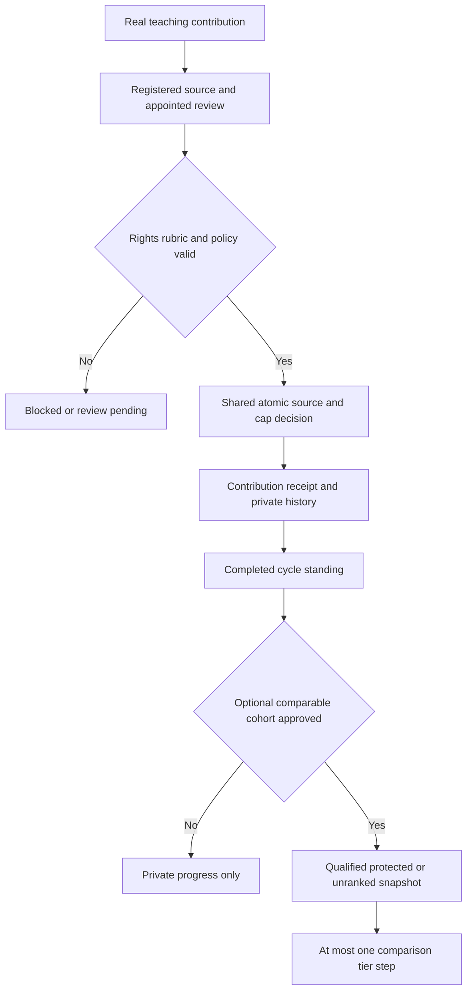

# F3 Mentor Playground Master Specification and Future Implementation Plan

Date: 2026-11-07. Phase E. Status: PROPOSED, NOT IMPLEMENTED, NOT PLAN LOCKED.

**Goal:** Make independently useful teaching contributions understandable without turning activity, purchases or league position into expertise, money or access authority.
**Architecture:** Canonical publication, reviewed outcomes, F1 milestones and reviewed resolutions produce authoritative contribution sources. The shared coordinator consumes each semantic source once, updates bounded score projections and receipts atomically, and delivers optional comparison/catalog views through rebuildable projections.
**Tech stack:** Reuse the audited JS/JSX application, Pact visual components and shared platform contracts. TypeScript-style notation specifies interfaces only. Storage topology, runner, deployed indexes and library APIs remain UNVERIFIED.
**Spec:** This document, [shared platform contracts](03-platform-contracts.md), [Student Playground](07-student-playground.md), and [proposed art directions](../../design/v2/playground-art-directions.md).

All implementation and test tasks are future and unchecked. E approval permits master-plan documents only. No app execution, source edits, installations, migrations, providers, credentials, commits or publication are authorized here.

## 1. Evidence, approaches and boundaries

| Read evidence | Supported planning fact | Limit |
|---|---|---|
| [D playground reasoning](thinking-playgrounds.md) | Rates, corrected caps, decay, internal bands, source and rest safeguards | Proposals and synthetic checks, not approved policy or efficacy |
| [D signal/rating reasoning](thinking-signal-ratings.md) | F1 expertise qualification and separate F2 quality computation | No actual database concurrency or allocation calibration |
| [Existing-system audit](01-existing-system-audit.md) | PactHall/six Pact divisions; unsafe XP, rollover and event coordination; reusable dashboards and art | Source audit, not deployed readiness; A/U findings need verification |
| [Existing art direction](../../design/00-art-direction.md) and [tokens](../../design/01-design-tokens.md) | Orbit observatory language, token names, typography and reduced-motion intent | Pending approval; contrast/device behavior unverified |
| [Lore proposal](../../design/v2/lore-live-ops.md) | Functional metaphors, voluntary participation and review-capacity discipline | Not approved branding, social scope or live-ops schedule |

Approaches considered: activity-volume competition is rejected because uploads/messages can be ground; quality-only rank is rejected because ratings are not outcome or contribution evidence; capped reviewed contributions with private progress are recommended. Optional comparable cohorts are an additional gated layer, not a requirement for the private tool. This recommendation is not a founder choice.

Global constraints:
- Mentor contribution points, F2 teaching quality, F1 expertise/claim eligibility, badges, virtual assets and INR are separate domains.
- No client XP override, bought rank, rating reward, message-count farming, attendance/streak reward, currency conversion or paid protection.
- Student, Peer and Mentor retain independent identities, source eligibility, totals and wallets. A Mentor who also learns does not copy these points into another identity.
- New progress/evidence is private by default. Unknown age or safety eligibility cannot authorize public ranking. Minors are not publicly ranked by default.
- Core learning, accessibility, support, security, consent, rights and basic export are never token advantages.
- Unknown required policy is a typed blocked state, not a guessed value or an implicit approval.

## 2. User flows

| Flow | Steps | Authoritative completion | Safe alternative |
|---|---|---|---|
| First visit | Select Mentor workspace; read explanation; view private history; optionally inspect proposed comparison eligibility | Server context and authorized projection | Private history works without competition |
| Useful contribution | Finish the real teaching job; submit bounded evidence where review is required; reviewer checks rubric/rights/conflicts; source coordinator decides grant | Durable contribution receipt, not upload success or reviewer click alone | Pending review and ordinary teaching access |
| Explain a score | Open own receipt; inspect source kind, rubric/policy version, requested/issued/unissued points, source cycle and cap breakdown | Authorized receipt plus projection source version | Safe unavailable-source label if rights revoked |
| Join comparison | Choose subject and participation window; read audience and rest policy; explicitly opt in; validate comparable manifest and safety policy | Versioned participation receipt | Decline without losing history, badges or course access |
| Rest or leave | Select private mode or pause; stop optional prompts and remove comparison visibility; resolve in-flight receipt | Preference receipt and authority-fenced projection update | Work can continue privately; no catch-up requirement |
| Appeal | Open own receipt/case; provide bounded correction evidence; appointed reviewer decides specific source correction | Linked correction receipt and case result | History remains accessible according to approved retention |

Ordinary publication, Q&A and studio controls remain canonical. Playground does not create another publication workflow, social network, dashboard or financial ledger.

## 3. Exact proposed contribution formula

Each event must be independently useful, rights-permitted and accepted by its registered authority. Rates and caps below are Phase D proposals.

| Stable category ID | Accepted source | Rate | Weekly category cap | Independent-source rule |
|---|---|---:|---:|---|
| `mentor.lesson` | Reviewed useful lesson publication | 30 | 120 | One reviewed semantic lesson; splitting/copying/reuploading does not make another contribution |
| `mentor.outcome` | Validated learning/repair outcome receipt | 40 | 160 | Versioned appointed review; not stars, anecdotes or a causal before/after claim |
| `mentor.milestone` | Accountable on-time claim milestone | 20 | 80 | F1 accepted milestone/version, original deadline and approved excuse classification |
| `mentor.resolution` | Reviewed helpful explanation resolution | 10 | 60 | One independently resolved source question, not reply count or coerced praise |
| `mentor.pattern` | Rights-reviewed reusable teaching pattern | 10 | 40 | Approved distinct outcome/pattern family; copies retain provenance |

For ordinary eligible sources in cycle c:
`categoryPotential(c,k) = min(rate(k) * independentAcceptedCount(c,k), categoryCap(k))`.
`weekPoints(c) = min(400, sum_k(categoryPotential(c,k)))`.
Category maxima sum to `120+160+80+60+40 = 460`. The binding overall cap proposal is **400**, not the historical erroneous 560/500.

Online grant decision under the same locked cycle/cap rows:
`requested = rate(category)`.
`issued = min(requested, categoryCap-categoryOccupied, 400-overallOccupied)`.
`unissued = requested-issued`.
All are nonnegative integer point units. Partial credit is permitted and explicitly displayed. A verified event can therefore issue 10 of a requested 30; its usefulness is not erased by clipping. Points are not currency.

A serial counter on the locked Mentor/cycle root assigns grant order; concurrent grants cannot each observe the same remaining cap. Accepted sources arriving in one batch sort by authoritative committed time, then stable source ID before serial allocation. Later-arriving sources cannot retroactively displace an earlier committed receipt. Category distribution under a binding global cap can depend on grant order; the total formula remains 400. This arrival-order choice and its fairness must be approved in DEC-E-M02.

`categoryOccupied` and `overallOccupied` count originally issued units. Specific source correction can reduce effective score but does not reopen consumed source benefits or silently free slots for reissuance. With corrections, derive effective weekly points from original issued units plus linked approved score adjustments, constrained to [0,400]; do not recompute an old receipt with today's weights. A reversal cannot create negative standing, virtual debt or cash recovery.

Lifetime views distinguish `verifiedContributionCount`, `lifetimeIssuedPoints` and `lifetimeEffectivePoints`. Capped sources remain verified history with issued points zero. Award count is never called learner improvement, certification or measured impact.

## 4. Time, decay, bands and seasons

Proposed weekly cycles use UTC Monday 00:00 inclusive to next Monday 00:00 exclusive. SourceRegistry `committedAt` fixes `sourceCycleId`; browser time, upload time, retries and new operation IDs cannot backdate or relocate a source. Whether a milestone was on time uses its authoritative F1 submission time and accepted deadline, not the later review time.

Cycle states: `OPEN -> CLOSING -> SEALED`; `CORRECTION_REVIEW` is a linked workflow, not reopening the old cycle. Proposed close grace is 24 hours for already committed sources awaiting recoverable grant processing; approval is required. After sealing, an old source stays in its old cycle and enters reviewed late-source correction, not the current week's faucet. Intake/processing delay is visible and must not become a mentor misconduct signal. GET never closes, resets or adjudicates a cycle.

For newest completed cycle W0 and preceding W1/W2/W3:
`standing = (W0 + 0.70*W1 + 0.49*W2 + 0.343*W3) / 2.533`.
Exact representation: `standingNumerator = 1000*W0 + 700*W1 + 490*W2 + 343*W3`; `standingDenominator = 2533`.
Missing/inactive weeks are zero; the denominator stays 2533, including new entrants. Compare rational values before display rounding. Display to two decimals with explicitly proposed HALF_UP rounding; never round 99.995 into a higher authoritative band.

| Stable private band | Exact lower bound | Exact upper bound | Meaning |
|---|---:|---:|---|
| `mentor.band.T0` | 0 | <100 | Current contribution-standing context, not low expertise |
| `mentor.band.T1` | 100 | <200 | Same |
| `mentor.band.T2` | 200 | <300 | Same |
| `mentor.band.T3` | 300 | <400 | Same |
| `mentor.band.T4` | 400 | 400 | Requires maximum effective score in all four weighted weeks |

Band selection compares numerator with `bound*2533`. Four 100-point weeks yield exactly 100; one newest 400-point week yields `400000/2533`, approximately 157.92, not T4. This cold-start effect is a disclosed proposal, not a behavioral finding.

A proposed season contains four consecutive weekly cycles anchored to an approved season epoch. Seasons organize private recaps and cohort manifests only: no points/badge wipe, limited-time loot, escalating multipliers or required attendance. Approved decay affects current standing, not retained work/history. Pause does not freeze a competitive advantage; rejoin uses current rolling standing.

## 5. Optional subject/cohort comparison and movement

This section adds explicit implementation choices where D left details open. Every choice remains PROPOSED and blocked without DEC-E-M03/M04 approval.

A comparison manifest fixes identity=Mentor, subject taxonomy version, allowed source categories/rubric versions, participation window, tier at entry, audience, and opportunity comparability before enrollment. It cannot silently compare a mentor with broad publication opportunities against one with no permitted teaching assignments. If comparability cannot be established, show private standing and no peer rank.

Proposed V1 audience is eligible adult opt-in members in a closed subject cohort; the public branch is off. Public adult opt-in is a separate later approval, never inferred from cohort enrollment. Mentor roles do not establish age, expertise or safety eligibility. Minors and age-unknown accounts retain private personal progress while the relevant comparison gate is unresolved.

Qualification for movement: opted in before cycle start; completed a whole eligible participation cycle; at least one accepted, nonquarantined comparable contribution in that cycle; no unresolved disqualifying authority state; and cohort qualified count >=10. Missing evidence is `UNRANKED`, not zero ability. Late joiners receive observation/private progress without catch-up or downward movement.

For optional display, competition rank is `1 + number of qualified members with strictly greater exact standing`; ties share rank. A stable opaque ID may order equal rows for deterministic rendering, but never decide benefits, relegation or expertise. No public learner-level evidence or counts are joined into this view.

Keep two fields separate:
- `computedBand`: exact current private standing band from section 4.
- `comparisonTier`: optional historical movement state, visibly labeled when protected or lagging the band.

At seal, target the computed band and move comparisonTier at most one step toward it. Proposed first whole participation cycle has no promotion or relegation. Opted-out, paused, late, unqualified or undersized-cohort members receive no movement. Protection never moves an additional member to meet a quota; F3 has no percentile quota. At T0/T4, movement clamps to the bounds. Relegation changes optional comparison only, not enrollment, claim access, quality score, history, balances or earned art. No purchased freeze or public absence label exists.

Cycle corrections do not silently rerun historic movement. A restricted adjudication appeal links the original snapshot and permits only an approved resolution; affected members receive private explanation. Current effective standing may update honestly while comparisonTier remains under review.

## 6. F1, F2, perks and currency wall

F1 retains its independent score `100*(.35Q+.30E+.15R+.10P+.05T+.05F)` and qualification: reviewed relevant expertise checklist >=.60, current role/account, approved safety eligibility, opted-in availability and atomic active-claim capacity. Mentor band, paid subscription, cosmetics and contribution points cannot bypass qualification or alter score.

F2 alone computes quality with prior [1,1,2,9,7], half-life 180 days and risk multiplier 1.2815515655. One perfect-review proxy 3.761973 remains below the established raw-4.7/300-review proxy 4.610277. No eligible reviews is UNRATED. F3 displays only the permitted quality summary, separately labeled; it never awards points for ratings or recomputes the proxy.

| Candidate perk | Evaluation | Proposed safe result |
|---|---|---|
| Optional original theme or workspace arrangement | Cosmetic/organizational only; basic equivalent remains usable | Candidate for separate scope/catalog approval, no rank or access benefit |
| Plain explanations of own analytics | Core comprehension should not depend on rank | Available as functional baseline, not an earned advantage |
| Reduced session platform fee | Changes fixed economics and makes league paid advantage | Rejected in this plan; no configurable tier override |
| Larger subscription mentor share | Changes separate subscription economics | Rejected in this plan |
| Paid flare priority, bought protection or rating boost | Buys rank/claims/credibility | Prohibited |
| Token-gated support, export, consent or accessibility | Sells core safeguards | Prohibited |

Optional student-chosen, mentor-priced sessions retain fixed 15% platform share. Subscriptions separately retain fixed 20% platform share and the other 80% for enrolled-course mentors under an approved base/allocation policy. F3 offers no money-rate endpoint. Tax, recognized basis, fees/refunds and provider obligations remain blocked shared money decisions, not a familiar statutory rate.

No automatic conversion of contribution points into `VIRTUAL_MENTOR`, `VIRTUAL_STUDENT`, `VIRTUAL_PEER` or INR exists. F5 alone may consume an approved eligible family through the shared registry; the default F3 contribution rule grants `mentor.quality` points only. Multiple legitimate benefits from one source need an explicit registry rule, not a catalog reward shortcut.

## 7. Authoritative source and award contract

Use the supplied shared `ActorContext`, `ResourceRef`, `CommandEnvelope<T>`, `Receipt<R>`, `PolicyGate<T>`, `SemanticGrantPlan`, `AtomicPlan`, `EventEnvelope<T>` and `ProjectionView`. Their names/semantics are canonical; F3 does not define another wallet, authority or coordinator.

```ts
type MentorCategory = "mentor.lesson" | "mentor.outcome" | "mentor.milestone" | "mentor.resolution" | "mentor.pattern";
type MentorContributionInput = Readonly<{ sourceId: Id; rubricVersion: Id; evidenceVersion: Version }>;
type MentorContributionResult = Readonly<{
  contributionId: Id; category: MentorCategory; sourceCycleId: Id;
  requestedPoints: IntUnits; issuedPoints: IntUnits; unissuedPoints: IntUnits;
  originalGrantId: Id; reviewState: "accepted"; projectionVersion: Version;
}>;
type MentorPreferenceInput = Readonly<{
  mode: "private" | "comparison" | "paused";
  cohortId: Id | null; scopeVersion: Version;
  optionalPrompts: "off" | "digest";
}>;
type MentorStanding = Readonly<{
  numerator: IntUnits; denominator: "2533"; completedCycleIds: readonly Id[];
  computedBand: "T0" | "T1" | "T2" | "T3" | "T4";
  comparisonTier: "T0" | "T1" | "T2" | "T3" | "T4" | null;
  rankState: "private" | "unranked" | "qualified" | "protected" | "review_pending";
}>;
type MentorCorrectionInput = Readonly<{ contributionId: Id; caseId: Id; evidenceRevisionId: Id }>;
```

Client input contains no category selection, rate, points, authoritative deadline, verified flag or role. The server derives category/recipient/cycle from registered accepted evidence and source permissions. Accept/review commands are available only to appointed reviewers or registered services; a Mentor cannot accept their own source.

Semantic grant uses benefit family `mentor.quality`, identity Mentor and shared basisKey derived from authoritative equivalence family, not operationId/policy/course copy. A source can support different categories only if the approved registry establishes genuinely independent outcomes; one lesson cannot be relabeled as a pattern/resolution to multiply credit without that review. Unknown origin/rights/comparability returns SOURCE_BLOCKED. Grade/outcome helpers and model suggestions cannot certify learning.

The shared atomic transaction includes live authority fences, consumed basis, cycle/category/global occupancy, contribution/history, effective standing inputs, immutable receipt and outbox. Score projection mutations use `projectionMutations`; no fake virtual ledger leg represents points. F3 stages plans through `executeCommand`/`commitAtomicPlan`; it never commits independently.

Same operation and intent returns the original currently permitted receipt with `replayed=true`. New operation on consumed source returns `no_change`, newly issued points zero, with original grant reference. Neither creates another notification/ceremony. Cap-clipped units are not debt and cannot be recovered by replay next week. Corrections link original evidence/grants and are separately authorized.

## 8. Persistence and indexes

All records use server timestamps, immutable approved policyVersion, schemaVersion and resource versions. Durations/retention are PolicyGate values; unknown retention blocks new sensitive persistence. Indexes are requirements, not applied migrations.

| Proposed record | Typed load-bearing fields | Required index/uniqueness |
|---|---|---|
| MentorProgression | `accountId:Id`, `identity:'Mentor'`, `version:Version`, `mode`, `authzEpoch`, `computedBand`, `comparisonTier`, rational standing, `policyVersion` | Unique account/identity; owner/version lookup |
| MentorContribution | `id`, `recipientId`, `sourceId`, `basisKey`, `category`, `rubricVersion`, `evidenceVersion`, `sourceCycleId`, integer requested/issued/unissued, `grantOrdinal`, `state:ACCEPTED/CORRECTED/REVOKED` | Unique basis/benefit sequence; recipient/cycle/category; source lookup |
| MentorCycleCap | `mentorId`, `cycleId`, `version`, category occupied/effective maps, `overallOccupied`, `overallEffective`, `nextGrantOrdinal` | Unique mentor/cycle; conditional write locked with grants |
| MentorCycle | `id`, `startAt`, `endAt`, `closeAt`, `state`, `version`, `policyVersion`, `adjudicationReceiptId` | Unique policy-cycle boundary; state/close lookup |
| MentorParticipation | `mentorId`, `cohortId`, `scopeVersion`, `entryTier`, `joinedAt`, `state`, `firstWholeCycleId`, prompt choice | Unique active mentor/cohort; cohort/state; live visibility fence |
| MentorCohort | `id`, `subjectId`, `taxonomyVersion`, fixed evidence manifest, `audience`, `cycleId`, `state`, `policyVersion` | Unique manifest/cycle/tier pool; authorized subject lookup |
| MentorAdjudication | `cohortId`, `cycleId`, snapshot version, participant eligibility, exact bands, tie ranks, protection reasons, movement decisions | Unique cohort/cycle/policy adjudication; decision/member lookup |
| MentorCorrection | original contribution/grant refs, evidence revision, caseId, appointed actor, adjustment units, decision state/version | Unique reviewed correction key; original grant/history lookup |

Reuse shared SourceRegistry/SourceConsumption/Operation/Receipt/Outbox/PolicyBundle/AuthzFence rather than feature-specific duplicates. Shared account/cache keys include accountId, sessionGeneration, activeIdentity, authzEpoch, policyVersion and sourceVersion. Do not TTL-delete semantic markers to permit re-earning; privacy-compatible minimal marker retention is a blocking decision.

Private evidence references remain separately authorized. Public/closed-cohort projections cannot contain learner identities, attempts, errors, contacts, original media URLs, reviewer private notes or full User records. Revoked evidence yields `This item is unavailable.` before exposing mapping or case details.

## 9. Actors and capability checks

| Actor | Proposed capability | Additional check | Denial |
|---|---|---|---|
| Mentor owner | `mentor.progression.read.own`, `mentor.progression.preference.edit.own`, `case.create.own` | Live identity, owner, scope version and policy gates | Self-award/review; other mentors' private evidence |
| Appointed reviewer | `mentor.contribution.review.assigned` | Assignment, rubric, conflicts, rights and field-level evidence grant | Own/conflicted contribution approval |
| Registered producer | `source.validate.mentorContribution` | Workload identity and source producer registry | Raw browser/model/socket claims |
| Cycle worker | `progression.cycle.adjudicate.assigned` | Approved manifest, authority fences and cycle version | Read-time rollover or arbitrary manual rank override |
| Moderator/appeal reviewer | `progression.correction.decide.assigned` | Assigned case, approved correction policy and limited fields | Wholesale deletion or private learner browsing |
| Authorized cohort member | `mentor.cohort.read.member` | Current membership/audience/safety fence | Participant evidence drill-down or public resharing |
| Public reader | None enabled in minimum/V1 | Separate approved adult opt-in projection if later selected | Minor/unknown/private/paused rows and inferred participation |

Revocation conflicts transactionally with grant/preference/publication writes through shared authority fences. Socket removal is supplemental, not permission enforcement. Role loss stops new Mentor awards/edits but does not erase independent learner entitlements, case rights or financial liabilities.

## 10. Proposed API and events

Normal commands use exactly `operationId`, `expectedVersion`, `policyVersion`, `resource`, `payload` under `/api/v2/fp2`. All route names below are PROPOSED registered extensions.

| Route/command | Request | Receipt/view result | Main errors |
|---|---|---|---|
| `POST /api/v2/fp2/commands/mentor.contribution.accept` | Envelope<MentorContributionInput>; root recipient progression; reviewer/service only | MentorContributionResult; committed or no_change | 400 authority fields; 404 unavailable evidence; 409 version/operation; 422 source/policy; 503 atomic authority unavailable |
| `POST /api/v2/fp2/commands/mentor.progression.preference.set` | Envelope<MentorPreferenceInput>; own progression | mode, cohort scope, effective visibility, revoked comparison grants, affectedVersions | 409 stale scope; 422 unsafe/unapproved audience; pause/private must not require rank |
| `POST /api/v2/fp2/commands/mentor.cycle.adjudicate` | Envelope<{cycleId,cohortId}>; authorized cycle root | snapshot ID/version, decided/pending counts permitted to worker | 409 already changed; 422 manifest/policy block; 503 topology |
| `POST /api/v2/fp2/commands/mentor.contribution.correct` | Envelope<MentorCorrectionInput>; assigned case root | linked adjustment, original grant, affected versions and movement review state | 404 unassigned/private case; 409 revision conflict; 422 unsupported remedy |
| `GET /api/v2/fp2/resources/progression/{id}/projection?minVersion={v}` | Owner/member authorization | ProjectionView with MentorStanding, cap breakdown and safe history refs | 404 uniform unavailable; 202 lagging; no mutation |
| `GET /api/v2/fp2/mentor/cohorts/{id}?cursor={opaque}` | Current authorized membership and bounded page | allowlisted pseudonymous rows, exact shared ranks, source snapshot version | 404 inaccessible cohort; no private member counts before authorization |
| `GET /api/v2/fp2/operations/{operationId}` | Own operation | Currently permitted Receipt or processing | Uniform 404 for other-owner/missing/inaccessible |

Illustrative owner preference body: `{"operationId":"op-m1","expectedVersion":7,"policyVersion":"approved-fixture-policy","resource":{"kind":"progression","id":"mp-1"},"payload":{"mode":"private","cohortId":null,"scopeVersion":3,"optionalPrompts":"off"}}`. Illustrative fixture IDs are not policy approvals or authority.

Registered event extensions: `fp2.v1.mentor.contribution.accepted`, `fp2.v1.mentor.contribution.corrected`, `fp2.v1.mentor.preference.changed`, `fp2.v1.mentor.movement.decided`. Also consume shared `fp2.v1.source.granted`, `fp2.v1.publication.changed`, `fp2.v1.cycle.adjudicated`, and `fp2.v1.account.authz.changed` where registered source adapters permit.

Each event uses the canonical eventId/schemaVersion=1/operationId/policyVersion/resource/resourceVersion/aggregateSequence/occurredAt/causationEventId envelope. Payload contains bounded source references and units, not raw learner evidence. Domain changes, source consumption, invariant projections, receipt and outbox commit together. Delivery is at least once; consumer checkpoint and read projection apply atomically. Old/duplicate events cannot downgrade a view; gaps fetch/rebuild. Notifications describe committed contributions, not learner efficacy or guaranteed opportunity.

## 11. Catalog integration, not a second catalog

Catalog package owns mission inventories, forty bespoke Mentor badge definitions, localization and art-key inventory. F3 exposes accepted evidence and consumes versioned criteria; it does not duplicate those inventories or invent extra faucets.

```ts
type CatalogCriterionResult = Readonly<{
  catalogEntryId: Id; catalogVersion: Id;
  state: "not_started" | "in_progress" | "eligible" | "earned" | "review_pending" | "revoked";
  acceptedSourceIds: readonly Id[]; originalGrantIds: readonly Id[];
  reasonCode: string | null; artKey: Id; accessibleLabelKey: Id;
}>;
interface MentorCatalogEvidence {
  getAcceptedEvidence(actor: ActorContext, ownerId: Id, windowRef: Id): Promise<readonly ResourceRef[]>;
  evaluateCriterion(actor: ActorContext, entryId: Id, catalogVersion: Id): Promise<CatalogCriterionResult>;
}
```

Mission completion cites real source/rubric/version and independent outcome; a mission UI click never creates another lesson/outcome grant. Badge eligibility can reference verified sources whose point issuance was cap-clipped if the approved criterion says so; show that distinction. Awarding `badge.achievement` requires the shared registry/semantic consumption, not a second catalog counter. Default extra points/currency reward is absent and disabled; any distinct approved reward must be registered with explicit caps/eligibility in F5/shared policy.

Catalog entries must provide stable ID, identity, source family, equivalence rule, criterion version/window, review/cap/reversal behavior, visibility, source rights, artKey and accessibleLabelKey. Unknown criterion/art mapping is `review_pending` with neutral labeled fallback, never invented completion. Badges confer no expertise, claim priority, reduced fees, money conversion or safety exemption.

## 12. UX, art and anti-burnout behavior

Extend existing Mentor surfaces rather than a parallel dashboard. Functional sections: private standing explanation; contribution receipts/caps; optional comparison; catalog evidence; mode/privacy; appeal/support. Default landing is own history, not a leaderboard.

| State | Exact proposed plain copy | Required behavior |
|---|---|---|
| No accepted history | `Your reviewed contributions will appear here.` | Explain real jobs; no zero-ability claim |
| Awaiting source review | `Review pending. No points have been awarded.` | Show own submission/receipt status; ordinary teaching remains usable |
| Committed grant | `Contribution recorded: {issued} points.` | Only after durable receipt; show requested/unissued when clipped |
| Full clipping | `Contribution recorded. No points added because the cap was reached.` | Keep useful history; no spending/catch-up prompt |
| Duplicate source | `This contribution was already recorded.` | Original receipt reference; no second celebration |
| Private/paused | `Your progress is private. Optional comparison prompts are off.` | No public absence marker or countdown |
| Unranked | `Not compared this cycle. Your teaching history is unchanged.` | Explain safe eligibility reason without ability judgment |
| Protected tier | `Comparison tier unchanged during your first full cycle.` | Display computedBand separately |
| Downward movement | `Current comparison changed. Your courses and history are unchanged.` | No failure/shame animation; appeal/privacy controls |
| Policy block | `This comparison needs policy review before it can open.` | Private progress and support alternatives |
| Correction | `A reviewed correction changed this contribution's points.` | Original and linked decision, private appeal path |
| Stale projection | `The saved change is still updating here.` | Show source version; never authorize from stale score |

The four-week view is a labeled table first: cycle, effective points, weight, weighted contribution, correction state. Optional single-series bars share one scale 0-400, remain keyed to cycle not rank, and have keyboard/focus equivalents and an identical table. No causal learning chart, mixed money axis or color-only identity. Palette/contrast validation and rendering are future tests, not performed here.

Use neutral IDs/labels until [art direction](../../design/v2/playground-art-directions.md) is separately approved. Static and reduced-motion states expose the same score, decision and controls. Proposed ordinary reveals <=180 ms, score comparisons <=400 ms, optional skippable earned-art reveal <=800 ms; sound off by default. Reduced-motion makes completion immediate, with no orbit/camera/layout movement. Account switch/unmount cancels stale callbacks. No full-screen particles or mandatory WebGL are needed.

No daily attendance target, expiring score-loss push, loss-framed reminders, automated message farming or unlimited review intake. Proposed prompt default off; an explicitly selected digest uses the shared delivery budget/quiet-hour policy. Reviewer capacity is a required policy input: when full, intake shows waiting/unavailable by choice rather than silently accumulating unpaid labor or increasing reward intensity.

## 13. Text flow diagram



| Diagram path | Equivalent rule |
|---|---|
| A-B-C-D | Work/upload alone is not reward evidence; unknown rights/rubric/policy blocks grant |
| C-E-F | Atomic source/cap/history/receipt/outbox; duplicate or clipped result is honest |
| F-G | Completed cycles and exact rational decay, never GET rollover |
| G-H-I | Comparison is optional and policy/comparability gated |
| H-J-K | Qualification/protection and bounded movement; no paid tier advantage |

Textual Mermaid and equivalent table only; no rendered/palette QA claim.

## 14. Dependencies and proposed future files

Existing claims below are supported by the read audit, not fresh source checks: PactHall and six Pact divisions exist; `D:/orbit-main/orbit-main/BackEnd/services/pactService.js`, `D:/orbit-main/orbit-main/BackEnd/services/gameologyService.js`, `D:/orbit-main/orbit-main/BackEnd/services/leagueService.js`, and `D:/orbit-main/orbit-main/BackEnd/models/XpEvent.js` are reuse investigation targets. Existing public XP override and read-time rollover must not power this feature. Verify exact guards/manifest before future changes; preserve A/U backlog labels.

All files/interfaces below are PROPOSED, not existing claims. They consume the shared coordinator, policy/source authority, fences and client account scope.

| Proposed absolute file | Responsibility and exact interface |
|---|---|
| `D:/orbit-main/orbit-main/shared/fp2/mentorProgression.js` | `calculateMentorStanding(weeks: readonly number[]): MentorStanding`; exactly four bounded effective scores and rational threshold comparison |
| `D:/orbit-main/orbit-main/BackEnd/services/fp2/mentorContribution.js` | `planMentorContribution(tx: Tx, actor: ActorContext, input: MentorContributionInput, target: ResourceRef): Promise<AtomicPlan<MentorContributionResult>>`; registered source/category and transactional caps |
| `D:/orbit-main/orbit-main/BackEnd/services/fp2/mentorCohorts.js` | `planMentorParticipation(tx: Tx, actor: ActorContext, envelope: CommandEnvelope<MentorPreferenceInput>): Promise<AtomicPlan<JsonValue>>`; audience/fences/private mode |
| `D:/orbit-main/orbit-main/BackEnd/services/fp2/mentorCycles.js` | `planMentorAdjudication(tx: Tx, actor: ActorContext, cycleId: Id, cohortId: Id): Promise<AtomicPlan<JsonValue>>`; immutable snapshot and movement |
| `D:/orbit-main/orbit-main/BackEnd/services/fp2/mentorCorrections.js` | `planMentorCorrection(tx: Tx, actor: ActorContext, input: MentorCorrectionInput): Promise<AtomicPlan<JsonValue>>`; specific additive score correction/case |
| `D:/orbit-main/orbit-main/BackEnd/services/fp2/mentorCatalogEvidence.js` | Implements MentorCatalogEvidence against authorized sources and catalog-owned criteria; no duplicate catalog/faucet |
| `D:/orbit-main/orbit-main/FrontEnd/src/components/fp2/MentorProgressionPanel.jsx` | `MentorProgressionPanel({view,accountScope,onCommand,onCase})`; private-first embedding in verified canonical Mentor surface |
| `D:/orbit-main/orbit-main/BackEnd/routes/fp2Routes.js` | Shared proposed route registry integration; no separate command coordinator |

Minimum: authoritative contribution receipts, private history, cap explanations, exact standing, correction/appeal and accessible static UI. V1 candidate: capacity-bounded reviews, approved adult closed cohorts and serialized cycle snapshots. V2 candidate: separately approved adult public projection and richer subject manifests after fairness/privacy/workload validation. Crews, social discovery, financial perks, global minors' rankings and migration of existing Pact/XP are not implicit membership.

## 15. Numbered future tasks

Runner commands are intentionally not guessed: manifest/runner verification and later implementation approval are prerequisites. Each numbered task starts with failing assertions, implements only the named contract, then runs targeted tests and reviews failures. All steps remain unchecked; no commit command is mandatory or authorized.

### Task M1 - Formula and types
- [ ] Author `D:/orbit-main/orbit-main/BackEnd/tests/fp2MentorMath.test.js` assertions `categorySumIs460`, `overallCapIs400`, `fourWeekDenominatorIs2533`, `bandUsesUnroundedRational`, `coldStartDoesNotNormalizeMissingWeeks` using M01/M06/M08/M09.
- [ ] Implement `calculateMentorStanding` in the proposed shared file; retain exact rational comparisons and bounded integer inputs.
- [ ] Under later approval, verify the runner, run those assertions and inspect every failure; numerical fixtures alone do not establish runtime authority.

### Task M2 - Sources, caps and atomic recovery
- [ ] Author `D:/orbit-main/orbit-main/BackEnd/tests/fp2MentorAward.integration.test.js` for `rejectClientAuthority`, `dedupAcrossPolicyAndCopies`, `concurrentCapsSerialize`, `lostResponseReplays`, `noHalfHistory`, `clippedSourceCannotReissue` using M02-M07/M10.
- [ ] Implement `planMentorContribution` with shared source authority, cap rows, authority fences, receipt and outbox in one proven atomic adapter.
- [ ] Run real topology concurrency/crash injections after each staged write; block release if uniqueness/fences are unproven.

### Task M3 - Cycles and movement
- [ ] Author `D:/orbit-main/orbit-main/BackEnd/tests/fp2MentorCycle.integration.test.js` for `getNeverAdjudicates`, `lateSourceStaysOriginalCycle`, `tieRankShared`, `firstCycleProtected`, `atMostOneTierStep`, `undersizedCohortNoMovement` using M11-M16.
- [ ] Implement `planMentorAdjudication` and durable cycle state/semantic adjudication key with approved manifest/close policy.
- [ ] Run duplicate-worker, deadline-boundary and recovery assertions; verify protected computedBand/comparisonTier copy.

### Task M4 - Preferences, privacy and account scope
- [ ] Author `D:/orbit-main/orbit-main/BackEnd/tests/fp2MentorPrivacy.integration.test.js` and `D:/orbit-main/orbit-main/FrontEnd/src/components/fp2/__tests__/MentorProgressionPanel.test.jsx` for `minorDefaultPrivate`, `cohortCannotReadLearnerEvidence`, `pauseRevokesProjection`, `staleAccountResponseDiscarded`, `unknownPolicyBlocksPublic` using M17-M19/M24.
- [ ] Implement `planMentorParticipation` and private-first panel through shared account-scope client; no new identity authority.
- [ ] Run live revocation/race plus keyboard/static/reduced-motion checks; real device behavior remains separately unverified.

### Task M5 - Corrections and catalog evidence
- [ ] Author `D:/orbit-main/orbit-main/BackEnd/tests/fp2MentorCorrection.integration.test.js` for `specificCorrectionOnly`, `spentVirtualRewardNotNegative`, `catalogDoesNotMintBaseGrant`, `unknownCriterionReviewPending` using M20-M22.
- [ ] Implement `planMentorCorrection` and MentorCatalogEvidence; defer all wallet remedies to approved F5/shared contract and all criteria/art inventory to catalog ownership.
- [ ] Run source-rights revocation, appealed movement and cap-clipped badge-evidence tests; verify no raw private evidence leaves the authorized view.

### Task M6 - F1/F2/economics and operational gate
- [ ] Author `D:/orbit-main/orbit-main/BackEnd/tests/fp2MentorCrossPack.integration.test.js` for `leagueDoesNotQualifyFlare`, `ratingNotRewardSource`, `feePerkRejected`, `reviewCapacityBlocksIntake`, `noCompulsoryDigest` using M23-M26.
- [ ] Register commands/events through shared fp2Routes/schema; validate audit-supported legacy guard issues before connecting producers.
- [ ] Run cross-pack assertions, retention/abuse/accessibility reviews and a capacity-bounded pilot only under later approval. Any required nonapproved gate blocks activation.

## 16. Failure vectors and expected assertions

These are future fixtures, not executed E tests. Approved policy IDs in fixtures mean isolated test-policy values, not actual founder approval.

| ID / input or failure | Expected outcome |
|---|---|
| M01 Category maxima 120/160/80/60/40 | Sum 460, weekly score at most 400; reject historical 560/500 expectation |
| M02 Browser supplies xpOverride, points, category or verified flag | INPUT_INVALID; no source/history/score/role/ledger effect |
| M03 Same accepted semantic lesson, new operation/policy/course copy | no_change; newly issued zero; same authoritative family consumed |
| M04 Two sources race with 10 global points remaining | Combined issuance <=10; one serial order, complete receipts; no in-memory-only proof |
| M05 Crash after contribution row but before source/receipt/outbox staging | Entire business transaction absent or complete; never unbacked score |
| M06 Four effective weeks 100/100/100/100 | Numerator 253300, denominator 2533, standing exactly 100, computedBand T1 |
| M07 Publication request30 with only10 global available | Issued10/unissued20; history retained; replay next week adds0 |
| M08 Newest week400, older three missing | Standing400000/2533, approximately157.92, T1; not400 or T4 |
| M09 Exact standing just below100 but display rounds100.00 | Authoritative band remains T0; accessible detail explains unrounded threshold |
| M10 HTTP response lost after complete grant commit | Same operation returns original permitted receipt; one contribution/outbox event |
| M11 GET at Monday rollover before worker | Read current/lagging projection only; no cycle reset/adjudication/wallet overwrite |
| M12 Old-cycle source processed after approved close grace | Reviewed late-source path in original sourceCycle; no fresh-week grant |
| M13 Equal rational standings in eligible cohort | Shared competition rank; ID ordering has no reward/relegation consequence |
| M14 First whole comparison cycle, target band higher/lower | No movement either way; computedBand still truthful |
| M15 Existing comparison T0, computedBand T3, otherwise qualified | At most T1 this seal; not three-step jump; no expertise certification |
| M16 Qualified cohort9 or late/unqualified/paused member | No movement; private progress/history remains; no replacement quota |
| M17 Minor or age-unknown account requests public ranking | Public branch blocked/nonenumerating; own private progress available |
| M18 Cohort member asks for another mentor's student error/outcome details | RESOURCE_NOT_AVAILABLE; allowlisted aggregate only; no private counts/contacts |
| M19 A delayed Mentor response resolves after account B/Student switch | Old generation discarded; no A score/evidence/cached subscriptions in B scope |
| M20 Fraud/rights correction to one credited source | Linked specific adjustment/case; no deletion of all work; cap markers not reopened for replay |
| M21 Linked optional virtual reward already spent before correction | F5 restricted review/appeal; no negative wallet, debt collection or INR clawback |
| M22 Mission reads accepted lesson already credited; badge art/criterion absent | No second lesson reward; criterion/art review_pending and neutral accessible fallback |
| M23 T4 mentor has unknown expertise or unavailable F2 evidence | F1 qualification still blocked; no league/purchased override; quality remains separate/UNRATED |
| M24 Role or cohort visibility revocation races with award/read | Shared fence ordering; post-revocation stale command denied; projection removes unauthorized fields |
| M25 Tier requests session/subscription fee reduction | No perk route; fixed session15% and subscription20% remain separate and unchanged |
| M26 Review capacity unknown/exhausted; prompts disabled or motion off | New reviewed intake gated or honest waiting; no coerced digest; full static completion/support |

## 17. Blocking decisions and verification limits

| Decision ID | Typed gate and blocked branch | Required decision/validation |
|---|---|---|
| DEC-E-M01 / shared C09 | `PolicyGate<MentorRatesAndCaps>`; contribution issuance | Founder approval/calibration of rates120/160/80/60/40/global400 and independent useful-source rules |
| DEC-E-M02 / C01,C07,C12 | `PolicyGate<MentorCyclePolicy>`; close/late-source/cap corrections | Approve UTC epoch, grace, arrival-order fairness and privacy-compatible markers; prove real atomic fences/uniques/crash recovery |
| DEC-E-M03 / C09,C11 | `PolicyGate<MentorComparisonPolicy>`; cohorts/movement | Approve manifest comparability, min10, qualification, one-step movement and first-cycle protection; test sparse/tied cohorts |
| DEC-E-M04 / C03,C11,C12 | `PolicyGate<MentorAudiencePolicy>`; public/minor/social branches | Qualified current-applicability safety/privacy review, opt-in/withdrawal and reidentification tests; public off meanwhile |
| DEC-E-M05 / C05,C07,C12 | `PolicyGate<ContributionReviewPolicy>`; outcome/repair acceptance | Appointments/conflicts/rubrics/rights/appeals and measured bounded reviewer capacity; no causal claim from synthetic receipts |
| DEC-E-M06 / C04,C06 | `PolicyGate<MentorOptionalPerks>`; any extra currency/perk membership | Explicit founder scope; no fee-share/rank/claim advantage; approved F5 source registry if any distinct reward |
| DEC-E-M07 / C10 | `PolicyGate<MentorArtBranding>`; visible names/assets | Separate art selection, asset/name clearance and accessible/device validation; neutral IDs until approved |

No app source was read beyond the six assigned planning/design documents; no code, command, test, build, provider, DB, credential, environment, migration, asset generation or rendered diagram was used. Main owns document writes, registry/link/line/character checks and preservation. Database behavior, device performance, learning effects, legal/safety/vendor clearance, staffing and original missing E/F tail remain unverified. This draft does not finalize policy or release membership.
