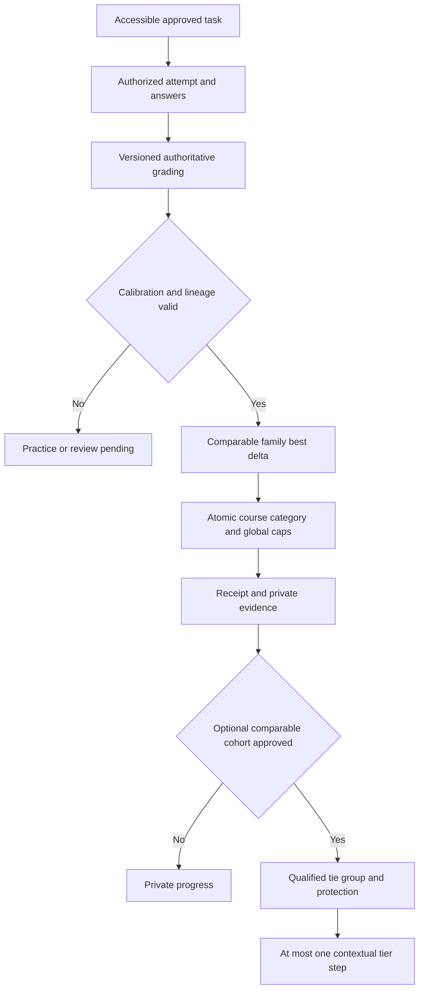

# F4 Student Playground Master Specification and Future Implementation Plan

Date: 2026-11-07. Phase E. Status: PROPOSED, NOT IMPLEMENTED, NOT PLAN LOCKED.

**Goal:** Explain verified low-stakes learning progress and optional comparable participation without rewarding guessing, easy repetition, speed, money or compulsory attendance.
**Architecture:** A versioned authoritative grader commits accepted assessment evidence. The shared coordinator consumes semantic best-delta sources, applies family/course/category/global caps atomically, and builds private progress plus separately gated cohort snapshots. Assessment value, spendable assets, badges and comparison tiers remain distinct.
**Tech stack:** Reuse audited JS/JSX CourseLearn/Enrollment and existing progression/art primitives after their source-authority contracts are verified. Type notation does not require a TypeScript migration. Storage, runners, SDK APIs and runtime behavior remain UNVERIFIED.
**Spec:** This document, [shared platform contracts](03-platform-contracts.md), [Mentor Playground](06-mentor-playground.md), and [proposed art directions](../../design/v2/playground-art-directions.md).

Every future code/test task is unchecked. Phase E permits documents only, not implementation, application execution, installs, migrations, paid services, credentials, commits or publication.

## 1. Evidence, approaches and separation

| Read evidence | Supports | Does not prove |
|---|---|---|
| [D playground reasoning](thinking-playgrounds.md) | Explicit chance/difficulty/value/retake formula, cap proposals, cohort movement/protection | Calibrated items, measured mastery or safe comparison |
| [D signal/rating reasoning](thinking-signal-ratings.md) | Independent expertise/quality and no purchased opportunity | Student grades are not mentor ratings |
| [Existing-system audit](01-existing-system-audit.md) | CourseLearn/Enrollment/Gameology/Pulse reuse; client XP and canonical quiz contract failures | Working authoritative graded progression or runtime readiness |
| [Existing art direction](../../design/00-art-direction.md), [tokens](../../design/01-design-tokens.md) | Orbit observatory language and shared visual/reduced-motion intent | Rendered contrast/device acceptance |
| [Lore proposal](../../design/v2/lore-live-ops.md) | Optional review, private artifacts and clean exit | Approved branding, reward faucets or child/social policy |

Rejected: raw completion/time/quiz-count XP; popularity or course-price difficulty; global learner ranking. Recommended: private verified outcomes with bounded positive improvement, plus optional predeclared comparable cohorts only after policy/calibration approval. This is a recommendation, not founder selection.

Student league identity is **Student**, not Peer. Existing Orbit/Photon/Pulse names and shared wallet are not silently renamed, copied or migrated. Stable asset IDs remain the shared proposed `VIRTUAL_STUDENT`, `VIRTUAL_PEER`, `VIRTUAL_MENTOR`; F4 points are not assets. No conversion or cash-out path exists.

Core access, accessibility, support, basic export, consent and security cannot depend on points/tokens. No bought grade/rating/rank/claim, paid difficulty/protection, gambling, loot boxes, coerced streaks, emotional dependence or minor payment pressure. Private personal progress can be the complete experience. Minors are not publicly ranked by default; unknown eligibility cannot enable a public branch.

## 2. Concrete user flows

| Flow | Steps | Truthful result | Recovery/alternative |
|---|---|---|---|
| Start privately | Select Student workspace; view own enrolled courses and attempted versions; read value/cap explanation | Owner-authorized progress projection | Learning works with Playground/comparison disabled |
| Attempt task | Read fixed task/rubric/band; request authorized attempt; answer accessible items; submit answer references with same operation ID on transport retry | Grader commits evidence and coordinator receipt; not local onPass | Pending grading/receipt status, preserved permitted draft |
| Improve | Choose a permitted comparable form; see previous best; submit; authoritative grader validates comparability | Only positive best-value delta, then cap clipping | Same-value repeat gives zero points but still useful private feedback |
| Complete unit | Meet approved meaningful unit criteria, not autoplay duration; canonical completion source validates | Independently reviewed completion record, cap result | Completion and assessment mastery labels remain separate |
| Choose transfer/revisit | Select an approved independently authored context task or optional delayed retrieval task | Versioned rubric/family evidence; no reward for opening reminder | Decline or reschedule without penalty/debt |
| Join comparison | Read fixed comparable manifest, audience, participation window and protection; opt in before cycle start | Authorized cohort participation receipt | Stay private; late join observes without catch-up |
| Leave/rest | Pause/private mode; optional prompts off; remove cohort visibility and stop future competitive adjudication | Preference/visibility receipt | Learning history, badges, enrollment and balances unchanged |
| Dispute evidence | Open own receipt/case; cite attempted version and bounded correction | Assigned grader/appeal reviewer produces linked decision | No silent regrade or negative-child-wallet clawback |

## 3. Exact chance, difficulty and task-value formula

The following Phase D model is a provisional low-stakes comparison measure, not a statistical certification of mastery.

For at least five independently scored, equally weighted binary items:
- `n = itemCount`, `c = correctItems`, `p = c/n`.
- `g = mean(chanceBaselinePerItem)` from approved item calibration, fixed before attempt.
- `C = clip((p-g)/(1-g),0,1)` when 0<=g<1 and every required item/rubric is valid.
- Reviewed band multiplier `D = 4/5` easy, `1` standard, `6/5` hard.
- `V = min(24, roundHalfUp(20*D*C))`.
- Comparable-family candidate credit `delta = max(0,V-previousConsumedBest)`.

The grader owns this equation, calibration and versioned answer/rubric integration. Consumers use shared `GradeEvidence.normalizedScore = V`, a bounded nonnegative safe integer, not their own calculator or a client flag.

Use exact rational arithmetic for p/g/D/C and HALF_UP: for nonnegative rational x=a/b, `roundHalfUp(x)=floor((2*a+b)/(2*b))`. Normalize fractions and use checked integer arithmetic. Reject invalid denominator, nonfinite input, c outside [0,n], invalid baseline, overflow or unapproved calibration. No reward from an invalid estimate. Display rounding never changes V or best-delta.

For independently equally plausible k-option MC items, candidate baseline is 1/k only when the approved calibration justifies that assumption. Free-response baseline zero is permitted only with an approved rubric justification, not because the UI lacks choices. Correlated guesses, unequal options, item leakage and clipping bias mean C is not proof of chance-adjusted mastery. Partial-credit, unequal-weight and richer item-response models are V2 candidates with a new approved contract, not silent V1 substitutions.

| Calibrated synthetic input | Exact calculation | Value |
|---|---|---:|
| n8/c2, all baselines1/4 | p1/4, C0 | 0 |
| n5/c4, baseline1/4, standard | C11/15; 20*C44/3 | 15 |
| Same p/g on approved comparable hard form | C11/15; 24*C88/5 | 18 |
| Perfect easy/standard/hard | C1 | 16 / 20 / 24 |
| n40/c21, justified baseline0, standard | 20*C10.5, HALF_UP | 11 |

Difficulty is immutable per form/rubric before participation, not learner-selectable after answering. A same-family standard-to-hard 15-to-18 fixture is valid only when approved calibration explicitly marks those forms comparable in one semantic outcome family. Changing an existing form's band/rubric mid-attempt is blocked. This distinction preserves the D illustrative delta without creating a difficulty-switch exploit.

No speed multiplier, time-spent XP, course-price multiplier, age/disability inference, mentor-popularity multiplier or randomized reward exists. Practice can remain untimed and accessible. Any course-required timed assessment uses separately approved rules/accommodations; time still does not increase Playground value.

## 4. Family identity, retakes and consumed best

The shared semantic basis for Student assessment points uses benefit family `student.mastery`, recipient Student identity and authoritative assessment-equivalence family. It deliberately excludes attempt ID, operationId, policyVersion, copied lesson/course ID and mutable name.

A permitted retake can create new evidence but does not create a new reward family. Family value is bounded at24 across all cycles and copies. Rename, regeneration, different question order, a new policy or another identity cannot reset the same Student family's credit. Unknown equivalence is SOURCE_BLOCKED until review, not presumed distinct.

Under a locked/CAS family SourceConsumption record:
1. Validate accepted GradeEvidence, answer/rubric/calibration, entitlement, recipient, authoritative lineage and comparability.
2. Compute V and `delta=max(0,V-consumedBest)`.
3. Apply section 5 caps to delta in the fixed source cycle.
4. Advance consumedBest to max(previous,V), even if issued units are clipped to zero; record requested/issued/unissued honestly.
5. Commit grade/source consumption, cap occupancy, progression mutation, receipt and outbox together.

`consumedBest` is the shared creditedBest boundary, not a promise that every value unit was issued as points. UI therefore separates best task value, total issued points and unissued cap-clipped units. Clipped improvement is consumed, not token debt that can be reclaimed next week.

A prior best15 improved to18 with sufficient caps issues3. Repeat18 or later15 issues0; best remains18. If the same improvement is capped to1, record requested3/issued1/unissued2 and consumedBest18; retry next week issues0. A later approved comparable value20 can request only2, not the earlier unissued2 plus2.

Different legitimate benefits from one source are allowed only under an approved source-registry rule. Default assessment grants only student.mastery; no automatic wallet/badge/review reward piggyback. Source-family category is fixed before attempt so one outcome cannot be relabeled as assessment/transfer/review to triple issue.

## 5. Weekly categories, course cap and global cap

D defines caps but not every event rate. The completion rate and classification below are explicit additional PROPOSALS requiring DEC-E-S02 approval.

| Stable category | Accepted evidence/value | Weekly category cap | Additional boundary |
|---|---|---:|---|
| `student.assessment` | Comparable-family positive V best-delta | 200 | At most80 assessment points from any one course per week |
| `student.unit` | Meaningful versioned unit completion; proposed10 per independent unit | 40 | One semantic unit completion lifetime; autoplay/click/attendance insufficient |
| `student.transfer` | Independently authored, graded context-transfer family; same normalized V/best-delta | 60 | Distinct reviewed learning outcome, not a renamed original assessment |
| `student.review` | Chosen delayed retrieval task in a genuinely distinct calibrated family; same V/best-delta | 40 | Optional schedule, source equivalence checked; repetition of a credited family still0 |

Let `Aq = sum of eligible assessment-family deltas for course q`, U independent accepted unit count, X transfer deltas, R delayed-review deltas.
`A = min(200, sum_q min(80,Aq))`.
`weeklyPotential = A + min(40,10*U) + min(60,X) + min(40,R)`.
`weekPoints = min(300,weeklyPotential)`.
Category maxima sum340; proposed binding total is300. Do not silently treat340 as the global cap or omit course80.

Online issuance locks family, Student/cycle, category and relevant course-cap rows:
`issued = min(requestedDelta, categoryRemaining, overallRemaining, courseRemainingIfAssessment)`.
Non-assessment courseRemaining is inapplicable, not an unknown zero. All remaining capacities are integer policy-derived nonnegative values. Shared commit order assigns a serial grant ordinal; batch sources sort authoritative committed time/source ID. Global cap distribution can depend on grant order; disclose and approve this policy rather than invent retrospective displacement.

Originally issued cap occupancy is monotonic for that cycle; corrections can reduce effective score without enabling source replay or reopening a child's reward debt. Linked score corrections follow approved policy and cannot make effective weekly score negative. No whole-wallet replacement, read-time cap reset or cap rollover on GET.

Completion criterion must identify a real unit goal, required authoritative checkpoint/approved alternative and version. Watch time is neither mastery nor a valid independent completion source by itself. Learners who already completed a unit are not forced to replay it for a new season.

Transfer and delayed review share the same calibrated V formula but require their own genuinely distinct outcome family and fixed category in the registry. A same-family revisit improves only its original best-delta category. Proposed delayed-review scheduling range7-28 days is a user-chosen organizational option, not evidence of optimal spacing; absence/rescheduling earns no penalty. Until distinct-family/calibration/schedule rules are approved, these award branches are policy-blocked while ordinary practice remains available.

## 6. Cycles, seasons and late/offline evidence

Proposed cycles: UTC Monday00:00 inclusive to next Monday00:00 exclusive. SourceRegistry committedAt fixes sourceCycleId. Grade value references its actual attempted form/rubric; browser time, packet order and callback duration cannot move points between cycles.

Cycle states `OPEN -> CLOSING -> SEALED`; proposed24-hour close grace handles already committed evidence awaiting recoverable processing. After seal, old evidence goes to a reviewed late-source correction in its original cycle, never a current-week reward reset. Authorized offline draft answers can submit later only under approved attempt validity/entitlement rules; an offline local result is not accepted grading evidence. Unknown attempt-expiry/offline policy blocks reward, not private practice.

Proposed seasons contain four weekly cycles anchored by an approved epoch. Season boundary creates a new comparison manifest/recap, not a new assessment family, value multiplier, attendance debt, wallet reset or wiped achievement. No score decay is applied to lifetime best task values. Current weekly comparison resets only through canonical cycle adjudication; lifetime verified history and earned art remain unless specific appealable evidence correction revokes an award.

A learning checkpoint, chapter marker and recorder recovery checkpoint are different resources. Timed course items/notes preserve immutable source anchors through the shared time map. Source70 seconds mapping to output50 after a cut does not change grade/reward evidence. Removed source anchors remain unavailable; no auto-snap or silent regrade.

## 7. Optional comparable cohorts, qualification and movement

All parameters remain proposed. Minimum private progress has no competitive requirement. V1 comparison candidate is an eligible adult, closed, opt-in cohort; any minor/private institutional comparison requires separately approved safety policy. Public comparison is off unless a separate explicit policy approves eligible adult opt-in. Unknown age/guardian/safety eligibility never enables the public branch.

The manifest fixes course or reviewed equivalent task set, prerequisite/outcome band, rubric/calibration versions, allowed families/categories, equal opportunity window, audience and entry tier before participation. Do not rank total cross-course weekly points when members have unequal task opportunities. `comparisonScore` includes only effective points attributable to this fixed manifest; `weeklyTotal` remains the separately labeled private capped total. Scores from other courses cannot silently enter a subject cohort.

Qualification: opted in before start; a whole approved participation window completed; at least three distinct valid calibrated families in the manifest during the cycle; current entitlement and safety/membership fences; no unresolved disqualifying evidence; cohort qualified count>=10. A valid value0 can count toward the three-family exposure criterion but is not called evidence of low ability. Fewer/invalid/unknown families produces UNRANKED, not zero ability. Previously mastered families can demonstrate valid participation but cannot issue their original points again.

Proposed internal comparison tiers `student.tier.T0` through `student.tier.T4` are contextual movement states, not mastery cutoffs. Initial tier T0 is not a diagnosis. At a season boundary, carry comparison tier unless an explicitly approved reviewed placement policy applies; no compulsory reset.

### Exact shared-tie movement rule

For N qualified members, let h be count with strictly higher exact comparisonScore and e count sharing the same score. Define midpoint rank proportion:
`r = (2*h + e - 1)/(2*(N-1))`.
N must be>=10, so denominator is positive. Promotion candidate if r<=1/5; relegation candidate if r>=9/10. Otherwise stay. Compare fractions exactly. All tied members receive identical candidacy; no stable-ID punitive tie-break. Ties can enlarge or reduce the candidate count; percentages are thresholds, not guaranteed quotas. All-equal group has r=1/2, so nobody moves.

Apply protection after computing the common snapshot. First whole participation cycle has neither promotion nor relegation. Late entrants, opted-out/paused/unqualified members and cohorts<10 receive no movement. Protected participants remain in the qualified rank denominator if otherwise qualified; no replacement member is promoted/relegated to fill a quota. Each unprotected candidate moves at most one step, clamped T0/T4. Declining comparison cannot reduce access, grade, history, badge, balance or mentor support.

For N10 with unique scores, top two are promotion candidates and bottom one is relegation candidate. A tied block spanning positions1-2 below the highest has r1.5/9 and both share promotion candidacy; no arbitrary member selection. This midpoint rule is an explicit E proposal requiring fairness approval, not an unseen D instruction.

Protection is free and not purchasable. Absence does not become a public row, countdown or automatic low score. Pause removes visibility/prompts and future movement; it does not freeze a place inside the active ranking. Rejoin needs a current comparable manifest and discloses protection state without catch-up pressure.

Corrections after seal open a restricted adjudication review; no automatic retroactive child relegation or wallet debit. Keep original snapshot, evidence revision and reviewed remedy linked. Current private evidence can update while comparison decision shows review_pending.

## 8. Grading, cheating, privacy and safety safeguards

- The authoritative grader verifies ownership/enrollment, attempt state, hidden answer/rubric version, item calibration, category, equivalence family and actual answers. Local CoachQuiz onPass, source helper, socket or model output cannot grant grades/points.
- Keep answer keys server-side until the approved feedback policy permits disclosure. Feedback and accessible practice remain available; a disclosed/reused form cannot masquerade as independent comparable evidence without approved equivalence/calibration.
- Forms may have deterministic server-selected variation, but variation does not create a new family or random reward. No paid easier task or hidden adaptive multiplier.
- Suspected cheating/collusion is QUARANTINED/REVIEW_PENDING with bounded source evidence and appeal. Flags, fast/slow responses, disability, language, device or demographic identity are not proof of misconduct.
- V1 requires no surveillance webcam, recording or invasive behavioral profiling. A proposed future proctoring branch is out of scope and separately safety/privacy/consent blocked.
- Quarantine blocks new source benefits and comparative qualification for the affected evidence only under approved rules; unrelated learning remains usable. Do not publish accusations, private errors or alleged-cheater badges.
- Source permissions/rights and purpose-specific retention/deletion apply to answers, rubrics, appeal evidence and dedup markers. Unknown retention blocks new sensitive persistence, not an invented perpetual record.
- No leaderboard exposes individual answers, grades by item, error histories, contacts, age, school/location or private notes. Cohort membership is not public-sharing consent.
- Recording consent belongs to the shared room/consent contract; an education label is not exemption. Playground never requires recording, attendance or payment.

## 9. Canonical transport and proposed types

Consume the supplied shared ActorContext, ResourceRef, CommandEnvelope, Receipt, PolicyGate, GradeEvidence, SemanticGrantPlan, AtomicPlan, EventEnvelope and ProjectionView without redefining their semantics. Commands use exactly operationId/expectedVersion/policyVersion/resource/payload. ActorContext is server-constructed, never body input.

```ts
type StudentCategory = "student.assessment" | "student.unit" | "student.transfer" | "student.review";
type StudentBand = "easy" | "standard" | "hard";
type RationalInput = Readonly<{ numerator: IntUnits; denominator: IntUnits }>;
type CalibratedTaskForm = Readonly<{
  formId: Id; assessmentFamilyId: Id; equivalenceFamilyId: Id;
  course: ResourceRef; taskVersion: Version; rubricVersion: Id; calibrationVersion: Id;
  category: StudentCategory; band: StudentBand;
  itemIds: readonly Id[]; chanceBaselines: readonly RationalInput[];
  approvedComparabilityRef: Id; feedbackPolicyVersion: Id;
}>;
type StudentAttemptRequest = Readonly<{ formId: Id; taskVersion: Version }>;
type StudentAnswer = Readonly<{ itemId: Id; responseRef: Id | null; responseText: string | null }>;
type StudentAttemptSubmit = Readonly<{
  attemptId: Id; taskVersion: Version; answers: readonly StudentAnswer[];
}>;
type StudentGradeResult = Readonly<{
  attemptId: Id; sourceId: Id; assessmentFamilyId: Id; rubricVersion: Id;
  gradeState: "accepted" | "review_pending";
  taskValue: number | null; consumedBestBefore: number | null; consumedBestAfter: number | null;
  requestedPoints: IntUnits; issuedPoints: IntUnits; unissuedPoints: IntUnits;
  sourceCycleId: Id | null; originalGrantId: Id | null;
}>;
type StudentPreferenceInput = Readonly<{
  mode: "private" | "comparison" | "paused"; cohortId: Id | null;
  scopeVersion: Version; optionalPrompts: "off" | "digest";
}>;
type StudentCycleView = Readonly<{
  cycleId: Id; weeklyTotal: number; comparisonScore: number | null;
  rankState: "private" | "unranked" | "qualified" | "protected" | "review_pending";
  comparisonTier: "T0" | "T1" | "T2" | "T3" | "T4" | null;
  qualificationFamilyCount: number; snapshotVersion: Version | null;
}>;
```

Each answer schema permits exactly one registered response shape according to item kind; unknown/duplicate items or extra answer-key/score/band/role/verified fields are INPUT_INVALID. responseText bounds and supported response encodings are approved schema configuration, not unbounded free JSON. Grader appointments/keys are server-only. If manual grading is required, submission receipt truthfully has review_pending, null taskValue and zero new award; later grading is a separate assigned command, not a fake committed grade.

Root attempt version covers submission; affected progression/source/cap versions participate in the shared atomic plan. A corrected submit needs a new operation ID and explicit allowed attempt revision. Exact same operation replay returns original permitted receipt; changed intent yields OPERATION_CONFLICT. A second attempt/new operation on the same best produces no_change benefit, not another award ceremony.

## 10. Proposed data records and mandatory indexes

All rows have bounded IDs, schemaVersion, server timestamps and immutable approved policy references. Content and allowlisted control metadata are separated. These are required future schema/index designs, not an applied migration.

| Record | Typed fields | Required index/uniqueness |
|---|---|---|
| StudentProgression | ownerId, identity Student, version, mode, audience fence, tier, lifetime issued/effective points, policyVersion | Unique owner/identity; owner/version |
| TaskFamily | family/equivalence IDs, origin, allowed category, approved comparability refs, state/version | Unique stable family; origin/equivalence lookup |
| TaskForm | CalibratedTaskForm plus server answer/rubric ref, state DRAFT/APPROVED/SUSPENDED | Unique form/taskVersion; family/calibration/state |
| StudentAttempt | id, learnerId, familyId, formId, immutable task/rubric/calibration versions, state OPEN/SUBMITTED/REVIEW_PENDING/GRADED/QUARANTINED/CORRECTED, version | Unique attempt; learner/family/state; operation-source linkage |
| StudentGrade | GradeEvidence plus p/g/C rational refs, band, evidence revision, appointed grader, sourceCycleId | Unique attempt/grade revision; source ID; learner/family |
| StudentFamilyBest | learnerId, identity Student, family/equivalence basisKey, consumedBest, totalIssued<=24, basisSequence, version | Shared SourceConsumption uniqueness; do not create competing best authority |
| StudentCycleCap | learnerId, cycleId, version, categoryOccupied/effective, overallOccupied/effective, nextGrantOrdinal | Unique learner/cycle; transactional cap conditional write |
| StudentCourseCap | learnerId, courseId, cycleId, assessmentOccupied<=80, version | Unique learner/course/cycle; locked with assessment grant |
| StudentUnitCompletion | learner/unit semantic family, sourceId, criterion/rubric version, state, grant refs | Unique completion basis; learner/course/source lookup |
| StudentReviewChoice | owner/task family, chosen interval/window, state PLANNED/DECLINED/RESCHEDULED/COMPLETED/CANCELED, version | Owner/state; unique choice version; no attendance/streak counter |
| StudentCohort | fixed manifest, course/equivalent task refs, tier pool, audience, cycle, policyVersion, version/state | Unique manifest/cycle/tier; authorized course lookup |
| StudentParticipation | learner/cohort, scopeVersion, entryTier, joinedAt, state, firstWholeCycleId, prompt choice | Unique active member/cohort; membership visibility fence |
| StudentAdjudication | cohort/cycle, snapshot, qualified count, exact tie groups/r fractions, protection and movement decisions, policyVersion | Unique cohort/cycle/policy adjudication; member decision lookup |
| StudentCorrection | original grade/grant refs, revision, caseId, remedy, appointment and state/version | Unique approved correction key; original history linkage |

Reuse shared Operation/Receipt/SourceRegistry/SourceConsumption/Outbox/AuthzFence/PolicyBundle and consumer checkpoints. No TTL deletion of basis history to reset reward. No public answer table or full User join. Proposed answers/attempt/marker/receipt retention must be approved separately; an education label does not authorize indefinite retention.

## 11. Actors, permissions and revocation

| Actor | Proposed capability | Additional checks | Explicit denial |
|---|---|---|---|
| Student owner | `assessment.attempt.submit`, `student.progression.read.own`, `student.progression.preference.edit.own`, `case.create.own` | Current enrollment, approved form/attempt, owner, policy and version | Self-grading or arbitrary normalizedScore/points |
| Appointed grader | `assessment.grade.assigned` | Rubric/form/version, assignment, conflict and least-purpose evidence grant | Unassigned answers/private notes or arbitrary family creation |
| Mentor author | `assessment.form.edit.own` | Ownership/rights and prepublication review | Self-approval of calibration or student award; changing active attempt rubric |
| Registered source/grading service | `source.validate.studentGrade` | Narrow workload identity, producer allowlist and approved rules | Browser/model/helper trust escalation |
| Cycle worker | `progression.cycle.adjudicate.assigned` | Approved cohort manifest/cycle and atomic shared fences | Read-time promotion/automatic old-source relocation |
| Support/appeal reviewer | `progression.correction.decide.assigned` | Assigned case and bounded fields/remedy | General private grade browsing or negative wallet clawback |
| Cohort member | `student.cohort.read.member` | Current audience, safety/membership fence, pseudonymous projection | Individual answers, errors, contacts or public export of members |

Live authority is rechecked and touched transactionally through shared fences. Role/entitlement/consent/membership revocation prevents later stale commands; supplemental sockets cannot grant access. Already valid learner entitlements, own case rights and historical permitted receipts are not erased merely because another role was removed.

## 12. Proposed endpoints and errors

All names below are PROPOSED under `/api/v2/fp2`, registered with canonical envelope and coordinator. No public reward amount, trusted grade or arbitrary ledger endpoint exists.

| Route | Request/root | Authorized response | Errors/recovery |
|---|---|---|---|
| `POST /commands/student.attempt.open` | Envelope<StudentAttemptRequest>; assessment parent resource | Creation Receipt with attempt ref/version, allowlisted form, feedback conditions; no answer key | 404 unavailable form/course; 422 policy/calibration; 409 operation/version |
| `POST /commands/student.attempt.submit` | Envelope<StudentAttemptSubmit>; owned attempt root | Receipt<StudentGradeResult> or processing; automatic grade/source/cap effects atomically committed | 400 authority/answer shape; 409 stale attempt; 422 source/policy; 503 authority unavailable |
| `POST /commands/student.attempt.grade` | Envelope<{attemptId,evidenceRevisionId}>; assigned attempt root; grader/service only | Accepted/review_pending grade receipt and exact issued/unissued units | 404 unassigned; 409 revision; 422 rubric/comparability block |
| `POST /commands/student.unit.accept` | Envelope<{sourceId,criterionVersion}>; own progression; registered authority only | Unit source grant receipt and cap breakdown | No completion via local autoplay flag |
| `POST /commands/student.progression.preference.set` | Envelope<StudentPreferenceInput>; own progression | mode/audience/protection/affectedVersions and revocation refs permitted to caller | 409 stale scope; 422 unapproved comparison; private/pause safe path |
| `POST /commands/student.review.choice.set` | Envelope<{taskFamilyId,choice,windowRef}>; own assessment/choice parent | chosen/declined/rescheduled receipt; no award for choosing | 422 unapproved interval/form; 404 unavailable task; no streak debt |
| `POST /commands/student.cycle.adjudicate` | Envelope<{cycleId,cohortId}>; assigned cycle root | Immutable snapshot/movement result | 409 changed/already sealed; 422 manifest/policy; recovery through same operation |
| `POST /commands/student.grade.correct` | Envelope<{gradeId,caseId,evidenceRevisionId}>; assigned case root | Linked correction/result and movement-review state | 404 unassigned; 422 unsupported remedy; no silent regrade |
| `GET /resources/progression/{id}/projection?minVersion={v}` | Owner authorized | ProjectionView with StudentCycleView, own best/issued/cap history | 202 lagging; 404 uniform unavailable; side-effect-free |
| `GET /student/cohorts/{id}?cursor={opaque}` | Current closed-cohort grant | Bounded pseudonymous rows, tie groups and snapshot version | 404 inaccessible; no private evidence/count detail |
| `GET /operations/{operationId}` | Own operation | Currently authorized receipt/processing | Uniform 404 for other-owner/missing/inaccessible |

Every route in the table has prefix `/api/v2/fp2`. Example submit: `{"operationId":"op-s1","expectedVersion":2,"policyVersion":"approved-fixture-policy","resource":{"kind":"assessment","id":"attempt-1"},"payload":{"attemptId":"attempt-1","taskVersion":3,"answers":[{"itemId":"item-1","responseRef":"option-b","responseText":null}]}}`. One illustrated answer is not a valid complete five-item task; schema requires the approved form's complete item set. Fixture identifiers confer no authority.

Use canonical Problem codes: AUTH_REQUIRED401; INPUT_INVALID400; RESOURCE_NOT_AVAILABLE404; VERSION_CONFLICT/OPERATION_CONFLICT409; POLICY_BLOCKED/SOURCE_BLOCKED422; TEMPORARILY_UNAVAILABLE503. Authorized version conflict includes currentVersion; unauthorized/missing resources share `This item is unavailable.` without learner, owner, answer-key or cohort-existence hints. Processing never displays a final grade or issues a second request under a new operation ID.

## 13. Event, receipt and recovery semantics

Register `fp2.v1.student.attempt.submitted`, `fp2.v1.student.preference.changed`, `fp2.v1.student.movement.decided`, `fp2.v1.student.unit.accepted`, `fp2.v1.student.review.choice.changed`, and `fp2.v1.student.grade.corrected`; consume canonical `fp2.v1.grade.committed`, `fp2.v1.source.granted`, `fp2.v1.cycle.adjudicated`, `fp2.v1.artifact.map.changed`, and `fp2.v1.account.authz.changed` only through approved adapters.

Events use the shared v1 envelope, monotonically ordered per root aggregate, with bounded source/family/rubric/units/state references and no raw answers/public child identifiers. A template-string event name is not permission to accept arbitrary suffixes. Breaking meaning/schema changes need an explicit new contract; replay uses recorded policy, not today's band or model answer.

Atomic business effects: accepted grade/source validation, family consumedBest, category/course/global cap occupancy, progression mutation, receipt and outbox. A grade accepted by an earlier canonical producer is looked up with provenance, not recreated from its socket payload. Duplicate provider/source/event/operation paths cannot mint again. Pending manual grading and outbox delivery are separate states; delivery failure does not erase an accepted grade or call a learner notified.

Discovery/cohort/catalog/read projections can lag and are rebuildable. Invariant family/cap/authority projections are transactional. Event+consumer checkpoint is atomic; duplicate/old events cannot overwrite newer best/cycle state; gaps fetch/rebuild. GET minVersion returns current or bounded lagging/processing, never changes caps or authorizes from cached points.

Account/cache keys include accountId, sessionGeneration, Student identity, authzEpoch, policyVersion, resource and sourceVersion. Account/identity/logout/epoch changes abort requests, remove scoped socket/push listeners and clear old private scope before mounting the next. Delayed answers/grades from A cannot enter B's view. Private offline answer persistence is disabled until shared-device disclosure, encryption/key/logout-deletion/retention are approved and tested.

## 14. Catalog interface and reusable art mapping

Catalog package owns the mission/badge inventories. F4 supplies versioned accepted learning evidence and criterion outcomes; it does not duplicate thirty-mission inventories or add another XP faucet.

```ts
type StudentCriterionResult = Readonly<{
  catalogEntryId: Id; catalogVersion: Id;
  state: "not_started" | "in_progress" | "eligible" | "earned" | "review_pending" | "revoked";
  familyIds: readonly Id[]; sourceIds: readonly Id[]; originalGrantIds: readonly Id[];
  artKey: Id; accessibleLabelKey: Id; reasonCode: string | null;
}>;
interface StudentCatalogEvidence {
  getAcceptedOutcomes(actor: ActorContext, learnerId: Id, manifestRef: Id): Promise<readonly GradeEvidence[]>;
  evaluateCriterion(actor: ActorContext, entryId: Id, catalogVersion: Id): Promise<StudentCriterionResult>;
}
```

Criteria must explicitly distinguish task value, issued points, completion and evidence comparability. A cap-clipped legitimate improvement can count as a verified criterion if approved, without issuing the missing points again. A mission click/reminder/animation is not a source. Duplicate task/family/copy restrictions persist across seasons/catalog versions. Badge achievement consumes an approved shared family; no grade/rank/fee/access advantage results.

Catalog entries provide actor identity, real job, rubric/calibration/source version, independent completion, equivalence/cap/window/reversal/appeal rules, visibility/rights, stable artKey and accessibleLabelKey. Unknown criteria or approved artwork yields review_pending/neutral labeled fallback. League/currency/badge visible names remain separate [branding proposals](../../design/v2/playground-art-directions.md).

## 15. UX states, comparison display and motion

Embed in canonical Student learning/progress surfaces after interface verification. Functional areas: task value and uncertainty; own best and incremental points; cap/source receipts; optional comparable cohort; catalog evidence; privacy/pause; appeal/support. No default leaderboard-first landing.

| State | Exact proposed copy | Required controls |
|---|---|---|
| No comparable evidence | `Your private learning history will appear here.` | Ordinary course/practice access |
| Form not calibrated | `Practice is available. This task is not used for comparison.` | Clear practice/comparison distinction; no guessed value |
| Submitting/grading | `Your answers are processing. No result is confirmed yet.` | Same-operation status lookup; no local success |
| Accepted task value | `Task value: {value}. This is not a mastery certificate.` | Show band, attempted version and approved explanation |
| Improvement | `New points: {issued}. Your previous best was {before}.` | Own receipt; requested/unissued if clipped |
| Unchanged retake | `No new points. Your best value is unchanged.` | Feedback/practice still available; no punitive prompt |
| Cap clipped | `Your result is recorded. Some points were limited by the cap.` | Best/issued/unissued distinction; no next-week debt |
| Unranked | `Not compared this cycle. Your learning record is unchanged.` | Safe qualification reason; private mode |
| First-cycle protection | `Comparison tier stays the same during your first full cycle.` | Show protection without paid unlock |
| Relegation | `Only your current comparison changed.` | Learning/access/history/appeal remain; no shame cue |
| Pause/private | `Your progress is private. Optional comparison prompts are off.` | Continue learning or clean exit |
| Suspected evidence issue | `This result needs review before it can be compared.` | Private case/appeal; no public accusation |
| Removed media anchor | `That time was removed by this edit.` | Preserve private source-linked evidence; no auto-placement/regrade |
| Account/access change | `Your access changed. Check which work was saved.` | Stop unauthorized sends; resolve permitted receipts |

Minimum presentation uses labeled tables, not a compulsory chart: course/family, form/band/version, task value, consumed best, issued/unissued, category/cycle and review state. Optional category bars use one point scale and stable category encoding, direct labels, legend for multiple categories, keyboard/focus tooltips and identical table. No dual money/grade axis, rainbow ranking or colored text as sole identity. Comparison shows manifest/window, qualification/protection and shared ties, never individual errors. Palette/contrast/layout validation is future work.

No speed race, live overtaking animation, countdown-loss copy or full-screen punishment/reward. Proposed ordinary reveal<=180ms, optional result comparison<=400ms, earned-art reveal<=800ms and always skippable. Sound off by default. Static/reduced-motion completion is immediate with the same controls and result; route/account interruption cancels stale callbacks. No WebGL dependency or device-fps claim.

## 16. Textual learning flow



| Diagram path | Equivalent operation |
|---|---|
| A-B-C | Server-owned task/attempt/rubric, not local callback grading |
| C-D-E | Unknown/invalid calibration or lineage blocks comparative award; safe practice alternative |
| D-F-G-H | Same semantic best, positive delta only, atomic caps/source/receipt/outbox |
| H-I-J | Optional comparison can remain disabled while private learning continues |
| I-K-L | Fixed manifest, qualification, shared ties, free protection and bounded movement |

Diagram is text/monochrome Mermaid with table equivalent; no render or visual QA claim.

## 17. Dependencies and proposed future files

Audit-supported existing reuse targets: `D:/orbit-main/orbit-main/FrontEnd/src/pages/CourseLearn.jsx`, `D:/orbit-main/orbit-main/FrontEnd/src/components/gameEngine/CoachQuiz.jsx`, `D:/orbit-main/orbit-main/BackEnd/controllers/courseController.js`, and `D:/orbit-main/orbit-main/BackEnd/services/gameologyService.js`. Enrollment/embedded quizzes and progress UI exist, but the canonical quiz submission/hidden-key/stale-onPass defects and public XP override must be verified and addressed before authoritative producer integration. Do not mount dormant AI helpers or duplicate dashboards. Exact future edit anchors require later bounded source inspection.

All paths/interfaces below are PROPOSED.

| Future absolute file | Responsibility / exact interface |
|---|---|
| `D:/orbit-main/orbit-main/shared/fp2/studentValue.js` | `calculateStudentValue(form: CalibratedTaskForm, correctItems: number): number`; exact rational chance/difficulty/HALF_UP, pure validated input |
| `D:/orbit-main/orbit-main/BackEnd/services/fp2/studentGrading.js` | `planStudentSubmission(tx: Tx, actor: ActorContext, envelope: CommandEnvelope<StudentAttemptSubmit>): Promise<AtomicPlan<StudentGradeResult>>`; authoritative answers/rubric/appointments |
| `D:/orbit-main/orbit-main/BackEnd/services/fp2/studentProgression.js` | `planStudentOutcome(tx: Tx, actor: ActorContext, evidence: GradeEvidence, target: ResourceRef): Promise<AtomicPlan<StudentGradeResult>>`; shared best-delta/source and cap decisions |
| `D:/orbit-main/orbit-main/shared/fp2/studentMovement.js` | `calculateStudentMovement(snapshot: JsonValue, policy: JsonValue): JsonValue`; registered snapshot/policy schemas, exact midpoint ties and protection |
| `D:/orbit-main/orbit-main/BackEnd/services/fp2/studentCohorts.js` | `planStudentParticipation(tx: Tx, actor: ActorContext, envelope: CommandEnvelope<StudentPreferenceInput>): Promise<AtomicPlan<JsonValue>>`; audience/manifest/live fences |
| `D:/orbit-main/orbit-main/BackEnd/services/fp2/studentCycles.js` | `planStudentAdjudication(tx: Tx, actor: ActorContext, cycleId: Id, cohortId: Id): Promise<AtomicPlan<JsonValue>>`; frozen comparable snapshot and movement |
| `D:/orbit-main/orbit-main/BackEnd/services/fp2/studentCorrections.js` | `planStudentCorrection(tx: Tx, actor: ActorContext, gradeId: Id, caseId: Id, evidenceRevisionId: Id): Promise<AtomicPlan<JsonValue>>`; linked approved correction |
| `D:/orbit-main/orbit-main/BackEnd/services/fp2/studentCatalogEvidence.js` | Implements StudentCatalogEvidence; no catalog duplication or reward loop |
| `D:/orbit-main/orbit-main/FrontEnd/src/components/fp2/StudentProgressionPanel.jsx` | `StudentProgressionPanel({view,accountScope,onCommand,onCase})`; private-first canonical embedding |
| `D:/orbit-main/orbit-main/BackEnd/routes/fp2Routes.js` | Shared proposed command/schema/event registration only |

Minimum: repaired authoritative attempt integration, accepted values/best-delta, family/course/category/global caps, private receipts/history, appeal and static/accessibility. V1 candidate: approved calibrated categories, capacity-bounded manual grading and eligible adult closed cohorts. V2 candidate: approved partial-credit/weighted models, broader comparable forms or separately approved audiences after fairness/device/privacy pilots. No implied Peer league merge, currency migration, minor public rank, AI auto-grading, surveillance, gifting or paid perk membership.

## 18. Numbered future tasks

Tasks/tests are not executed here. Verify manifest/runner before choosing commands; every later task authors named failing assertions, implements the contract, executes targeted tests and reviews failures. No mandatory commit command or current implementation permission.

### Task S1 - Exact calibrated value
- [ ] Author `D:/orbit-main/orbit-main/BackEnd/tests/fp2StudentValue.test.js` assertions `atChanceZero`, `standardValue15`, `hardValue18`, `perfectValues16_20_24`, `halfUp11`, `invalidCalibrationBlocked` using S01-S06.
- [ ] Implement `calculateStudentValue` with exact rational arithmetic and approved binary-item schema; reject unsupported partial-credit input.
- [ ] Under later approval, run verified-runner assertions and boundary/overflow checks; label results mathematical, not learning efficacy.

### Task S2 - Authoritative attempt integration
- [ ] Author `D:/orbit-main/orbit-main/BackEnd/tests/fp2StudentGrading.integration.test.js` for `localPassCannotGrant`, `hiddenKeyServerOnly`, `formVersionImmutable`, `unassignedGraderDenied`, `manualGradePending` using S07/S08/S21/S27.
- [ ] Implement `planStudentSubmission` and assigned grade command through canonical shared coordination; verify existing CourseLearn/CoachQuiz contract anchors before edits.
- [ ] Run auth/answer-shape/grade-state/revocation tests; do not mount dormant helper endpoints or claim model output is evidence.

### Task S3 - Family best and caps
- [ ] Author `D:/orbit-main/orbit-main/BackEnd/tests/fp2StudentProgression.integration.test.js` for `best15To18Only3`, `repeatZero`, `copyPolicyCannotReset`, `courseCap80`, `overall300`, `clippedDeltaConsumed`, `noHalfGrant` using S09-S16/S28.
- [ ] Implement `planStudentOutcome` with shared family SourceConsumption, course/category/global occupancy, receipt and outbox in one real atomic transaction.
- [ ] Run concurrent attempts/new-policy retries/crash injections; unproven topology or unique/fence behavior blocks launch.

### Task S4 - Manifest, ties and protection
- [ ] Author `D:/orbit-main/orbit-main/BackEnd/tests/fp2StudentMovement.test.js` and `fp2StudentCycle.integration.test.js` for `onlyManifestPointsCompared`, `threeFamilyQualification`, `midpointTiesShared`, `allEqualStay`, `firstCycleNoMovement`, `smallOrLateNoMovement` using S17-S20/S22/S23.
- [ ] Implement registered movement snapshot/policy schemas, `calculateStudentMovement` and `planStudentAdjudication`; exact r formula and no replacement quotas.
- [ ] Run sealed-cycle/duplicate-worker/boundary/protection tests; demonstrate no read-time rollover and original-cycle late source handling.

### Task S5 - Privacy, rest and account isolation
- [ ] Author `D:/orbit-main/orbit-main/BackEnd/tests/fp2StudentPrivacy.integration.test.js` and `D:/orbit-main/orbit-main/FrontEnd/src/components/fp2/__tests__/StudentProgressionPanel.test.jsx` for `minorDefaultPrivate`, `noAnswerLeak`, `pauseNoAccessLoss`, `oldAccountResponseDiscarded`, `fullStaticFlow` using S24-S26/S30.
- [ ] Implement `planStudentParticipation` and private-first panel with shared account-scope/generation/fence behavior and neutral branding labels.
- [ ] Run keyboard/screen-reader/static/reduced-motion/sound-off checks; separately schedule real device and reidentification testing under later approval.

### Task S6 - Corrections, catalog and operating capacity
- [ ] Author `D:/orbit-main/orbit-main/BackEnd/tests/fp2StudentCorrection.integration.test.js` and `fp2StudentCatalog.integration.test.js` for `noSilentRegrade`, `spentRewardReviewNotDebt`, `catalogNoDuplicateGrant`, `reviewChoiceNoAttendanceReward`, `capacityGate` using S29/S31-S34.
- [ ] Implement `planStudentCorrection` and StudentCatalogEvidence; register optional review/unit source rules only when approved and defer wallet remedies to F5.
- [ ] Run appeals/rights/marker-retention/capacity and cross-pack fixed-money-share assertions; any required unknown gate keeps the branch disabled.

## 19. Failure vectors and expected outcomes

Future fixtures only; no app, DB, browser or grader tests were run in E.

| ID / input or failure | Expected outcome |
|---|---|
| S01 n8/c2/g1/4 calibrated standard | C0, V0; no mastery certificate or negative value |
| S02 n5/c4/g1/4 standard | C11/15, V15 by exact HALF_UP |
| S03 Approved comparable hard form with same p/g | V18; band fixed before attempt; no client switch |
| S04 Perfect calibrated easy/standard/hard | V16/20/24; no value>24 |
| S05 n40/c21/g0 with justified rubric | Standard exact10.5 -> V11; not binary-float tie drift |
| S06 n4, g1, invalid/correlated/unreviewed items or unsupported partial weights | Comparative normalization/source blocked; safe private practice, no guessed zero baseline |
| S07 Client posts pass=true, normalizedScore, xpOverride, band or verified | INPUT_INVALID; no authoritative grade/source/points/roles |
| S08 Form/rubric/band changes after attempt opened | VERSION_CONFLICT/SOURCE_BLOCKED as authorized; attempted version retained; no silent regrade |
| S09 Prior consumed best15, accepted comparable18, sufficient caps | Requested3/issued3; consumedBest18 |
| S10 After S09, repeat18 then15 | Requested0/issued0 both; consumedBest18; useful private feedback remains |
| S11 New attempt/operation/policy/copied course with same family value15 | No reset or extra15; shared semantic basis persists |
| S12 Prior15 ->18 but only1 cap unit remains | Requested3/issued1/unissued2, consumedBest18; next-week replay0 |
| S13 Then genuine approved same-family value20 next week | Requests only2; no recovery of earlier clipped2 |
| S14 Four standard-perfect independent assessment families in one course, then fifth | First total80; fifth issued0 and best consumed; no course cap evasion |
| S15 Assessment potential200, unit40, transfer60, review40 | Category potential340; issued weekly total<=300 with honest global clipping |
| S16 Six accepted independent unit completions at proposed10 each | Unit category at most40; autoplay/click alone creates no completion source |
| S17 Member has200 points outside fixed cohort manifest,20 inside | Compare only20; private weekly total separately labeled; no unfair global-total ranking |
| S18 Two valid calibrated families or unknown calibration | UNRANKED/no movement; not zero ability; ordinary practice available |
| S19 N10 unique scores, unprotected qualified members | Top2 promotion candidates, bottom1 relegation candidate; at most one tier step |
| S20 N10 all equal scores or tied boundary block | All-equal r1/2 -> no movement; each tie block shares candidacy, no ID punishment |
| S21 Manual grade pending or unassigned grader posts decision | Pending receipt zero award/null value; unassigned decision denied; no fake grade |
| S22 First whole participation cycle with top/bottom candidate | No promotion or relegation; no replacement quota |
| S23 N9, late entry, opted-out/paused or no whole cycle | No movement/catch-up requirement; learning/history unchanged |
| S24 Minor/age-unknown/public request or cohort asks for private answers | Public branch blocked; uniform unavailable for other-owner details; private own progress remains |
| S25 A delayed grade response after logout/login B or Peer workspace | Generation mismatch discarded; no A answer/grade/receipt/cache in B scope |
| S26 Rest or decline delayed review/digest | No attendance penalty/streak debt, no loss-pressure prompt or learning-access removal |
| S27 Answer key leak, duplicate/unknown item or unapproved response shape | Fail schema/source validity; affected comparative branch review pending; no trusted local grade |
| S28 Concurrent same-family improvements plus crash between best/cap/receipt writes | One ordered validated best progression; all effects absent or complete; no half-grant or overcap |
| S29 Rubric appeal/correction after seal; linked wallet benefit already spent | Linked reviewed evidence and adjudication case; no silent historical overwrite, negative wallet or cash debt |
| S30 Motion/sound off, account switch or route interruption during result reveal | Complete static controls/result/support; no stale award callback or animation-created success |
| S31 Mission reads a credited family or season regenerates same task | No second base grant/family reset; badge criterion uses approved evidence only |
| S32 Review task is merely a renamed credited assessment | Same family/category best-delta; repeat0, not extra review10/24 |
| S33 Grading capacity/retention/calibration unknown or exhausted | Typed policy block or honest waiting; no unbounded unpaid review queue |
| S34 Paid subscription/cosmetic requests grade/rank/fee advantage | Rejected; no asset conversion; session15% and subscription20% remain separate/unchanged |

## 20. Blocking decisions and verification limits

| ID | Typed gate / blocked action | Concrete requirement |
|---|---|---|
| DEC-E-S01 / shared C05,C09 | `PolicyGate<StudentNormalization>`; comparative grade awards | Approve exact chance/difficulty/HALF_UP model, binary items, minimum5, calibration/feedback/appointments and comparability; validate bias/fairness, not only arithmetic |
| DEC-E-S02 / C04,C05,C09 | `PolicyGate<StudentSourcesAndCaps>`; category issuance | Approve200/80/40/60/40/global300, proposed completion10, independent transfer/review families and no duplicate-benefit registry |
| DEC-E-S03 / C01,C07,C12 | `PolicyGate<StudentCyclePolicy>`; cap/cycle/late correction | Approve UTC epoch/grace/arrival order/offline/expiry and marker retention; prove actual transactions/uniques/fences/crash recovery |
| DEC-E-S04 / C09,C11 | `PolicyGate<StudentComparisonPolicy>`; cohort movement | Approve manifest comparability, three-family qualification, min10, midpoint ties/top20/bottom10/free first-cycle protection and season carry policy |
| DEC-E-S05 / C03,C11,C12 | `PolicyGate<StudentAudienceSafety>`; minor/public/social branch | Qualified current-applicability privacy/safety review, age/guardian rules, membership withdrawal, sparse-cohort/reidentification tests; public off meanwhile |
| DEC-E-S06 / C05,C07,C12 | `PolicyGate<StudentCorrectionReview>`; contested evidence and remedies | Approve conflicts/appeals/corrections, limited cheating evidence, retention and staffed grading capacity; no surveillance or disability inference |
| DEC-E-S07 / C04,C10 | `PolicyGate<StudentBrandAndCatalog>`; visible names/extra rewards | Separate founder branding/membership and asset/license/support validation; neutral IDs, no bought advantage |
| DEC-E-S08 / C12 | `PolicyGate<StudentOptionalReviewDelivery>`; schedule/digest/offline persistence | Approve chosen interval/window, quiet-hour/budget, shared-device/key/logout deletion and staffing; no attendance or reminder-open reward |

Unknown statutory tax, vendor API/license/support/price, device fps and legal/safety applicability are not inferred from educational purpose or historical code. F4 adds no money policy: fixed optional-session15% and separate subscription20% remain unchanged, with enrolled-course mentor80% allocation blocked until approved shared money rules.

Only the six assigned planning/design documents were read. No application imports, commands, tests, builds, DB/provider calls, credentials/environment reads, writes, migrations, rendered diagrams or asset generation occurred. Main owns files, registry/link/line/character/preservation checks. Mathematical fixtures and cached Phase D models are not learning effects, Office recalculation or runtime acceptance. Missing original E/F tail must be obtained before applying unseen instructions or expanding membership.
