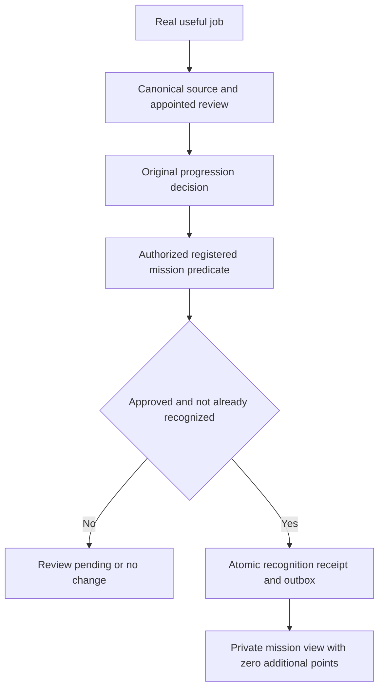

# F3/F4 Mission Catalogs and Future Implementation Contract

Date: 2026-11-08. Phase E continuation. Status: PROPOSED, NOT IMPLEMENTED, NOT PLAN LOCKED.

## 1. Purpose, evidence and scope

Make real teaching and learning jobs understandable without creating a second progression faucet. This package owns 30 Mentor and 30 Student mission definitions; F3/F4 retain source validation, grading, progression and cap authority. Names, predicates, sources, thresholds, release membership and artwork remain proposals.

Authoritative dependency: [written shared platform contracts](03-platform-contracts.md), not a cached inline predecessor. Related documents: [Mentor Playground](06-mentor-playground.md), [Student Playground](07-student-playground.md), [D reasoning](thinking-playgrounds.md), [humane loops](feature-loops.md), [lore](../../design/v2/lore-live-ops.md), and [badge catalog](09-badge-catalog.md).

Six named planning/design files were successfully read. An initial read of the shared contract at the outer workspace path failed; the written nested-workspace file was then located and read first. No application source, web, provider, database or secret research was performed.

Only known F1-F9 requirements are covered. The original detailed E/F tail remains missing; this document does not reconstruct it or restart completed packages. MAIN alone writes/registers/logs the returned documents.

### Approaches considered

| Approach | Consequence | Disposition |
|---|---|---|
| Give every mission another points payout | Publication/assessment benefits can be credited twice and copied work can farm rewards | Rejected |
| Award activity counts or positive reviews | Encourages messages, attendance, time, payment and praise rather than useful work | Rejected |
| Recognize approved existing-source predicates and explain the original grant | Makes useful work legible while retaining one authority and semantic consumption boundary | Recommended proposal; not founder approval |

Anti-goals: new wallet, public learner-error collection, mandatory competition, bought progress, fee perks, claim priority, scarcity, gambling, loot, compulsory streaks, recording requirements or a new dashboard/art system.

## 2. Common completion and reward rules

Every catalog row inherits the following mandatory rules; its additional predicate cannot weaken them.

1. Identity is fixed by the row prefix: M means Mentor, S means Student. Server-only ActorContext supplies account/session/identity; body fields never grant authority.
2. A registered producer must have committed accepted evidence with exact schema/source/rubric versions, subject ownership, source rights and an approved mission criterion policy.
3. Its authoritative SourceRegistry record must have accepted lineage, immutable rootOriginId/equivalenceFamilyId, fixed sourceCycleId and an allowed base benefit/category.
4. A source lookup ID is only a hint. Client flags, uploads, model output, local quiz callbacks, socket messages and browser clocks cannot satisfy a predicate.
5. The original F3/F4 source decision must exist as an authorized receipt, including a legitimate zero-issued cap result. Missing decisions produce review_pending; mission evaluation must not mint the missing grant.
6. **Additional mission points = 0; additional virtual units = 0; additional INR = 0 for all 60 rows.** Listed point rates describe the original proposed F3/F4 grant, never a mission bonus.
7. A mission may recognize an already credited source, but recognition cannot call planSemanticGrant again for that publication, outcome, assessment or unit benefit. A new operation/policy/catalog/copy/name cannot reset its consumption.
8. One source may satisfy several descriptive missions only under approved predicate mapping. Those labels do not multiply source counts, points, badges or eligibility. Default ambiguous mapping is blocked.
9. Recognition is once per owner/identity/stable mission criterion/authoritative family. Independent future work can create another recognition link, not a weekly reset of the old work.
10. Capped genuine evidence may meet a mission criterion. Display best value, requested base points, issued base points and unissued units separately; never describe unissued units as debt.
11. Every source retains its original category and cycle. A lesson cannot become a pattern, and an assessment cannot become transfer/review, merely because a different mission is selected.
12. Copies, splits, regenerated forms and reordered material inherit their reviewed equivalence family. Unknown lineage blocks recognition/issuance pending review, without claiming perfect plagiarism detection.
13. Corrections and rights revocations create linked revisions and appealable decisions. Never overwrite receipts, erase unrelated work, reopen old cap occupancy or silently debit a child's wallet.
14. All mission evidence is private by default. Mentor course ownership does not authorize owner-private Student artifacts, answers, notes or error histories.
15. Practice/teaching, support, accessibility, consent, security and basic export work without missions, points or badges. No mission requires recording, payment, attendance, response speed or public sharing.

### Fixed proposed base categories

| Code | Source category / stable benefit | Original proposed rate | Weekly bound |
|---|---|---|---|
| ML | mentor.lesson / mentor.quality | 30 per independent reviewed lesson | 120 |
| MO | mentor.outcome / mentor.quality | 40 per independent validated outcome | 160 |
| MK | mentor.milestone / mentor.quality | 20 per independent accepted on-time milestone | 80 |
| MQ | mentor.resolution / mentor.quality | 10 per independent reviewed question resolution | 60 |
| MP | mentor.pattern / mentor.quality | 10 per independent rights-reviewed pattern | 40 |
| SA | student.assessment / student.mastery | Positive comparable-family normalized-best delta | 200; at most 80 assessment points/course |
| SU | student.unit / student.mastery | Proposed 10 per independent meaningful unit | 40 |
| ST | student.transfer / student.mastery | Positive comparable-family normalized-best delta | 60 |
| SR | student.review / student.mastery | Positive comparable-family normalized-best delta | 40 |

Mentor category bounds total 120+160+80+60+40=460; the binding overall weekly proposal is 400. Four-week standing remains (W0+0.7W1+0.49W2+0.343W3)/2.533, owned by F3, not recalculated by missions.

Student category potential totals 340, with overall weekly cap 300 and assessment-course cap 80. Family normalized value is at most 24 across copies/cycles; assessment, transfer and review consumers use the same registered F4 integer normalization.

GradeEvidence.normalizedScore must be a bounded nonnegative safe integer under an approved scale/range/rounding/calibration/comparability registry. No consumer floors a rational/raw score or reinterprets an old credited best. Comparable 15 -> 18 requests 3; repeat 18 or lower 15 requests 0. Cap clipping still advances consumed best under F4.

No points-to-currency mapping exists here. Technical assets VIRTUAL_STUDENT, VIRTUAL_MENTOR and VIRTUAL_PEER remain separate and nonconvertible; visible asset names and any additional source eligibility require explicit F5/shared approval.

## 3. Registered evidence adapters

The names below are PROPOSED adapter registrations, not claims of deployed APIs or new product membership. Checks are appointed-reviewer/grader findings under fixed rubrics, never client booleans.

| Adapter | Proposed evidence schema v1 / producer authority | Trigger event | Lookup index |
|---|---|---|---|
| ML | mentor.lesson.v1 / canonical publication plus appointed content/rights reviewer | fp2.v1.publication.changed, accepted publication only | subjectId/schemaId/sourceCycleId; sourceId/sourceVersion |
| MO | mentor.outcome.v1 / appointed outcome/repair reviewer | fp2.v1.mentor.contribution.accepted, category mentor.outcome | subjectId/schemaId/sourceCycleId; repairRootId/evidenceVersion |
| MK | mentor.milestone.v1 / F1 claim/milestone authority plus appointed review | fp2.v1.mentor.contribution.accepted, category mentor.milestone | subjectId/claimId/milestoneFamilyId; sourceId/sourceVersion |
| MQ | mentor.resolution.v1 / canonical question authority plus appointed resolution reviewer | fp2.v1.mentor.contribution.accepted, category mentor.resolution | subjectId/questionRootId; sourceId/sourceVersion |
| MP | mentor.pattern.v1 / appointed pattern/rights reviewer | fp2.v1.mentor.contribution.accepted, category mentor.pattern | subjectId/patternFamilyId; sourceId/sourceVersion |
| SA/ST/SR | student.grade.v1 / authoritative F4 grader with fixed registry category | fp2.v1.grade.committed | learnerId/equivalenceFamilyId; attemptId/evidenceVersion |
| SU | student.unit.v1 / canonical meaningful-unit validator | fp2.v1.student.unit.accepted | learnerId/unitFamilyId; sourceId/sourceVersion |

Shared fp2.v1.source.granted is a receipt/source linkage trigger, not a second completion signal. Corrections use fp2.v1.mentor.contribution.corrected or fp2.v1.student.grade.corrected; account revocation uses fp2.v1.account.authz.changed. Consumers fetch current authorized truth rather than trust event payload evidence.

Strict check registries: ML allows LP01-LP06; MO OR01-OR06; MK KM01-KM06; MQ QR01-QR06; MP PT01-PT06; SA A01-A12; SU U01-U06; ST T01-T06; SR R01-R06. Each row defines the meaning of its one check. Unknown keys, changed meanings and unregistered schema versions fail closed.

### Inherited evidence/access profiles

| Profile | Window/repeat/semantic origin | Privacy, accessibility and abuse boundary |
|---|---|---|
| C | Any accepted lesson source; once per mission/lesson equivalence family | Own permitted teaching artifacts; reviewer verifies stated accessible equivalent; splitting, reuploading or changing format does not create points |
| O | Any accepted repair/outcome source; once per mission/repair-outcome family | Mentor receives only approved minimal result/aggregate; no private learner drill-down; observation is not causal efficacy; appointed conflict review |
| K | Accepted F1 claim milestone; once per mission/milestone family | Original accepted scope/deadline and authoritative submission; accommodations/excuses under approved F1 policy; no deadline edits, attendance or instant-failure punishment |
| Q | Any reviewed resolution source; once per mission/question-equivalence family | Question must be in a currently granted purpose; no message-count/likes/stars; private source stays private; author and reviewer cannot self-certify usefulness |
| P | Any accepted pattern source; once per mission/pattern-equivalence family | Rights/attribution and distinct reusable teaching job reviewed; no stolen/paraphrased-copy clearance from fingerprint alone; text/static equivalent |
| A | Any authorized graded form; once per mission/assessment-equivalence family | Owner-private answers/artifacts; assigned grader only; untimed/static alternative; no surveillance, device/language/disability inference or raw-score shortcut |
| U | Any canonical unit completion; once per mission/unit-equivalence family | Owner-private completion; approved checkpoint or accessible alternative; autoplay/open/save/time alone insufficient; independent-unit benefit rule required |
| T | Any approved transfer grade; once per mission/transfer-equivalence family | Genuinely distinct registered outcome/context, not renamed assessment; same F4 normalization and owner ACL; no breadth-as-mastery claim |
| R | Learner-chosen eligible retrieval grade; once per mission/review-equivalence family | Approved chosen window and independent family; decline/reschedule without penalty; same-family revisit stays original category/best, not SR faucet |

All recognition windows are lifetime eligible evidence unless the producer predicate contains an accepted claim deadline or chosen retrieval window. No mission expires an earned record or requires consecutive attendance. Source cycles still constrain original points.

## 4. Mentor mission inventory: exactly 30 proposed definitions

Predicate notation: B means all section 2 base checks. Check=true means every listed subcondition was accepted by its registered appointed reviewer. Mission predicate version is 1 for every row. The code supplies exact producer/schema/event/index and proposed base rate/cap from sections 2-3; final column supplies inherited origin/repeat/privacy/accessibility/abuse rules.

| ID | Proposed name / real job | Additional deterministic accepted check | Code | Profile |
|---|---|---|---|---|
| M-MIS-001 | Outcome Bridge / connect an explanation to its declared goal | LP01: published lesson has one declared outcome, a worked example explicitly addressing it, and a separately solvable check with reviewed answer | ML | C |
| M-MIS-002 | Boundary Window / teach where a method stops working | LP02: published lesson includes a valid method example and a reviewed counterexample exposing a named applicability condition | ML | C |
| M-MIS-003 | Prerequisite Passage / repair a missing prerequisite | LP03: lesson names a prerequisite, explains its connection to the target task, and contains an accepted prerequisite check and alternative entry path | ML | C |
| M-MIS-004 | Caption Thread / make spoken instruction usable as text | LP04: published lesson's instructional speech has reviewed text coverage, essential non-speech cues and a static text route matching its stated goal | ML | C |
| M-MIS-005 | Representation Link / connect two ways to express one idea | LP05: lesson links two representations with an explicit correspondence and one reviewed conversion task; decorative duplication is insufficient | ML | C |
| M-MIS-006 | Uncertainty Margin / teach a justified limitation | LP06: lesson labels a specific assumption, explains what is unknown, and supplies a reviewed test or source that could resolve the uncertainty | ML | C |
| M-MIS-007 | Resource Refit / replace an unavailable teaching resource | OR01: repair receipt links unavailable resource/version to a rights-permitted replacement and an accepted goal-equivalence check | MO | O |
| M-MIS-008 | Misconception Repair / correct a documented conceptual defect | OR02: reviewed defect category, old/new lesson versions and a rubric-scored follow-up validate the corrected concept; no causal improvement claim | MO | O |
| M-MIS-009 | Instruction Alignment / repair task directions | OR03: repair identifies a direction/task mismatch, publishes aligned directions and validates one independent task under the repaired rubric | MO | O |
| M-MIS-010 | Access Route Repair / remove an instructional access barrier | OR04: named content barrier has a reviewed non-barrier alternative and an approved equivalent-goal check; diagnosis or learner disability disclosure is unnecessary | MO | O |
| M-MIS-011 | Evidence Erratum / correct a material factual claim | OR05: original claim/version is linked to a reviewed supporting source, corrected version and accepted verification of the specific correction | MO | O |
| M-MIS-012 | Context Repair / fix an example that fails outside its stated context | OR06: repair records the failed context condition, a corrected example and a separately reviewed valid application in that context | MO | O |
| M-MIS-013 | Scope Anchor / deliver an accepted outcome outline | KM01: accepted F1 outline milestone identifies deliverable outcome, explicit exclusions and reviewed acceptance checks; submitted by its accepted deadline or approved compliant excuse classification | MK | K |
| M-MIS-014 | Sample Crossing / deliver a claim's pilot example | KM02: accepted sample milestone contains a runnable-in-principle learning task, reviewed solution and recorded scope feedback; on-time classification accepted | MK | K |
| M-MIS-015 | Dependency Ledger / resolve a claim's production dependencies | KM03: accepted dependency milestone records required resources, rights/access status and disposition of each mandatory blocker; on-time classification accepted | MK | K |
| M-MIS-016 | Review Packet / deliver a bounded publication review package | KM04: accepted review milestone contains the agreed artifact versions, outcome-to-check mapping and rights manifest, without undisclosed missing deliverables; on-time classification accepted | MK | K |
| M-MIS-017 | Handoff Path / deliver a usable learner handoff | KM05: accepted handoff milestone includes navigation, version-specific availability and an accessible alternative for each required learning step; on-time classification accepted | MK | K |
| M-MIS-018 | Change Boundary / account for an approved scope change | KM06: accepted change-control milestone links original scope, authorized revision, changed acceptance tests and unresolved items; deadline was approved before submission, not edited afterward | MK | K |
| M-MIS-019 | Assumption Reply / resolve a hidden-assumption question | QR01: reviewed resolution names the questioned assumption, justifies or corrects it and gives one valid consequence check | MQ | Q |
| M-MIS-020 | Counterexample Reply / resolve a proposed counterexample | QR02: reviewed resolution tests the proposed counterexample and states whether it refutes, limits or does not apply to the claim with a justified reason | MQ | Q |
| M-MIS-021 | Method Contrast / explain two candidate solution methods | QR03: reviewed resolution contrasts applicability and tradeoffs of two valid methods for the question, including one selection condition | MQ | Q |
| M-MIS-022 | Error Localization / explain the first invalid reasoning step | QR04: reviewed resolution identifies the first invalid step in an authorized submitted example, explains the violated rule and supplies a corrected continuation | MQ | Q |
| M-MIS-023 | Source Answer / resolve a disputed factual reference | QR05: reviewed resolution links an authorized source/version to the question and separates supported facts from unresolved claims | MQ | Q |
| M-MIS-024 | Meaning Clarifier / resolve ambiguous task wording | QR06: reviewed resolution identifies two plausible readings, declares the intended reading under the task rubric and supplies an unambiguous restatement | MQ | Q |
| M-MIS-025 | Worked-Step Weave / author a reusable explanation pattern | PT01: rights-reviewed pattern specifies a goal, ordered worked steps, rationale for each step and one independent check | MP | P |
| M-MIS-026 | Example Pair / author a minimal contrast pattern | PT02: pattern contains matched example/nonexample differing in a named decisive property, with reviewed applicability conditions | MP | P |
| M-MIS-027 | Representation Shuttle / author a translation pattern | PT03: pattern supplies a reusable mapping between two representations, one invariant and a reviewed boundary case | MP | P |
| M-MIS-028 | Scaffold Release / author a fading-support pattern | PT04: pattern supplies full, partial and independent forms of one task with an explicit support-removal rule and equivalent goal | MP | P |
| M-MIS-029 | Question Diagnostic / author a branching clarification pattern | PT05: pattern contains at least two distinct answer-dependent branches, a justified diagnostic question and a useful next explanation for each branch | MP | P |
| M-MIS-030 | Revision Trace / author a before/after teaching pattern | PT06: pattern preserves old/new versions, a specific change rationale and a reviewed check of the revised explanation without claiming causal learning impact | MP | P |

A milestone mission cannot require accepting a claim or unpaid work to use core tools. Six KM predicates describe different accepted deliverables; splitting a single agreed milestone into six documents does not create six independent F1 sources.

MO evidence requires a qualified outcome-review policy and capacity. A repair submission or before/after anecdote alone is not a validated outcome. Minimum deployment may leave all MO recognition review_pending while ordinary repair remains usable.

## 5. Student mission inventory: exactly 30 proposed definitions

For SA/ST/SR, G means accepted GradeEvidence with normalizedScore > 0 and its registered rubric check=true. This is a proposed low-stakes criterion, not a mastery certificate. SU uses accepted independent meaningful-unit criteria instead of pretending completion is a grade. Every row also requires B.

| ID | Proposed name / real job | Additional deterministic predicate | Code | Profile |
|---|---|---|---|---|
| S-MIS-001 | Concept in Context / explain a concept in a concrete case | G and A01: grader accepts concept identification and its justified application to the supplied case | SA | A |
| S-MIS-002 | Boundary Test / identify when a rule fails | G and A02: grader accepts one counterexample and the specific violated applicability condition | SA | A |
| S-MIS-003 | Reasoned Sequence / order dependent reasoning steps | G and A03: grader accepts the dependency order and justification of the critical predecessor relation | SA | A |
| S-MIS-004 | Error Pinpoint / locate an invalid solution step | G and A04: grader accepts first invalid step, violated rule and corrected next step | SA | A |
| S-MIS-005 | Representation Match / translate without changing meaning | G and A05: grader accepts conversion between the task's two representations and its preserved invariant | SA | A |
| S-MIS-006 | Assumption Check / distinguish given facts from assumptions | G and A06: grader accepts classification and a consequence of removing one identified assumption | SA | A |
| S-MIS-007 | Estimate Boundary / justify a bounded approximation | G and A07: grader accepts estimate, valid lower/upper bound and stated approximation limitation | SA | A |
| S-MIS-008 | Alternative Account / compare explanations of supplied evidence | G and A08: grader accepts two plausible explanations and one discriminating observation; no learner causal claim is inferred | SA | A |
| S-MIS-009 | Solution Rationale / explain why a method applies | G and A09: grader accepts method choice, applicability condition and justification of a decisive step | SA | A |
| S-MIS-010 | Ambiguity Resolver / identify and resolve task ambiguity | G and A10: grader accepts two readings and a justified interpretation under the fixed task rubric | SA | A |
| S-MIS-011 | Best-Value Revision / improve a permitted comparable attempt | G and A11: accepted comparable revision plus original source receipt requestedPoints > 0; bestBefore/bestAfter must show a positive approved integer delta | SA | A |
| S-MIS-012 | Known and Unknown / state an evidential limitation | G and A12: grader accepts supported conclusion, explicit uncertainty and a valid proposed information check | SA | A |
| S-MIS-013 | Goal Closure / complete a declared unit outcome | U01: canonical unit validator accepts the declared outcome checkpoint and required independent completion conditions | SU | U |
| S-MIS-014 | Prerequisite Closure / finish a prerequisite bridge unit | U02: canonical validator accepts the unit's prerequisite check and target-goal bridge checkpoint under fixed unit criteria | SU | U |
| S-MIS-015 | Model Closure / finish a unit that constructs a usable model | U03: validator accepts model checkpoint, stated assumptions and required interpretation checkpoint; merely saving a diagram is insufficient | SU | U |
| S-MIS-016 | Procedure Closure / finish a unit with a validated procedure | U04: validator accepts ordered procedure checkpoint and required result-verification checkpoint or approved accessible equivalent | SU | U |
| S-MIS-017 | Explanation Closure / finish a unit with a justified conclusion | U05: validator accepts conclusion/evidence link and required limitations checkpoint under the unit rubric | SU | U |
| S-MIS-018 | Revision Closure / finish a unit with reviewed reasoning revision | U06: validator accepts original/revised reasoning references and the unit's required correction check; saving an edit alone is insufficient | SU | U |
| S-MIS-019 | New Setting / apply an idea in a distinct context | G and T01: approved transfer family tests same target principle in a genuinely different reviewed setting and accepts application rationale | ST | T |
| S-MIS-020 | New Representation / transfer an idea to a different expression | G and T02: independent transfer family uses a representation not credited as the original assessment outcome and accepts preserved meaning | ST | T |
| S-MIS-021 | Combined Tools / solve a task requiring two learned methods | G and T03: distinct transfer rubric requires both methods and accepts their connection, not two pasted prior solutions | ST | T |
| S-MIS-022 | Constraint Shift / adapt a method to a changed constraint | G and T04: distinct transfer rubric changes a material constraint and accepts justified adaptation plus validity check | ST | T |
| S-MIS-023 | Unfamiliar Example / classify and justify an unseen case | G and T05: approved independent transfer form contains a reviewed unfamiliar case and accepts classification with decisive evidence | ST | T |
| S-MIS-024 | Transfer Boundary / explain why a familiar method does not transfer | G and T06: distinct transfer task requires a justified failure condition and a valid alternative, not just refusal to answer | ST | T |
| S-MIS-025 | Recall by Choice / retrieve a core explanation after a chosen delay | G and R01: eligible chosen retrieval window, independent reviewed family and accepted unaided core explanation under disclosed feedback rules | SR | R |
| S-MIS-026 | Delayed Boundary / revisit an applicability condition | G and R02: chosen-window independent retrieval family accepts valid example/nonexample distinction and decisive condition | SR | R |
| S-MIS-027 | Delayed Reconstruction / rebuild a reasoning sequence | G and R03: chosen-window independent retrieval family accepts dependency order and critical step rationale | SR | R |
| S-MIS-028 | Delayed Translation / retrieve a representation correspondence | G and R04: chosen-window independent retrieval family accepts conversion and preserved invariant | SR | R |
| S-MIS-029 | Delayed Repair / revisit a previously corrected reasoning rule | G and R05: chosen-window independent retrieval family tests the rule through a distinct reviewed problem and accepts correction rationale | SR | R |
| S-MIS-030 | Delayed Distinction / discriminate two easily confused concepts | G and R06: chosen-window independent retrieval family accepts both classifications and distinguishing condition | SR | R |

The six SU predicates describe different unit goals, not six rewards for the same unit. The source registry must explicitly establish that unit completion is a legitimate independent benefit before it coexists with related assessment sources; otherwise the unit award/recognition branch is blocked.

R predicates do not authorize creating a fresh family for a renamed retake. A same-family delayed revisit remains its original category and positive-best rule, even if useful privately; it does not satisfy this catalog's independent SR-family branch. Proposed 7-28-day organization is inherited only after approval; it is not an optimal-spacing claim.

All written/oral/drawn response formats require registered rubric-equivalent accessible alternatives. No mission denies recognition because a learner used an approved accommodation. A task with fewer than five valid independently scored items can remain practice but cannot supply this F4 normalized comparison source.

## 6. Compact owned schemas and interfaces

Use canonical shared Id, Version, IntUnits, ResourceRef, ActorContext, Tx, CommandEnvelope, PolicyGate, Receipt, GradeEvidence, EventEnvelope and AtomicPlan. Type notation is not a TypeScript migration decision.

```ts
type MissionId = `M-MIS-${string}` | `S-MIS-${string}`;
type MissionCode = "ML" | "MO" | "MK" | "MQ" | "MP" | "SA" | "SU" | "ST" | "SR";
type MissionState = "not_started" | "in_progress" | "eligible" | "earned" | "review_pending" | "revoked";
type MissionDefinition = Readonly<{
  missionId: MissionId; stableCriterionId: Id; catalogVersion: Id; predicateVersion: 1;
  identity: "Mentor" | "Student"; nameKey: Id; jobKey: Id; code: MissionCode;
  schemaId: Id; checkId: Id; profileId: Id; additionalPoints: "0";
  additionalVirtualUnits: "0"; artKey: Id; accessibleLabelKey: Id;
}>;
type MissionEvidence = Readonly<{
  schemaId: Id; schemaVersion: 1; sourceId: Id; sourceVersion: Version;
  subjectId: Id; identity: "Mentor" | "Student"; evidenceRef: ResourceRef;
  rootOriginId: Id; equivalenceFamilyId: Id; sourceCycleId: Id;
  rubricVersion: Id; producerId: Id; evidenceVersion: Version;
  checks: Readonly<Record<string, boolean>>; gradeRef: Id | null;
  originalGrantId: Id; originalReceiptId: Id;
}>;
type MissionRecognition = Readonly<{
  recognitionId: Id; ownerId: Id; identity: "Mentor" | "Student";
  stableCriterionId: Id; missionId: MissionId; catalogVersion: Id;
  sourceId: Id; sourceVersion: Version; equivalenceFamilyId: Id;
  basisKey: Id; sourceCycleId: Id;
  state: MissionState; version: Version; originalReceiptId: Id;
  correctionCaseId: Id | null; newlyAppliedPoints: "0";
}>;
type MissionEvaluateInput = Readonly<{ missionId: MissionId; sourceId: Id; evidenceVersion: Version }>;
type MissionResult = Readonly<{
  recognition: MissionRecognition | null; state: MissionState;
  acceptedSourceIds: readonly Id[]; familyIds: readonly Id[];
  originalGrantIds: readonly Id[]; baseRequested: IntUnits;
  baseIssued: IntUnits; baseUnissued: IntUnits; newlyAppliedPoints: "0";
  artKey: Id; accessibleLabelKey: Id; reasonCode: string | null;
}>;
interface MissionCatalogService {
  evaluateMission(tx: Tx, actor: ActorContext, definition: MissionDefinition, evidence: MissionEvidence): Promise<MissionResult>;
  planMissionRecognition(tx: Tx, actor: ActorContext, envelope: CommandEnvelope<MissionEvaluateInput>): Promise<AtomicPlan<MissionResult>>;
}
```

Template-string IDs and Record keys are not open registries. The allowlist contains exactly the 60 IDs/checks in this document. MissionEvidence is internal producer data: public payloads cannot provide checks, subjectId, grade, lineage, category, units, timestamp or verified fields.

GradeEvidence remains the single normalized-score authority. gradeRef resolves it after source authorization; MissionEvidence does not maintain another score or consumed-best field. Base units resolve immutable receipts, not today's rate applied to old evidence.

F3 MentorCatalogEvidence.evaluateCriterion maps MissionResult to CatalogCriterionResult; F4 StudentCatalogEvidence.evaluateCriterion maps it to StudentCriterionResult. Their exact existing planning interfaces remain unchanged. Adapters expose only permitted sources/families; they do not return internal producer identity or hidden source content.

## 7. Owned data, mandatory indexes and source-consumption mapping

| Proposed owned record | Required fields / indexes | Authority and correction rule |
|---|---|---|
| MissionDefinitionVersion | missionId, stableCriterionId, catalogVersion, predicateVersion, code/check/schema/profile, state; unique missionId/catalogVersion; unique stable criterion meaning | Immutable definition; DRAFT/APPROVED/SUSPENDED; a version change cannot create a new benefit |
| MissionEvidenceLink | subjectId, identity, schemaId, sourceId/sourceVersion, evidenceVersion, authorized evidence reference; unique schemaId/sourceId/sourceVersion/evidenceVersion; subject/schema/cycle lookup | Authorized pointer to producer truth, not copied private payload or independent source registry |
| MissionRecognition | declared type; unique ownerId/identity/stableCriterionId/equivalenceFamilyId; owner/identity/state; sourceId/sourceVersion lookup | Transactional recognition record; references existing shared basisKey and original receipt; no new base consumption |
| MissionRecognitionHistory | recognitionId, revision, state, linked correction, receiptId; unique recognitionId/revision | Append-only state history under approved retention; no overwrite of earlier receipts |
| MissionPreference | ownerId, identity, hidden mission IDs, optionalPrompts, version; unique owner/identity | Private preference; no award or participation debt |
| MissionReadProjection | owner/identity/mission, sourceVersion, state and allowlisted receipt summary; unique owner/identity/mission; version lookup | Rebuildable with shared consumer checkpoints; never grading/award/access authority |

MissionRecognition.equivalenceFamilyId is copied only from the currently authorized accepted MissionEvidence under the same transaction, not client input or a recalculated fingerprint. Future assertion `independentFamiliesSameCriterionHaveSeparateRecognition`: same owner/identity/criterion with genuine familiesA/B creates two permitted family-specific links, both with additional units0; copied/replayed familyA creates no new link or base grant. Add to BackEnd/tests/fp2MissionRecognition.integration.test.js, NOT_RUN. Use shared Operation/Receipt/SourceRegistry/SourceConsumption/Outbox/AuthzFence/PolicyBundle; no MissionWallet or competing family-best/cap counter.

For ML/MO/MK/MQ/MP, resolve existing mentor.quality basisKey. For SA/SU/ST/SR, resolve existing student.mastery basisKey. Every MissionRecognition retains that basis and original fixed source cycle. Its recognition uniqueness includes stable criterion only to distinguish descriptive labels, not to create another base grant family.

One equivalent source is counted once in any aggregate distinct-family predicate, even if it has several mission labels. Correction invalidates affected links and rebuilds permitted projections; original SourceConsumption markers remain consumed. Deletable private content and minimal dedup/control metadata require separate approved retention.

## 8. Proposed commands, errors, events and atomic algorithm

All routes use /api/v2/fp2 and canonical operationId/expectedVersion/policyVersion/resource/payload. Root is the owner's existing progression ResourceRef; child recognition/preference versions appear in affectedVersions. ActorContext is constructed server-side and live fences are touched transactionally.

| Proposed route | Actor/request | Result / errors |
|---|---|---|
| GET /api/v2/fp2/catalogs/missions?identity={identity}&catalogVersion={id} | Authenticated member; bounded registered identity/version | Safe definitions only; no private counts; INPUT_INVALID for unknown version/identity |
| GET /api/v2/fp2/resources/progression/{id}/projection?minVersion={v} | Owner under current scope | MissionResult summaries with base receipt units; 202 if lagging; uniform 404 if unavailable |
| POST /api/v2/fp2/commands/catalog.mission.evaluate | Registered catalog service or appointed source reviewer; envelope<MissionEvaluateInput> | Receipt<MissionResult>; no public self-award; SOURCE_BLOCKED/POLICY_BLOCKED422, version/operation409, unavailable404 |
| POST /api/v2/fp2/commands/catalog.mission.preference.set | Owner; envelope<{hiddenMissionIds,optionalPrompts}> | Private preference receipt; no source/points effect; schema400, conflict409 |
| POST /api/v2/fp2/commands/catalog.mission.correct | Assigned correction service/reviewer; envelope<{recognitionId,caseId,evidenceRevisionId}> | Linked recognition correction; unrelated learning unaffected; unassigned404, unsupported remedy422 |
| GET /api/v2/fp2/operations/{operationId} | Operation owner, current authorized receipt fields | Original receipt/processing; missing/other-owner/inaccessible uniformly404 |

HTTP401 AUTH_REQUIRED; 400 INPUT_INVALID; 404 RESOURCE_NOT_AVAILABLE; 409 VERSION_CONFLICT/OPERATION_CONFLICT; 422 POLICY_BLOCKED/SOURCE_BLOCKED; 503 TEMPORARILY_UNAVAILABLE. Detailed predicate/source/version errors follow authorization; unavailable copy is always `This item is unavailable.`

1. Authenticate, allowlist envelope/command/schema, authorize root and evidence discovery, and construct server context.
2. Resolve actor/operation intent under shared idempotency. Exact retry returns original permitted receipt without mutation; changed intent returns OPERATION_CONFLICT.
3. Resolve approved criterion/provenance/retention/safety policy and registered producer evidence inside the shared transaction; recheck resource ACL, sessionGeneration, authzEpoch and applicable membership/consent versions.
4. Fetch original source consumption and receipt. Validate category, cycle, integer normalization/comparability and check meaning; missing evidence stays review_pending or source-blocked, never invented.
5. CAS progression/recognition versions and all relevant authority fences. Existing owner/criterion/family recognition returns no_change with zero new units; an independent family may add a recognition link.
6. Commit recognition/domain history, invariant projection, receipt, operation completion and outbox atomically. sourceGrants and ledgerPlans are empty for recognition. No source consumption or original award is modified.
7. Deliver/read-project asynchronously with atomic consumer checkpoint. Event gaps trigger authorized rebuild; old/duplicate events cannot overwrite newer state. Notification delivery is not recognition completion.

Register fp2.v1.catalog.mission.recognized, fp2.v1.catalog.mission.corrected and fp2.v1.catalog.mission.preference.changed with the canonical v1 envelope. Payload allowlist: recognitionId, missionId, identity, sourceVersion, state, originalGrantId, newlyAppliedPoints=0 and safe correction reference; source IDs are restricted internal references, not public learner evidence.

No reward event is emitted for a replay/no_change result. Mission events cannot feed F3/F4 source adapters as new publication/grade evidence or feed F5 wallets. Provider inbox receipt is never mission business completion.

## 9. States, UX and textual flow

| State / transition | Exact proposed copy | Expected behavior |
|---|---|---|
| not_started -> in_progress | `Choose this job if it is useful to you.` | Optional hide/exit; no timer, loss countdown or rank penalty |
| in_progress -> review_pending | `Evidence needs review. No new points are confirmed here.` | Show bounded review availability; ordinary task remains usable |
| accepted evidence -> eligible | `The source meets the proposed criterion.` | Planning preview only until approved policy/recognition receipt; no client award |
| eligible -> earned | `Mission recorded. Additional mission points: 0.` | Show original base grant and clipping separately, only after durable receipt |
| same source -> no_change | `This source was already recorded for this mission.` | Original receipt link; no second ceremony |
| correction -> revoked/review_pending | `This recognition changed after evidence review.` | Private linked reason/case/appeal; no public accusation |
| source inaccessible | `This item is unavailable.` | Do not leak owner, learner, question, hidden count or content |
| paused/hidden | `Optional mission prompts are off.` | Work/access/history retained; no public absence row |

Use existing Mentor/Student progress surfaces, shared cards/tokens, Board snapshots, notes and Motion primitives. Mission titles supplement plain functional jobs and may be removed. No new palette, icon font, Three scene, competing dashboard or achievement overlay is required.

Static text, keyboard operation and status announcements complete every path. Sound defaults off. Optional shared reveals use proposed <=180 ms ordinary / <=400 ms comparison / <=800 ms skippable art; reduced motion is immediate and route/account changes cancel stale callbacks. Motion communicates committed facts and grants nothing.

Private cache scope includes accountId/sessionGeneration/activeIdentity/authzEpoch/policyVersion/resource/sourceVersion. Account/identity/epoch changes abort old requests, clear private scope and detach scoped subscriptions before mounting the next account. Private offline evidence is disabled until approved storage/key/logout-deletion policy.



| Diagram path | Equivalent rule |
|---|---|
| A-B-C | Real work and original F3/F4 authority; mission is not a producer shortcut |
| C-D-E | Current ACL/policy/lineage/check and recognition uniqueness |
| E-F | No invented award, no replay issuance, safe practice/review alternative |
| E-G-H | Atomic recognition only; original grant unchanged; projection may lag |

Text/monochrome Mermaid plus equivalent table only. No render, palette, device, Office or runtime validation is claimed.

## 10. Policy blocks, reuse and minimum/V1/V2

```ts
type MissionPolicy = Readonly<{
  allowedDefinitions: readonly MissionId[]; allowedProducerSchemas: readonly Id[];
  checkRegistryVersion: Id; recognitionMappingVersion: Id;
  allowCapClippedRecognition: boolean; sourceRetentionPolicyVersion: Id;
  reviewCapacityRef: Id; publicProjection: "off" | "approved_adult_opt_in";
}>;
type MissionActivation = PolicyGate<MissionPolicy>;
```

Unknown/proposed/suspended gates cannot authorize production recognition. Proposed catalogs may be read as explicitly labeled planning previews only. Missing rubric/calibration blocks the affected grade/mission branch; missing mandatory guardian/session eligibility blocks the affected session, not ordinary local stop controls.

| Open decision | Blocked action / concrete acceptance |
|---|---|
| DEC-E-CAT01 / shared C04,C09; M01,S02 | Activate definitions/base explanations: approve 60 meanings, zero-additional rule, categories/caps and any multiple-label mapping |
| DEC-E-CAT02 / C02,C05,C07 | Accept evidence: approve producer/schema/check registries, lineage/equivalence/comparability and reviewer appointments/conflicts |
| DEC-E-CAT03 / C01,C07,C12 | Persist recognition: prove real atomicity/CAS/live fences/indexes and approve privacy-compatible retention/deletion/control markers |
| DEC-E-CAT04 / C03,C11,C12 | Show external evidence/audience: approve purpose/age/safety/scoped consent/suppression; public/minor branches off meanwhile |
| DEC-E-CAT05 / C10,C12 | Visible names/art/prompts/intake: founder branding/membership plus asset/accessibility review, staffed capacity and optional delivery budget |

Recording consent is never a mission criterion. Deny-only consent.recording.withdraw authenticates scope ownership and uses approved minimal revocation authority even if recording-use policy is suspended; no Mentor role/all-party re-consent. If durable authority is unavailable, local capture still stops, server new recording/renewal/ingest fails closed and remote success is unavailable. Nonrecording calls require independent valid booking/participant/age/safety eligibility.

EPHEMERAL_CALL intentionally ends with its call purpose. Persistent studio and course publication require separate rights/purpose/retention. Any mission-linked time anchor uses the versioned half-open shared map; removed/unknown anchors are explicit and cannot silently relocate/regrade evidence.

Fixed optional learner-chosen mentor-priced session share stays 15%; subscription separately stays 20%, with remaining 80% for enrolled-course mentors. Recognized bases, fees, tax, refund/reserve/KYC and allocation remain blocked shared decisions. No guessed rates or zero UNKNOWN; integer INR minor units only.

Existing reuse claims are inherited from the read plans, not fresh source verification: Pact/progression components, Gameology, CourseLearn/CoachQuiz, Recorder/MediaLibrary, Board/notes, source/receipt/coordinator concepts and token/Motion systems. Verify source guards before later integration; do not mount dormant helpers or overwrite whole wallets.

| Future proposed absolute file | Owned interface / distinction |
|---|---|
| D:/orbit-main/orbit-main/shared/fp2/catalogs/missionDefinitions.js | Data-only 60 definitions and strict ID/check registry; not written now |
| D:/orbit-main/orbit-main/BackEnd/services/fp2/missionCatalog.js | Implements MissionCatalogService through shared coordinator; not a new award engine |
| D:/orbit-main/orbit-main/BackEnd/services/fp2/missionEvidenceAdapters.js | resolveMissionEvidence(tx: Tx, actor: ActorContext, code: MissionCode, sourceId: Id): Promise<MissionEvidence>; registered producer lookups |
| D:/orbit-main/orbit-main/BackEnd/services/fp2/mentorCatalogEvidence.js | Planned F3 adapter reuse; map results to its existing planning interface |
| D:/orbit-main/orbit-main/BackEnd/services/fp2/studentCatalogEvidence.js | Planned F4 adapter reuse; no score normalization duplicate |
| D:/orbit-main/orbit-main/FrontEnd/src/components/fp2/MissionCatalogPanel.jsx | MissionCatalogPanel({view,accountScope,onPreference,onCase}); canonical embedding, no self-award |
| D:/orbit-main/orbit-main/BackEnd/routes/fp2Routes.js | Shared proposed command/schema/event registrations, not a second router/coordinator |

Minimum: approved evidence-only private recognition, zero extra rewards, original receipts, strict schemas, current fences, correction/appeal and full static UI. Unavailable producer branches stay disabled.

V1 candidate: capacity-bounded approved definitions/adapters and private mission selection within verified canonical surfaces. The inventory is not a promise all 60 ship together.

V2 candidate: approved additional equivalent response formats, localization and bounded purpose-scoped audiences after real privacy/abuse/accessibility pilots. No implicit social crews, new live-ops, public minors, paid perks, gifting, conversion, surveillance or new money flows.

## 11. Numbered future tasks and exact inventory acceptance

Every task/assertion is future, unchecked and NOT RUN. Runner commands remain unselected until later authorized manifest/runner verification. No mandatory commit or execution is requested now.

- [ ] Task 1: Author D:/orbit-main/orbit-main/BackEnd/tests/fp2MissionInventory.test.js; assert exactly 60 rows, Mentor=30 and Student=30, IDs equal the explicit contiguous M-MIS-001..030 and S-MIS-001..030 sets, no 000/031, no duplicate IDs/names, and exactly one registered criterion meaning per stableCriterionId.
- [ ] Task 2: In the same future inventory test, assert Mentor code counts ML/MO/MK/MQ/MP each 6; Student counts SA=12, SU=6, ST=6, SR=6; all additional fields exactly zero; all check IDs unique and schema/profile compatible. Compare canonical criterion signatures, not names alone, and review the distinct real jobs manually.
- [ ] Task 3: Author D:/orbit-main/orbit-main/BackEnd/tests/fp2MissionEvidence.integration.test.js; implement registered adapters; assert unknown schemas/checks, spoofed producers, unassigned reviewers, client score/authority fields and unavailable private resources are denied before detailed disclosure.
- [ ] Task 4: Author D:/orbit-main/orbit-main/BackEnd/tests/fp2MissionRecognition.integration.test.js; implement MissionCatalogService; assert lost-response replay, new-operation no_change, copy/policy/category immutability, empty sourceGrants/ledgerPlans and no base grant or wallet effect from recognition.
- [ ] Task 5: In that integration suite, inject failures after every recognition/history/projection/receipt/outbox stage and race live revocation against commit; require all-or-nothing effects and real storage fence/index evidence, not an in-memory mock claim.
- [ ] Task 6: Author D:/orbit-main/orbit-main/BackEnd/tests/fp2MissionCorrections.integration.test.js; assert affected-link-only corrections, no reopened source/cap boundary, no private Student artifact access for course owners, and approved deletion that cannot permit replay.
- [ ] Task 7: Author D:/orbit-main/orbit-main/FrontEnd/src/components/fp2/__tests__/MissionCatalogPanel.test.jsx; implement canonical panel; assert static/keyboard/sound-off/reduced-motion completion, truthful zero-additional copy, no pressure prompt, hidden missions without access loss and old-account response discard.
- [ ] Task 8: Author D:/orbit-main/orbit-main/BackEnd/tests/fp2MissionCrossPack.integration.test.js; assert Mentor 460/400 and Student 340/300/course80/family24, 15->18 delta3 then zero, no mission-to-wallet mapping, no rating/message/time/pay benefit and unchanged separate money shares.
- [ ] Task 9: MAIN reviews returned line counts, links, ASCII/no-pictograph content, IDs, criterion distinctness and registry ownership before saving. Later implementation review must verify real producer/rubric/calibration/capacity/accessibility behavior; document checks are not launch clearance.

### Concrete future invalid/replay/correction vectors

| ID / failure or input | Expected outcome |
|---|---|
| MC01 Publish one accepted LP01 lesson; F3 already requested30/issued30 | M-MIS-001 recognition may commit; displayed original30, additional0; no second mentor.quality grant |
| MC02 Same lesson satisfies LP01 and LP02 under approved mapping | Two descriptive links at most; one semantic lesson source/count/base grant; no60 points |
| MC03 Copy lesson, new operation/policy/catalog/name | Same family; no new base benefit or repeat same-mission recognition; unknown lineage blocks |
| MC04 Same operation and intent after HTTP loss | Original permitted receipt, replayed=true; one recognition/outbox, no second ceremony |
| MC05 Same operation but different source/policy | OPERATION_CONFLICT; no new intent effect |
| MC06 Client sends checks, normalizedScore, category, points or verified | INPUT_INVALID; no trusted evidence/grade/recognition/asset effect |
| MC07 Mentor owns course and asks for S-MIS-011 learner's private revision | Uniform RESOURCE_NOT_AVAILABLE; course ownership supplies no Student artifact grant |
| MC08 Accepted comparable best15->18 with cap remaining3 | Original F4 requested3/issued3; S-MIS-011 may recognize; additional0 |
| MC09 Same improvement clipped to1; retry next cycle or repeat18/lower15 | Original requested3/issued1/unissued2, consumedBest18; no recovery debt; subsequent same-family base delta0 |
| MC10 Raw/rational score or changed scale without approved conversion/comparison | SOURCE_BLOCKED; no flooring, guessed normalization or reinterpretation of prior best |
| MC11 Same assessment renamed delayed review or transfer | Original family/category retained; no SR/ST reset; independent-family mission branch not satisfied |
| MC12 Autoplay, elapsed minutes, attendance, positive stars, payments or messages | No eligible mission producer/check/source; no recognition points or new wallet benefit |
| MC13 Split one accepted milestone into six files; retroactively extend deadline | One milestone family; invalid changed deadline blocked; no six grants |
| MC14 Cap full, accepted useful source with original zero-issued receipt | Approved criterion may recognize; show issued0/unissued honestly, no debt or forced spending |
| MC15 Evidence corrected or rights revoked after recognition | Linked private recognition review/revocation; original receipts/consumption retained, unrelated history/access untouched |
| MC16 Already spent optional F5-linked virtual benefit later disputed | Approved F5 restricted case; mission service cannot debit wallet, invent cash debt or make balance negative |
| MC17 Old event/duplicate event, projection gap or crash during recognition | No downgrade/duplicate; gap rebuild; all transactional effects absent or complete |
| MC18 Logout A/login B or Mentor->Student scope change during request | Previous generation aborted/discarded, cache/subscriptions cleared; no private cross-account result |
| MC19 Unknown review capacity/retention/mandatory safety policy | Affected branch policy-blocked or honest waiting; no invented approval/unbounded unpaid intake; safe independent learning remains |
| MC20 Recording-use suspended; user withdraws while remote authority unavailable | Local stop works, server recording fails closed, remote durable confirmation explicitly unavailable; no mission penalty |

## 12. Handoff and verification limits

This is returned draft material, not a disk-write or execution result. The tables enumerate the required 30+30 IDs and distinct predicate jobs; programmatic count/signature/link/line checks remain MAIN's responsibility. All tests and future files above are proposed and NOT RUN/NOT CREATED.

No Edit/Write, application import/run/test/build, server, watcher, package, helper, migration, seed, database/provider/paid call, environment/secret read, commit, publication or rendered asset was performed. Names/art are not cleared or shipped. No runtime, causal-learning, current-law, vendor-support/price, device or Office claim is made.

Founder/qualified policy decisions, atomic topology, source rights/equivalence, normalized grading, retention, safety, staffing and final feature membership remain open. Continue integration/review through MAIN only; this package does not resume other workflows.
