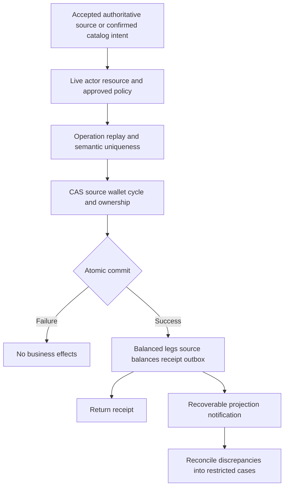

# F5 - Separate Virtual Currencies and Atomic Ledger Master Plan

Date: 2026-11-07. Phase E. Status: PROPOSED, NOT IMPLEMENTED, NOT PLAN LOCKED.

**Goal:** Give Student, Peer and Mentor separate earned-only virtual assets without making learning, ratings, rank, claims, support or money purchasable advantages.
**Architecture:** Registered authoritative evidence produces a semantic grant plan; the shared coordinator commits domain/source/ledger/balance/receipt/outbox effects together. Discovery views are rebuildable, not balance authority.
**Stack:** Reuse the audited JS/JSX application and existing catalog/art where appropriate. Proposed TypeScript-style interfaces are contract notation, not approval to change language, storage or dependencies.
**Execution gate:** Phase E permits master-plan documents only. Every implementation/test task is future and unchecked. No app edit/import/run/test/build, server, install, migration/seed, live provider/DB operation, credential/environment read, commit or publication is authorized here.

## 1. Audit current Peer authority and accounting first

Evidence: [existing-system audit](01-existing-system-audit.md), especially B01/B02/B08/B09/B14; [economy/session reasoning](thinking-economy-sessions.md); [marketplace ledger research](research-marketplace-economy.md); [D model recipe](thinking-model-recipe.md). These are historical source reports/planning evidence, not runtime reproduction or causal learning evidence. No application source was reread for this draft.

| Audit-supported current state/failure | Existing source path, supported by audit | Required future boundary |
|---|---|---|
| Current Peer Photon is one `orbit.stardust` wallet with Photon/legacy aliases, not three isolated assets | `BackEnd/controllers/orbitController.js`, `BackEnd/services/orbitEngine.js`, `BackEnd/services/photonLedger.js` | Explicit per-identity asset accounts; no automatic rename, conversion or migration |
| Public authenticated XP award accepts client `xpOverride`; balance may precede history write | `BackEnd/routes/gameologyRoutes.js`, `BackEnd/controllers/gameologyController.js`, `BackEnd/services/gameologyService.js` | A raw activity/XP/helper event cannot become wallet issuance evidence |
| Rolled GET/action can replace the full orbit snapshot and overwrite a newer atomic purchase; REP-CURRENCY-01 is T-checked | `BackEnd/controllers/orbitController.js:118-122`, `BackEnd/controllers/shopController.js:86-104` | GET is side-effect-free; resource/version CAS and transactional balance projection, never whole-wallet replacement |
| Concurrent gifts can write a stale `sentToday` and undercount the allowance; REP-CURRENCY-02 is T-checked | `BackEnd/controllers/orbitController.js:322-370` | If gifting is later approved, debit, credit, allowance fence and semantic transfer resolve atomically |
| Gift-credit exceptions and duel settlement lack recoverable all-or-nothing boundaries; REP-CURRENCY-03 is T-checked | `BackEnd/controllers/orbitController.js`, `BackEnd/controllers/duelController.js:28-52` | Do not launch F5 over sequential debit/credit or client-declared duel results |
| Freeze-cap/sale-window findings remain A-labeled, not confirmed | Audit separate currency bug list | Verify before changing; no invented defect or automatic removal |
| Cash payouts use a separate MoneyLedger, but its row loop is not a multi-record atomic guarantee | `BackEnd/models/MoneyLedger.js:51-61`, `BackEnd/services/payment/index.js:151-165` | Preserve virtual/money separation; do not copy the sequential cash coordinator into F5 |
| Account/identity display changes are not universal server active-identity authority | `BackEnd/middleware/requireRoles.js`, `FrontEnd/src/soul/identityStore.js` | Use canonical server ActorContext/live fences and account-scoped cache isolation |

These are source-checked risk paths, not evidence of actual exploitation, hosted balance loss or deployed topology. Intentional ephemeral Board deletion is unrelated and remains intentional. Future containment must block unsafe authoritative bridges before enabling a new asset; this document does not disable any existing route now. Preserve legacy records and reconcile them read-only until an explicit migration decision exists.

## 2. Product boundaries and approach

Considered: a shared convertible wallet is rejected because it mixes identities and money/fairness obligations; unlimited rewards with optional sinks are rejected because a correct ledger can still record unbounded issuance; recommended PROPOSED approach is separate source-bounded assets with optional cosmetic sinks and no expiry. This is the drafter's recommendation, not a founder-selected final policy.

- Assets have no cash value, purchase route, exchange rate, cash-out, interidentity conversion, session discount or subscription allocation effect.
- No loot boxes, gambling, staking, duel wagers, bought grades/reviews/rank/claims, streak repair pressure, coerced attendance, emotional dependence or minor payment pressure.
- Core learning, accessibility, prerequisites, ordinary organization, corrections, support, consent, security and basic export remain functional without tokens. A decorative theme must not be the only readable/high-contrast theme.
- Private wallet/history by default. Do not publish minor balances, earners or rankings. Unknown age never enables a public branch.
- Scores/mastery, reputation, weekly progression and wallets remain distinct. Mentor progression's category caps sum to 460 and its proposed overall cap is 400; neither is this wallet's 150-unit weekly cap.
- Fixed money rules remain elsewhere: optional sessions 15% platform; subscriptions separately 20% platform and 80% enrolled-course mentor pool. Virtual assets never offset those shares.

## 3. Shared contract integration

Consume the written [shared contract](03-platform-contracts.md) as canonical. Earlier inline/not-on-disk wording is historical delegation provenance, not current authority. MAIN owns revisions/cross-pack consistency. Do not redefine ActorContext, ResourceRef, CommandEnvelope, Receipt, Problem, PolicyGate, SourceRecord, GrantRequest, SemanticGrantPlan, LedgerPlan, AtomicPlan, AccountScope or EventEnvelope.

Canonical identifiers: `operationId`, `expectedVersion`, `policyVersion`; routes `/api/v2/fp2`; events `fp2.v1.*`; positive safe-integer versions; `expectedVersion='absent'` only for authorized creation. `IntUnits` is a canonical decimal integer string, handled with checked integer arithmetic. Server context and Tx never arrive from a client. Feature handlers stage plans but cannot independently commit or make external calls inside the transaction.

F5 uses ResourceRef kind `wallet` for the identity wallet and child catalog/reservation references as opaque IDs in validated payloads. Asset IDs are exactly the shared proposed `VIRTUAL_STUDENT`, `VIRTUAL_PEER`, `VIRTUAL_MENTOR`. Benefit families are `student.wallet`, `peer.wallet`, `mentor.wallet`. They are registered stable families, not client-selectable aliases for mastery or rating. Required scopes are `identitySafety`, `sourceProvenance`, `virtualEconomy`, `retention`; grading/progression are also required when their evidence is consumed. Public visibility requires its separate approved gate.

A policy bundle must be approved and current for every required scope. `unknown`, `proposed` and `suspended` are blocked for authoritative issuance/spend. A preview may show proposed parameters with an explicit planning label; it cannot change a balance. Unknown retention is not guessed zero/forever. Administrative deployment-off returns HTTP 503 `TEMPORARILY_UNAVAILABLE`; unresolved policy returns HTTP 422 `POLICY_BLOCKED` with safe decision IDs.

## 4. Proposed asset/source/sink configuration

All names/rates/caps/catalog membership below are PROPOSED, pending DEC-E-V01/V02 and shared DEC-E-C04/C09. Technical IDs are not approved visible currency brands. No automatic credit for historical events.

| Identity/asset | Weekly aggregate issuance cap | Available plus reserved balance cap | Eligible proposed source/rate | Explicitly excluded |
|---|---:|---:|---|---|
| Student / VIRTUAL_STUDENT | 100 | 2,000 | 1 unit per newly validated comparable mastery best-delta unit; source-family ceiling 24 per current approved comparable assessment outcome | Local quiz result, attempts alone, watching time, login/streak, repeated 18 after credited 18, paid lesson advantage |
| Mentor / VIRTUAL_MENTOR | 150 | 3,000 | Rights-cleared reviewed original publication 10; validated learner-outcome evidence 20; reviewed original reusable explanation/pattern 5; assigned support resolution validated by independent reviewer 5 | Raw uploads, self-approval, review purchases, claim acceptance alone, paid session attendance, bank payout size |
| Peer / VIRTUAL_PEER | 75 | 1,500 | Authorized purposeful peer exchange with independent eligibility validation 5; reviewed original reusable peer explanation 5 | Raw chat/messages, client `call-ended`, self-created history, reactions, ratings volume, duel wins or wagering |

The Peer exchange semantic family is server-established from participants, approved learning purpose and evidence-equivalence lineage; a new room/call ID cannot create another family for the same credited exchange. Candidate rate limit is one eligible exchange benefit per participant pair/purpose/cycle, and one explanation benefit per authoritative origin family. Pair/cycle eligibility is an additional validator, not a replacement for the shared stable consumption key. Approval must determine evidence sufficiency without forced recording; if that is unresolved, Peer issuance remains blocked rather than trusting mutual client assertions.

Student consumers resolve only the single registered F4 GradeEvidence integer; they do not calculate or floor another normalization. The historical D grader proposal is q=clip((accuracy-chance)/(1-chance),0,1), value=min(24,HALF_UP(20*difficulty*q)), delta=max(0,value-creditedBest). F4 owns the approved unit scale/range/rounding/calibration/rubric comparability; missing approved conversion or changed old-best scale blocks issuance. Comparable15->18 requests3; repeat18/lower15 requests0. This retained historical formula is not wallet authority, calibrated fairness or client grading permission.

Mentor wallet sources are separate registered benefits, not automatic currency from every F3 score event. An approved source can authorize several distinct legitimate families only through the shared registry. Multiple account identities cannot mint all three wallets from one event merely by switching presentation. Unknown lineage/rights/validation quarantines the source and blocks issuance.

| Optional candidate sink | Proposed fixed price | Conditions | Fairness exclusion |
|---|---:|---|---|
| Private decorative wallet/card border | 40 matching-asset units | Preview, confirmation, rights-cleared catalog item; persistent ownership | Default readable border/theme stays free |
| Alternate private avatar accent | 60 matching-asset units | No public rarity hierarchy or exclusive status; all required identity indicators remain free | No expertise/rating/claim implication |
| Decorative notebook cover | 30 Student or Peer units in separate listings | Core editor, covers required for legibility, organization and export remain free | No extra storage, search or learning access |
| Decorative studio folder icon | 30 Mentor units | Core studio folders/export/support remain free | No publication priority, analytics entitlement or speed boost |

Cross-asset listings are independent prices/ownership, not a conversion path. These are candidates, not approved catalog prices. Minimum foundation has no sink; V1 may enable only reviewed static cosmetics. No randomized rewards, expiring sale/FOMO, subscription fee perks, paid balance top-up, gifting or duels in minimum/V1. Optional gifting would need a distinct explicit safety/abuse/allowance decision and the atomic both-party protocol; no implicit membership in V2.

## 5. Actor capabilities and flows

| Actor | Proposed capability | Additional required authority | Denial |
|---|---|---|---|
| Account in Student/Peer/Mentor workspace | `wallet.read.own`, `wallet.catalog.read`, `wallet.purchase.own` | Current identity exists, matching wallet owner/asset, approved item policy and live authz fence | Other identity asset spend, other user's history, amount/source authority |
| Registered source service | `source.validate.<kind>`, `wallet.grant.plan` | Registered producer, accepted source, allowed family/recipient/cycle, approved policy | Browser/helper/socket event used as accepted source |
| Appointed correction reviewer | `wallet.correction.review.assigned` | Assigned restricted case, evidence/reason, approved reversal/appeal policy | Arbitrary mint, private account browsing or negative recovery |
| Reconciliation service/operator | `wallet.reconcile.assigned` | Narrow affected wallet/source/case, approved control-data retention | Whole snapshot replacement or unexplained balance adjustment |
| Support | `case.create.own` or assigned case capability | Field-level access and purpose | General wallet/grade/private media access |

Flow A, earn: learner completes an authorized assessment or reviewer accepts a qualifying original contribution; authority commits source evidence; service stages F5 grant using shared basis; coordinator issues the allowed delta and source consumption atomically; UI receives a receipt or eventually reads it. Notification says issued units only. Raw clients cannot call a mint route.

Flow B, optional purchase: open own catalog, see plain asset/price and free alternatives, preview item, confirm once; server reads price/version and available balance; coordinator posts balanced spend plus ownership plus receipt/outbox; UI applies ownership after committed receipt. Lost response checks the same operation. Already owned nonconsumable returns `no_change`, charged zero. No auto-repurchase on retry.

Flow C, access change: account/identity/epoch change clears prior private cache/listeners and rejects delayed responses before mounting the next scope. Live revocation fences order against every grant/spend. A past successful receipt is replayed only with currently permitted fields; an old identity grant cannot authorize a new purchase.

Flow D, correction: source revoked/appealed opens an assigned case; reviewer checks original benefit and fund position. Unspent eligible amount may have one linked balanced reversal; spent amount remains a restricted correction case awaiting approved remedy. No hidden child/user debt or coercion to earn/spend. Source/history corrections do not silently mutate grade or ranking.

## 6. F5 feature types and persistence

All interfaces/records are PROPOSED. Strings are bounded allowlisted IDs; personal content is stored separately from control metadata; maxima and purpose-specific lifetimes require approval.

```ts
type VirtualAsset = 'VIRTUAL_STUDENT' | 'VIRTUAL_PEER' | 'VIRTUAL_MENTOR';
type WalletState = 'ACTIVE' | 'ISSUANCE_BLOCKED' | 'SPEND_BLOCKED' | 'RECONCILIATION_REQUIRED' | 'CLOSED';
type WalletView = Readonly<{ wallet: ResourceRef; identity: Identity; assetId: VirtualAsset; version: Version; state: WalletState; available: IntUnits; reserved: IntUnits; weeklyIssued: IntUnits; weeklyCap: IntUnits; balanceCap: IntUnits; cycleId: Id; sourceVersion: Version }>;
type CatalogItem = Readonly<{ itemId: Id; itemVersion: Version; assetId: VirtualAsset; price: IntUnits; ownershipKind: 'NONCONSUMABLE'; state: 'AVAILABLE' | 'WITHDRAWN'; policyVersion: Id; previewRef: Id }>;
type PurchasePayload = Readonly<{ itemId: Id; itemVersion: Version }>;
type PurchaseResult = Readonly<{ itemId: Id; ownershipId: Id; chargedUnits: IntUnits; ledgerTxnId: Id | null; wallet: WalletView }>;
type GrantResult = Readonly<{ sourceId: Id; benefitFamily: BenefitFamily; basisSequence: Version; requestedUnits: IntUnits; issuedUnits: IntUnits; unissuedUnits: IntUnits; ledgerTxnId: Id | null; originalReceiptId: Id | null; wallet: WalletView }>;
type ReservationState = 'RESERVED' | 'POSTED' | 'VOIDED' | 'EXPIRED';
type WalletReservation = Readonly<{ reservationId: Id; wallet: ResourceRef; assetId: VirtualAsset; units: IntUnits; purpose: string; state: ReservationState; expiresAt: UtcInstant; version: Version }>;
type CorrectionState = 'REVIEW_REQUIRED' | 'REVERSAL_AUTHORIZED' | 'REVERSED' | 'SPENT_REMEDY_BLOCKED' | 'APPEALED' | 'RESOLVED_NO_DEBIT';
type WalletCorrection = Readonly<{ caseId: Id; originalTxnId: Id; sourceId: Id; requestedCorrectionUnits: IntUnits; eligibleUnspentUnits: IntUnits; spentUnits: IntUnits; state: CorrectionState; remedyPolicyVersion: Id | null; version: Version }>;
```

| Record | Additional fields | Required indexes/constraints | State/lifetime |
|---|---|---|---|
| WalletRoot | accountId, identity, assetId, state, version, policyVersion | Unique account/identity/asset; identity-to-asset equality; shared resource identity | Version/CAS authority; no GET rollover |
| AssetAccount | Shared available/reserved/issuance/sink account fields | Shared unique asset/owner/bucket; available and reserved checked nonnegative for user | Ledger-transaction invariant projection |
| WalletCycleCounter | walletId, sourceCycleId, issuedUnits, version | Unique wallet/cycle; transaction conditional cap write | Server-assigned source cycle; approved boundary/timezone |
| SourceConsumption/grant history | Shared basisKey, creditedBest, sequence, sourceCycleId, original grant | Shared semantic unique plus sequence; no operation/policy/copy ID in basis | Stable replay suppression, reviewed privacy-compatible markers |
| CatalogItem/Ownership | item fields; owner account/identity/asset, origin receipt | Unique item/version; unique owner/identity/asset/item for nonconsumable | Withdrawal stops new sales; past rights/remedy policy required |
| WalletReservation | Defined type plus original purchase intent hash | Unique ID; wallet/state/expiry index; exclusive terminal resolution | Expiry is a command, not TTL balance deletion |
| CorrectionCase | Defined type, assigned reviewer, evidenceRef, appeal link | Unique original transaction/correction scope; assigned/state lookup | Purpose-limited evidence; approved retention/appeal |
| LedgerTransaction/Entry, Receipt, Operation, Outbox | Exact shared contract | Shared transaction/leg/semantic/actor-operation/event uniqueness | Immutable posted history; atomic commit and recoverable delivery |

Storage/index/authority-fence guarantees remain UNVERIFIED. Select a real topology and prove transaction durability/unique/CAS behavior under shared DEC-E-C01. A database driver method name, in-memory lock or sequential row loop does not prove these constraints. A read projection is never a source of spendable balance.

## 7. Exact grant, cap and integer ledger algorithm

1. Shared coordinator validates envelope/registered command, authenticates, authorizes discovery/live wallet/identity fences and hashes canonical intent. Same actor/operation/same intent replays original receipt; changed intent returns OPERATION_CONFLICT.
2. Resolve approved policy scopes and accepted authoritative source with registered lineage/family/recipient. Shared basis is `digest(domain,recipientAccountId,recipientIdentity,stableBenefitFamily,authoritativeEquivalenceFamilyId)`. Operation ID, policy version, copied artifact/course ID and display name are absent.
3. Lock/CAS shared source basis and wallet/cycle counters. Comparable Student improvement computes the new requested delta against prior validated best, not another attempt ID. A clipped grant advances credited best/source-consumption honestly; unissued units do not become debt or a future replay entitlement.
4. For requested positive integer `r`, current total `t=available+reserved`, cycle issuance `w`, caps `B,C`, compute `issued=max(0,min(r,B-t,C-w))`, `unissued=r-issued`. Already consumed/no improvement issues zero. Source committed time fixes the cycle. Reservation cannot hide balance-cap occupancy.
5. If `issued>0`, stage an issuance debit and matching user-account credit in the same virtual asset; stage updated invariant balance/cap, source sequence, grant history, receipt and outbox. If zero, record authorized `no_change` with requested/issued/unissued and consumed basis as appropriate, no fake positive ledger leg or reward ceremony.
6. Commit all shared AtomicPlan effects together or roll back all business effects. Never complete operation/receipt before source/legs/balance. Crash after commit and before response returns the existing receipt on retry.

Proposed accounting map uses credit-normal user virtual balances: issuance debit/user available credit; user available debit/system sink credit; available debit/reserved credit for a reservation; reserved debit/sink credit for posting; reserved debit/available credit for void/expiry. Map/system normal-side conventions still require shared DEC-E-C04/C06 approval. All posted transactions use one asset and `sum(debits)=sum(credits)`. User available/reserved cannot be negative. System issuance counterbalance is not cash debt.

Purchase amount is derived from approved catalog item/version. Reject fractions, negatives, zero-effect transfers, unknown accounts, same-account transfers and asset mismatch. Concurrent purchases CAS/touch the same spend balance; with 50 available and two distinct 40-unit purchases, at most one commits, the loser gets INSUFFICIENT_AVAILABLE or VERSION_CONFLICT after authorized refresh. Owned-item uniqueness prevents charging twice with different operation IDs. Balance updates never rewrite an entire orbit/identity subdocument.

No user transfer route exists in minimum/V1. If a future transfer is approved, both users' same-asset legs, allowance counter, reservation, source/semantic transfer identity, balances, receipt and outbox must share one commit. Post/void/expire are mutually exclusive CAS terminal states; timeout cannot separately refund and post. Duels never stake assets or authorize funds from client claims.

## 8. Corrections, recovery and reconciliation

Posted transactions are immutable. A correction has a unique link and additive reverse/adjustment legs; it does not delete a posted grant or fabricate a void for money already posted. Cumulative reversed units cannot exceed the original issued units. A duplicate correction returns original permitted receipt with no new debit.

For eligible unspent correction `u`, approved reviewer/service authority may post user available debit/issuance credit. If relevant units have been spent or reserved, the correction becomes SPENT_REMEDY_BLOCKED or REVIEW_REQUIRED. Approved resolution may affect unspent units only after checking provenance/reservations; do not assume fungible balance proves all originally awarded units remain unspent. Allocation/tracing rule is DEC-E-V04. No automatic negative wallet, parent debt, cash recovery or future-issuance freeze unless an explicitly approved safe remedy policy allows it. The safe default is no further debit and ordinary support/appeal access.

| Failure boundary | Expected durable truth and recovery |
|---|---|
| Crash before commit/after one staged leg | No business effect; reclaim expired operation lease and revalidate current authority/source/policy |
| Commit complete, HTTP reply lost | One receipt/source/balanced ledger/cap/ownership/outbox; replay same operation |
| Outbox notification failure | Grant remains committed; leased delivery retries idempotently; do not say delivered or grant again |
| Source revoked while grant races | Shared source/authority fences order commit; subsequent new issuance blocked; prior committed grant opens reviewed correction |
| Projection differs from posted history | Mark affected spending RECONCILIATION_REQUIRED, open restricted case, rebuild projection from ledger/checkpoints; no silent patch |
| Unknown storage/retention/dedup-marker availability | Block authoritative branch; no mock ledger, forgotten history or unsafe fallback |

Reconciliation compares per-asset posted legs, asset-account projections, reservations, source sequences, cycle issuance/caps, ownership receipts and outbox/checkpoints. System-wide balance sum alone cannot detect wrong recipient or duplicated source. A difference creates an assigned case with source/amount/state and proposed remedy; reconciliation never invents an unexplained mint/sink. Cadence, staffing, alerting and retention are DEC-E-V04/V06 and shared DEC-E-C12, not an assumed unattended worker.

Content deletion and minimal semantic dedup markers require separate approved retention/key-lifecycle policy. Do not TTL-delete receipts/source consumption and permit reissuance under a fresh ID. If required dedup history cannot lawfully remain, block that benefit basis pending reviewed resolution rather than claiming permanent retention. No credentials are included in export, logs or cases.

## 9. Proposed API, events and UX

All command requests use the exact shared CommandEnvelope; authorized responses are CommandResult with Receipt, processing or Problem. Only the shared registered service can execute grant commands; there is no public arbitrary grant/amount/source-verified route.

| Route/command | Payload and root | Receipt/result | Failure examples |
|---|---|---|---|
| GET `/api/v2/fp2/wallets/{identity}` | Auth session; allowed identity | ProjectionView containing WalletView, no other account data | 401 AUTH_REQUIRED; 404 unavailable workspace/wallet; 503 deployment/authority off |
| GET `/api/v2/fp2/wallets/{identity}/history?cursor={opaque}` | Own wallet; bounded page | Allowlisted immutable receipt/transaction references and next cursor | Invalid cursor 400; inaccessible 404; no raw evidence/private grader fields |
| GET `/api/v2/fp2/wallets/{identity}/catalog` | Own approved workspace | Approved item/version/price/free alternatives; clearly separate planning preview | Unknown economy 422 POLICY_BLOCKED; no purchasable preview item |
| POST `/api/v2/fp2/commands/wallet.purchase` | CommandEnvelope<PurchasePayload>; root wallet | PurchaseResult; `no_change` chargedUnits='0' if owned | 409 version/item-version or operation conflict; 422 policy/insufficient; 404 unavailable item/wallet |
| POST `/api/v2/fp2/commands/wallet.correction.request` | Own wallet, payload {originalReceiptId, reasonCode, optionalPrivateTextRef} | Case ref, no immediate debit | 404 inaccessible receipt; 422 evidence-retention policy blocked |
| Service command `wallet.grant.apply` | Registered GrantRequest; authorized wallet target | GrantResult plus shared receipt | SOURCE_BLOCKED, POLICY_BLOCKED, VERSION_CONFLICT; browser registration denied |
| Service command `wallet.reservation.resolve` | {reservationId, resolution:'POST'|'VOID'|'EXPIRE'} | Exclusive resolution and resulting wallet | Wrong terminal intent/version 409; premature expiry 400; policy blocked 422 |
| Assigned service command `wallet.correction.apply` | {caseId, approvedRemedyId}; root wallet | Linked correction result or blocked case | No client amount; unauthorized 404; spent remedy unresolved 422 |

Problems use shared codes: deployment-off 503 TEMPORARILY_UNAVAILABLE; nonapproved policy 422 POLICY_BLOCKED; insufficient 422 INSUFFICIENT_AVAILABLE; accepted-source failure 422 SOURCE_BLOCKED; stale resource/operation 409; absent/unauthorized/revoked 404 RESOURCE_NOT_AVAILABLE with `This item is unavailable.` Detailed validation/version/source hints appear only after resource authorization.

Register bounded payloads for `fp2.v1.source.granted`, `fp2.v1.ledger.posted`, `fp2.v1.wallet.ownership.changed`, `fp2.v1.wallet.correction.changed`, `fp2.v1.cycle.adjudicated`, `fp2.v1.notification.requested`. Every envelope preserves eventId, operationId, policyVersion, resourceVersion, aggregateSequence and committed server time. The last two F5-specific suffixes require shared schema registration, not an arbitrary string event. No sensitive answer/media/case text in events. Delivery is at-least-once; consumer effect plus checkpoint is atomic. Replay/no_change emits no duplicate reward notification. GET never adjudicates cycles; old/gapped events refresh projections rather than overwrite balance authority.

| UX state | Plain copy | Required behavior |
|---|---|---|
| Private wallet ready | `These units are optional and have no cash value.` | Identity/asset label, available/reserved/caps, free alternatives |
| Sending or response lost | `Your request is processing. Check its status before trying again.` | Same operation lookup; no second charge or optimistic ownership |
| Committed grant | `Awarded 3 units.` | Exact committed issued amount; not requested amount |
| Duplicate source | `Not awarded: this source has already been credited.` | Newly issued zero; own original receipt link |
| Cap clipping | `Award limited by the current cap.` | Requested/issued/unissued and period; no debt or pressure to spend |
| Insufficient | `You do not have enough available units. Nothing was charged.` | Keep free option; no top-up/cash prompt |
| Owned item | `You already have this item. Nothing was charged.` | Durable no_change receipt; no ceremony |
| Conflict | `This wallet changed. Review the latest balance before confirming.` | Explicit refresh/reconfirmation, not automatic changed-price retry |
| Spent correction | `This correction needs review. No additional units were taken.` | Private case/support/appeal; no negative balance |
| Policy/deployment block | `This optional wallet action is unavailable. Learning and support remain available.` | Safe decision/status, complete core path |

Static text, keyboard focus/status announcements and sound-off path convey all results. Proposed optional reveal <=180 ms, optional skippable receipt ceremony <=800 ms; reduced-motion removes spatial effects without changing commit semantics. No animation awards units, blocks exit or implies measured fps. AccountScope keys and generation checks follow shared contract; logout/identity switch aborts pending display work, clears prior private cache and listeners. Offline private persistence remains off until shared-device encryption/logout/retention approval.



| Diagram nodes | Equivalent step |
|---|---|
| A-B | Validate source/purchase intent, live authority and required approved gates |
| C-D | Reuse prior operation or lock semantic source/caps/available/ownership |
| E-F | Roll back every business effect on failure |
| E-G-H | Commit balanced effects and return durable result |
| I-J | Idempotent asynchronous display/delivery and restricted reconciliation |

Textual Mermaid and equivalent table only; no rendered or palette QA claim.

## 10. Guarded E planning workbook; actual Office execution unverified

Existing D [workbook](models/thinking-simulations.xlsx), [recorded results](models/thinking-simulation-results.csv) and [recipe](thinking-model-recipe.md) remain untouched. D recipe reports nine identity/archetypes, 108 baseline months and 432 sensitivity months, 540 cap/nonnegative wallet steps in its abstract assertions. Cached/source-reported PASS does not prove new guards, Office recalculation, actual issuance, inflation, behavior or database concurrency.

Canonical E planning artifacts are [master-plan-model-recipe](master-plan-model-recipe.md), [typed master-plan-inputs CSV](models/master-plan-inputs.csv) and [master-plan-models workbook](models/master-plan-models.xlsx), authorized by the recorded E PATHS contract. MAIN created/registered these planning outputs on2026-11-08; they supplement rather than overwrite D edits. Fifteen sheets include the thirteen schema sheets below plus EligibleCourses and FormulaManifest. No macros, external workbook links, application data, credentials, network functions, helpers or publication. Formula protection is an accidental-edit barrier, not security; authoritative grants never read workbook cells. Guarded Python/arithmetic/XML results are not actual Office recalculation or production approval.

### 10.1 Exact sheet schema and model status

Workbook schema ID `fp2.e.economy-model.v1` is PROPOSED. Sheets below have header row 1; data begins row 2. Strings and numeric input cells have explicit validation; every row has status/result rather than silently coercing bad input.

| Sheet | Exact ordered columns or fixed schema | Cardinality/role |
|---|---|---|
| Readme | key, value, evidenceStatus | Model schema/input hash/snapshot time, PROPOSED labels, unknown-policy and recalculation limits |
| ModelConfig | parameter, value, unit, state, decisionId | Required named values below; unknown values stored as explicit state, not numeric zero |
| WalletInputs | identity, archetype, weeklyRequested, monthlySinkRequested, weeklyCap, balanceCap, openingUnits, activeWeeksPerMonth | Exactly nine unique identity/archetype rows; all editable inputs PROPOSED |
| Scenarios | scenarioId, faucetScaleBp, sinkScaleBp, scaleDenominator | Exactly BASELINE/10000/10000/10000, MORE_EARNING/12000/10000/10000, LESS_SPENDING/10000/8000/10000, COMBINED/12000/8000/10000 |
| WalletBaseline | identity, archetype, month, opening, weeklyRequested, weeklyCap, balanceCap, activeWeeks, faucetScaleBp, sinkScaleBp, scaleDenominator, monthlySinkRequested, requested, issued, spent, closing, unissuedAtCap, inputStatus, invariantStatus | Exactly 9*12=108 rows; baseline scenario only |
| WalletStress | scenarioId, identity, archetype, month, opening, weeklyRequested, weeklyCap, balanceCap, activeWeeks, faucetScaleBp, sinkScaleBp, scaleDenominator, monthlySinkRequested, requested, issued, spent, closing, unissuedAtCap, inputStatus, invariantStatus | Exactly 4*9*12=432 rows, including duplicated baseline comparison |
| YearEnd | scenarioId, identity, archetype, month12Closing, totalIssued, totalSpent, totalUnissued, rowStatus | 36 rows derived from stress; no mixed-asset total presented as currency |
| SessionInputs | scenarioId, recognizedBasisMinor, gatewayRateBp, gatewayFixedMinor, infrastructureMinor, supportMinor, riskMinor, costMode, taxState, providerState | Three D synthetic prices plus minor-boundary stress; exact cost meaning below |
| SessionOutputs | scenarioId, basisMinor, sessionSharePct, platformMinor, mentorObligationMinor, assumedCostsMinor, conditionalContributionMinor, contributionRatio, allInNetStatus, inputStatus | All-in net remains blocked until signed actual policy/cost inputs |
| SubscriptionInputs | scenarioId, recognizedBasisMinor, eligibleCourseIds, allocationMode, policyState | Stable sorted unique eligible IDs, or blocked zero-beneficiary state |
| SubscriptionOutputs | scenarioId, basisMinor, subscriptionSharePct, platformMinor, mentorPoolMinor, courseCount, eachFloorMinor, remainderMinor, allocationStatus, inputStatus | Equal-course candidate arithmetic only; not adopted settlement policy |
| GuardVectors | vectorId, targetField, injectedValueType, injectedValueText, expectedStatus, observedStatus, verificationKind | Sixty executed typed-Python model vectors; spreadsheet edits/recalculation NOT_RUN |
| Checks | assertionId, expected, observed, outcome, engineName, engineVersion, verifiedAt |620 Python planning checks with actual snapshot metadata; separate Office row NOT_RUN, not engine PASS |

Required ModelConfig parameters: SessionSharePct=15 and SubscriptionSharePct=20 fixed; MoneyMinorPerINR=100 fixed; ScaleDenominator=10000 fixed; ModelMonths=12 fixed; ActiveWeeksPerMonth=4 proposed D baseline; ModelNumericLimit=1000000000 proposed bounded planning limit; TaxPolicyState=UNKNOWN; ProviderPolicyState=UNKNOWN; AllocationPolicyState=PROPOSED; OfficeRecalculationState=UNVERIFIED. Approved production amount/calendar/tax/provider policy is not inferred from these bounded model settings.

WalletInputs exact D tuples: Student Casual 40/80/100/2000; Student Steady 80/250/100/2000; Student Intensive 120/380/100/2000; Mentor Casual 25/40/150/3000; Mentor Steady 75/160/150/3000; Mentor Intensive 180/550/150/3000; Peer Casual 15/40/75/1500; Peer Steady 45/160/75/1500; Peer Intensive 90/260/75/1500. Tuple order is weeklyRequested/monthlySinkRequested/weeklyCap/balanceCap. OpeningUnits=0 and activeWeeksPerMonth=4. These archetype requests are not live faucet rates, catalog demand or engagement forecasts; four weeks each month models 48 active weeks, not a real calendar.

### 10.2 Exact valid-input predicate and formulas

Validator rejects rather than clamps invalid inputs. A numeric input must be an actual finite nonboolean numeric cell/number of the expected integrality/range; numeric-looking text, blank, formula error, typed/date-formatted units, nonfinite text and unexpected formula inputs are invalid. An unformatted numeric date serial is indistinguishable from a numeral and is not claimed detectable by value alone; actual engine/import checks remain unverified. JSON import rejects nonfinite values and duplicate keys before conversion. Integers have no fraction; currency display converts validated minor units only after arithmetic.

Wallet predicate: registered identity/archetype pair; month integer 1..12; all units/caps/requests/opening nonnegative integers <=ModelNumericLimit; activeWeeks integer 0..52; opening<=balanceCap; multipliers integer 0..100000; denominator exactly10000 and positive; checked intermediates <=100000000000000. If a lowered cap makes opening exceed cap, return INVALID_INPUT:OPENING_ABOVE_CAP, not a silent confiscation. A zero multiplier is valid and models no requests; a zero denominator is invalid. A zero balance/weekly cap is a valid explicit synthetic disabled-award scenario, not an unknown production-policy value.

For a valid row, let O,R,C,B,W,S be opening, weekly request/cap, balance cap, active weeks and monthly sink request; f,s,D are multiplier basis points and denominator. Exact integer formulas are:
`requested=min(C,floor(R*f/D))*W`; `issued=max(0,min(B-O,requested))`; `spent=min(O+issued,floor(S*s/D))`; `closing=O+issued-spent`; `unissuedAtCap=requested-issued`.

WalletBaseline positions: O=D, R=E, C=F, B=G, W=H, f=I, s=J, D=K, S=L; outputs M/N/O/P/Q respectively. Row-2 formula bodies are `MIN(F2,INT(E2*I2/K2))*H2`, `MAX(0,MIN(G2-D2,M2))`, `MIN(D2+N2,INT(L2*J2/K2))`, `D2+N2-O2`, `M2-N2`. Wrap each with `IF(R2="VALID",body,"INVALID_INPUT")`; R is the explicit inputStatus predicate and S verifies integer/nonnegative/conservation/cap outputs. Formula compatibility and validation behavior must be tested in the selected spreadsheet engine; the expressions specify required arithmetic, not an API/library endorsement.

Rows are generated/grouped by scenario/identity/archetype/month. Month1 opening references that tuple's keyed input opening; month2..12 references the previous closing for the same complete key, never blindly an unrelated prior row. Current E output sorting/row insertion/deletion is intentionally disabled until selected-engine key-chain tests pass; filters remain usable. Source lookup keys and formula manifests are independently validated; unprotecting/moving/overwriting cells invalidates trusted export. WalletStress has the extra scenario column, so all references shift one column. An invalid upstream month blocks its descendants rather than treating text as zero. WalletInputs/Scenarios include additional input-status/key columns, and baseline/stress include exact row keys. ModelConfig.ActiveWeeksPerMonth is a seed default; WalletInputs.H is the live per-archetype control. Date-formatted numeric cells must be rejected by the later importer; an unformatted numeric date serial is not distinguishable from an ordinary number, and is not claimed detected.

All valid rows assert `O+issued-spent=closing`, `0<=closing<=B`, `issued<=requested`, `spent<=O+issued`, `0<=unissuedAtCap`, and requested respects weekly cap. This simplified model issues before optional spending in each month; spending does not reopen that month's issuance. A real event ledger is order-sensitive and is not forecast by this aggregate sequence. YearEnd sums remain per asset/identity and preserve that distinction.

Money predicate: basis/cost amounts are nonnegative integer minor units within model limit; quote/session candidate basis must be positive; gatewayRateBp nonnegative bounded integer; MoneyMinorPerINR exactly100; fixed shares exactly15/20; denominators positive; no boolean/text/fraction/nonfinite values. Session nominal platform is `floor((15*B+50)/100)` and mentor obligation `B-platform`; subscription nominal platform is `floor((20*B+50)/100)` and pool `B-platform`. Every dependent money cell emits FIXED_SHARE_VIOLATION if either fixed share is edited; it cannot continue with a changed share.

Conditional synthetic gateway cost is `floor((B*gatewayRateBp+5000)/10000)+gatewayFixedMinor`; conditional contribution is platform minus gateway/infra/support/risk. Negative contribution is a valid stress result, not invalid input or a reason to change shares. Ratio requires positive B; B=0 yields INVALID_INPUT:DENOMINATOR for a quote ratio, while a separately labeled zero-recognition accounting row may show zero conserved split without ratio. No model recommends a minimum real price.

`costMode=SYNTHETIC` permits only clearly labeled conditional pre-unknown-cost contribution. `costMode=ACTUAL` with providerState not APPROVED is BLOCKED_POLICY:PROVIDER; taxState not APPROVED keeps all-in net output BLOCKED_POLICY:TAX. An input zero requires explicit known-zero justification in an approved actual policy; UNKNOWN tax/fee never becomes zero. No statutory section/rate, invoice/KYC clearance, provider price or tax-base assumption is preloaded. Subscription courseCount=0 yields BLOCKED_POLICY:NO_BENEFICIARIES, not division-by-zero handling that assigns pool to platform. Equal-course arithmetic requires unique eligible course IDs and approved candidate mode; malformed/duplicate IDs are invalid.

### 10.3 Preservation, reference values and future validation

Recorded D baseline year-end balances, ordered Casual/Steady/Intensive: Student 960/840/240; Mentor 720/1680/600; Peer 240/240/480. D combined +20% requested earnings/-20% optional spending: Student1536/1800/1152; Mentor1056/2784/1920; Peer480/1056/1104. Future guarded baseline should match these only with identical valid inputs/formulas. These are reference arithmetic, not evidence of sustainable supply, inflation or actual learning effects. No-sink and low-activity scenarios must be added only as separately labeled optional analyses, not silently replacing required 108/432 grids.

Future guard acceptance includes negative amount/cap/opening, fractional units/weeks, boolean, numeric text, blank, nonfinite JSON, denominator0/negative, opening above cap, overflow intermediate, share14/19, unknown tax/provider, zero beneficiaries, duplicate courses, formula tamper and invalid upstream propagation. Data validation alone is bypassable; independent trusted validator plus engine recalculation must detect pasted/imported bad cells. Expected status strings are explicit, and Checks remain NOT_RUN until evidence exists. An engine recalculation check must alter one valid input, demonstrate all dependent rows update, then inject each invalid vector and show blocked outputs. ZIP/XML validity/cached values alone do not satisfy it. Preserve input snapshot/hash and engine/version/evidence without overwriting user edits or D CSV; CSV export is a timestamped snapshot, not autosynced live data.

## 11. Minimum, V1, V2 and dependencies

- Minimum: shared authority/policy/account isolation, real atomic source/ledger/cap/receipt/outbox, private history, correction/reconciliation and disabled optional currency UI when gates are missing. No legacy conversion, sink, gift, duel or cash bridge.
- V1 candidate: one private authoritative source slice per approved identity, reviewed static nonconsumable cosmetics, serialized purchases, honest cap clipping, assigned correction cases. Peer source sufficiency and Student grader comparability are hard prerequisites, not substituted with raw helper activity.
- V2 candidate: additional independently validated source families and approved catalog items; gift proposal only after separate membership/safety/abuse decision and both-party atomic tests. No conversion/wagers/paid advantage even in V2.
- Dependencies: shared C01/C02/C04/C07/C09/C12; F4 grading/family best-delta; F3 reviewed source evidence without copying its score caps; F2 reviews remain credibility, not currency authority; F7 money remains separate; shared notifications/account reset/cases/catalog rights. F5 cannot unblock money or roles.

## 12. Proposed future files, interfaces and unchecked tasks

All following paths/interfaces/test names are PROPOSED, not claims of existing files. Existing reuse targets from audit are orbitController/orbitEngine/photonLedger/shopController, catalog/art, Gameology pure helpers and existing notification/case surfaces. They require guard/schema verification before repairs; no application file is changed now.

| Proposed file | Exact owned interface/responsibility |
|---|---|
| `D:/orbit-main/orbit-main/BackEnd/services/fp2/virtualEconomyPolicy.js` | `getVirtualPolicy(policyVersion: Id): Promise<PolicyGate<VirtualEconomyConfig>>`; config contains approved asset/identity map, source rates/caps/catalog/remedy references |
| `D:/orbit-main/orbit-main/BackEnd/services/fp2/virtualGrantPlanner.js` | `planVirtualGrant(tx: Tx, actor: ActorContext, request: GrantRequest): Promise<SemanticGrantPlan>`; calls shared source authority and preserves basis/source cycle |
| `D:/orbit-main/orbit-main/BackEnd/services/fp2/virtualPurchasePlanner.js` | `planVirtualPurchase(tx: Tx, actor: ActorContext, envelope: CommandEnvelope<PurchasePayload>): Promise<AtomicPlan<PurchaseResult>>`; derives catalog price/ownership/spend legs |
| `D:/orbit-main/orbit-main/BackEnd/services/fp2/virtualCorrectionPlanner.js` | `planVirtualCorrection(tx: Tx, actor: ActorContext, caseId: Id, approvedRemedyId: Id): Promise<AtomicPlan<JsonValue>>`; blocks unresolved spent remedy |
| `D:/orbit-main/orbit-main/BackEnd/services/fp2/virtualReconciliation.js` | `reconcileWallet(wallet: ResourceRef): Promise<Readonly<{state:'MATCHED'|'CASE_OPENED'; caseId:Id|null}>>`; never writes unexplained adjustments |
| `D:/orbit-main/orbit-main/BackEnd/models/fp2/VirtualWallet.js` | WalletRoot/cycle/ownership/reservation schemas and required uniqueness; storage choice through shared adapter |
| `D:/orbit-main/orbit-main/FrontEnd/src/services/fp2WalletClient.js` | `getOwnWallet(identity: Identity): Promise<ProjectionView>`; `purchaseItem(envelope: CommandEnvelope<PurchasePayload>): Promise<CommandResult<PurchaseResult>>`; uses shared account scope |
| `D:/orbit-main/orbit-main/FrontEnd/src/components/fp2/PrivateWalletPanel.jsx` | Own private balances/caps/history and free alternatives; static/reduced-motion completion |
| [Canonical E model recipe](master-plan-model-recipe.md), [typed input CSV](models/master-plan-inputs.csv), [workbook](models/master-plan-models.xlsx) | Created planning artifacts within E authorization; guarded schema/assumptions above, no server authority or Office-engine approval |

Future tasks require later implementation/model approval. For each code task first author named failing assertions, implement specified interface through shared coordinator, then execute under the verified project runner and review failures. No guessed install/runner/commit command is mandatory.

- [ ] Task1 - Verify and contain audited authority bridges. Proposed test `D:/orbit-main/orbit-main/BackEnd/tests/fp2VirtualAuthority.integration.test.js`: `rawXpCannotMint`, `clientAmountRejected`, `legacySnapshotCannotOverwriteNewAsset`, `identitySwitchCannotConvert`; verify T findings and A backlog before repairs.
- [ ] Task2 - Policy/schema/source registry. virtualEconomyPolicy/virtualGrantPlanner plus `BackEnd/tests/fp2VirtualGrant.integration.test.js`: `policyOffReturns503`, `unknownPolicy422`, `copiedSourceNoRegrant`, `best15To18OnlyThree`, `sourceCycleFixed`, `capClippingConsumesWithoutDebt` using V01-V07/V18-V20.
- [ ] Task3 - Atomic balances/catalog. virtualPurchasePlanner/models plus `BackEnd/tests/fp2VirtualAtomic.integration.test.js`: `bothLegsRollback`, `availableAndReservedCountAtCap`, `concurrentPurchasesOneWinner`, `ownedItemNewOperationNoCharge`, `lostResponseReplayNoDuplicate`; use real chosen transaction topology, not a serialized toy.
- [ ] Task4 - Corrections/reservation/reconciliation. correction/reconciliation plus `BackEnd/tests/fp2VirtualRecovery.integration.test.js`: `exclusivePostVoidExpire`, `unspentReverseOnce`, `spentReverseBlocked`, `projectionMismatchCase`, `outboxCrashRecovery`, `dedupRetentionBlocksUnsafeReplay`.
- [ ] Task5 - Client/UI privacy/accessibility. wallet client/panel plus `FrontEnd/src/components/fp2/__tests__/PrivateWalletPanel.test.jsx`: `delayedAccountAResponseDiscarded`, `staticPurchaseComplete`, `reducedMotionSameReceipt`, `noTopUpPrompt`, `coreLearningWithoutTokens`, `capCopyUsesIssuedNotRequested`.
- [ ] Task6 - Actual engine/import validation of the created guarded planning workbook, still gated. Use the canonical recipe and its GuardVectors/Checks/FormulaManifest; no extra JSON/helper artifact is created. Verify section10 invalid types/nonfinite/denominator/fixed-share/unknown-policy/tamper inputs, exact108/432 keys, prior-month chains, identical-input D reference values and actual engine recalculation. Python arithmetic/XML/recorded vector PASS is not engine success; preserve workbook edits and approve a separate snapshot/engine scope before running it.
- [ ] Task7 - Cross-pack release review. Proposed `BackEnd/tests/fp2CurrencyWalls.integration.test.js`: virtual assets cannot buy grade/rating/rank/claim or cash discount; Student/Peer/Mentor remain distinct; session15/subscription20 remain unaffected; purpose/age/retention and staffing gates fail closed. Obtain founder decisions and qualified evidence before activating any branch.

## 13. Future edge vectors: failure input to expected outcome

| ID | Input/failure | Expected outcome |
|---|---|---|
| V01 | Client `amount=999`, `verified=true`, arbitrary source | INPUT_INVALID or unavailable service command; no grant/role/payment |
| V02 | Same actor/operation/intent after reply lost | Original permitted receipt replay; one source/ledger/event |
| V03 | Same operation, different payload/policy | OPERATION_CONFLICT; no changed intent effect |
| V04 | Same accepted source, new operation/policy/artifact ID | Newly issued0; shared basis remains consumed |
| V05 | Comparable credited best15, new18, repeat18, later15 | Requested improvements3,0,0; no repeat credit |
| V06 | Unknown rubric comparison or origin lineage | SOURCE_BLOCKED; no helper/model/client authority |
| V07 | 98 weekly issued, request5, available1990/reserved0, caps100/2000 | Issue2, unissued3; no next-week replay debt |
| V08 | Total available1998+reserved2 at cap2000, request3 | Issue0; reserved occupancy cannot evade cap |
| V09 | 50 available, two distinct40-unit purchases concurrently | At most one commits; loser insufficient/conflict, never negative |
| V10 | Already owned40-unit nonconsumable, new operation | no_change charged0; original ownership preserved |
| V11 | Crash after staged debit or source marker | Entire business transaction absent or complete, never half-credit |
| V12 | Commit succeeded, notification worker dies | Receipt/balance/ownership durable; delivery retry no regrant |
| V13 | Reservation expiry races with post | One terminal resolution; no spend plus returned funds |
| V14 | Unspent authorized20-unit reversal requested twice | One additive balanced reversal, never delete history |
| V15 | Original reward spent/reserved, correction seeks full debit | SPENT_REMEDY_BLOCKED/review; no hidden negative/debt |
| V16 | Ledger projection mismatch or illegal whole snapshot update | Spend quarantined/case/rebuild from posted history; no unexplained overwrite |
| V17 | Student token offered for mentor wallet/cash/session discount | Asset/flow wall denies; no conversion path |
| V18 | One multi-identity account replays Peer evidence as Student/Mentor | Only registry-authorized recipient family eligible; no workspace-created grant |
| V19 | Old source from cycleC1 retried inC2 | Source cycle remainsC1, new issued0 |
| V20 | Unknown required economy/retention or suspended policy | 422 POLICY_BLOCKED; deployment-off separately503; core learning works |
| V21 | A request resolves after accountB/login/identity switch | Old generation discarded, no private A balance/history/cache |
| V22 | Raw duel result, gift UI or `call-ended` used as mint evidence | No authoritative grant; minimum/V1 gift/duel unavailable |
| V23 | Model negative/text/fraction/nonfinite/opening above cap/denominator0 | Explicit INVALID_INPUT reason and upstream propagation, never clamp/zero success |
| V24 | Model share14/19, unknown tax/provider, zero courses, overwritten formula | FIXED_SHARE_VIOLATION/BLOCKED_POLICY/FORMULA_TAMPERED; no numeric all-in net or launch clearance |

These are future assertions, not executed application/database/provider/spreadsheet tests.

## 14. Open decisions and verification limits

| Decision | Typed block and concrete required validation |
|---|---|
| DEC-E-V01 / shared C04 | Virtual asset/display names, source and sink membership/rates/caps: PROPOSED; founder chooses explicitly, rights/fairness review and source pilot required |
| DEC-E-V02 / shared C05/C07/C09 | Authoritative assessment/Peer/Mentor evidence and comparability: unknown required validation blocks issuance; verify original-family/copy/independence and 15-to18 tests |
| DEC-E-V03 / shared C01/C02 | Real atomic adapter/index/fence/digest encoding: unavailable blocks authority; prove concurrent/crash behavior on chosen topology |
| DEC-E-V04 / shared C04/C06/C12 | Reversal tracing, spent remedy, appeal/reconciliation: unknown remedy blocks debit; approve safe fund-position rules and staffed recovery drill |
| DEC-E-V05 / shared C03/C11 | Minor/public/gifting/privacy: public and gift branches off; qualified current-applicability/safeguarding review and explicit founder scope decision |
| DEC-E-V06 / shared C07/C12 | Content/control/dedup/receipt retention and key lifecycle: unknown blocks persistence/issuance where required; deletion/replay adversarial tests and purpose-specific retention |
| DEC-E-V07 | Legacy balance treatment/migration: NONE_APPROVED; separate preserved reconciliation/migration plan, never guessed1:1 rename or seed |
| DEC-E-V08 | Canonical guarded E planning artifacts CREATED; independent Python/arithmetic/XML evidence recorded by MAIN; actual Office recalculation/rendering/import/sort compatibility remains UNVERIFIED and is a separate validation gate, not a production authority |

Six named planning/evidence files were read for the combined currency/session package. No STATE/root/environment/application file was additionally read; restrictions were supplied inline and obeyed. No Edit/Write, Bash, web, app execution or external service call occurred. This returned text has not been filesystem line/link/character validated; MAIN owns writes/registration/preservation checks. Spreadsheet engine behavior, source calibration, legal/safety/vendor clearance, live transaction topology and efficacy remain UNVERIFIED. Original detailed E/F tail is missing and is not reconstructed.
