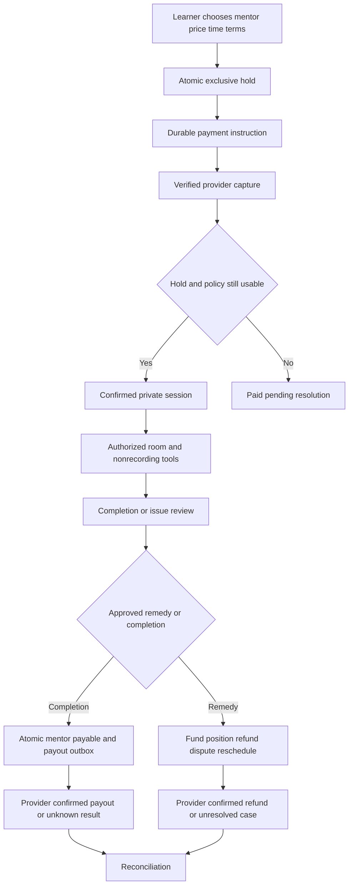

# F7 - Optional Mentorship Sessions and Recoverable Money Master Plan

Date: 2026-11-07. Phase E. Status: PROPOSED, NOT IMPLEMENTED, NOT PLAN LOCKED.

**Goal:** Let a learner optionally choose a mentor and that mentor's price, receive an authorized usable session, and see honest payment/remedy states without unsafe money, room or recording shortcuts.
**Architecture:** Shared authoritative coordinator joins scheduling holds, immutable terms, verified provider evidence, balanced ledger obligations, receipts/outbox, live room grants and restricted resolution cases. External payment/payout/refund results are reconciled, not invented from queues.
**Stack:** Reuse audited JS/JSX booking/call/Board/snapshot primitives. Proposed types are interface notation; actual storage/provider/media APIs, packages/licenses/support/prices remain UNVERIFIED.
**Gate:** E documents only. No implementation/test/build/app import/run, install, server, migration, DB/provider transaction, environment/credential read, commit or publication is authorized. All future tasks are unchecked.

## 1. Evidence, current failures and reuse

Read evidence for this package: [existing audit](01-existing-system-audit.md), [D economy/session reasoning](thinking-economy-sessions.md), [marketplace economy](research-marketplace-economy.md), [India safety/payments](research-india-safety.md), [notes/calls comparison](research-notes-calls.md), [D model recipe](thinking-model-recipe.md). No broad audit/research or source execution was repeated. Research marketing page observations are dated and incomplete, not current applicable contracts or approval.

| Audited existing primitive/failure | Audit-supported existing path | Future requirement |
|---|---|---|
| Approved mentor profiles, Student booking,30/45/60-minute snapshots exist; share defaults15 but has override/whole-INR rounding;90% copy conflicts | `BackEnd/services/sessionService.js:16-43`, `BackEnd/controllers/sessionsController.js:228-308` | Fixed15%, integer minor-INR conservation, versioned price/base/terms, no fee perk or override |
| Missing production keys can enter mock acceptance; multiple pending orders can buy one slot | `BackEnd/controllers/sessionsController.js`, audit FIN-MONEY-01..08 | Production fail-closed; atomic occupied intervals and one active hold intent |
| Capture without browser verification can stay held/unbooked; webhook receipt-before-effect suppresses handler retry | Audit B08/FIN-MONEY | Authenticated provider capture independently drives recoverable confirmation or paid-pending-resolution |
| Failed refund can be marked refunded; refunds lack coordinated payout reversal | `BackEnd/controllers/sessionsController.js:563-597` | Separate instructed/unknown/provider-confirmed outcomes and fund-position-aware resolution |
| Completion/released saved before sequential ledger writes can strand obligations | `BackEnd/controllers/sessionsController.js:428-444`, `BackEnd/models/MoneyLedger.js:51-61` | Completion decision, obligations, legs, receipt and payout outbox atomically staged |
| initiatePayout queues intent, not bank transfer | `BackEnd/services/payment/index.js:151-165` | PAYOUT_INSTRUCTED distinct from provider-confirmed PAID and reconciliation |
| Paid wrapper imports default VideoCall with incompatible route parameter/lobby behavior | `FrontEnd/src/pages/OrbitSessionRoom.jsx:135-141`, `FrontEnd/src/pages/VideoCall.jsx:583-593` | One purpose/booking-aware room adapter; direct integration tests before paid availability |
| Generic joins/call-ended/client call history can bypass Board isolation; nonparticipant legacy end path exists | `BackEnd/server.js`, audit B10/MED-WB and MED-CALL | Same live room/member/purpose authority for signaling, Board, end and cleanup |
| Shared Board/call controls exist; call-end deletion/TTL is intentional | `FrontEnd/src/whiteboard/board.js`, `FrontEnd/src/whiteboard/sync.js`, `BackEnd/models/whiteboard.js` | Preserve EPHEMERAL_CALL; persistent studio/export needs distinct explicit purpose/rights/retention |
| Subscription endpoint disabled503/enabled501; dormant allocation excludes unengaged seats; coded tax parameter not law | `BackEnd/routes/billingRoutes.js`, `BackEnd/services/billingPlans.js`, `BackEnd/services/billingSettlement.js` | No claim of operational recurring billing; separate fixed20/80 enrolled-course allocation policy |

This audit supports static failure boundaries, not deployed loss, actual provider SDK availability, live installed dependencies, actual TURN success or database topology. Existing self-approved Mentor profile policy is intentional current behavior; it does not verify expertise, KYC, identity or child safeguards. Do not revive A/U hypotheses as proven defects. No current route is changed by this document.

## 2. Scope, approach and non-negotiable walls

Recommended PROPOSED minimum: private policy-gated one-to-one sessions with provider-neutral room and money adapters, no recording by default and an explicitly staffed resolution path. Alternatives: launching UI over current money/room paths is rejected because source authority/recovery is inconsistent; building a replacement studio/room stack immediately is rejected because mounted tools can be reused after authority repairs. Media procurement remains a separate decision, not finalized by this recommendation.

1. Sessions are optional, learner-chosen, mentor-priced. Declining sessions never blocks an enrolled course, support or earned progress. No minor payment pressure, dependency framing, coerced attendance/streak or bought grading/rating/rank/claims.
2. SESSION platform share is fixed15%; SUBSCRIPTION is separately fixed20% with80% allocated to approved enrolled-course mentors. No override,90% session copy, subscription engaged-seat substitution, asset conversion or fee perk.
3. Integer minor INR throughout authoritative money. Mentor gross obligation is not take-home net or confirmed bank paid. Unknown base/tax/withholding/fees/KYC/invoice/legal/provider terms are explicit policy blocks, not guessed zero or familiar statutory rates.
4. Education labeling is not exemption. Unknown age/guardian/current-applicability safety blocks new paid child branches. Adult pilot does not clear child access or legal classification.
5. Verified capture does not necessarily mean confirmed usable booking; instructed refund/payout is not provider-confirmed settled. Raw browser success, call-ended, local grades/helpers/socket history never grant funds, roles or rooms.
6. Recording requires all required participants' explicit current scope consent and approved purpose/retention/safety. Nonrecording calls remain usable; payment, microphone/camera use or a booking checkbox is not recording consent.
7. New session/room/artifact/evidence is private by default; minor public ranking remains off. Core Board accessibility, basic export under rights, support, reporting, cancellation, consent and security cannot be token advantages.

## 3. Canonical shared contract and feature types

Consume the written [shared platform contract](03-platform-contracts.md), not a separately invented coordinator. Earlier inline/not-on-disk wording describes only historical delegation. Keep exact ActorContext/ResourceRef/CommandEnvelope/Receipt/PolicyGate/Problem/MoneyBasis/MoneySplit/LedgerPlan/AtomicPlan/EventEnvelope/BoardGrant/ConsentChoice names and semantics. Public routes use `/api/v2/fp2`; booking/hold/money root kind is `session`; room/consent use registered kinds. Child IDs remain bounded internal references, not new public ResourceKind strings.

`operationId`, `expectedVersion`, `policyVersion` are exact. Server builds ActorContext; service identity, live capability/ownership/membership/epoch fences and immutable approved scopes authorize execution. Proposal previews never charge/book/grant. Required scopes: money, identitySafety, retention, sourceProvenance, delivery, media, board as applicable; recording adds recordingConsent. Deployment/provider disabled or unproven topology is503 TEMPORARILY_UNAVAILABLE; missing/suspended required policy is422 POLICY_BLOCKED. No arbitrary client ledger/amount/verified/role endpoint.

```ts
type SessionLifecycle = 'DRAFT' | 'HELD' | 'PAYMENT_PENDING' | 'CONFIRMED' | 'IN_SESSION' | 'COMPLETION_REVIEW' | 'COMPLETED' | 'CANCELLED' | 'RESOLUTION_REQUIRED' | 'CLOSED';
type HoldState = 'ACTIVE' | 'CONSUMED' | 'EXPIRED' | 'RELEASED';
type CaptureState = 'NOT_INITIATED' | 'INTENT_PENDING' | 'AUTHORIZED' | 'CAPTURED' | 'FAILED' | 'UNKNOWN_RESULT';
type ObligationState = 'UNALLOCATED' | 'HELD_FOR_SERVICE' | 'REVIEW_HELD' | 'MENTOR_PAYABLE' | 'PAYOUT_INSTRUCTED' | 'PAID_CONFIRMED' | 'RESOLUTION_HELD';
type RefundState = 'NONE' | 'REVIEW_REQUIRED' | 'AUTHORIZED' | 'INSTRUCTED' | 'UNKNOWN_RESULT' | 'PARTIAL_CONFIRMED' | 'FULL_CONFIRMED' | 'FAILED';
type Eligibility = 'APPROVED_ADULT' | 'APPROVED_CHILD_SCOPE' | 'UNKNOWN' | 'BLOCKED';
type SessionQuote = Readonly<{ quoteId: Id; mentorId: Id; learnerId: Id; rateVersion: Version; durationMinutes: number; priceMinor: IntUnits; currency:'INR'; flowType:'SESSION'; termsSnapshotId: Id; expiresAt: UtcInstant; policyVersion: Id }>;
type SlotIntent = Readonly<{ mentorId: Id; startAt: UtcInstant; durationMinutes: number; learnerTimeZone: string; quoteId: Id }>;
type F7HoldCreatePayload = SlotIntent & Readonly<{ termsSnapshotId: Id; acceptanceChoice: 'ACCEPT' }>;
type PriceTermsSnapshot = Readonly<{ termsSnapshotId:Id; rateVersion:Version; quotedPriceMinor:IntUnits; recognizedBasisRuleId:Id; roundingRuleId:Id; feeTaxRuleId:Id; remedyRuleId:Id; paymentRuleId:Id; safetyRuleId:Id; retentionRuleId:Id; acceptedBy:readonly Id[]; acceptedAt:UtcInstant; policyVersion:Id }>;
type HoldResult = Readonly<{ session:ResourceRef; version:Version; holdId:Id; holdState:HoldState; expiresAt:UtcInstant; startAt:UtcInstant; endAt:UtcInstant; priceMinor:IntUnits; termsSnapshotId:Id }>;
type SessionMoneyView = Readonly<{ currency:'INR'; flowType:'SESSION'; capturedMinor:IntUnits; recognizedBasisMinor:IntUnits|null; platformMinor:IntUnits|null; mentorGrossMinor:IntUnits|null; captureState:CaptureState; obligationState:ObligationState; refundState:RefundState; refundedMinor:IntUnits; payoutConfirmedMinor:IntUnits; reconciliationState:'MATCHED'|'PENDING'|'CASE_OPEN' }>;
type SessionView = Readonly<{ session:ResourceRef; version:Version; lifecycle:SessionLifecycle; startAt:UtcInstant; endAt:UtcInstant; mentorTimeZone:string; learnerTimeZone:string; termsSnapshotId:Id; holdState:HoldState; money:SessionMoneyView; roomAvailable:boolean; recordingAvailable:boolean; caseId:Id|null }>;
type ResolutionReason = 'LEARNER_CANCEL' | 'MENTOR_CANCEL' | 'LEARNER_NO_SHOW' | 'MENTOR_NO_SHOW' | 'TECHNICAL_FAILURE' | 'LATE_CAPTURE' | 'DUPLICATE_CAPTURE' | 'UNRECOGNIZED_PAYMENT' | 'SAFETY_REPORT' | 'CHARGEBACK' | 'OTHER_APPROVED';
type ResolutionRequest = Readonly<{ reason:ResolutionReason; evidenceRefs:readonly ResourceRef[]; requestedOutcome:'REVIEW'|'RESCHEDULE'|'REFUND_REVIEW'; privateTextRef:Id|null }>;
```

Nullable derived split fields in a permitted historic captured-funds view mean blocked/unallocated truth, never numeric zero permission. A newly payable command cannot proceed with null policy/base. Returned views are field-allowlisted for learner/mentor/operator; not everyone sees provider/KYC/other-party sensitive fields.

## 4. Actors, capabilities and authorization

| Actor | Proposed capability | Required live authority | Explicit denial |
|---|---|---|---|
| Student learner | `session.quote.read`, `session.hold.create.own`, `session.payment.request.own`, `session.room.join.own`, `session.resolution.request.own` | Enrolled/product entitlement where required, age/safety eligibility, confirmed usable booking, own session/terms | Other learner billing/media, self-declared payment/completion, coerced payment |
| Mentor | `session.rate.edit.own`, `session.availability.edit.own`, `session.room.join.own`, `session.resolution.request.own` | Current role plus approved onboarding/purpose/ownership; no conflict with holds | Mentor role alone as KYC/guardian/room authority; unilateral extra charge |
| Required guardian/observer | `session.guardian.respond.assigned`, optionally `session.room.observe.assigned` | Approved current relationship/safety scope and verified purpose-specific appointment | Automatic private note/billing access or payment as consent |
| Assigned completion/resolution reviewer | `session.completion.review.assigned`, `session.resolution.decide.assigned` | Assigned case, conflict checks, approved terms/remedy and field-level evidence | Arbitrary rate/share or unassigned recording/private grade access |
| Finance operator | `money.resolve.assigned`, `money.reconcile.assigned` | Approved fund-position remedy, provider evidence and dual-control rule where required | Manual paid/refunded flag, uncapped mentor debit or refund to arbitrary account |
| Narrow payment/recovery service | Registered capture/refund/payout/outbox capabilities | Approved adapter/config, verified source, stable instruction identity, shared transaction | Raw browser/model/socket/provider-looking body as trusted evidence |
| Support/safety staff | Assigned case/report capabilities | Purpose and escalation policy; minimal fields | General financial/KYC/contact/media browsing |

Role/suspension/room revocation touches shared live authority fences that financial/content/room commands conditionally touch. A stale role context cannot authorize later writes. Losing Mentor role does not erase committed payable liabilities or case rights; recovery services resolve those obligations without reactivating content/room access. Account switch clears prior scoped cache/socket/push and rejects delayed A results in B.

## 5. Scheduling, rate, quote and exclusive holds

**Rate proposal:** mentor publishes versioned positive fixed price for an approved duration, displayed as that duration's total minor-INR price rather than an ambiguous hourly label. Candidate duration list30/45/60 reuses current UI; approval may choose another bounded list. Zero-rate/free-session branch is distinct and out of paid V1 until explicitly scoped; it never creates a positive provider order artificially. Maximum amount/duration/minimum lead time require approved config, not a guessed statutory or vendor limit.

**Availability:** mentor authors future windows in a selected IANA timezone. Server materializes versioned UTC start/end intervals using a verified timezone database/version. Store zone, local intended wall time, offset/fold choice and materialization version for recurrence; a raw UTC offset is not a timezone. Ambiguous fall-back time requires explicit occurrence selection; nonexistent spring-forward time is rejected. Recurrence exceptions and mentor edits cannot invalidate already held/confirmed commitments silently.

**PROPOSED schedule defaults pending DEC-E-S01:** hold5 minutes from server issuance; pre/post buffer10 minutes each; minimum lead2 hours; reschedule offer expires24 hours or before applicable lead cutoff, whichever earlier; room entry allowed10 minutes before scheduled start and revoked at end plus15-minute technical wrap window. These are bounded candidates, not final cancellation/no-show/settlement policy or permission to charge overtime. Operational eligibility config lacking approval blocks hold/room branches.

Occupancy uses half-open UTC intervals `[start-bufferBefore,end+bufferAfter)`. Two occupied intervals overlap if `aStart<bEnd && bStart<aEnd`. Adjacent buffered endpoints may touch without overlap. Enforce mentor and, where policy requires, learner conflicts across active holds/confirmed/reschedule candidates, not just unique `(mentor,start)`. Proposed ScheduleFence `(actorId,utcDay)` with version is locked/touched for every crossed UTC day in deterministic ID order; check overlapping intervals and insert/update hold atomically. A mere range query without serializable fence is insufficient. Chosen storage must prove interval race behavior under shared C01.

Flow: learner selects mentor/duration/slot, sees both zones, price/terms, optionality and recording-off default; server issues short-lived immutable quote; learner explicitly accepts exact terms and sends hold command; coordinator validates quote/rate/window/safety and atomically reserves interval plus session/receipt; payment-init outbox follows. Do not hold indefinitely while checkout sits open. Same operation replays same hold; new operation for same current semantic slot/terms cannot reserve two intentions. Quote expiration/rate change before hold asks explicit requote, never silently raises price. A mentor changing rates afterward cannot alter that booking's snapshot.

Hold expires by authoritative command using server time, not client clock/TTL deletion. Payment intent ID remains linked for later capture resolution. Capture after hold expiry never consumes someone else's new slot. Session becomes paid-pending-resolution with captured funds evidence, no room grant; operator offers approved rebooking/refund remedy. Capture while hold active consumes hold and confirms only when all mandatory terms/invoice/safety policy checks still pass. If a gate became suspended, preserve captured truth and open resolution rather than mock-confirm or discard money.

## 6. Durable records, indexes and immutable terms

| Proposed record | Load-bearing fields | Required constraints/indexes |
|---|---|---|
| MentorRate | mentorId, durationMinutes, priceMinor, currency, version, state, policyVersion | Unique mentor/duration/version; current-pointer CAS; positive approved paid price |
| AvailabilityWindow | mentorId, zone, local recurrence/exception, UTC materialized intervals, tzdbVersion, version | Mentor/start/end lookup; window/version unique; conflict with protected occupancy checked atomically |
| ScheduleFence/Occupancy | actor/day/version; sessionId, holdId, buffered UTC interval, state, expiresAt | Unique fence actor/day; interval query index; unique active hold/session intent; conflict proof, not same-start uniqueness only |
| SessionRoot | sessionId, participants, lifecycle/version, UTC times/zones, rate/quote/terms refs, hold/room/case refs | Unique resource ID; participant/lifecycle/time lookup; versions/authz/source fences in transaction |
| TermsSnapshot/Acceptance | All PriceTermsSnapshot fields; text hash/version, each participant acceptance | Immutable snapshot; unique participant/terms/acceptance purpose; accepted scope equals displayed scope |
| PaymentIntent | intentId, sessionId, capture policy, providerId, external identity/ref, state, requestedMinor, semanticKey | Unique business intent key; external provider intent unique; recoverable state/lease index |
| CaptureRecord | provider capture business ID, currency/amount, verified inbox/source refs, sessionId, committedAt, allocation state | Unique provider/capture ID, not webhook event ID only; captured amount conservation |
| MoneyPosition | sessionId, collected/basis/split/refunded/payable/payout/reserve amounts, state, version, accountingPolicyVersion | Unique session/asset; source-linked invariant projection; posted ledger controls balances |
| ResolutionCase | reason, fundPosition, assigned reviewer, evidence refs, decision/remedy/refund/payout links, appeal state/version | Assigned/state/time lookup; unique resolution intent; restricted purpose fields |
| Refund/PayoutInstruction | stable instructionId, semanticKey, provider/ref, approved amount/basis legs, status, lease, original source | Unique business-derived key; unique provider external ID; unknown-result/retry index; cumulative limits |
| Attendance/TechnicalEvidence | server room grants/join/leave intervals, quality incidents, source provenance, bounded metrics, evidence policy | Unique source; session/participant/server-time index; no raw content by default |
| RoomMembership/Consent/Board | Exact shared records plus confirmed session purpose link | Live membership/epoch/consent/version/expiry; same authority for join, signaling, Board and cleanup |
| Operation/Receipt/Source/Ledger/Inbox/Outbox/Checkpoints | Exact shared contract | Actor-operation/source/txn/leg/provider-event/event/consumer uniqueness; atomic effect completion |

Every row uses bounded IDs, schemaVersion and server timestamps. Provider payload/KYC/recording private content is separated from allowlisted metadata. No universal TTL is approved for receipts/terms/consent/evidence/dedup or recordings. Terms/rate/policy values are immutable snapshots, not editable columns retrospectively reinterpreting financial history. Money account map, retention, signing and topology require shared C01/C02/C06/C07/C12.

## 7. Orthogonal state machines and transition authority

One overloaded `completed` boolean cannot describe capture, service, obligation, refund and provider payout. Use the typed dimensions in section3 and the following guarded transitions; every new transition CASes SessionRoot and affected money/occupancy/authority versions in the shared transaction.

| Transition | Required authoritative evidence/commit | Failure/alternative |
|---|---|---|
| DRAFT -> HELD | Live eligibility, valid quote/current availability, accepted terms, exclusive interval, active hold/receipt | Conflict409; unknown money/safety422; deployment-off503 |
| HELD -> PAYMENT_PENDING | Durable provider-intent request/outbox identity; hold still active | Provider-init unknown shown pending; hold may expire, no fake captured |
| NOT_INITIATED/INTENT_PENDING -> AUTHORIZED/CAPTURED | Verified provider evidence for actual currency/amount/business intent | Mismatch quarantined/case; browser callback never authority |
| CAPTURED + active valid hold -> CONFIRMED/HELD_FOR_SERVICE | Consume occupancy hold, verify gate/terms/funds and atomically confirm booking/allocation/receipt | Late/suspended/mismatch capture -> RESOLUTION_REQUIRED/UNALLOCATED; no room |
| CONFIRMED -> IN_SESSION | Current usable booking/live participant room grant and permitted start window | Generic join or role alone denied; recording not required |
| IN_SESSION -> COMPLETION_REVIEW/REVIEW_HELD | Server evidence/end/participant attestations under approved completion policy; release room as policy permits | Client call-ended only requests leave/end; cannot decide payable |
| COMPLETION_REVIEW -> COMPLETED/MENTOR_PAYABLE | Approved completion/resolution decision, dispute-window rule satisfied, balanced obligations/receipt/payout outbox | Unknown completion/remedy blocks; preserve review-held funds/case |
| MENTOR_PAYABLE -> PAYOUT_INSTRUCTED | Approved payout instruction atomically reserves relevant obligation and outbox, validated onboarding/provider | Queue fail retries durable outbox; no PAID label |
| PAYOUT_INSTRUCTED -> PAID_CONFIRMED | Authenticated provider-confirmed settlement and reconciled amount/source | UNKNOWN_RESULT reconciliation; no blind resend |
| Before capture cancel -> CANCELLED + hold RELEASED | Authorized versioned cancellation, exclusive hold resolution; provider intent cancelled only when confirmed possible | Later capture still recognized -> late-capture resolution |
| Any captured state -> refund review/authorized/instructed | Approved fund-position remedy and cumulative limits, balanced reservation/reversal/instruction | Unknown funding/terms -> resolution-held; no guessed full/partial refund |
| Refund instructed -> PARTIAL/FULL_CONFIRMED | Verified provider refund business source and reconciled original payment/amount | Failure/unknown remains explicit, never local refunded flag |
| Dispute/chargeback/safety -> RESOLUTION_REQUIRED/RESOLUTION_HELD | Verified provider dispute or assigned case, permitted holds and evidence scope | No automatic mentor/user debit or permanent unrestricted hold |
| Settled obligations/remedies -> CLOSED | No unresolved capture/refund/payout/case, approved retention/closure | Historical receipts/rights retained/redacted per policy, not forgotten |

`CONFIRMED` implies usable booking with captured/approved funds or an explicitly separately approved free-session branch; no paid child/guardian unknown branch. Recording consent is not a confirmation prerequisite when session can be nonrecording. Completion does not itself mean paid. Refund and payout can coexist only under an approved coherent fund-position resolution, never contradictory independent worker writes.

## 8. Fixed shares, bases and synthetic economics

Authoritative MoneyBasis has `flowType='SESSION'|'SUBSCRIPTION'`, currency INR, recognizedBasisMinor, approved basis policy and terms/provider source. Collection amount, tax-inclusive/exclusive components, recognized base, fee incidence, tax/withholding, reserve/refund attribution and invoice issuer are distinct typed approved-policy outputs. Do not reuse the coded tax18 parameter, a historical withholding section/rate, promotional provider fees or familiar legal thresholds.

For approved nonnegative integer basis B, proposed deterministic HALF_UP split: SESSION `platform=floor((15*B+50)/100)`; SUBSCRIPTION `platform=floor((20*B+50)/100)`; mentor gross/pool `B-platform`. Checked integer arithmetic; one asset/precision; debits equal credits. Fixed percentage is a product constraint; HALF_UP/base/fee/refund policy needs explicit shared C06 approval. A client cannot set recognized basis or accounting legs.

Illustrative session mentor prices INR500/1500/3000 are synthetic D rate points, not approved/minimum/recommended prices. They assume recognized basis equals that illustrative price only for comparison. Arbitrary scenario cost assumptions: gateway2% of basis+INR5, media/TURN allowanceINR8, supportINR20, risk allowanceINR10, all absorbed by platform in that scenario. These are not provider prices, tax rates, measured support effort or underwritten loss probabilities. Unknown tax/other costs remain excluded and blocked for all-in net.

| Synthetic price/basis | Platform15% | Mentor gross85%, not paid/net | Assumed gateway/infra/support/risk | Conditional platform contribution before unknown costs |
|---|---:|---:|---|---:|
| INR500 /50000minor | INR75 | INR425 | INR15/8/20/10 | INR22 |
| INR1500 /150000minor | INR225 | INR1275 | INR35/8/20/10 | INR152 |
| INR3000 /300000minor | INR450 | INR2550 | INR65/8/20/10 | INR347 |

Algebra under only these assumptions: contribution=`0.13*P-43` INR; break-even aboutINR330.77. It is not a real minimum-price recommendation. Precision stress B=101minor yields platform15, mentor86; assumed costs4302minor, conditional contribution-4287minor. Negative contribution is an honest stress result, not reason to change shares or sell advantage. Actual all-in contribution/mentor net is BLOCKED_POLICY until qualified approved tax/provider/fee/onboarding terms exist.

Subscriptions remain a separate flow, not session revenue or a session discount wallet. At illustrative basis100000minor, platform20000 and enrolled-course mentor pool80000. Exact allocation method/base/partial month/refund/enrollment treatment is OPEN. Candidate equal-enrolled-course algorithm: immutable eligible course IDs, unique/stable sorted order, floor(pool/n) each, distribute remaining one minor to first remainder IDs, aggregate each mentor's eligible courses afterward. With A/B/C, shares26667/26667/26666; mentor owning A/B gets53334. Two/five/ten equal courses at INR1000 basis give INR400/160/80 per course. Equal-unique-mentor or weighted outcomes is a different explicit choice; dormant half-flat/engagement code is not adopted. Zero eligible courses keeps explicit unresolved pool under approved accounting map; never platform revenue by default.

New guarded workbook schema/input-validity is specified in [F5](10-currencies-ledger.md), section10, using D [recipe](thinking-model-recipe.md) and retaining D workbook/results. No model is written/run here. Unknown tax/provider/allocation blocks actual/net outputs; fixed15/20 cannot be edited; nominal synthetic arithmetic remains clearly conditional. Office recalculation and model validation are UNVERIFIED.

## 9. Ledger coordination, refunds, disputes and fund position

Money accounting map/legal arrangement is not decided by names such as escrow/held/payable. Qualified finance/legal/provider policy must approve the account map and what collected funds legally represent. No claim that Orbit is a licensed aggregator, bank escrow operator or exempt educational institution. Technical ledger held state does not prove legal escrow.

All accepted capture allocation, completion obligations, reservations, refund/payout resolutions, source consumption, receipt and outbox effects share one real atomic transaction. Separate provider effects are asynchronous and idempotent. The coordinator must never mark completed/released/processed before ledger legs. Positive legs use IntUnits; reject fractions, negatives, zero-effect transfers, asset/flow mismatch and unsupported accounts. No cross-virtual/cash transaction.

Fund-position stages: captured/unallocated; held-for-service; review-held; mentor-payable; payout-reserved/instructed; provider-confirmed paid; refund-reserved/instructed/confirmed; dispute-held. A MoneyPosition projection distinguishes collected, refunded, recognized/retained basis, mentor/platform obligations, provider costs and funding reserves. The approved account map defines admissible normal balances; absence blocks new authorizing flow.

**Refund candidate arithmetic, not final policy:** if an approved remedy says cumulative recognized-basis refund R of original B, `0<=R<=B`, retained basis `B-R`; retained platform `split(B-R)`, retained mentor `B-R-retainedPlatform`. Cumulative platform reversal=`originalPlatform-retainedPlatform`; cumulative mentor reversal=`originalMentor-retainedMentor`. Incremental reversal subtracts previously posted cumulative reversals. This avoids over-refund rounding when many small partial refunds arrive. Actual collection refund may include separately approved taxes/fees; mapping collection refund to recognized R requires policy, not assumption they are equal.

For SESSION B=101, original15/86; cumulative R=1 retains B100, platform15/mentor85, reversal0/1; cumulative R=2 retains99, platform15/mentor84, total reversal0/2; fullR101 reverses15/86. Linked refund legs and provider instruction cumulative amounts cannot exceed original approved captured/refundable amounts. Two concurrent partial remedies lock the same cumulative refund fence. Provider-refunded evidence differs from local instruction acceptance.

| Fund position/remedy | Required approved handling | Safe blocked state |
|---|---|---|
| Before capture | Release hold/cancel intent only through verified state; no fictitious cash refund | Intent/cancel unknown retained for reconciliation; late capture possible |
| Captured before payable | Approved refund reserves funded customer remedy and linked allocation reversals | Unknown refundable basis/fee/tax -> REVIEW_REQUIRED, no confirmed-refund copy |
| Mentor payable, payout not sent | Serialize refund against payout reservation; approved obligation reduction/funding | No independent payout plus refund against same funds |
| Payout instructed/unknown | Query provider before remedy that assumes funds returned; hold resolution within approved limits | UNKNOWN_RESULT, assigned finance case; no blind duplicate payout or refund |
| Provider-confirmed paid | Approved platform/reserve/mentor recovery allocation and consent/contract/funding; linked case/legs | No invented automatic negative mentor balance or debit from child/user wallet |
| Chargeback after payout | Provider dispute evidence, approved reserve/funding/appeal/recovery and deadline ownership | Restricted resolution case; no automatic share override or fraud verdict |
| Duplicate/mismatched/orphan capture | Recognize actual funds once, quarantine misattribution, approved payer/provider resolution | No unauthorized room, arbitrary refund recipient or silently ignored capture |

No automatic penalties from one missing packet/no-show assertion. Resolution requires initiator, timing, accepted terms, permissible evidence, fund position, refundable basis, fee/tax allocation, availability release, remedy reason and appeal. Frozen money cannot remain indefinitely by an unrestricted flag; permitted hold lengths/escalation are policy and staffing decisions. Refund to original payment method or alternative payer-owned destination must follow qualified current-applicability/provider policy, not a guessed unrestricted destination.

## 10. Provider-neutral owned adapters and recovery

The following are exact OWN PROPOSED interfaces, not Razorpay/Cashfree/Stripe/SFU SDK method claims. Concrete adapters must map verified contract/API behavior to them after shared C10 approval, including signatures, supported India charge/account flow, idempotency, reconciliation, KYC, settlement/refund limits and costs. Do not inspect credentials during E.

```ts
type AdapterMode = 'PRODUCTION' | 'ISOLATED_SANDBOX';
type ProviderConfigState = Readonly<{ state:'READY'|'DISABLED'|'UNVERIFIED'|'MISSING_REQUIRED_CONFIG'; mode:AdapterMode; decisionIds:readonly Id[] }>;
type ProviderInstruction = Readonly<{ instructionId:Id; businessIdempotencyKey:Id; sessionId:Id; currency:'INR'; amountMinor:IntUnits; approvedPolicyVersion:Id; originalProviderSourceId:Id|null }>;
type ExternalResult = Readonly<{ state:'ACCEPTED'|'CONFIRMED'|'FAILED'|'UNKNOWN_RESULT'; externalId:Id|null; verifiedSourceId:Id|null; safeErrorCode:string|null }>;
type PaymentIntentResult = Readonly<{ state:'ACCEPTED'|'FAILED'|'UNKNOWN_RESULT'; externalIntentId:Id|null; checkoutRef:Id|null; expiresAt:UtcInstant|null }>;
type VerifiedProviderEvidence = Readonly<{ providerId:Id; providerEventId:Id; businessSourceId:Id; kind:'AUTHORIZED'|'CAPTURED'|'REFUND_CONFIRMED'|'PAYOUT_CONFIRMED'|'DISPUTE_CHANGED'; currency:'INR'; amountMinor:IntUnits; originalBusinessSourceId:Id|null; observedAt:UtcInstant; verifiedPayloadRef:Id }>;
type ProviderStatement = Readonly<{ statementId:Id; periodStart:UtcInstant; periodEnd:UtcInstant; verifiedEvidenceRefs:readonly Id[]; complete:boolean }>;
interface SessionPaymentAdapter {
  getConfigState(): Promise<ProviderConfigState>;
  createPaymentIntent(instruction:ProviderInstruction): Promise<PaymentIntentResult>;
  queryPaymentIntent(instructionId:Id): Promise<ExternalResult>;
  requestIntentCancellation(instructionId:Id): Promise<ExternalResult>;
  verifyInbound(rawBody:Uint8Array, headers:Readonly<Record<string,string>>): Promise<VerifiedProviderEvidence>;
  requestRefund(instruction:ProviderInstruction): Promise<ExternalResult>;
  queryRefund(instructionId:Id): Promise<ExternalResult>;
  requestPayout(instruction:ProviderInstruction): Promise<ExternalResult>;
  queryPayout(instructionId:Id): Promise<ExternalResult>;
  fetchStatement(periodStart:UtcInstant, periodEnd:UtcInstant): Promise<ProviderStatement>;
}
```

VerifiedProviderEvidence is server-only and constructed only by the registered adapter after approved signature/replay/currency/amount/source checks; HTTP clients cannot deserialize it into authority. CONFIRMED requires verified evidence, not adapter optimism. Checkout ref is an opaque bounded reference to a permitted checkout instruction, not credentials. Sensitive raw payload and bank/KYC information follow approved secure custody/retention, not public events/logs.

PRODUCTION with missing required keys/config returns MISSING_REQUIRED_CONFIG and503; no fallback to mock/sandbox, fake signature, fake capture or paid state. ISOLATED_SANDBOX is explicitly nonproduction, separate assets/data/rooms/workload identity and cannot award production balances/roles/ratings. This document does not authorize sandbox runs or configuration changes.

Webhook ingress: authenticate/verify raw provider protocol; insert unique provider/event inbox record with minimal approved evidence; provider-specific acknowledgment only after durable acceptance. Signature/ack/retry/status details are UNVERIFIED until actual adapter contract is approved. Business handler leases RECEIVED/PROCESSING rows; atomically commits capture/refund/payout source effects, ledger/positions/receipt/outbox and PROCESSED. Inbox existence alone does not suppress recovery after handler crash. Distinct webhook event IDs for one capture/refund/payout deduplicate the stable business source. Unexpected schema/signature/source goes quarantine/fail-closed, not mock-success.

Outbox uses stable business-derived instruction IDs/idempotency keys. Provider call is outside DB transaction. Network failure after send gives UNKNOWN_RESULT; query/reconcile that identity before another request. Provider without proven idempotency plus query/reconciliation cannot launch that money flow. Do not blindly retry an ambiguous payout. Lease expiry permits a recovery worker, not another independent obligation.

Reconciliation compares provider statements and verified sources with capture/intent, holds/booking, posted ledger/positions, cumulative refunds, payable/payout instructions, receipts/outbox and cases. Complete statements/version/date and unresolved evidence are recorded. Differences create assigned restricted cases, not unexplained adjusting entries. Cadence/escalation/staffing must be approved; a queued worker is not guaranteed finance operations. Recovery can recognize already captured historic obligations under narrow service authority even if user role changes, while new bookings remain blocked.

## 11. Reschedule, cancellation, attendance and technical failure

**Reschedule flow:** participant requests proposed new UTC slot under existing terms or explicit new quote; reserve candidate interval atomically without freeing confirmed original; other required participant accepts exact new scope before deadline; coordinator atomically swaps occupancy/terms/session version, releases original, and records receipt/outbox. Decline/expiry releases only candidate; original remains. If new rate/duration differs, no automatic charge/top-up or refund: require explicitly approved financial amendment and renewed learner agreement, otherwise deny change. Never retain two confirmed billable slots or lose both through sequential updates.

**Cancellation:** before capture release hold with durable provider-cancel/reconciliation state; after capture route to approved resolution. A cancellation receipt means request/state saved, not bank-refunded. Mentor cancellation and learner cancellation have separately approved remedies. No guessed universal refund window, cancellation fee, mandatory T+ settlement deadline or no-show penalty.

**Attendance evidence:** live room membership permits plus server observed join/leave intervals, acknowledgments and bounded technical incidents under approved evidence/retention. Connectivity does not prove learning, quality or uninterrupted presence; self-attestation is a signal, not sole financial authority. Exact minimum duration, grace/no-show threshold and dispute window remain typed policy gates; lacking approval keeps completion review blocked. No recording requirement to prove attendance.

**Technical flow:** device permission/preflight before joining, accessible mic/camera/sound controls, visible connectivity/reconnect state, manual retry/audio-only path only under approved same session/media scope, and report technical issue. TURN/SFU/provider outage produces technical evidence/case and approved remedy, not automatic learner no-show or mentor payable. A preference or media mode change cannot add an undisclosed charge. Room may close/revoke for safety independently of whether money is resolved.

**Completion:** participants can submit bounded completion/issue attestations; authoritative assigned decision uses approved policy/evidence. Client `call-ended` can terminate own media subscription/request room end only within permissions; it cannot mark complete/release/pay. Completion decision and payable outbox commit together. Pending issue/appeal preserves approved resolution hold and support; no animation showing paid before provider evidence.

## 12. Transport comparison and owned media interface

Evidence boundaries from [notes/calls research](research-notes-calls.md): participant minutes, connection minutes, recording wall-clock/track/composition, bandwidth, storage and transcription are different meters; free pools do not cover all costs. Dated published values are not inserted as launch prices. No India network winner, SLA, support package, full license or exact library/API is verified here.

| Option | Candidate advantages | Operational/cost burden | Blocking validation |
|---|---|---|---|
| Native one-to-one P2P WebRTC | Reuses current native transport; direct media possible, low server media under favorable networks | Signaling/room auth, NAT failures, TURN bandwidth/CPU, reconnect/device support, potential peer network metadata | Approved privacy/network handling and measured authorized network/device/firewall tests; P2P does not mean TURN-free |
| Self-hosted SFU, e.g. evaluated media layers | Operator routing/control, server-mediated topology, adaptable room authority | Hosting/bandwidth/TURN/certificates/scaling/monitoring/on-call/recording integration; low-level SFU not complete app | Exact current license/version/APIs, regions, failover/security/capacity and staffed recovery; self-hosting not free |
| Managed media | Provider operates media routing/TURN/selected diagnostics/features according to contract | Different participant/track/composition/egress/storage meters, minimums/limits, region/vendor dependency | Written applicable quote, meter model, DPA/residency/retention/support/SLA/revocation, India-network pilot |
| TURN relay for native or compatible SFU | Connectivity fallback when direct transport fails | Auth credentials, short-lived authorization, relay bandwidth, TCP/TLS/firewall costs, abuse controls | Proven relay on restricted networks, credential expiry/revocation/limits and measured usage; not optional merely because direct demo worked |

Recommendation is an adapter boundary and later authorized adult-only technical pilot, not selected vendor or consent to run it. Candidate matrix must measure connection success, reconnect time, audio/video usability, relay fraction/egress, device CPU/thermal/accessibility and operational incidents separately. No60fps, quality winner or total cost is promised. A room-switch to another transport requires a valid same-purpose grant and approved data/provider scope; it cannot silently enable recording or new charges.

```ts
type SessionRoomPermit = Readonly<{ permitId:Id; room:ResourceRef; session:ResourceRef; actorId:Id; sessionGeneration:Id; authzEpoch:Version; membershipVersion:Version; purpose:'OPTIONAL_SESSION'; permissions:readonly ('join'|'signal'|'board.read'|'board.edit'|'report')[]; issuedAt:UtcInstant; expiresAt:UtcInstant; policyVersion:Id }>;
type MediaConnectionResult = Readonly<{ state:'CONNECTED'|'RECONNECTING'|'FAILED'; connectionRef:Id|null; safeReasonCode:string|null }>;
interface SessionMediaAdapter {
  getConfigState(): Promise<ProviderConfigState>;
  prepareJoin(permit:SessionRoomPermit): Promise<Readonly<{ joinRef:Id; expiresAt:UtcInstant }>>;
  join(joinRef:Id): Promise<MediaConnectionResult>;
  leave(connectionRef:Id): Promise<void>;
  revokePermit(permitId:Id): Promise<Readonly<{state:'ENFORCED'|'PENDING'|'UNVERIFIED'; evidenceRef:Id|null}>>;
  readTechnicalEvidence(sessionId:Id): Promise<readonly Id[]>;
}
```

These are owned proposed contracts, not actual SFU/WebRTC library methods. Shared authority must validate the permit before generating join refs and recheck on ingress. Revocation latency/external media-token behavior must be verified; an unenforceable long-lived token cannot be advertised as instantaneous revocation. BoardGrant remains the shared exact type, not replaced by SessionRoomPermit. Recording is a separately authorized adapter/scope, not implicitly permitted by join.

## 13. Private room, shared tools, recording and safety gates

Room grants require confirmed usable session, current participant/guardian eligibility, session lifetime, live epoch/membership and purpose. Generic socket join, URL room ID, default lobby, client history, payment callback or `call-ended` is not authority. Signaling, join/leave/end, Board snapshot/edit/export/cleanup and recording ingest check the same live purpose/membership. Revocation denies subsequent ingress immediately under transaction fence ordering; disconnect outbox is supplemental. In-flight committed commands resolve by receipt before UI claims changes saved/lost.

Tools: reuse shared Board adapter with serialized document version and schema-validated patch; chat/raised hands/controls under room membership; authorized notes remain private to their owner; source assets/links require rights/entitlement. EPHEMERAL_CALL Board ends/expiry as intentional current purpose. Retained PERSISTENT_STUDIO or COURSE_PUBLISHED artifact requires separate rights/purpose/retention and explicit reviewed transition, not automatic archival of every call. Basic allowed export/support remains available without tokens; exporting another participant's source content needs its own rights.

Recording default OFF. Consent scope identifies participants, purpose/source, visibility, retention and policy version; all required participants grant same current scope. Re-prompt on changed purpose/version. Deny/withdraw keeps nonrecording session usable without financial punishment. Withdrawal stops UI capture, revokes live server recording permits and fences further ingest/publication; disconnected capture cannot continue under an unverifiable live shared permit. Prior authorized bytes follow approved deletion/hold/appeal policy; no promise of instant universal deletion or recall of already delivered media. Source-to-output mapping uses shared immutable anchors; edited70sec -> output50sec, removed anchors remain unavailable, never auto-relocated for attendance/grades.

| Policy area | PROPOSED safe blocked/default alternative | Required signed decision/validation |
|---|---|---|
| Age unknown/child scope | No new paid session/recording branch; core course/support remains usable | Qualified current India applicability and identity/guardian verification/safeguarding policy |
| Adult pilot | Candidate private, nonrecording, explicitly opted-in technical slice after approvals | Does not clear child/public/financial production policy |
| Child tutoring alternatives | Blocked choices: guardian-present supervised1:1, appointed observer model, or no child sessions | Founder/qualified safeguarding chooses scope, confidentiality/reporting and verification; no automatic approval |
| Off-platform contact | Do not solicit contact/payment; report action available; no dependency framing | Approved contact handling, intervention/appeal and participant copy |
| Reporting/emergency/mandatory reporting | Visible report/exit/support; do not promise emergency response or invent duty/jurisdiction | Qualified current-applicability escalation, trained staffed ownership, severity/response boundaries |
| Recording/evidence | No new recording persistence while consent/retention unknown; noncontent evidence only if separately approved | Mutual consent, guardian scope, source rights, prior-content/withdrawal/hold/deletion/appeal |
| Privacy/publicity | Session/notes/financial details private; minor public ranking OFF | Approved adult opt-in public projection and reidentification tests, not inferred from booking |
| KYC/bank/invoice | No payout onboarding clearance from mentor checkbox | Contracted provider and qualified finance/legal current-applicability validation; safe custody/retention |

No guessed statutory rate/section, DPDP commencement conclusion, universal retention period or educational exemption is adopted. Research expressly leaves current tax/KYC/commencement/child tutoring obligations unresolved. Safety/finance policy must be approved with applicability/evidence/date/reviewer ownership, not generic TBD. Policy gate unknown blocks the exact action with safe decision ID; sensitive counsel/KYC/evidence is never public.

## 14. Proposed endpoint request/result/error contracts

All normal JSON commands use shared CommandEnvelope and shared CommandResult/Receipt. Authentication and resource authorization precede detailed source/current-version/participant errors. IDs/zone/arrays/pages/text references are bounded allowlisted schemas. No trusted amount, verified, role, settlement time or provider source in browser payload. Provider webhook is its separately authenticated raw protocol.

| Proposed route/command | Request payload/root | Authorized response | Important errors |
|---|---|---|---|
| GET `/api/v2/fp2/mentors/{id}/session-options` | Auth learner; mentor public-safe allowed projection | Approved durations/current rate versions, bounded available UTC slots/zones, policy availability | 404 unavailable mentor; 503 disabled; blocked branch displayed without private safety reason |
| POST `/api/v2/fp2/commands/session.quote.request` | {mentorId,startAt,durationMinutes,learnerTimeZone}; authorized new session root `absent` | SessionQuote plus draft resource receipt | 400 invalid/nonexistent/ambiguous time; 422 policy; 409 unavailable capacity |
| POST `/api/v2/fp2/commands/session.hold.create` | F7HoldCreatePayload; exact accepted terms snapshot/choice and draft session version | HoldResult; one exclusive interval | 409 quote/rate/version/capacity; 422 eligibility/policy; no silent requote |
| POST `/api/v2/fp2/commands/session.payment.request` | {holdId,termsSnapshotId}; session version | Receipt result intent state/opaque checkoutRef or processing; not captured | 409 expired/conflicting hold; 503 adapter missing; 422 policy |
| GET `/api/v2/fp2/sessions/{id}` | Current participant/assigned field-level grant | ProjectionView of permitted SessionView, exact saved/source version | Same404 for missing/unauthorized/revoked; no bank/KYC/private notes |
| POST `/api/v2/fp2/commands/session.cancel.request` | {reasonCode}; session version | Cancellation/resolution request receipt; refund state separate | 409 stale/conflicting resolution; 422 remedy-policy block |
| POST `/api/v2/fp2/commands/session.reschedule.propose` | {newStartAt,durationMinutes,quoteId,termsSnapshotId}; session version | Candidate hold/deadline ref, original preserved | 409 capacity/version; 422 financial amendment/safety blocked |
| POST `/api/v2/fp2/commands/session.reschedule.respond` | {proposalId,choice:'ACCEPT'|'DECLINE'}; session version | Atomic swap or release-candidate receipt | 409 expired/changed proposal; no extra client charge |
| POST `/api/v2/fp2/commands/session.room.grant.request` | {sessionId}; root room linked to session | Receipt result SessionRoomPermit and approved join ref | 404 nonparticipant/unavailable; 422 time/purpose/safety; 503 media unavailable |
| POST `/api/v2/fp2/commands/session.completion.attest` | {choice:'COMPLETED'|'ISSUE',evidenceRefs}; session version | Review evidence/request receipt, not payable/paid | 422 evidence policy; 404 wrong session/participant |
| POST `/api/v2/fp2/commands/session.resolution.request` | ResolutionRequest; session version | Restricted case/status receipt; no immediate refund verdict | 422 retention/remedy; 409 already changing state |
| Assigned command `session.resolution.decide` | {caseId,approvedRemedyId}; session root/version | Approved AtomicPlan receipt, linked funding/refund/payout state | No client amount;422 unknown fund remedy;404 unassigned |
| Service command `session.completion.decide` | {approvedCompletionDecisionId}; session version | Payable/review-held receipt plus durable outbox where approved | 422 unresolved terms/window/evidence;409 refund/payout fence conflict |
| GET `/api/v2/fp2/sessions/{id}/money-status` | Participant/finance grant | Own allowlisted capture/refund/payout confirmation status/sourceVersion | No other-party bank/KYC/evidence;404 inaccessible |
| POST `/api/v2/fp2/providers/{providerId}/webhooks` | Approved signature/raw protocol | Provider-specific durable inbox acknowledgment only | Invalid/missing keys never mock-accepted; transient persistence retry behavior adapter-validated |
| Shared `board.grant.request`, `board.patch.apply`, `consent.recording.respond/withdraw` | Exact shared envelope/types/root | Exact shared Board/consent receipt results | Same live booking/room/purpose checks; no F7 alternative Board authority |

HTTP503 TEMPORARILY_UNAVAILABLE for deployment/provider/topology-off;422 POLICY_BLOCKED for nonapproved required rules;409 VERSION_CONFLICT/OPERATION_CONFLICT/CAPACITY_CONFLICT after authorization;400 INPUT_INVALID for shape/authority fields;401 AUTH_REQUIRED;404 RESOURCE_NOT_AVAILABLE with `This item is unavailable.` Source/consent errors use shared SOURCE_BLOCKED/CONSENT_REQUIRED where applicable. A money-resolution request saved is not `refunded`; response copy follows specific state.

## 15. Events, idempotency, cache and UX

Register proposed bounded suffixes `fp2.v1.session.hold.changed`, `fp2.v1.session.payment.changed`, `fp2.v1.session.lifecycle.changed`, `fp2.v1.session.resolution.changed` plus shared `ledger.posted`, `room.grant.revoked`, `consent.changed`, `notification.requested`. Every event preserves canonical eventId/operationId/policyVersion/resourceVersion/aggregateSequence/server time/causation; no private KYC/contact/recording text. Schema registration is required, not arbitrary template suffix acceptance. Required meaning changes need new schema contract/migration, never reinterpret old15/20/base/terms events under current policy.

Actor-operation same-intent replay returns durable permitted original receipt without second hold/capture/refund/payout/event/celebration. Different operation IDs still deduplicate semantic hold/payment/capture/refund/payout/source keys. Two inbox IDs describing one capture are one source. Consumers apply event and checkpoint atomically; old/duplicate cannot downgrade, gaps trigger authorized refresh. Financial invariant projections are transaction-owned; read dashboards may lag and cannot authorize funds or room. GET is side-effect-free.

| UI state | Plain copy | Controls/truth |
|---|---|---|
| Optional choice | `Sessions are optional. Choose a mentor and review their price.` | Course/support free of session purchase pressure |
| Quote | `Review the time, total price and terms before reserving.` | Both zones/date/offset, duration/buffers, recordingoff, terms scope |
| Hold | `This slot is reserved until the time shown.` | Server expiry display, cancel, no infinite checkout occupancy |
| Payment intent pending | `Payment is processing. Check its status before trying again.` | Same operation lookup; no duplicate pay button |
| Captured/unconfirmed | `Payment received. Your booking needs resolution.` | No room/join, restricted support/reschedule/refund review |
| Confirmed | `Your session is confirmed.` | Exact committed time/price/terms; preflight and approved room access |
| Connectivity issue | `Connection interrupted. You can retry or report a technical issue.` | Exit/support/audio-only approved path; not no-show verdict |
| Recording deny/withdraw | `Recording is off. You can continue without it.` | Live indicator, easy withdrawal, no financial penalty for consent |
| Completion review | `The session is under review. Transfer is not confirmed.` | Issue/appeal route and safe policy window display |
| Mentor payable | `Your session amount is payable. Transfer has not been sent.` | Gross obligation separate from fees/withholding/net |
| Payout instructed/unknown | `Sent to the provider. Transfer is not confirmed.` | Reconciliation/support; never deposited copy |
| Refund requested/instructed | `Your refund is being reviewed.` or `Refund sent to the provider. Return is not confirmed.` | Actual state, no bank-return promise |
| Provider confirmed | `The provider confirmed the transfer.` or `The provider confirmed the refund.` | Confirmed amount/reference permitted to caller, reconciliation distinction |
| Policy/off block | `This session action is unavailable while policy or service review is pending.` | Safe decision IDs, core learning/support/exit remains available |
| Stale version | `This booking changed. Review the latest details before continuing.` | Explicit rebase/reaccept, not automatic changed-rate/payment retry |

Complete static/keyboard/sound-off/reduced-motion paths. Proposed ordinary reveal<=180ms; optional skippable receipt ceremony<=800ms only after authoritative receipt; no countdown animation pressure beyond honest hold expiry. Route/account interruption cancels stale callbacks. AccountScope cache keys/session generation follow shared contract; no delayed prior-account billing or media results. Private offline storage remains off until device/encryption/retention/logout policy approval. No actual devicefps/accessibility/provider delivery acceptance is claimed.



| Diagram nodes | Equivalent operation |
|---|---|
| A-B | Explicit choice/terms and exclusive schedule commit |
| C-D | Recoverable intent and authenticated capture source |
| E-F/G | Confirm only usable hold/policy; otherwise captured funds with no room |
| H-I | Live room/shared tools and independent completion/issue evidence |
| J-K/L | Approved completion or fund-position remedy with balanced atomic effects |
| M-N-O | Instruction versus confirmed settlement, unknown-result query and restricted reconciliation |

Textual Mermaid plus equivalent table; no rendering/palette QA claim.

## 16. Minimum, V1, V2 and release dependencies

- Minimum foundation: disabled financial branches with typed503/422, verified shared context/authority/atomic store/source/ledger/receipt/inbox/outbox, private scheduling/terms/resolution schemas, nonrecording room contract, account isolation. Documented quote previews alone do not mean operational paid sessions.
- V1 candidate only after required approvals: private one-to-one optional approved-adult sessions, fixed approved duration/mentor-price snapshots, one selected validated payment/media adapter, exclusive holds, nonrecording shared Board, supervised finance resolution/reconciliation, static accessible controls. Recording, child sessions, packages, public ratings/rank bridges, subscriptions activation and extras are not implied V1 membership.
- V2 candidate: explicitly approved child/guardian scope, optional mutual-consent recording/retained artifact mode, richer scheduling/packages, additional provider failover and measured pilots. Each needs separate scope/policy/operational validation; no unseen E/F tail is invented.
- Shared C01/C02/C03/C06/C07/C08/C10/C12 are mandatory for applicable branches. F2 verified session review eligibility must consume authoritative completion, not raw call history; reviews cannot influence unpaid release or retaliation by default. F5 cannot discount or cash out. F6 shared Board/source permissions/time mapping and acknowledgment ladder govern retained artifacts; basic tools are not token perks. Existing subscription activation remains unimplemented audit state; this F7 document preserves20/80, not a separate billing implementation package.

## 17. Proposed future files/interfaces and unchecked tasks

Every path/interface/test name here is PROPOSED, not verified existing. Reuse targets are current BookingModal/session profile/rate snapshots, OrbitSessionRoom/VideoCall transport controls, shared Board, notification inbox and MoneyLedger identities after authority/recovery verification. Do not install a provider SDK by guess or mount unverified helper APIs.

| Proposed file | Exact owned interface/responsibility |
|---|---|
| `D:/orbit-main/orbit-main/BackEnd/services/fp2/sessionPolicy.js` | `getSessionPolicy(policyVersion:Id): Promise<PolicyGate<SessionPolicyConfig>>`; approved scheduling/safety/completion/remedy/accounting refs, no guessed tax |
| `D:/orbit-main/orbit-main/BackEnd/services/fp2/sessionScheduling.js` | `planHold(tx:Tx, actor:ActorContext, envelope:CommandEnvelope<F7HoldCreatePayload>): Promise<AtomicPlan<HoldResult>>`; `planRescheduleSwap(tx:Tx, actor:ActorContext, proposalId:Id): Promise<AtomicPlan<SessionView>>`; locks interval fences |
| `D:/orbit-main/orbit-main/BackEnd/services/fp2/sessionMoneyPlanner.js` | `planCapture(tx:Tx, evidence:VerifiedProviderEvidence): Promise<AtomicPlan<JsonValue>>`; `planCompletion(tx:Tx, approvedDecisionId:Id): Promise<AtomicPlan<JsonValue>>`; uses shared MoneyBasis/split/ledger |
| `D:/orbit-main/orbit-main/BackEnd/services/fp2/sessionResolutionPlanner.js` | `planSessionRemedy(tx:Tx, actor:ActorContext, caseId:Id, approvedRemedyId:Id): Promise<AtomicPlan<JsonValue>>`; cumulative refunds/fund-position serialization |
| `D:/orbit-main/orbit-main/BackEnd/services/fp2/sessionProviderAdapter.js` | Implements OWN SessionPaymentAdapter; concrete provider selected/pinned/verified only after C10 |
| `D:/orbit-main/orbit-main/BackEnd/services/fp2/sessionReconciliation.js` | `reconcileSessionMoney(sessionId:Id): Promise<Readonly<{state:'MATCHED'|'CASE_OPENED';caseId:Id|null}>>`; approved statement/evidence map |
| `D:/orbit-main/orbit-main/BackEnd/services/fp2/sessionRoomAuthority.js` | `issueSessionRoomPermit(tx:Tx, actor:ActorContext, sessionId:Id): Promise<SessionRoomPermit>`; same shared live Board/consent/membership fences |
| `D:/orbit-main/orbit-main/BackEnd/models/fp2/OptionalSession.js` | SessionRoot/rate/quote/terms/occupancy/proposals/positions/case references; approved storage through shared adapter |
| `D:/orbit-main/orbit-main/FrontEnd/src/services/fp2SessionClient.js` | `getSession(sessionId:Id): Promise<ProjectionView>`; `sendSessionCommand<I,R>(name:CommandName, envelope:CommandEnvelope<I>): Promise<CommandResult<R>>`; shared client and account isolation |
| `D:/orbit-main/orbit-main/FrontEnd/src/services/fp2SessionMediaAdapter.js` | Implements OWN SessionMediaAdapter using selected verified transport, no generic lobby/join authority |
| `D:/orbit-main/orbit-main/FrontEnd/src/components/fp2/OptionalSessionBooking.jsx` | Optional learner choice/quote/hold/status and explicit changed-terms acceptance |
| `D:/orbit-main/orbit-main/FrontEnd/src/components/fp2/OptionalSessionRoom.jsx` | Permit-gated controls/shared Board/nonrecording/support; separate optional consent UI |

Each future code task starts with named failing assertions, then implementation through exact shared interfaces, then targeted execution under the verified project runner, review and documented evidence. Future code/test tasks are not permission now; no mandatory commit commands.

- [ ] Task1 - Verify audited money/room guards before repairs. Proposed `BackEnd/tests/fp2SessionAuthority.integration.test.js`: `productionMissingKeys503NoMock`, `browserSuccessCannotCapture`, `callEndedCannotRelease`, `nonparticipantJoinEndDenied`, `paidWrapperUsesAuthorizedAdapter`, `roleLossPreservesLiabilityNotRoom`.
- [ ] Task2 - Policy/terms/rate schema. sessionPolicy/model/client plus `BackEnd/tests/fp2SessionPolicy.test.js`: `fixedSession15Subscription20`, `unknownTaxProviderBlocks`, `mentorPriceSnapshotImmutable`, `educationNoExemption`, `unknownChildScopeBlocked`, `nonrecordingChoiceValid`, `noClientAmount`.
- [ ] Task3 - Real exclusive schedule/hold. scheduling plus `BackEnd/tests/fp2SessionSchedule.integration.test.js`: `concurrentOverlapOneHold`, `bufferOverlapRejected`, `crossMidnightFence`, `dstAmbiguityExplicit`, `expiredQuoteReaccept`, `lateCaptureCannotTakeReassignedSlot`, `rescheduleSwapAtomic` using S01/S02/S10/S11/S29-S31.
- [ ] Task4 - Provider inbox/intent/capture. adapter/shared inbox/coordinator plus `BackEnd/tests/fp2SessionCapture.integration.test.js`: `inboxReceiptCrashRecoversHandler`, `alternateWebhookSameCaptureOnce`, `captureWithoutBrowserConfirms`, `mismatchQuarantined`, `intentUnknownQueryBeforeRetry`, `lostHttpReplay`; inject failures at every staged atomic write.
- [ ] Task5 - Completion and balanced payable. money planner plus `BackEnd/tests/fp2SessionCompletion.integration.test.js`: `completionNoClientAuthority`, `technicalFailureNotAutomaticNoShow`, `unknownWindowBlocked`, `payableAndPayoutOutboxAtomic`, `reviewIssuePreserved`; prove C01 topology, not toy assertions.
- [ ] Task6 - Refund/dispute/chargeback fund position. resolution planner plus `BackEnd/tests/fp2SessionRemedy.integration.test.js`: `cumulativePartialRoundingConserves`, `concurrentRefundCap`, `refundBeforePayoutSerializes`, `paidRefundNeedsApprovedFunding`, `chargebackNoAutoMentorDebit`, `failedRefundNotConfirmed`, `withdrawConsentNoFinancialPenalty`.
- [ ] Task7 - Payout unknown result/reconciliation. adapter/reconciliation/outbox plus `BackEnd/tests/fp2SessionRecovery.integration.test.js`: `payoutQueueNotPaid`, `unknownPayoutNoBlindResend`, `sourceBusinessDedup`, `providerStatementMismatchCase`, `projectionRebuildNoHistoryRewrite`, `staffRestrictedFields`, `oldRoleObligationRecovery`.
- [ ] Task8 - Room/Board/consent/safety. room authority/media/shared Board plus `BackEnd/tests/fp2SessionRoom.integration.test.js`: `bookingRequiredAtIngress`, `revocationFenceOrdersAgainstJoin`, `genericSocketDenied`, `recordingNeedsAllCurrentChoices`, `withdrawStopsFurtherAuthorizedIngest`, `ephemeralBoardNotAutoRetained`, `sourceAnchorRemovedNotMoved`.
- [ ] Task9 - Client/timezone/static accessibility/account scope. booking/room plus `FrontEnd/src/components/fp2/__tests__/OptionalSessionFlow.test.jsx`: `bothZonesAndExactPrice`, `delayedAccountABillingDiscarded`, `pendingPaymentNoSecondCharge`, `staticReducedMotionSoundOffComplete`, `cancelReportSupportKeyboard`, `capturedUnconfirmedNoJoin`, `mentorGrossNotBankPaid`.
- [ ] Task10 - Later authorized model and operational acceptance. Consume F5 guarded workbook schema and S06/S20/S21/S28/S32; verify negative/type/nonfinite/denominator/fixed-share/unknown-policy guards and real engine recalculation without overwriting D. Separately verify selected provider/media exact APIs/licenses/contracts, restricted-network/device/recovery/abuse tests and staffed finance/safety drills. No costs, current legal applicability, fps or learning efficacy is declared proven by synthetic PASS.

## 18. Financial and lifecycle vectors: future assertions

| ID | Input/failure | Expected outcome |
|---|---|---|
| S01 | Two learners concurrently hold overlapping mentor interval | One exclusive usable hold; loser409, no second valid booking |
| S02 | Hold expires, slot reassigned, original capture arrives | One verified capture source, paid-pending-resolution; no stolen/double room |
| S03 | Same webhook retries after inbox saved but handler crashes | Reclaim handler lease; exactly one business effect; inbox existence does not suppress retry |
| S04 | Different webhook event IDs describe same capture | Unique provider capture business source; one allocation/receipt effect |
| S05 | Browser closes after provider capture, no client verification | Verified provider handler confirms valid hold or opens explicit resolution independently |
| S06 | SESSION basis50000, SUBSCRIPTION basis100000 | Session7500/42500; subscription20000/80000; no mixed rates |
| S07 | Client submits captured=true, paid=true or call-ended | No capture/completion/payable/room from asserted state |
| S08 | Cancellation before capture, cancel result unknown, later capture | Hold released once; money recognized late and resolved, never fake refund |
| S09 | Cancellation after capture with unknown remedy/tax/fee | REVIEW_REQUIRED/POLICY_BLOCKED, no guessed full/partial refund or confirmed return |
| S10 | Reschedule accepted but failure injected between old/new occupancy updates | Both swap effects commit or neither; original not lost, no two confirmed slots |
| S11 | Mentor rate changes after quote/hold | Prehold expired quote requires explicit requote; valid held terms retain old price |
| S12 | Mentor no-show allegation without sufficient approved evidence | Completion/remedy review; no automatic payout or accusation verdict |
| S13 | Learner disconnect packet/missing heartbeat | Technical/attendance signal only; no automatic penalty/no-show |
| S14 | TURN/media outage during usable session | Technical case and approved remedy path, no assumed completed service |
| S15 | Completion committed but payout queue worker fails | Durable payable/receipt/outbox; retry delivery, never stranded invisible obligation |
| S16 | Payout sent, network acknowledgment unknown | UNKNOWN_RESULT; query/reconcile same instruction before resend |
| S17 | Provider accepts payout request, no settlement evidence | PAYOUT_INSTRUCTED, not PAID_CONFIRMED |
| S18 | Refund fails at provider | FAILED or unknown/review, never FULL_CONFIRMED by local save |
| S19 | Full approved refund before payable | Linked funded balanced reversals plus provider instruction once; confirmed only on verified source |
| S20 | B101 session, cumulative basis refunds1,2,101 | Original15/86; reversals0/1,0/2,15/86 cumulatively; exact conservation |
| S21 | Two concurrent60-minor refunds against refundable100minor | At most authorized cumulative100; loser conflict/review, no120 refund |
| S22 | Refund races with reserved payout | Shared fund fence permits coherent single ordering; no unfunded refund+payout double consumption |
| S23 | Refund requested after provider-confirmed paid, funding unknown | Resolution held/case, no automatic negative mentor/user/virtual wallet |
| S24 | Chargeback after payout | Verified dispute plus approved funding/recovery/appeal case, no invented automatic mentor debit |
| S25 | Capture currency/amount/intent differs from approved snapshot | Verified mismatch quarantined/unallocated case; no false confirmation or arbitrary recipient refund |
| S26 | Two captures for same business booking | Distinct actual funds recognized once each by source, excess/duplicate paid-resolution; no second room/service obligation |
| S27 | Production required keys absent or provider API unverified |503 fail-closed, never sandbox/mock captured/paid |
| S28 | Tax/withholding/KYC/invoice/current India applicability unknown |422 POLICY_BLOCKED for required new money action; no guessed rate/section/zero |
| S29 | Local time nonexistent or ambiguous across DST | Reject nonexistent; explicit occurrence for ambiguous; authoritative UTC snapshot |
| S30 | Nominally different starts but buffers overlap | Capacity conflict; same-start uniqueness alone cannot admit overlap |
| S31 | Buffered occupancy crosses UTC midnight, concurrent next-day hold | All crossed day fences participate; one coherent interval outcome |
| S32 | Subscription pool80000, A/B/C, mentor ownsA/B; zero eligible courses |26667/26667/26666, mentor53334 under approved candidate; zero courses unresolved pool, not platform revenue |
| S33 | Minor/unknown required guardian/session scope, or recording participant denies/withdraws | Unknown required booking/participant/age/guardian/safety eligibility blocks that affected session; recording-use suspension/denial blocks new recording, not an otherwise independently eligible nonrecording call; local stop remains usable and no denial-derived consent/payment penalty or remote acknowledgment is invented |
| S34 | Nonparticipant generic join/end or confirmed booking revoked | Nonenumerating denial/live ingress fence; no room/Board/call history authority |
| S35 | AccountA money/room request returns after accountB login; staff unassigned case | Old generation discarded; unassigned field-level access denied, no billing/KYC/media leak |
| S36 | Model negative/text/fraction/nonfinite/denominator0/share14/19/unknown provider tax | Explicit INVALID_INPUT/FIXED_SHARE_VIOLATION/BLOCKED_POLICY; no numeric all-in net or runtime compliance claim |

These vectors are specified future assertions, not executed financial/database/provider/device tests. Model conservation is not bank settlement, learning efficacy or legal clearance.

## 19. Blocking decision register and handoff limits

| Decision | Explicit blocked state | Concrete approval/evidence needed |
|---|---|---|
| DEC-E-S01 / shared C09 | Scheduling defaults/duration/rate/hold/buffer/grace/completion/dispute windows PROPOSED | Founder chooses bounded rules; timezone/interval/attendance/remedy tests and fair optionality review |
| DEC-E-S02 / shared C06 | Recognized collection/basis/rounding/tax/withholding/fees/KYC/invoice/account map UNKNOWN | Qualified signed current-applicability finance/legal/provider policy; integer conservation/funding/invoice/onboarding validation; preserve15/20 |
| DEC-E-S03 / shared C06 | Refund/cancel/no-show/reschedule/paid-remedy/chargeback/reserve funding UNKNOWN | Signed fund-position/fee/base/cumulative/appeal policy and supported provider refund/payout recovery tests; no automatic negative recovery |
| DEC-E-S04 / shared C03/C11 | Age/guardian/child/supervision/off-platform/reporting/emergency/privacy UNKNOWN | Qualified current applicability/safeguarding advice, founder scope choice, trained staffing and deny/report/withdraw/appeal drills |
| DEC-E-S05 / shared C03/C07/C08/C12 | Recording/source rights/Board mode/purpose/retention/withdrawal/holds UNKNOWN | Mutual-consent scope and prior-content/deletion/retention/key controls, authorized source/Board/time-map/revocation tests |
| DEC-E-S06 / shared C01/C02 | Atomic topology/uniques/CAS/fences/clocks/source/signatures UNVERIFIED | Choose actual adapter, verify real concurrency/crash durability and key lifecycle without credential inspection during E |
| DEC-E-S07 / shared C10 | Payment/media/TURN exact APIs/licenses/prices/support/India flow and acknowledgment UNKNOWN | Current primary-source/version/license/security/legal review and written applicable contracts; idempotency/query/reconciliation/network tests |
| DEC-E-S08 / shared C06 | Subscription enrolled-course allocation/base/refund/eligibility method UNKNOWN | Explicit founder/finance enrollment snapshot policy; beneficiary/residual/no-course conservation;20/80 fixed and distinct |
| DEC-E-S09 / shared C12 | Reconciliation/delivery/support/safety staffing, cadence, escalation and permitted hold limits UNKNOWN | Named operational owners/capacity/on-call/response boundaries and recoverability drills; not assumed unattended service |
| DEC-E-S10 | V1/V2 membership, packages/child/recording/adapters/extras NOT_APPROVED | Explicit release membership decisions, applicable gates and evidence; supplied scope is not missing original phase tail |

This is returned draft material only; MAIN owns exactly assigned file writes, registration, cross-pack contract review and line/link/character/preservation checks. Six named docs were read for the combined package; no root/STATE/application/environment/credential additional read, Bash, Edit/Write, web or execution occurred. Storage/provider signatures/APIs/contracts/current law/safety/retention, real browser/network/device behavior, staffing, guarded workbook/Office recalculation and learning effects remain UNVERIFIED. No public publication, commit or scope/policy finalization occurred. Obtain missing detailed original E/F tail before extending or applying unseen instructions.
